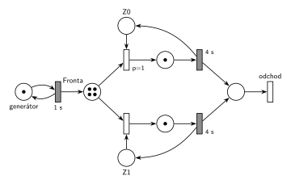

# 08–05 – D/D/2 s LIFO frontou, obsluha 4 s, značení v čase 9,5

## Zadání

> ⚠️ Jen studentská vzpomínka, která uvádí pouze rozdíly proti skupině B. Zbytek zadání (LIFO fronta, příchody od času 0 po 1 s, priority, pojmenování událostí, pseudokód next-event) je převzatý ze skupiny B.

> 1\) D/D/2. Doba obsluhy 4s.
>
> Nakreslete casovy diagram ....:
>
> - Seznam udalosti pri cas t1 = 5
> - Obsah kalendare v t2 = 9.5
> - Nakreslete PS v t2 = 9.5

Plné znění skupiny B (s obsluhou 5 s a t1 = 6) je v [08–04](<../08–04 - DD2 LIFO obsluha 5, čas 9,5/08–04 - DD2 LIFO obsluha 5, čas 9,5.md>).

Podobné úlohy: [08–04 – DD2 LIFO obsluha 5, čas 9,5](<../08–04 - DD2 LIFO obsluha 5, čas 9,5/08–04 - DD2 LIFO obsluha 5, čas 9,5.md>), [08–03 – DD2 LIFO obsluha 6, čas 13,5](<../08–03 - DD2 LIFO obsluha 6, čas 13,5/08–03 - DD2 LIFO obsluha 6, čas 13,5.md>), [08–01 – DD2 FIFO, čas 6,5](<../08–01 - DD2 FIFO, čas 6,5/08–01 - DD2 FIFO, čas 6,5.md>), [08–02 – DD3 LIFO, čas 10,5](<../08–02 - DD3 LIFO, čas 10,5/08–02 - DD3 LIFO, čas 10,5.md>).

## Interpretace

Zobrazit interpretaci (nápověda)

- **LIFO je předpoklad.** Vzpomínka frontu neuvádí. Protože jde o „to co B“ a skupina B má LIFO, počítá se tu s LIFO. Při FIFO by bylo **značení sítě stejné** (síť pořadí ve frontě nevidí). Lišilo by se, kdo je kde: v čase 5 by z fronty šel P3 místo P4 a v čase 9,5 by byla fronta P6, P7, P8, P9, na Z0 P4 a na Z1 P5.
- **Petriho síť zachycuje jen počty**, ne pořadí ve frontě.
- **Zařízení obsazovaná prioritně:** `p=1` (Z0) a `p=0` (Z1, implicitní). Když jsou volná obě, vezme se Z0.
- **Pořadí událostí ve stejném čase:** všechny události mají stejnou prioritu, takže se dřív provede ta, která byla **dřív naplánována**. V čase 5 nejdřív končí obsluha P1 (naplánovaná v čase 1), až pak přichází P5 (naplánovaný v čase 4). Proto Z1 dostane P4 a P5 jde do fronty.
- Generátor: první příchod P0 je v čase 0. Každý příchod naplánuje další za 1 s.

## Petriho síť

Zobrazit Petriho síť

### Časový diagram (obsazení zařízení)

| zařízení | obsluhy |
|---|---|
| Z0 | P0 0–4, P3 4–8, P7 8–12 |
| Z1 | P1 1–5, P4 5–9, P8 9–13 |

Fronta: P2 čeká od 2 (pod ním se střídají novější). P3 jde ve 4 na Z0, P4 v 5 na Z1, P5 a P6 přicházejí v 5 a 6 a čekají, P7 jde v 8 na Z0, P8 v 9 na Z1, P9 čeká od 9.

### Události provedené v čase t1 = 5

1. P1 uvolňuje Z1 a odchází
2. P4 vystupuje z fronty (LIFO – poslední) a obsazuje Z1; plánuje konec obsluhy P4 na Z1 v čase 9
3. příchod P5; plánuje příchod P6 v čase 6
4. P5 jde do fronty

Proč toto pořadí: konec obsluhy P1 byl naplánován v čase 1, příchod P5 až v čase 4. Při stejné prioritě rozhoduje pořadí naplánování.

### Kalendář v čase t2 = 9,5

| čas | událost |
|---|---|
| 10 | příchod P10 |
| 12 | konec obsluhy P7 na Z0 |
| 13 | konec obsluhy P8 na Z1 |

Fronta v čase 9,5 (od nejstaršího): P2, P5, P6, P9. Zařízení: Z0 – P7, Z1 – P8.

### Petriho síť se značením v čase 9,5

- *generátor*: 1 značka (příchod P10 se právě odpočítává)
- *Fronta*: 4 značky (P2, P5, P6, P9)
- *Z0*, *Z1*: 0 značek (obě zařízení obsazená)
- místa obsluhy: po 1 značce (P7, P8)

Kontrola (`make check`): síť se odsimuluje od času 0 (P0 ve frontě, zařízení volná) do času 9,5 a výsledné značení se musí shodovat s nakresleným. Výpočet událostí a kalendáře: `python3 -m pn.dd 2 lifo 1 4 5 9.5`.

## Časté chyby

Zobrazit časté chyby

- Opačné pořadí v čase 5 (nejdřív příchod P5). Pak by P5 obsadil Z1 a ve frontě by zůstal P4.
- Kalendář s událostmi v čase 9 (konec obsluhy P4, příchod P9): ty už jsou v čase 9,5 provedené. Na zařízeních jsou v čase 9,5 už P7 a P8, ne P3 a P4.
- Brát z LIFO fronty nejstarší požadavek. P2 čeká od času 2 a v čase 9,5 je ve frontě pořád.
- Zapomenuté plánování do kalendáře u událostí v čase 5.

## Původ a zdroje

Zobrazit původ a zdroje

**Původ:** zkouška 2015/16, 2. termín, skupina A, otázka 1, 15 bodů. Sesterská skupina B je [08–04 – DD2 LIFO obsluha 5, čas 9,5](<../08–04 - DD2 LIFO obsluha 5, čas 9,5/08–04 - DD2 LIFO obsluha 5, čas 9,5.md>).

**Zdroje:**

- `Fitcheats/Zkoušky z minulých let/2015-16 - 2. termín.txt`, druhá skupina („Skupina A … Prakticky to co B, tu sa nachadzaju iba rozdielne ulohy“), otázka 1

**Existující řešení:**

- K této úloze řešení v podkladech není. Síť má stejný tvar jako studentská řešení úlohy [08–02](<../08–02 - DD3 LIFO, čas 10,5/08–02 - DD3 LIFO, čas 10,5.md>), jen se dvěma zařízeními.

