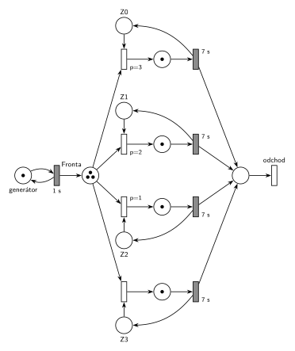

# 08–06 – D/D/4 s LIFO frontou, obsluha 7 s, značení v čase 9,5

## Zadání

> ⚠️ Jen studentská vzpomínka, původní zadání v podkladech není.

> pseudokód Next-event (-5b pokud chybí)
>
> D/D/4 s LIFO, doba obsluhy přesně 7 sekund
>
> \- nakreslit diagram +
>
> a) seznam všech událostí v čase 7 (ve správném pořadí)\
> b) obsah kalendáře v čase t = 9,5 (-5b pokud chybí)\
> c) obsah LIFO v čase t = 9,5\
> d) petriho síť v čase t = 9,5

Podobné úlohy: [08–02 – DD3 LIFO, čas 10,5](<../08–02 - DD3 LIFO, čas 10,5/08–02 - DD3 LIFO, čas 10,5.md>), [08–07 – DD3 FIFO, čas 9,5](<../08–07 - DD3 FIFO, čas 9,5/08–07 - DD3 FIFO, čas 9,5.md>), [08–04 – DD2 LIFO obsluha 5, čas 9,5](<../08–04 - DD2 LIFO obsluha 5, čas 9,5/08–04 - DD2 LIFO obsluha 5, čas 9,5.md>). Zkouška 2014/15, 2. termín měla „D/D/4 klasika“ s popisem událostí v čase 4 včetně plánování; čísla ani síť vzpomínka neuvádí.

## Interpretace

<details>
<summary>Zobrazit interpretaci (nápověda)</summary>
<br>

- **Interval příchodů ve vzpomínce chybí.** Předpokládá se šablona ostatních zadání: příchody od času 0 po **1 s**, požadavky číslované od P0, zařízení Z0–Z3 obsazovaná prioritně (nižší číslo dřív), všechny události se stejnou prioritou.
- **Příchody:** místo *příchody požadavků* s jednou značkou ve smyčce s časovaným přechodem `1 s`. První příchod P0 je v čase 0, každý příchod naplánuje další za 1 s.
- **Společná fronta:** jedno místo *fronta*, ze kterého vedou hrany k přechodům obsazení všech čtyř zařízení.
- **Petriho síť zachycuje jen počty**, ne pořadí ve frontě. LIFO se v síti neprojeví, projeví se jen v seznamu událostí a v obsahu fronty.
- **Zařízení obsazovaná prioritně:** každé zařízení je místo s jednou značkou (*Z0* až *Z3*) a má svůj okamžitý přechod obsazení s prioritou `p=3` (Z0), `p=2` (Z1), `p=1` (Z2) a `p=0` (Z3, implicitní).
- **Obsluha a uvolnění:** časovaný přechod `7 s` po skončení obsluhy vrací značku zařízení; uvolnění je s ním sloučené.
- **Odchod:** obsloužený požadavek přejde do místa *hotovo* a opouští systém přechodem *odchod* bez výstupních hran.
- **Pořadí událostí ve stejném čase:** dřív se provede událost, která byla **dřív naplánována**. V čase 7 nejdřív končí obsluha P0 (naplánovaná v čase 0), až pak přichází P7 (naplánovaný v čase 6). Proto Z0 dostane P6 a P7 jde do fronty.

### Časový diagram (obsazení zařízení)

| zařízení | obsluhy |
|---|---|
| Z0 | P0 0–7, P6 7–14 |
| Z1 | P1 1–8, P7 8–15 |
| Z2 | P2 2–9, P8 9–16 |
| Z3 | P3 3–10 |

Fronta: P4 a P5 čekají od 4 a 5 (pod nimi se střídají novější). P6 jde v 7 na Z0, P7 v 8 na Z1, P8 v 9 na Z2, P9 čeká od 9.

### Události provedené v čase 7

1. P0 uvolňuje Z0 a odchází
2. P6 vystupuje z fronty (LIFO – poslední) a obsazuje Z0; plánuje konec obsluhy P6 na Z0 v čase 14
3. příchod P7; plánuje příchod P8 v čase 8
4. P7 jde do fronty

Proč toto pořadí: konec obsluhy P0 byl naplánován v čase 0, příchod P7 až v čase 6. Při stejné prioritě rozhoduje pořadí naplánování.

### Kalendář v čase 9,5

| čas | událost |
|---|---|
| 10 | konec obsluhy P3 na Z3 (naplánováno v čase 3) |
| 10 | příchod P10 (naplánováno v čase 9) |
| 14 | konec obsluhy P6 na Z0 |
| 15 | konec obsluhy P7 na Z1 |
| 16 | konec obsluhy P8 na Z2 |

Obsah LIFO v čase 9,5 (od dna): P4, P5, P9 (na vrcholu P9, ten půjde ven první). Zařízení: Z0 – P6, Z1 – P7, Z2 – P8, Z3 – P3.

### Značení sítě v čase 9,5

- *příchody požadavků*: 1 značka (příchod P10 se právě odpočítává)
- *fronta*: 3 značky (P4, P5, P9)
- *Z0* až *Z3*: 0 značek (všechna zařízení obsazená)
- místa obsluhy: po 1 značce (P6, P7, P8, P3)

</details>

## Petriho síť

<details>
<summary>Zobrazit Petriho síť</summary>
<br>



</details>

## Časté chyby

<details>
<summary>Zobrazit časté chyby</summary>
<br>

- Zapomenutý P3 na Z3: obsluha 3–10 v čase 9,5 ještě běží, takže v kalendáři je jeho konec v čase 10.
- V kalendáři obráceně dvě události v čase 10. Konec obsluhy P3 byl naplánován v čase 3, příchod P10 v čase 9.
- Opačné pořadí v čase 7 (nejdřív příchod P7). Pak by P7 obsadil Z0 a ve frontě by zůstal P6.
- Stejná priorita na všech přechodech obsazení. Pak síť nevyjadřuje, že se zařízení obsazují od Z0.

</details>

## SIMLIB

<details>
<summary>Zobrazit SIMLIB kód</summary>
<br>

Model je izomorfní k Petriho síti výše: každé místo, přechod a značka mají svůj protějšek v kódu. Simulace běží do času 9,5 a vypíše frontu, obsazení zařízení a obsah kalendáře.

```cpp
// 08–06 D/D/4 se společnou LIFO frontou – model v SIMLIB/C++
#include "simlib.h"

const int N = 4;                         // počet zařízení Z0, Z1, Z2, Z3
Facility Z[N];                           // místa Z0–Z3 (značka = volné zařízení)
Queue Fronta("fronta");                  // místo „fronta“ (společná LIFO fronta)

class Pozadavek : public Process {       // transakce = značka, která prochází sítí
 public:
  const int id;                          // číslo požadavku P0, P1, ...
  explicit Pozadavek(int n) : id(n) {}
  void Behavior() override {
    int k;                               // obsazení s prioritami p=3, 2, 1, 0:
    for (;;) {                           // volné zařízení s nejnižším číslem
      for (k = 0; k < N && Z[k].Busy(); k++) {}
      if (k < N) break;
      Fronta.InsFirst(this);             // vše obsazeno: čeká v místě „fronta“
      Passivate();                       // (LIFO: na začátek, odkud se bere)
    }
    Seize(Z[k]);                         // obsazení: značka ze Zk do místa obsluhy
    Wait(7);                             // časovaný přechod 7 s ...
    Release(Z[k]);                       // ... který vrací značku do Zk
    if (!Fronta.Empty())                 // další z fronty (LIFO: naposledy vložený)
      Fronta.GetFirst()->Activate();
  }                                      // místo „hotovo“ a přechod „odchod“
};

class Prichody : public Event {          // „příchody požadavků“ ⇄ přechod 1 s
 public:
  int n = 0;                             // číslo dalšího požadavku
  void Behavior() override {
    (new Pozadavek(n++))->Activate();    // příchod Pn: nová značka v místě „fronta“
    Activate(Time + 1);                  // plánuje další příchod za 1 s
  }
};
Prichody *Gen;

class Stav : public Event {              // výpis stavu v čase t po událostech
 public:
  Stav() : Event(-1) {}                  // nižší priorita než události modelu
  void Behavior() override {
    Print("Stav v čase %g\nfronta (od začátku, odkud se bere):", Time);
    for (Link *l : Fronta)
      Print(" P%d", static_cast<Pozadavek *>(l)->id);
    Print("\n");
    for (int k = 0; k < N; k++) {        // zařízení a v kalendáři konce obsluh
      auto *p = static_cast<Pozadavek *>(Z[k].In());
      if (p)
        Print("Z%d: P%d, konec obsluhy v %g\n", k, p->id, p->ActivationTime());
      else
        Print("Z%d: volné\n", k);
    }
    Print("v kalendáři příchod P%d v čase %g\n", Gen->n, Gen->ActivationTime());
  }
};

int main() {
  Init(0, 9.5);                          // čas v sekundách, běh do t = 9,5 s
  Gen = new Prichody;
  Gen->Activate();                       // příchod P0 v čase 0
  (new Stav)->Activate(9.5);
  Run();
}
```

| Petriho síť | SIMLIB |
|---|---|
| *příchody požadavků* ⇄ `1 s` | událost `Prichody`, která se znovu plánuje za 1 s; `n` čísluje požadavky P0, P1, … |
| značka (požadavek) | proces `Pozadavek` s číslem `id` |
| *fronta* | `Queue Fronta`: `Fronta.InsFirst(this)` + `Passivate()` (LIFO, na začátek), výběr `Fronta.GetFirst()->Activate()` |
| *Z0* až *Z3* (1 značka) | `Facility Z[N]` |
| obsazení s prioritami `p=3` až `p=0` | cyklus přes `Z[k].Busy()`: první volné zařízení od Z0 |
| místo obsluhy + časovaný přechod `7 s` se sloučeným uvolněním | `Seize(Z[k]); Wait(7); Release(Z[k]);` |
| *hotovo* + přechod *odchod* | konec metody `Behavior()` |
| značení v čase t | událost `Stav` s nižší prioritou, která proběhne po všech událostech v čase 9,5 |

**Kontrola simulací.** Petriho síť: síť se odsimuluje od času 0 (P0 ve *frontě*, zařízení volná) do času 9,5 a výsledné značení se musí shodovat s nakresleným; zařízení se vždy vrátí a *fronta* smí růst, protože systém není stabilní (`make check`). Seznam událostí a kalendář počítá `python3 -m pn.dd 4 lifo 1 7 7 9.5`. SIMLIB model vypíše v čase 9,5 frontu P9 P5 P4 (od vrcholu LIFO), Z0 – P6 s koncem obsluhy ve 14, Z1 – P7 v 15, Z2 – P8 v 16, Z3 – P3 v 10 a příchod P10 v 10, tedy stejný stav a kalendář jako výše (`make simlib`). Kalendář SIMLIB obsluhuje události se stejným časem a prioritou v pořadí naplánování, stejně jako odpověď výše. Jediný rozdíl je v jemnějším dělení: P6 probuzený z fronty obsadí Z0 až ve své vlastní aktivaci, tedy po příchodu P7. P7 ale volné zařízení hledá až po něm, takže výsledek je stejný.

</details>

## Původ a zdroje

<details>
<summary>Zobrazit původ a zdroje</summary>
<br>

**Původ:** zkouška 2014/15, 3. termín, skupina D (podle studenta „asi“), otázka 1, 15 bodů.

**Původní znění:**

> pseudokód Next-event (-5b pokud chybí)
>
> D/D/4 s LIFO, doba obsluhy = 7s
>
> \- nakreslit diagram +
>
> a) seznam všech událostí v čase 7 (ve správném pořadí)\
> b) obsah kalendáře v čase t = 9,5 (-5b pokud chybí)\
> c) obsah LIFO v čase t = 9,5\
> d) petriho síť v čase t = 9,5

**Zdroje:**

- `Fitcheats/Zkoušky z minulých let/2014-15 - 3. termín.txt`, otázka 1 (studentská vzpomínka)

**Existující řešení:**

- K této úloze řešení v podkladech není. Síť má stejný tvar jako studentská řešení úlohy [08–02](<../08–02 - DD3 LIFO, čas 10,5/08–02 - DD3 LIFO, čas 10,5.md>), jen se čtyřmi zařízeními a prioritami 3, 2, 1, 0.

</details>
