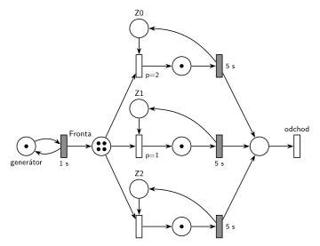

# 08–07 – D/D/3 s FIFO frontou, značení v čase 9,5

## Zadání

> ⚠️ Jen studentská vzpomínka, původní zadání v podkladech není.

> napsat next-event
>
> D/D/3 s FIFO frontou\
> v čase t=9,5: vypsat kalendář, fronty, petriho síť\
> vypsat události v čase 5

Podobné úlohy: [08–02 – DD3 LIFO, čas 10,5](<../08–02 - DD3 LIFO, čas 10,5/08–02 - DD3 LIFO, čas 10,5.md>), [08–01 – DD2 FIFO, čas 6,5](<../08–01 - DD2 FIFO, čas 6,5/08–01 - DD2 FIFO, čas 6,5.md>), [08–06 – DD4 LIFO, čas 9,5](<../08–06 - DD4 LIFO, čas 9,5/08–06 - DD4 LIFO, čas 9,5.md>).

## Interpretace

Zobrazit interpretaci (nápověda)

 

- **Časy ve vzpomínce chybí.** Předpokládají se příchody od času 0 po **1 s** a obsluha **5 s**, jako u druhé skupiny téhož termínu („prichody 1s, obsluha 5s“) a u stejného zadání z roku 2016/17. Zbytek podle šablony: požadavky od P0, zařízení Z0–Z2 obsazovaná prioritně (nižší číslo dřív), všechny události se stejnou prioritou.
- **Petriho síť zachycuje jen počty**, ne pořadí ve frontě. Značení vyjde stejně jako v LIFO úloze [08–02](<../08–02 - DD3 LIFO, čas 10,5/08–02 - DD3 LIFO, čas 10,5.md>) v čase 10,5 (4 značky ve frontě, všechna zařízení obsazená). Liší se jen to, kdo je kde.
- **Zařízení obsazovaná prioritně:** `p=2` (Z0), `p=1` (Z1), `p=0` (Z2, implicitní).
- **Pořadí událostí ve stejném čase:** dřív se provede událost, která byla **dřív naplánována**. V čase 5 nejdřív končí obsluha P0 (naplánovaná v čase 0), až pak přichází P5 (naplánovaný v čase 4). U FIFO to výsledný stav nezmění (z fronty jde stejně první P3), ale seznam událostí musí mít správné pořadí.

## Petriho síť

Zobrazit Petriho síť

 

### Časový diagram (obsazení zařízení)

| zařízení | obsluhy |
|---|---|
| Z0 | P0 0–5, P3 5–10 |
| Z1 | P1 1–6, P4 6–11 |
| Z2 | P2 2–7, P5 7–12 |

Fronta: P3 čeká 3–5, P4 4–6, P5 5–7, P6 až P9 čekají od 6 až 9.

### Události provedené v čase 5

1. P0 uvolňuje Z0 a odchází
2. P3 vystupuje z fronty (FIFO – první) a obsazuje Z0; plánuje konec obsluhy P3 na Z0 v čase 10
3. příchod P5; plánuje příchod P6 v čase 6
4. P5 jde do fronty

Proč toto pořadí: konec obsluhy P0 byl naplánován v čase 0, příchod P5 až v čase 4. Při stejné prioritě rozhoduje pořadí naplánování.

### Kalendář v čase 9,5

| čas | událost |
|---|---|
| 10 | konec obsluhy P3 na Z0 (naplánováno v čase 5) |
| 10 | příchod P10 (naplánováno v čase 9) |
| 11 | konec obsluhy P4 na Z1 |
| 12 | konec obsluhy P5 na Z2 |

Fronta v čase 9,5 (od 1. prvku): P6, P7, P8, P9. Zařízení: Z0 – P3, Z1 – P4, Z2 – P5.

### Petriho síť se značením v čase 9,5

- *generátor*: 1 značka (příchod P10 se právě odpočítává)
- *Fronta*: 4 značky (P6, P7, P8, P9)
- *Z0*, *Z1*, *Z2*: 0 značek (všechna zařízení obsazená)
- místa obsluhy: po 1 značce (P3, P4, P5)

Kontrola (`make check`): síť se odsimuluje od času 0 (P0 ve frontě, zařízení volná) do času 9,5 a výsledné značení se musí shodovat s nakresleným. Výpočet událostí a kalendáře: `python3 -m pn.dd 3 fifo 1 5 5 9.5`.

## Časté chyby

Zobrazit časté chyby

 

- V kalendáři chybí příchod P10 nebo jsou dvě události v čase 10 obráceně. Konec obsluhy P3 byl naplánován v čase 5, příchod P10 v čase 9.
- Opačné pořadí v čase 5 (nejdřív příchod P5). Stav vyjde stejně, ale seznam událostí je špatně.
- Fronta vypsaná v obráceném pořadí. U FIFO je první P6, který půjde na zařízení jako další.
- Pořadí požadavků nakreslené v síti. Místo *Fronta* nese jen počet (4).

## Původ a zdroje

Zobrazit původ a zdroje

 

**Původ:** zkouška 2015/16, 1. termín, skupina 5H, otázka 1, 15 bodů. Stejné zadání bez zmínky o síti: zkouška 2016/17, 1. termín (jedna ze skupin: „D/D/3, FIFO, 1s, 5s, t=9,5s“).

**Zdroje:**

- `Fitcheats/Zkoušky z minulých let/2015-16 - 1. termín.txt`, skupina 5H, otázka 1 (studentská vzpomínka); druhá skupina téhož souboru: „D/D/3, T=10.5, prichody 1s, obsluha 5s“
- `Fitcheats/Zkoušky z minulých let/2016-17 - 1. termín.txt`, druhá skupina, otázka 1 (stejné parametry, síť nezmíněna)

**Existující řešení:**

- K této úloze řešení v podkladech není. Síť je stejná jako v [08–02](<../08–02 - DD3 LIFO, čas 10,5/08–02 - DD3 LIFO, čas 10,5.md>), kde jsou rozebraná studentská řešení.

