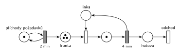

# 08–08 – D/D/1, příchody po 2 min, obsluha 4 min

## Zadání

> Mějme systém D/D/1 s intervaly mezi příchody = 2 minuty a délkou obsluhy = 4 minuty. Systém modelujte Petriho sítí. Zjistěte, zda je tento systém stabilní. Určete, ve kterých časových okamžicích dochází ke změně stavu systému až po čas TMAX=10 včetně. Do tabulky napište hodnoty stavových veličin systému ve zjištěných okamžicích změny stavu systému (po provedení všech událostí v daném čase). Tabulka nechť obsahuje: 1) čas, 2) délku fronty, 3) počet transakcí v obsluze.

Podobné úlohy: [08–09 – DD1 – příchody 3, obsluha 2](<../08–09 - DD1 – příchody 3, obsluha 2/08–09 - DD1 – příchody 3, obsluha 2.md>) (skupina H, stabilní varianta), [08–01 – DD2 FIFO, čas 6,5](<../08–01 - DD2 FIFO, čas 6,5/08–01 - DD2 FIFO, čas 6,5.md>).

## Interpretace

Zobrazit interpretaci (nápověda)

 

- **První příchod v čase 0.** Zadání ho neuvádí. Bere se konvence starších D/D/x zadání („Příchody požadavků začínají v čase 0“). Při jiném prvním příchodu se celá tabulka posune.
- **Současné události:** v časech 4 a 8 končí obsluha a zároveň přichází další požadavek. Dřív se provede událost, která byla dřív naplánována: konec obsluhy (naplánovaný v čase 0, resp. 4) před příchodem (naplánovaným v čase 2, resp. 6). Tabulka ukazuje stav **po provedení všech událostí** v daném čase, takže na pořadí výsledek nezávisí a mezistavy (např. chvíle, kdy P0 odešel a P2 ještě nepřišel) se do ní nepíšou.
- **Časy 4 a 8:** počty (1 a 1, resp. 2 a 1) zůstanou stejné jako předtím, ale stav systému se změní: jeden požadavek odejde, další začne obsluhu a další přijde. Proto jsou tyto okamžiky v tabulce. Kdo chápe „stav“ jen jako dvojici (délka fronty, počet v obsluze), může je vynechat; je dobré to k tabulce napsat.
- **Stabilita:** λ = 1/2 za minutu, μ = 1/4 za minutu, ρ = λ/μ = 2 > 1. Systém **není stabilní**: přicházejí dva požadavky za dobu jedné obsluhy, fronta roste zhruba o 1 každé 4 minuty a nikdy se neustálí.
- **Síť:** jedna linka = místo *Linka* s 1 značkou, obsazení okamžitým přechodem, obsluha časovaným přechodem `4 min`, který linku vrací. Zadání značení v žádném čase nežádá. Nakreslené je značení v čase TMAX = 10, aby šlo porovnat s posledním řádkem tabulky: značky v *Frontě* = délka fronty, značka v místě obsluhy = počet transakcí v obsluze, *Linka* = 1 − počet v obsluze. Počáteční značení pro start v čase 0 je: *generátor* 1, *Fronta* 1 (P0, který přichází v čase 0), *Linka* 1.

## Petriho síť

Zobrazit Petriho síť

 

### Časový diagram

| zařízení | obsluhy |
|---|---|
| Linka | P0 0–4, P1 4–8, P2 8–12 |

Příchody: P0 v 0, P1 ve 2, P2 ve 4, P3 v 6, P4 v 8, P5 v 10.

### Stav po provedení všech událostí v daném čase

| čas [min] | délka fronty | v obsluze | události |
|---|---|---|---|
| 0 | 0 | 1 | příchod P0, P0 obsazuje linku |
| 2 | 1 | 1 | příchod P1, jde do fronty |
| 4 | 1 | 1 | P0 končí a odchází, P1 z fronty obsazuje linku, příchod P2 do fronty |
| 6 | 2 | 1 | příchod P3 do fronty |
| 8 | 2 | 1 | P1 končí a odchází, P2 obsazuje linku, příchod P4 do fronty |
| 10 | 3 | 1 | příchod P5 do fronty |

Stabilita: ρ = 4/2 = 2 > 1, systém **není stabilní** (fronta roste nade všechny meze).

### Petriho síť se značením v čase TMAX = 10

- *generátor*: 1 značka (příchod P6 v čase 12 se odpočítává)
- *Fronta*: 3 značky (P3, P4, P5)
- *Linka*: 0 značek (obsazená)
- místo obsluhy: 1 značka (P2, obsluha 8–12)

Kontrola (`make check`): síť se odsimuluje od času 0 (P0 ve frontě, linka volná) do času 10 včetně událostí v čase 10 a výsledné značení se musí shodovat s nakresleným. Simulace bez omezení času potvrzuje nestabilitu: na 2 000 příchodů připadá 1 000 obsluh. Výpočet: `python3 -m pn.dd 1 fifo 2 4 10 10`.

## Časté chyby

Zobrazit časté chyby

 

- Obrácené kritérium stability („interval 2 je menší než obsluha 4, tedy stabilní“). Rozhoduje ρ = λ/μ = obsluha / interval = 2 > 1.
- Chybějící řádek pro čas 0: P0 přichází hned na začátku a hned obsazuje linku.
- V čase 4 zapsaný mezistav (fronta 0 po odchodu P0) místo stavu po všech událostech.
- Požadavek, který právě skončil, započtený do „v obsluze“. V jednom okamžiku je v obsluze nejvýš 1 transakce.
- Síť bez vrácení značky *Lince* po obsluze nebo bez výstupního přechodu.

## Původ a zdroje

Zobrazit původ a zdroje

 

**Původ:** zkouška 2022/23, 3. termín (3. 2. 2023), skupina G, otázka 1, 15 bodů.

**Zdroje:**

- `Fitcheats/Zkoušky z minulých let/2022-23 - 3. termín G.pdf`, str. 1 (fotka zadání, rámeček na odpověď je prázdný)

**Existující řešení:**

- K této úloze řešení v podkladech není (rámeček na fotce je prázdný).

