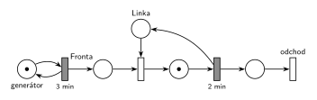

# 08–09 – D/D/1, příchody po 3 min, obsluha 2 min

## Zadání

> Mějme systém D/D/1 s intervaly mezi příchody = 3min a délkou obsluhy = 2min. Systém modelujte Petriho sítí. Zjistěte, zda je tento systém stabilní. Určete, ve kterých časových okamžicích dochází ke změně stavu systému až po čas TMAX=10 včetně. Do tabulky napište hodnoty stavových veličin systému ve zjištěných okamžicích změny stavu systému (po provedení všech událostí v daném čase). Tabulka nechť obsahuje: 1) Čas 2) délku fronty 3) počet transakcí v obsluze.

Podobné úlohy: [08–08 – DD1 – příchody 2, obsluha 4](<../08–08 - DD1 – příchody 2, obsluha 4/08–08 - DD1 – příchody 2, obsluha 4.md>) (skupina G, nestabilní varianta), [08–01 – DD2 FIFO, čas 6,5](<../08–01 - DD2 FIFO, čas 6,5/08–01 - DD2 FIFO, čas 6,5.md>).

## Interpretace

Zobrazit interpretaci (nápověda)

- **První příchod v čase 0.** Zadání ho neuvádí. Bere se konvence starších D/D/x zadání („Příchody požadavků začínají v čase 0“). Při jiném prvním příchodu se celá tabulka posune.
- **Současné události tu nenastávají:** obsluha (2 min) vždy skončí dřív, než přijde další požadavek (za 3 min). Každý požadavek tak hned obsadí volnou linku a fronta je pořád prázdná.
- **Čas 10:** v čase 10 žádná událost není (další jsou v 11 a 12), stav z času 9 trvá. Řádek pro čas 10 se dá připsat se stejnými hodnotami, změna stavu to ale není.
- **Stabilita:** λ = 1/3 za minutu, μ = 1/2 za minutu, ρ = λ/μ = 2/3 < 1. Systém **je stabilní**; linka je vytížená 2/3 času.
- **Síť:** jedna linka = místo *Linka* s 1 značkou, obsazení okamžitým přechodem, obsluha časovaným přechodem `2 min`, který linku vrací. Zadání značení v žádném čase nežádá. Nakreslené je značení v čase TMAX = 10, aby šlo porovnat s posledním řádkem tabulky: značky v *Frontě* = délka fronty, značka v místě obsluhy = počet transakcí v obsluze, *Linka* = 1 − počet v obsluze. Počáteční značení pro start v čase 0 je: *generátor* 1, *Fronta* 1 (P0, který přichází v čase 0), *Linka* 1.

## Petriho síť

Zobrazit Petriho síť

### Časový diagram

| zařízení | obsluhy |
|---|---|
| Linka | P0 0–2, P1 3–5, P2 6–8, P3 9–11 |

Příchody: P0 v 0, P1 ve 3, P2 v 6, P3 v 9 (další P4 až ve 12).

### Stav po provedení všech událostí v daném čase

| čas [min] | délka fronty | v obsluze | události |
|---|---|---|---|
| 0 | 0 | 1 | příchod P0, P0 obsazuje linku |
| 2 | 0 | 0 | P0 končí a odchází |
| 3 | 0 | 1 | příchod P1, P1 obsazuje linku |
| 5 | 0 | 0 | P1 končí a odchází |
| 6 | 0 | 1 | příchod P2, P2 obsazuje linku |
| 8 | 0 | 0 | P2 končí a odchází |
| 9 | 0 | 1 | příchod P3, P3 obsazuje linku |

Stabilita: ρ = 2/3 < 1, systém **je stabilní** (fronta zůstává prázdná).

### Petriho síť se značením v čase TMAX = 10

- *generátor*: 1 značka (příchod P4 v čase 12 se odpočítává)
- *Fronta*: 0 značek
- *Linka*: 0 značek (obsazená)
- místo obsluhy: 1 značka (P3, obsluha 9–11)

Kontrola (`make check`): síť se odsimuluje od času 0 (P0 ve frontě, linka volná) do času 10 a výsledné značení se musí shodovat s nakresleným. Navíc se kontroluje, že ve *Frontě* po provedení okamžitých přechodů nikdy nic nezůstane. Výpočet: `python3 -m pn.dd 1 fifo 3 2 9 10`.

## Časté chyby

Zobrazit časté chyby

- Obrácené kritérium stability. Rozhoduje ρ = λ/μ = obsluha / interval = 2/3 < 1.
- Vynechané okamžiky konce obsluhy (2, 5, 8). I v nich se stav mění: počet v obsluze klesne na 0.
- Chybějící řádek pro čas 0: P0 přichází hned na začátku a hned obsazuje linku.
- Příchozí požadavek zapsaný do fronty, i když je linka volná. Délka fronty je pořád 0.
- Síť bez vrácení značky *Lince* po obsluze nebo bez výstupního přechodu.

## Původ a zdroje

**Původ:** zkouška 2022/23, 3. termín, skupina H, otázka 1 (body v přepisu nejsou; ve skupině G má stejná otázka 15 bodů).

**Zdroje:**

- `Fitcheats/Zkoušky z minulých let/2022-23 - 3. termín H.pdf`, str. 1 (přepsané zadání bez hlavičky a číslování)

**Existující řešení:**

Zobrazit existující řešení

- K této úloze řešení v podkladech není.

