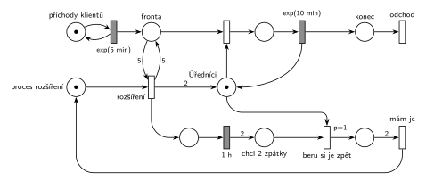

# 09-01 Úřad

## Zadání

> Na úřad přichází klienti v intervalech exponenciálně se středem 5 minut. Klienty obsluhuje jeden úředník, vyřízení klienta trvá exponenciálně se středem 10 minut. Pokud ve frontě čeká alespoň 5 klientů, přijdou na pomoc dva další úředníci na dobu přesně 1 hodiny. Po uplynutí hodiny odcházejí, rozpracované klienty ale nejdřív dokončí.

Všimni si: jeden úředník (10 min) na příchody každých 5 minut nestačí, fronta by bez posil rostla do nekonečna. Se třemi úředníky se zase zkracuje.

Podobné úlohy: [Úřad s dodatečnými přepážkami](<../15 - Úřad s dodatečnými přepážkami/15 - Úřad s dodatečnými přepážkami.md>), [Dočasně MM2 při dlouhé frontě](<../../05 - Délka fronty a kapacita/02 - Dočasně MM2 při dlouhé frontě/02 - Dočasně MM2 při dlouhé frontě.md>), [Sklad s dočasně větší kapacitou](<../../05 - Délka fronty a kapacita/08 - Sklad s dočasně větší kapacitou/08 - Sklad s dočasně větší kapacitou.md>), [Pomocník přidá kapacitu](<../../05 - Délka fronty a kapacita/10 - Pomocník přidá kapacitu/10 - Pomocník přidá kapacitu.md>).

## Nápověda

<details>
<summary>Zobrazit nápovědu</summary>
<br>

- **Příchody** modeluje místo *příchody klientů* s jednou značkou ve smyčce s časovaným přechodem `exp(5 min)`; každé provedení vloží klienta do místa *fronta*.
- **Úředníci** jsou jedna linka typu sklad: místo *Úředníci* má na začátku jednu značku, posily do něj přidají další dvě (hrana s váhou 2). Obsazení bere značku úředníka, časovaný přechod `exp(10 min)` ji vrací (uvolnění je s ním sloučené).
- **„Alespoň 5 ve frontě“** je test dvojicí hran s váhou 5 (z *fronty* do přechodu *rozšíření* a zpět), fronta se tím nezmění. Kdyby zadání znělo „víc než 5“, byla by váha 6.
- **Proces rozšíření** je samostatná značka. Dokud jsou posily na úřadě, značka v *proces rozšíření* chybí, takže se posily nepřivolají podruhé.
- **Návrat posil:** po `1 h` vznikne v místě *chci 2 zpátky* dvojice značek. Přechod *beru si je zpět* vezme jednu volnou značku *Úředníků*, takže pracující úředník nejdřív dokončí klienta. Úředníci se vrací po jednom, *mám je* čeká (váha 2), až se vrátí oba. Pak je proces připravený na další přivolání.
- **`p=1` na *beru si je zpět*:** když úředník dokončí klienta a ve frontě někdo čeká, jsou proveditelné oba přechody, *beru si je zpět* i obsazení linky. Priorita zajistí, že posila po hodině nezačne nového klienta; bez ní by se konflikt řešil náhodně.
- Značky v místě *Úředníci* jsou nerozlišitelné: je jedno, jestli odejde „posila“, nebo „původní“ úředník, důležitý je jen počet.
- Klient **opouští systém** přes místo *konec* okamžitým přechodem *odchod* bez výstupních hran.

</details>

## Petriho síť

<details>
<summary>Zobrazit Petriho síť</summary>
<br>



</details>

## Časté chyby

<details>
<summary>Zobrazit časté chyby</summary>
<br>

- Odebrání obou posil jedním přechodem s váhou 2: čeká, až budou volné dvě značky naráz. Mezitím si každou uvolněnou značku může vzít další klient, takže posily mohou zůstat mnohem déle než hodinu.
- Odebrání posil hned po hodině i s rozpracovaným klientem: značka v *Úřednících* v tu chvíli není, takže to bez přerušení obsluhy ani nejde. Zadání chce, aby klienta dokončili.
- Test fronty jednou hranou s váhou 5 bez návratu: přechod pět klientů z fronty odebere.
- Chybějící procesní značka: přechod rozšíření by se prováděl znovu a znovu, dokud je ve frontě aspoň 5 klientů, a přidával by další úředníky.
- Zapomenutý návrat značky procesu po *mám je*: posily by přišly jen jednou.

</details>

## SIMLIB

<details>
<summary>Zobrazit SIMLIB kód</summary>
<br>

Model je izomorfní k Petriho síti výše: každé místo, přechod a značka mají svůj protějšek v kódu.

```cpp
// Úřad – model v SIMLIB/C++
#define I_REALLY_KNOW_HOW_TO_USE_WAITUNTIL  // zpřístupní makro WaitUntil (test podmínky)
#include "simlib.h"

// místo „Úředníci“ = sklad s kapacitou 3 (1 stálý úředník + 2 posily);
// posily, které zrovna nejsou na úřadě, drží obsazené proces rozšíření
Store Urednici("Úředníci", 3);
Histogram Doba("Doba klienta na úřadě [min]", 0, 10, 20);
int pocetRozsireni = 0;                // kolikrát se provedl přechod „rozšíření“

class Klient : public Process {        // transakce = značka, která prochází sítí
  void Behavior() {
    double prichod = Time;
    Enter(Urednici, 1);                // „Fronta“ + obsazení (bere značku úředníka)
    Wait(Exponential(10));             // časovaný přechod exp(10 min) ...
    Leave(Urednici, 1);                // ... který vrací značku úředníka
    Doba(Time - prichod);
  }                                    // konec Behavior = místo „konec“ + přechod „odchod“
};

class Rozsireni : public Process {     // značka v místě „proces rozšíření“
  void Behavior() {
    Enter(Urednici, 2);                // na začátku posily na úřadě nejsou
    for (;;) {
      WaitUntil(Urednici.QueueLen() >= 5);  // test fronty dvojicí hran s váhou 5
      pocetRozsireni++;
      Leave(Urednici, 2);              // přechod „rozšíření“: 2 značky do „Úředníků“
      Wait(60);                        // časovaný přechod 1 h → „chci 2 zpátky“
      Enter(Urednici, 1);              // „beru si je zpět“: jednoho úředníka ...
      Enter(Urednici, 1);              // ... a pak druhého, až dokončí klienta
    }                                  // „mám je“: značka zpět do „proces rozšíření“
  }
 public:
  Rozsireni() : Process(1) {}          // priorita 1 = p=1 u „beru si je zpět“ (ve frontě skladu je první)
};

class Generator : public Event {       // místo „příchody klientů“ ve smyčce s exp(5 min)
  void Behavior() {
    (new Klient)->Activate();          // nová značka v místě „Fronta“
    Activate(Time + Exponential(5));   // další příchod
  }
};

int main() {
  Init(0, 60 * 1000);                  // modelový čas v minutách: 1000 hodin provozu
  (new Rozsireni)->Activate();
  (new Generator)->Activate();
  Run();
  Urednici.Output();
  Doba.Output();
  Print("Posily přivolány: %d krát\n", pocetRozsireni);
}
```

| Petriho síť | SIMLIB |
|---|---|
| *příchody klientů* ⇄ `exp(5 min)` | událost `Generator`, která se znovu plánuje za `Exponential(5)` |
| značka (klient) | proces `Klient` |
| místo *Úředníci* (1 značka, posily přidají 2) | `Store Urednici` s kapacitou 3, z níž 2 jednotky drží `Rozsireni`, dokud posily nejsou na úřadě |
| *fronta* + obsazení | `Enter(Urednici, 1)` (fronta je vnitřní fronta skladu) |
| `exp(10 min)` se sloučeným uvolněním | `Wait(Exponential(10)); Leave(Urednici, 1);` |
| značka *proces rozšíření* | proces `Rozsireni` (jeden, takže se posily nepřivolají dvakrát) |
| test fronty hranami s váhou 5 | `WaitUntil(Urednici.QueueLen() >= 5)` |
| *rozšíření* → *Úředníci* (váha 2) | `Leave(Urednici, 2)` |
| `1 h` → *chci 2 zpátky* | `Wait(60)` |
| `p=1` *beru si je zpět* (po jednom) | dvakrát `Enter(Urednici, 1)` s prioritou procesu 1 |
| *mám je* (váha 2) → *proces rozšíření* | konec těla cyklu `for` |
| přechod *odchod* | konec metody `Behavior()` klienta |

**Kontrola simulací.** Petriho síť: platí *Úředníci* + obsluhovaní = 1 + dosud nevrácené posily a značka procesu rozšíření se nikdy neztratí; posily přichází zhruba každou hodinu a půl a fronta zůstává omezená (nejvýš kolem 25) (`make check`). SIMLIB model: v jednom běhu (1000 h) se posily přivolaly 644krát, tedy zhruba každých 93 minut, nejdelší fronta měla 26 klientů a klient strávil na úřadě průměrně 21,5 minuty. Pracují v průměru dva úředníci (12 000 klientů × 10 min za 60 000 min), takže jeden stálý úředník nestačí a posily jsou na úřadě zhruba dvě třetiny času (`make simlib`).

</details>

## Původ a zdroje

<details>
<summary>Zobrazit původ a zdroje</summary>
<br>

**Původ:** půlsemestrální písemka 2025/26, varianta D, 10 bodů (bodování podle ostatních let).

**Původní znění** (rekonstrukce): Zadání z roku 2025/26 v materiálech chybí, existuje jen Hrubého řešení. Text níže je odvozený z jeho sítě a poznámek („proces rozšíření kapacity“, „2 „extra““, „chci 2 zpátky“, „beru si je zpět“). Čísla jsou převzatá z řešení.

> Na úřad přichází klienti v intervalech daných exponenciálním rozložením se středem 5 minut. Klienty obsluhuje jeden úředník, vyřízení klienta trvá dobu danou exponenciálním rozložením se středem 10 minut. Pokud ve frontě čeká alespoň 5 klientů, přijdou na pomoc dva další úředníci na dobu 1 hodiny. Po uplynutí hodiny odcházejí, rozpracované klienty ale nejdřív dokončí. V modelu jednoznačně ukažte (přechodem) moment, kdy transakce opouští systém.

**Zdroje:**

- `Fitcheats/Půlsemestrálky/Hrubý - Řešení 2025-26.pdf`, str. 4

**Existující řešení:**

- **Hrubý (str. 4):** stejná síť: *proces rozšíření kapacity* s testem fronty vahou 5, hrana „2 „extra““ do linky, `1h`, váha 2 do *chci 2 zpátky*, *beru si je zpět* po jednom a *mám je* s váhou 2 zpět do procesu. Rozdíly: linku kreslí nad hlavní řadou (tady je pod ní, aby se hrany posil nekřížily s frontou) a nepíše prioritu u *beru si je zpět* (tady `p=1`, viz Nápověda).

</details>

## Reference

- [Jak síť funguje](<../../../basics/Jak síť funguje.md>)
- [Notace a vzory](<../../../basics/Notace a vzory.md>)

<!-- -->

- [Studijní plán](<../../Studijní plán.md>)
- [Seznam úloh](<../../Seznam úloh.md>)
