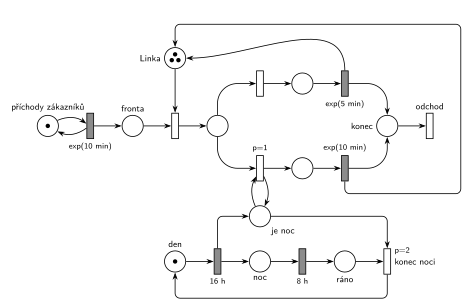

# Obslužné centrum

## Zadání

> ⚠️ **Rekonstrukce.** Zadání z roku 2025/26 v materiálech chybí, existuje jen Hrubého řešení. Text níže je odvozený z jeho sítě a poznámek („if-else“, „je noc“, „proces den/noc“). Čísla jsou převzatá z řešení. Že délka obsluhy závisí na denní době v okamžiku jejího začátku, je odvozené ze sítě.
>
> Do obslužného centra přichází zákazníci v intervalech exponenciálně se středem 10 minut. Zákazníky obsluhují tři linky. Ve dne trvá obsluha exponenciálně se středem 5 minut, v noci exponenciálně se středem 10 minut. Den trvá přesně 16 hodin, noc přesně 8 hodin, model začíná ráno.

Podobné úlohy: [Centrum MM1 s rychlým režimem](<../04 - Centrum MM1 s rychlým režimem/04 - Centrum MM1 s rychlým režimem.md>) (délka obsluhy podle režimu), [Přečerpávací elektrárna](<../../12 - Výroba a sklady/11 - Přečerpávací elektrárna/11 - Přečerpávací elektrárna.md>) (cyklus den/noc 16 h/8 h), [Překladiště s jeřábem](<../../11 - Doprava a dávky/09 - Překladiště s jeřábem/09 - Překladiště s jeřábem.md>).

## Interpretace

<details>
<summary>Zobrazit interpretaci (nápověda)</summary>
<br>

- **Příchody** modeluje místo *příchody zákazníků* s jednou značkou ve smyčce s časovaným přechodem `exp(10 min)`; zákazník čeká v místě *fronta*.
- **Tři linky** jsou jeden sklad: místo *Linka* se třemi značkami. Každý zákazník zabere jednu; oba časované přechody obsluhy ji vrací (uvolnění je s nimi sloučené).
- **Délka obsluhy** se rozhodne v okamžiku začátku obsluhy (if-else za obsazením linky). Obsluha začatá ve dne doběhne s `exp(5 min)`, i když mezitím nastane noc. Přepínat rychlost uprostřed obsluhy by vyžadovalo přerušení, to zadání (v rekonstrukci) nechce.
- **If-else přes prioritu:** přechod *v noci* s `p=1` testuje místo *je noc* smyčkou (značku vezme a hned vrátí) a vede na `exp(10 min)`. Ve dne proveditelný není, takže se provede přechod *ve dne* (p=0) s `exp(5 min)`. Inhibiční hrana („není noc“) se nepoužívá.
- **Proces den/noc** je samostatná značka: *den* → `16 h` → *noc* → `8 h` → *ráno* → *konec noci* → *den*. Přechod `16 h` zároveň označí *je noc*, *konec noci* tuto značku odebere. Model začíná ráno (značka v *den*).
- **Proč dvě místa *noc* a *je noc*:** kdyby se testovalo přímo místo *noc*, smyčka přechodu *v noci* by značku na okamžik odebrala a probíhající odpočet `8 h` by podle sémantiky časovaného přechodu (slajd 139) zanikl a začal znovu. Stavové místo *je noc* proto do žádného časovaného přechodu nevede.
- **`p=2` na *konci noci*** zajistí, že noc skončí dřív, než se ve stejném okamžiku rozhoduje zákazník. V zásadě je jedno, jak by taková souběžná situace dopadla, priorita tu není podstatná.
- Zákazník **opouští systém** přes místo *konec* okamžitým přechodem *odchod* bez výstupních hran.

</details>

## Petriho síť

<details>
<summary>Zobrazit Petriho síť</summary>
<br>



</details>

## Časté chyby

<details>
<summary>Zobrazit časté chyby</summary>
<br>

- Test „je noc“ obyčejnou hranou bez návratu: první noční zákazník značku spotřebuje a další už jdou denní větví.
- Testování místa, ze kterého vede časovaný přechod `8 h`: každý noční zákazník by odpočet noci restartoval.
- Noc modelovaná pravděpodobností (např. 33 % na `exp(10 min)`): zadání závisí na čase, ne na náhodě.
- Zapomenutý návrat značky *Lince* z jedné z větví: linky postupně „zmizí“.
- Jedna linka místo tří (značka navíc v místě *Linka* je celý rozdíl mezi M/M/1 a M/M/3).

</details>

## SIMLIB

<details>
<summary>Zobrazit SIMLIB kód</summary>
<br>

Model je izomorfní k Petriho síti výše: každé místo, přechod a značka mají svůj protějšek v kódu.

```cpp
// Obslužné centrum – model v SIMLIB/C++
#include "simlib.h"

Store Linka("Linka", 3);               // místo „Linka“ se třemi značkami
Histogram Doba("Doba zákazníka v centru [min]", 0, 5, 20);
bool jeNoc = false;                    // místo „je noc“ (značka = true)
int nocni = 0, denni = 0;              // kolikrát se provedl přechod „v noci“ / „ve dne“

class Zakaznik : public Process {      // transakce = značka, která prochází sítí
  void Behavior() {
    double prichod = Time;
    Enter(Linka, 1);                   // „Fronta“ + obsazení linky
    if (jeNoc) {                       // „v noci“ (p=1, smyčka s „je noc“)
      nocni++;
      Wait(Exponential(10));           // časovaný přechod exp(10 min) ...
    } else {                           // „ve dne“ (p=0)
      denni++;
      Wait(Exponential(5));            // časovaný přechod exp(5 min) ...
    }
    Leave(Linka, 1);                   // ... který vrací značku linky
    Doba(Time - prichod);
  }                                    // konec Behavior = místo „konec“ + přechod „odchod“
};

class DenNoc : public Process {        // značka procesu den/noc
  void Behavior() {
    for (;;) {                         // značka v místě „den“
      Wait(16 * 60);                   // časovaný přechod 16 h → „noc“ + „je noc“
      jeNoc = true;
      Wait(8 * 60);                    // časovaný přechod 8 h → „ráno“
      jeNoc = false;                   // „konec noci“ odebere „je noc“, zpět do „den“
    }
  }
 public:
  DenNoc() : Process(2) {}             // priorita 2 = p=2: konec noci před zákazníkem ve stejném okamžiku
};

class Generator : public Event {       // místo „příchody zákazníků“ ve smyčce s exp(10 min)
  void Behavior() {
    (new Zakaznik)->Activate();        // nová značka v místě „Fronta“
    Activate(Time + Exponential(10));  // další příchod
  }
};

int main() {
  Init(0, 60 * 1000);                  // modelový čas v minutách: 1000 hodin, začíná se ráno
  (new DenNoc)->Activate();
  (new Generator)->Activate();
  Run();
  Linka.Output();
  Doba.Output();
  Print("Obsluha v noci: %d, ve dne: %d\n", nocni, denni);
}
```

| Petriho síť | SIMLIB |
|---|---|
| *příchody zákazníků* ⇄ `exp(10 min)` | událost `Generator`, která se znovu plánuje za `Exponential(10)` |
| značka (zákazník) | proces `Zakaznik` |
| místo *Linka* (3 značky) | `Store Linka("Linka", 3)` |
| *fronta* + obsazení | `Enter(Linka, 1)` (fronta je vnitřní fronta skladu) |
| *v noci* (`p=1`, smyčka s *je noc*) / *ve dne* (p=0) | `if (jeNoc) … else …` |
| `exp(10 min)` / `exp(5 min)` se sloučeným uvolněním | `Wait(Exponential(10))` / `Wait(Exponential(5))`, pak `Leave(Linka, 1)` |
| místo *je noc* | proměnná `bool jeNoc` |
| *den* → `16 h` → *noc* → `8 h` → *ráno* → *konec noci* | proces `DenNoc`: `Wait(16 * 60)`, `jeNoc = true`, `Wait(8 * 60)`, `jeNoc = false` |
| `p=2` na *konci noci* | priorita procesu `DenNoc` 2 |
| přechod *odchod* | konec metody `Behavior()` zákazníka |

**Kontrola simulací.** Petriho síť: platí *Linka* + obsluhovaní = 3, *den* + *noc* + *ráno* = 1 a *den* + *je noc* = 1; v noční větvi skončí asi třetina zákazníků (8 h z 24 h) a fronta zůstává krátká (nejvýš asi 5) (`make check`). SIMLIB model: v jednom běhu (1000 h) prošlo 6025 zákazníků, z toho 2005 (33 %) obsluhovaných v noci, v souladu s poměrem 8 h z 24 h. Linky byly obsazené průměrně 0,67 značky; teoreticky 0,1 zákazníka za minutu × (2/3 · 5 + 1/3 · 10) min = 0,67. Čekal jen asi každý 25. zákazník a nejdelší fronta měla 4 zákazníky (`make simlib`).

</details>

## Původ a zdroje

<details>
<summary>Zobrazit původ a zdroje</summary>
<br>

**Původ:** půlsemestrální písemka 2025/26, varianta B, 10 bodů (bodování podle ostatních let).

**Původní znění:** (rekonstrukce, viz ⚠️ v zadání)

> Do obslužného centra přichází zákazníci v intervalech daných exponenciálním rozložením se středem 10 minut. Zákazníky obsluhují tři linky. Ve dne trvá obsluha dobu danou exponenciálním rozložením se středem 5 minut, v noci se středem 10 minut. Den trvá 16 hodin, noc 8 hodin, model začíná ráno. V modelu jednoznačně ukažte (přechodem) moment, kdy transakce opouští systém.

**Zdroje:**

- `Fitcheats/Půlsemestrálky/Hrubý - Řešení 2025-26.pdf`, str. 2

**Existující řešení:**

- **Hrubý (str. 2):** stejná síť: tři značky v *Lince* (kreslené jako tři tečky), if-else s `p=1` a smyčkou na *je noc* (inhibiční hranu „není noc“ nepoužívá), proces den/noc `16h` → `8h` → `p=2`. K prioritě `p=2` si připsal, že „priorita zde není ESENCIÁLNÍ“: v zásadě je jedno, jak by souběžná situace dopadla. Rozdíl je jen v uvolnění linky: obě obsluhy u něj vedou do společného místa a teprve přechod za ním vrací značku *Lince* a zároveň ukončuje transakci. Tady je uvolnění sloučené s oběma časovanými přechody (jako na slajdu 164) a odchod je samostatný přechod bez výstupu. Obojí je správně.

</details>
