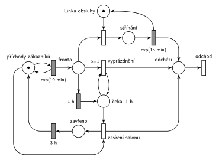

# Psí salon

## Zadání

> ⚠️ **Rekonstrukce.** Zadání z roku 2025/26 v materiálech chybí, existuje jen Hrubého řešení. Text níže je odvozený z jeho sítě a poznámek („čekající zákazníci odchází ze salonu“, „deaktivace procesu příchodů“, „pokud kdokoli ve frontě čeká ≥ 1 h, pak …“). Čísla jsou převzatá z řešení.
>
> Do psího salonu přichází zákazníci v intervalech exponenciálně se středem 10 minut. Salon má jednu linku obsluhy, obsluha (stříhání) trvá exponenciálně se středem 15 minut. Pokud některý zákazník čeká ve frontě alespoň 1 hodinu, všichni čekající zákazníci salon opustí a salon na přesně 3 hodiny přestane přijímat nové zákazníky. V modelu jednoznačně ukažte (přechodem) moment, kdy transakce opouští systém.

Všimni si: obsluha (15 min) je pomalejší než příchody (10 min), takže bez pravidla s jednou hodinou by fronta rostla do nekonečna. Právě proto zadání dává smysl.

Podobné úlohy: [Přerušení příchodů při plné frontě](<../../05 - Délka fronty a kapacita/05 - Přerušení příchodů při plné frontě/05 - Přerušení příchodů při plné frontě.md>), [Každá 100. transakce vyprázdní frontu](<../../05 - Délka fronty a kapacita/07 - Každá 100. transakce vyprázdní frontu/07 - Každá 100. transakce vyprázdní frontu.md>), [Netrpělivé požadavky](<../../02 - Netrpělivost a omezená fronta/01 - Netrpělivé požadavky/01 - Netrpělivé požadavky.md>).

## Interpretace

<details>
<summary>Zobrazit interpretaci (nápověda)</summary>
<br>

- **Příchody** modeluje místo *příchody zákazníků* s jednou značkou ve smyčce s časovaným přechodem `exp(10 min)`; zákazník čeká v místě *Fronta*.
- **Jedna linka obsluhy** je místo *Linka obsluhy* s jednou značkou; obsazení ji bere, časovaný přechod `exp(15 min)` ji vrací (uvolnění je s ním sloučené). Obsloužený zákazník jde do místa *ven*.
- **Vyhlížení** je samostatný proces (místo se značkou). Časovaný přechod `1 h` je proveditelný, když je značka ve *vyhlížení* a někdo je ve *Frontě*. Odpočet tedy běží, dokud je fronta neprázdná. Když se fronta mezitím vyprázdní, odpočet zanikne a s dalším zákazníkem začne znovu.
- To je **abstrakce**: odpočet měří, jak dlouho je fronta nepřetržitě neprázdná, ne kolik čeká konkrétní zákazník. Přesnější alternativa je dát každé transakci vlastní timeout: časovaný přechod `1 h` jen se vstupem z *Fronty* (bez *vyhlížení*), který má podle slajdu 138 odpočet pro každou značku zvlášť.
- Přechod `1 h` vezme z fronty zákazníka, který čekal nejdéle. Ten se stane značkou v místě *poplach*. Odchází ze systému až přechodem *deaktivace příchodů*.
- **Vyprázdnění fronty:** okamžitý přechod s `p=1` opakovaně bere zákazníky z *Fronty* do místa *ven* a vrací značku *poplach* zpět (smyčka), dokud fronta není prázdná. Priorita `p=1` zajistí, že vyprázdnění proběhne dřív než deaktivace (p=0) a dřív než případné obsazení linky.
- **Deaktivace příchodů** odebere značku z místa *příchody zákazníků*, takže probíhající odpočet `exp(10 min)` zanikne a nikdo nepřichází; zákazníka z *poplachu* pošle do místa *ven*. Po `3 h` se vrátí značka příchodů i vyhlížení.
- Zákazník, který je právě obsluhován, obsluhu normálně dokončí.
- Všichni zákazníci **opouští systém** přes místo *ven* okamžitým přechodem *odchod* bez výstupních hran.

</details>

## Petriho síť

<details>
<summary>Zobrazit Petriho síť</summary>
<br>



</details>

## Časté chyby

<details>
<summary>Zobrazit časté chyby</summary>
<br>

- Zastavení příchodů odebráním značky z *Fronty* místo z místa *příchody zákazníků*. Generátor musí přijít o svou značku, jinak příchody pokračují.
- Vyprázdnění fronty jedním přechodem s váhou hrany. Váha bere přesný počet značek, ne „všechny“. Na „všechny“ je potřeba smyčka s prioritou.
- Zapomenutá smyčka *poplach* → přechod → *poplach*: pak se odebere jen jeden zákazník.
- Zapomenutý návrat značky do *vyhlížení* po 3 h: hlídání by pak fungovalo jen jednou.

</details>

## SIMLIB

<details>
<summary>Zobrazit SIMLIB kód</summary>
<br>

Model je izomorfní k Petriho síti výše: každé místo, přechod a značka mají svůj protějšek v kódu.

```cpp
// Psí salon – model v SIMLIB/C++
#include "simlib.h"

Queue Fronta("Fronta");                // místo „Fronta“
Facility Linka("Linka obsluhy", &Fronta);  // místo „Linka obsluhy“ (1 značka), čeká se ve „Frontě“
Histogram Doba("Doba obslouženého zákazníka [min]", 0, 10, 20);
bool vyhlizeni = true;                 // značka v místě „vyhlížení“
int obslouzeno = 0, vyhozeno = 0, poplachy = 0;

class Poplach : public Event {         // časovaný přechod 1 h (vyhlížení + neprázdná fronta)
  void Behavior();
};
Poplach *hodina;                       // jediný odpočet, protože „vyhlížení“ má jednu značku
Event *prichody;                       // značka v místě „příchody zákazníků“

class Zakaznik : public Process {      // transakce = značka, která prochází sítí
  void Behavior() {
    double prichod = Time;
    if (Linka.Busy() && Fronta.Empty() && vyhlizeni)
      hodina->Activate(Time + 60);     // fronta přestává být prázdná: začíná odpočet 1 h
    Seize(Linka);                      // „Fronta“ + obsazení linky
    if (Fronta.Empty())
      hodina->Passivate();             // fronta je prázdná: odpočet 1 h zaniká
    Wait(Exponential(15));             // časovaný přechod exp(15 min) ...
    Release(Linka);                    // ... který vrací značku linky
    obslouzeno++;
    Doba(Time - prichod);
  }                                    // konec Behavior = místo „ven“ + přechod „odchod“
};

class Pauza : public Event {           // místo „pauza“ + časovaný přechod 3 h
  void Behavior() {
    vyhlizeni = true;                  // značka zpět do „vyhlížení“ ...
    prichody->Activate(Time + Exponential(10));  // ... i do „příchody zákazníků“ (nový odpočet)
  }
};

void Poplach::Behavior() {
  poplachy++;
  vyhlizeni = false;                   // značka „vyhlížení“ přechází do „poplach“
  while (!Fronta.Empty()) {            // nejdéle čekající zákazník (poplach) a smyčka p=1:
    delete Fronta.GetFirst();          // každý čekající odchází přes „ven“
    vyhozeno++;
  }
  prichody->Passivate();               // „deaktivace příchodů“: odpočet exp(10 min) zaniká
  (new Pauza)->Activate(Time + 180);   // značka do „pauza“, za 3 h zpět
}

class Generator : public Event {       // místo „příchody zákazníků“ ve smyčce s exp(10 min)
  void Behavior() {
    (new Zakaznik)->Activate();        // nová značka v místě „Fronta“
    Activate(Time + Exponential(10));  // další příchod
  }
};

int main() {
  Init(0, 60 * 1000);                  // modelový čas v minutách: 1000 hodin provozu
  hodina = new Poplach;
  prichody = new Generator;
  prichody->Activate();
  Run();
  Linka.Output();
  Fronta.Output();
  Doba.Output();
  Print("Obslouženo: %d, odešlo z fronty: %d, poplachů: %d\n", obslouzeno, vyhozeno, poplachy);
}
```

| Petriho síť | SIMLIB |
|---|---|
| *příchody zákazníků* ⇄ `exp(10 min)` | událost `Generator` (ukazatel `prichody`), která se znovu plánuje za `Exponential(10)` |
| značka (zákazník) | proces `Zakaznik` |
| místo *Fronta* | `Queue Fronta`, vstupní fronta zařízení `Linka` |
| místo *Linka obsluhy* (1 značka) + obsazení | `Facility Linka`, `Seize(Linka)` |
| `exp(15 min)` se sloučeným uvolněním | `Wait(Exponential(15)); Release(Linka);` |
| místo *vyhlížení* | proměnná `bool vyhlizeni` |
| časovaný přechod `1 h` (vyhlížení + neprázdná fronta) | událost `Poplach`: naplánuje se, když fronta přestane být prázdná, a zruší (`Passivate`), když se vyprázdní |
| *poplach* + smyčka `p=1` vyprázdnění | cyklus `while (!Fronta.Empty()) delete Fronta.GetFirst();` |
| *deaktivace příchodů* (bere značku příchodů) | `prichody->Passivate()` |
| *pauza* → `3 h` → zpět *příchody* a *vyhlížení* | událost `Pauza` za 180 min: `vyhlizeni = true`, `prichody->Activate(…)` |
| *ven* → přechod *odchod* | konec metody `Behavior()` zákazníka nebo `delete` čekajícího zákazníka |

**Kontrola simulací.** Petriho síť: linka se vždy vrátí, platí *příchody zákazníků* + *pauza* = 1 a *vyhlížení* + *poplach* + *pauza* = 1; fronta zůstává omezená (nejvýš asi 16), i když je obsluha pomalejší než příchody (`make check`). SIMLIB model: v jednom běhu (1000 h) nastal poplach 197krát, takže salon byl zavřený 197 × 3 h = 591 h, tedy víc než polovinu doby. Za zbylých 409 h přišlo asi 2460 zákazníků (409 h × 6 za hodinu): 1443 jich bylo obslouženo a 1021 odešlo z fronty při poplachu. Linka byla vytížená na 38 %, nejdelší fronta měla 13 zákazníků a nikdo ve frontě nečekal déle než 60 minut (`make simlib`).

</details>

## Původ a zdroje

<details>
<summary>Zobrazit původ a zdroje</summary>
<br>

**Původ:** půlsemestrální písemka 2025/26, varianta A, 10 bodů (bodování podle ostatních let).

**Původní znění:** (rekonstrukce, viz ⚠️ v zadání)

> Do psího salonu přichází zákazníci v intervalech daných exponenciálním rozložením se středem 10 minut. Salon má jednu linku obsluhy, obsluha (stříhání) trvá dobu danou exponenciálním rozložením se středem 15 minut. Pokud některý zákazník čeká ve frontě alespoň 1 hodinu, všichni čekající zákazníci salon opustí a salon na 3 hodiny přestane přijímat nové zákazníky. V modelu jednoznačně ukažte (přechodem) moment, kdy transakce opouští systém.

**Zdroje:**

- `Fitcheats/Půlsemestrálky/Hrubý - Řešení 2025-26.pdf`, str. 1

**Existující řešení:**

- **Hrubý (str. 1):** síť výše je jeho řešení překreslené: stejná místa, přechody i priority. Generátor kreslí také jako místo ve smyčce s `exp(10min)`. U přechodu `1 h` má poznámku „Trvá!“ (odpočet běží, dokud je fronta neprázdná) a sám přiznává abstrakci: „pokud kdokoli ve frontě čeká ≥ 1 h“ modeluje přibližně; jako alternativu navrhuje dát každé transakci vlastní timeout.

</details>
