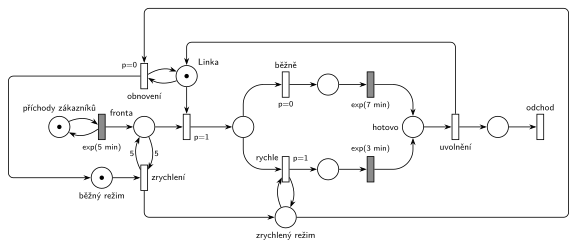

# Centrum MM1 s rychlým režimem (09/04)

## Zadání

> Zákazníci přichází do obslužného Centra typu M/M/1 v intervalech exponenciálně se středem 5 minut. Doba obsluhy je v běžném režimu exponenciálně se středem 7 minut. Pokud však délka fronty dosáhne 5 čekajících zákazníků, pak se Centrum přepne do zrychleného režimu, ve kterém trvá obsluha exponenciálně se středem 3 minut, což se projeví na nově zahájené obsluze. Centrum setrvá ve zrychleném režimu, dokud se fronta nevyprázdní.

Všimni si: v běžném režimu je obsluha (7 min) pomalejší než příchody (5 min). Bez zrychleného režimu by fronta rostla do nekonečna.

Podobné úlohy: [Doba obsluhy podle délky fronty](<../../05 - Délka fronty a kapacita/01 - Doba obsluhy podle délky fronty/01 - Doba obsluhy podle délky fronty.md>), [Dočasně MM2 při dlouhé frontě](<../../05 - Délka fronty a kapacita/02 - Dočasně MM2 při dlouhé frontě/02 - Dočasně MM2 při dlouhé frontě.md>), [Klientské centrum](<../06 - Klientské centrum/06 - Klientské centrum.md>) (přepnutí režimu podle délky fronty, 2023/24).

## Nápověda

<details>
<summary>Zobrazit nápovědu</summary>
<br>

- **M/M/1:** místo *příchody zákazníků* s jednou značkou ve smyčce s `exp(5 min)` plní *frontu*; *Linka* má jednu značku a obsazení (`p=1`) ji bere.
- **Režim** je stav: jedna značka buď v *běžném režimu*, nebo v *zrychleném režimu*.
- **„Dosáhne 5 čekajících“:** přechod *zrychlení* bere značku *běžného režimu* a testuje *frontu* dvojicí hran s váhou 5. Přechod se provede hned, jak je ve frontě aspoň 5 zákazníků („dosáhne 5“ = váha 5, ne 6).
- **„Projeví se na nově zahájené obsluze“:** doba se volí až po obsazení linky. Z místa za obsazením vedou dva přechody. *Rychle* (`p=1`) testuje *zrychlený režim* a vede na `exp(3 min)`, *běžně* (`p=0`) vede na `exp(7 min)`. Probíhající obsluhu přepnutí nijak nemění.
- **Uvolnění linky** je samostatný okamžitý přechod (plný tvar ze slajdu 154). Obě větve obsluhy se sejdou v *hotovo* a linku stačí vracet jedinou hranou. Vracet ji z obou časovaných přechodů zvlášť je také správně.
- **„Dokud se fronta nevyprázdní“:** *obnovení* vrací *běžný režim*, když je linka volná a nikdo nečeká. Prázdnou frontu nejde přímo otestovat (bez inhibiční hrany). Proto *obnovení* (p=0) soupeří o *Linku* s obsazením (`p=1`). Když někdo čeká, vyhraje obsazení. *Obnovení* se tedy provede, jen když je linka volná a fronta prázdná: nejdřív proběhne obsazení a teprve potom obnovení.
- Toto čtení má jemný důsledek. Pokud se fronta vyprázdní zahájením poslední obsluhy a během ní někdo přijde, režim zůstane zrychlený. Přesnější čtení by přepnulo zpět hned při zahájení obsluhy, po které je fronta prázdná. To by ale potřebovalo pomocnou kontrolní značku a další přechody; jednodušší řešení u písemky postačí.
- Zákazník **opouští systém** za *uvolněním* okamžitým přechodem *odchod* bez výstupních hran.

</details>

## Petriho síť

<details>
<summary>Zobrazit Petriho síť</summary>
<br>



</details>

## Časté chyby

<details>
<summary>Zobrazit časté chyby</summary>
<br>

- Přepnutí režimu napojené na časovaný přechod probíhající obsluhy (přerušení obsluhy). Zadání mění jen nově zahájené obsluhy.
- Test délky fronty jednou hranou s váhou 5 bez zpětné hrany. Přechod by pak 5 zákazníků z fronty odebral.
- Návrat do běžného režimu bez podmínky prázdné fronty, nebo s inhibiční hranou. Hrubý inhibiční hrany nechce, podmínka se dělá prioritou (obsazení `p=1` před obnovením `p=0`).
- Volba doby obsluhy před obsazením linky (rozdělení už z fronty). Režim se pak určí v okamžiku příchodu, ne při zahájení obsluhy.
- Obě větve `p=0` a `p=1` bez testu režimu u rychlé větve: pak by se vždy obsluhovalo rychle.

</details>

## SIMLIB

<details>
<summary>Zobrazit SIMLIB kód</summary>
<br>

Model je izomorfní k Petriho síti výše: každé místo, přechod a značka mají svůj protějšek v kódu.

```cpp
// Centrum M/M/1 s rychlým režimem – model v SIMLIB/C++
#define I_REALLY_KNOW_HOW_TO_USE_WAITUNTIL  // zpřístupní makro WaitUntil (test podmínky)
#include "simlib.h"

Facility Linka("Linka");               // místo „Linka“ (1 značka), její fronta = „Fronta“
Histogram Doba("Doba zákazníka v centru [min]", 0, 5, 20);
bool zrychleny = false;                // značka v „zrychlený režim“ (false = „běžný režim“)
int rychlych = 0, beznych = 0, zrychleni = 0;

class Zakaznik : public Process {      // transakce = značka, která prochází sítí
  void Behavior() {
    double prichod = Time;
    Seize(Linka);                      // „Fronta“ + obsazení (p=1)
    if (zrychleny) {                   // „rychle“ (p=1, test „zrychlený režim“)
      rychlych++;
      Wait(Exponential(3));            // časovaný přechod exp(3 min)
    } else {                           // „běžně“ (p=0)
      beznych++;
      Wait(Exponential(7));            // časovaný přechod exp(7 min)
    }
    Release(Linka);                    // „hotovo“ → „uvolnění“ vrací značku linky
    Doba(Time - prichod);
  }                                    // konec Behavior = přechod „odchod“
};

class Rezim : public Process {         // značka režimu centra
  void Behavior() {
    for (;;) {                         // značka v „běžný režim“
      WaitUntil(Linka.QueueLen() >= 5);  // „zrychlení“: test fronty dvojicí hran s váhou 5
      zrychleni++;
      zrychleny = true;                // značka v „zrychlený režim“
      WaitUntil(!Linka.Busy() && Linka.QueueLen() == 0);  // „obnovení“ (p=0): linka volná, nikdo nečeká
      zrychleny = false;               // značka zpět v „běžný režim“
    }
  }
};

class Generator : public Event {       // místo „příchody zákazníků“ ve smyčce s exp(5 min)
  void Behavior() {
    (new Zakaznik)->Activate();        // nová značka v místě „Fronta“
    Activate(Time + Exponential(5));   // další příchod
  }
};

int main() {
  Init(0, 60 * 1000);                  // modelový čas v minutách: 1000 hodin provozu
  (new Rezim)->Activate();
  (new Generator)->Activate();
  Run();
  Linka.Output();
  Doba.Output();
  Print("Zrychlení: %d krát, obsluh rychle: %d, běžně: %d\n", zrychleni, rychlych, beznych);
}
```

| Petriho síť | SIMLIB |
|---|---|
| *příchody zákazníků* ⇄ `exp(5 min)` | událost `Generator`, která se znovu plánuje za `Exponential(5)` |
| značka (zákazník) | proces `Zakaznik` |
| místo *Linka* (1 značka), *fronta* + obsazení `p=1` | `Facility Linka`, `Seize(Linka)` (fronta je vnitřní fronta zařízení) |
| *rychle* (`p=1`, test *zrychlený režim*) / *běžně* (`p=0`) | `if (zrychleny) … else …` až po `Seize` |
| `exp(3 min)` / `exp(7 min)` | `Wait(Exponential(3))` / `Wait(Exponential(7))` |
| *hotovo* → *uvolnění* | `Release(Linka)` |
| místa *běžný režim* / *zrychlený režim* | proměnná `bool zrychleny` a proces `Rezim` |
| *zrychlení* (test 5 na *frontě*) | `WaitUntil(Linka.QueueLen() >= 5)` |
| *obnovení* (`p=0` proti obsazení `p=1`, test *Linky*) | `WaitUntil(!Linka.Busy() && Linka.QueueLen() == 0)` |
| přechod *odchod* | konec metody `Behavior()` zákazníka |

**Kontrola simulací.** Petriho síť: *Linka* + obsluhovaný zákazník = 1, *běžný režim* + *zrychlený režim* = 1; režim se přepíná zhruba každých 120 minut, asi dvě třetiny obsluh probíhají zrychleně a fronta zůstává omezená (nejvýš kolem 18), i když by běžný režim sám frontu neudržel (`make check`). SIMLIB model: v jednom běhu (1000 h) se centrum zrychlilo 491krát (zhruba každých 122 minut), zrychleně proběhlo 64 % obsluh (7682 z 11 974), nejdelší fronta měla 19 zákazníků. Linka byla vytížená na 87 %, což odpovídá součtu dob obsluhy (7682 × 3 + 4292 × 7 min ≈ 53 100 min z 60 000), a zákazník strávil v centru průměrně 17,7 minuty (`make simlib`).

</details>

## Původ a zdroje

<details>
<summary>Zobrazit původ a zdroje</summary>
<br>

**Původ:** půlsemestrální písemka 2024/25, varianta D, 10 bodů.

**Původní znění:**

> Zákazníci přichází do obslužného Centra typu M/M/1 v intervalech daných exponenciálním rozložením (EXP) se středem 5 minut. Doba obsluhy se v běžném režimu řídí EXP(7min). Pokud však délka fronty dosáhne 5 čekajících zákazníků, pak se Centrum přepne do zrychleného režimu, ve kterém provádí obsluhu v době EXP(3min), což se projeví na nově zahájené obsluze. Centrum setrvá ve zrychleném režimu, dokud se fronta nevyprázdní.
>
> Zadaný systém modelujte formou Petriho sítě s vyznačením všech potřebných parametrů. **V modelu jednoznačně ukažte (přechodem) moment, kdy transakce opouští systém.**

**Zdroje:**

- `Fitcheats/Půlsemestrálky/Zadání z minulých let/2024-25.pdf`, str. 1 (koláž zadání všech čtyř variant)
- `Fitcheats/Půlsemestrálky/Hrubý - Řešení 2024-25.pdf`, str. 4 (řešení od Hrubého)

**Existující řešení:**

- **Hrubý (str. 4):** síť výše je jeho řešení překreslené: *seize* s `p=1` → místo → větvení `p=0` na `exp(7m)` a `p=1` (s testem *rychlo režimu*) na `exp(3m)` → společné místo → *release* zpět k *lince*. *Normální režim* → přechod s testem 5 na frontě → *rychlo režim*. *Obnovení* bere *rychlo režim* a je napojené na *linku*; k lince si poznamenal, že nejdřív proběhne seize a teprve potom obnovení. Generátor kreslí jako přechod `exp` bez místa. Výstupní přechod nekreslí, za *release* je jen šipka ven. Hrany režimů u něj kříží hlavní řadu; tady obchází síť zleva a zprava.

</details>

## Reference

- [Jak síť funguje](<../../../basics/Jak síť funguje.md>)
- [Notace a vzory](<../../../basics/Notace a vzory.md>)

<!-- -->

- [Studijní plán](<../../Studijní plán.md>)
- [Seznam úloh](<../../Seznam úloh.md>)
