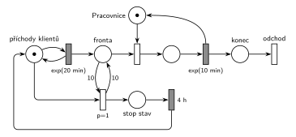

# 09-06 Klientské centrum

## Zadání

> Do klientského centra přichází klienti v intervalech exponenciálně se středem 20 minut. Požadavky obsluhuje jedna pracovnice. Doba obsluhy je exponenciálně se středem 10 minut. Pokud fronta k obsluze dosáhne délky 10 čekajících, pak centrum vyhlásí dočasný "stop stav", během kterého se zastaví proces příchodu požadavků. Stop stav trvá přesně 4 hodiny.

Podobné úlohy: [Přerušení příchodů při plné frontě](<../../05 - Délka fronty a kapacita/05 - Přerušení příchodů při plné frontě/05 - Přerušení příchodů při plné frontě.md>), [MM3 – zastavení příchodů](<../../05 - Délka fronty a kapacita/06 - MM3 – zastavení příchodů/06 - MM3 – zastavení příchodů.md>), [Psí salon](<../03 - Psí salon/03 - Psí salon.md>), [Centrum MM1 s rychlým režimem](<../04 - Centrum MM1 s rychlým režimem/04 - Centrum MM1 s rychlým režimem.md>), [Výrobní hala](<../../12 - Výroba a sklady/03 - Výrobní hala/03 - Výrobní hala.md>).

## Nápověda

<details>
<summary>Zobrazit nápovědu</summary>
<br>

- **Příchody** modeluje místo *příchody klientů* s jednou značkou ve smyčce s `exp(20 min)`; klient čeká v místě *fronta*.
- **Jedna pracovnice** je místo *Pracovnice* s jednou značkou; obsazení ji bere, časovaný přechod `exp(10 min)` ji vrací (uvolnění je s ním sloučené).
- **Délka fronty** jsou jen čekající klienti v místě *fronta*. Obsluhovaný klient je v jiném místě, takže se nepočítá („10 čekajících“).
- **„Dosáhne délky 10“** = test, že je ve *frontě* aspoň 10 značek: hrana s váhou 10 do přechodu a hrana s váhou 10 zpět. Z fronty se nic neodebere. (Kdyby zadání říkalo „přesáhne 10“, byla by váha 11.)
- **Zastavení příchodů:** přechod stop stavu odebere značku z místa *příchody klientů*, takže probíhající odpočet `exp(20 min)` zanikne a nikdo nepřichází. Značka přejde do místa *stop stav*, po `4 h` se vrátí a příchody pokračují.
- **Značka příchodů slouží i jako pojistka:** během stop stavu chybí, a proto se stop stav nemůže vyhlásit znovu, i když je ve frontě pořád 10 klientů. Samostatné řídicí místo (jako u vzoru „dočasné zastavení příchodů“) by bylo také správně, jen je to prvek navíc.
- **Priorita `p=1`** na vyhlášení stop stavu říká, že se podmínka „fronta dosáhla 10“ vyhodnotí dřív než cokoli jiného v tomtéž okamžiku (např. obsazení pracovnice). V téhle úloze ke střetu prakticky nedojde, protože fronta roste, jen když je pracovnice obsazená. Priorita ale nic nezkazí a odpovídá vzoru testu fronty.
- Obsluha během stop stavu normálně pokračuje a fronta se vyprazdňuje. Po 4 h je fronta prakticky vždy kratší než 10.
- Klient **opouští systém** přes místo *konec* okamžitým přechodem *odchod* bez výstupních hran.

</details>

## Petriho síť

<details>
<summary>Zobrazit Petriho síť</summary>
<br>



</details>

## Časté chyby

<details>
<summary>Zobrazit časté chyby</summary>
<br>

- Hrana s váhou 10 jen do přechodu, bez hrany zpět. Přechod by pak z fronty odebral 10 klientů.
- Zastavení příchodů odebráním klientů z *fronty* místo odebrání značky generátoru (místa *příchody klientů*).
- Zapomenutý návrat značky generátoru po 4 h: příchody by se zastavily natrvalo.
- Vyhlášení stop stavu, které nebere značku generátoru ani jinou řídicí značku. Test fronty pak zůstává splněný a přechod se provádí pořád dokola.
- Váha 11 („přesáhne“) místo 10 („dosáhne“), nebo započítání obsluhovaného klienta do délky fronty.

</details>

## SIMLIB

<details>
<summary>Zobrazit SIMLIB kód</summary>
<br>

Model je izomorfní k Petriho síti výše: každé místo, přechod a značka mají svůj protějšek v kódu.

```cpp
// Klientské centrum – model v SIMLIB/C++
#define I_REALLY_KNOW_HOW_TO_USE_WAITUNTIL  // zpřístupní makro WaitUntil (test podmínky)
#include "simlib.h"

Facility Pracovnice("Pracovnice");     // místo „Pracovnice“ (1 značka), její fronta = „Fronta“
Histogram Doba("Doba klienta v centru [min]", 0, 10, 20);
Event *prichody;                       // značka v místě „příchody klientů“
int stopStavu = 0;

class Klient : public Process {        // transakce = značka, která prochází sítí
  void Behavior() {
    double prichod = Time;
    Seize(Pracovnice);                 // „Fronta“ + obsazení
    Wait(Exponential(10));             // časovaný přechod exp(10 min) ...
    Release(Pracovnice);               // ... který vrací značku pracovnice
    Doba(Time - prichod);
  }                                    // konec Behavior = místo „konec“ + přechod „odchod“
};

class StopStav : public Process {      // přechod „stop“ (p=1), místo „stop stav“ a přechod 4 h
  void Behavior() {
    for (;;) {
      WaitUntil(Pracovnice.QueueLen() >= 10);  // test fronty dvojicí hran s váhou 10
      stopStavu++;
      prichody->Passivate();           // značka příchodů → „stop stav“: odpočet exp(20 min) zaniká
      Wait(4 * 60);                    // časovaný přechod 4 h
      prichody->Activate(Time + Exponential(20));  // značka zpět, odpočet příchodu začíná znovu
    }
  }
 public:
  StopStav() : Process(1) {}           // priorita 1 = p=1 u přechodu „stop“
};

class Generator : public Event {       // místo „příchody klientů“ ve smyčce s exp(20 min)
  void Behavior() {
    (new Klient)->Activate();          // nová značka v místě „Fronta“
    Activate(Time + Exponential(20));  // další příchod
  }
};

int main() {
  Init(0, 60 * 100000);                // modelový čas v minutách: 100 000 hodin (stop stav je vzácný)
  prichody = new Generator;
  prichody->Activate();
  (new StopStav)->Activate();
  Run();
  Pracovnice.Output();
  Doba.Output();
  Print("Stop stav vyhlášen: %d krát\n", stopStavu);
}
```

| Petriho síť | SIMLIB |
|---|---|
| *příchody klientů* ⇄ `exp(20 min)` | událost `Generator` (ukazatel `prichody`), která se znovu plánuje za `Exponential(20)` |
| značka (klient) | proces `Klient` |
| místo *Pracovnice* (1 značka), *fronta* + obsazení | `Facility Pracovnice`, `Seize(Pracovnice)` (fronta je vnitřní fronta zařízení) |
| `exp(10 min)` se sloučeným uvolněním | `Wait(Exponential(10)); Release(Pracovnice);` |
| test fronty hranami s váhou 10 | `WaitUntil(Pracovnice.QueueLen() >= 10)` |
| *stop* (`p=1`) bere značku příchodů | `prichody->Passivate()` v procesu `StopStav` s prioritou 1 |
| *stop stav* → `4 h` → *příchody klientů* | `Wait(4 * 60)`, pak `prichody->Activate(…)` |
| přechod *odchod* | konec metody `Behavior()` klienta |

**Kontrola simulací.** Petriho síť: *Pracovnice* + obsluhovaný = 1, *příchody klientů* + *stop stav* = 1, ve *frontě* nikdy není víc než 10 klientů; pracovnice je vytížena jen na 50 %, takže stop stav je vzácný, v simulaci zhruba jednou za 3700 klientů (`make check`). SIMLIB model: v jednom běhu (100 000 h, asi 300 000 klientů) byla pracovnice vytížena na 49,8 % (teoreticky 10/20 = 50 %), klient strávil v centru průměrně 19,7 minuty (pro M/M/1 teoreticky 1/(1/10 − 1/20) = 20 min) a stop stav se vyhlásil 71krát, tedy zhruba jednou za 4200 klientů; fronta nepřesáhla 10 (`make simlib`).

</details>

## Původ a zdroje

<details>
<summary>Zobrazit původ a zdroje</summary>
<br>

**Původ:** půlsemestrální písemka 2023/24, varianta D, 10 bodů.

**Původní znění:**

> Do klientského centra přichází klienti v intervalech daných exponenciálním rozložením se středem 20 minut. Požadavky obsluhuje jedna pracovnice. Doba obsluhy se řídí exponenciálním rozložením se středem 10 minut. Pokud fronta k obsluze dosáhne délky 10 čekajících, pak centrum vyhlásí dočasný "stop stav", během kterého se zastaví proces příchodu požadavků. Stop stav trvá 4 hodiny.
>
> **V modelu jednoznačně ukažte (přechodem) moment, kdy transakce opouští systém.**

**Zdroje:**

- `Fitcheats/Půlsemestrálky/Zadání z minulých let/2023-24.pdf`, str. 4 (fotka zadání; v plném rozlišení čitelná celá)

**Existující řešení:**

- K této variantě v materiálech žádné řešení není (ani od Hrubého, ani studentské).

</details>

## Reference

- [Jak síť funguje](<../../../basics/Jak síť funguje.md>)
- [Notace a vzory](<../../../basics/Notace a vzory.md>)

<!-- -->

- [Studijní plán](<../../Studijní plán.md>)
- [Seznam úloh](<../../Seznam úloh.md>)
