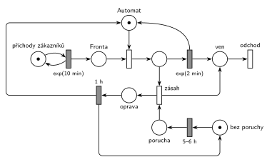

# Automat na kávu

## Zadání

> K automatu na kávu přichází zákazníci v intervalech exponenciálně se středem 10 minut. Doba obsluhy je exponenciálně se středem 2 minuty. V automatu se cyklicky projevuje porucha, a to vždy rovnoměrně 5–6 hodin od okamžiku poslední opravy poruchy (nebo od počátku času). Porucha se projeví na právě probíhající obsluze nebo na další následující transakci. Požadavek zasažený poruchou opouští systém bez obsluhy. Oprava poruchy zabere přesně 1 hodinu.

Podobné úlohy: [Porucha zničí obsluhu nebo počká](<../../03 - Poruchy/06 - Porucha zničí obsluhu nebo počká/06 - Porucha zničí obsluhu nebo počká.md>), [Porucha s opravou, transakce odchází](<../../03 - Poruchy/04 - Porucha s opravou, transakce odchází/04 - Porucha s opravou, transakce odchází.md>), [Porucha vrací transakci do fronty](<../../03 - Poruchy/02 - Porucha vrací transakci do fronty/02 - Porucha vrací transakci do fronty.md>), [Spalovna](<../../12 - Výroba a sklady/07 - Spalovna/07 - Spalovna.md>), [Výroba hrášku](<../../12 - Výroba a sklady/14 - Výroba hrášku/14 - Výroba hrášku.md>).

## Nápověda

<details>
<summary>Zobrazit nápovědu</summary>
<br>

- **Příchody** modeluje místo *příchody zákazníků* s jednou značkou ve smyčce s `exp(10 min)`; zákazník čeká v místě *fronta*.
- **Automat** je místo s jednou značkou; obsazení ji bere, časovaný přechod `exp(2 min)` ji vrací (uvolnění je s ním sloučené) a obsloužený zákazník jde do místa *ven*.
- **Cyklus poruchy** je jedna značka, která obíhá: *bez poruchy* → `5–6 h` (rovnoměrně) → *porucha* → zásah → *oprava* → `1 h` → zpět *bez poruchy*. Další porucha se tak počítá od konce opravy, jak chce zadání. Počáteční značka v *bez poruchy* odpovídá „nebo od počátku času“.
- **Zásah** je okamžitý přechod se vstupy *porucha* a obsluhovaný zákazník. Když automat právě obsluhuje, provede se hned a odpočet `exp(2 min)` zanikne (slajd 139). Když automat stojí, porucha čeká a zasáhne prvního zákazníka, který automat obsadí, ve stejném okamžiku, kdy ho obsadí. To je „na další následující transakci“.
- Na rozdíl od úloh, kde porucha bez obsluhy zaniká ([Porucha vrací transakci do fronty](<../../03 - Poruchy/02 - Porucha vrací transakci do fronty/02 - Porucha vrací transakci do fronty.md>)), tady porucha **nezaniká**, takže žádný přechod „porucha bez účinku“ není.
- **Zasažený zákazník** jde z přechodu zásah rovnou do místa *ven* a odchází stejným výstupním přechodem *odchod* jako obsloužení.
- **Oprava drží automat:** zásah nevrací značku *Automatu*. Ta je po dobu opravy v místě *oprava* a vrátí ji až přechod `1 h`. Zákazníci mezitím čekají ve *frontě*.
- Priorita není potřeba: o obsluhovaného zákazníka soupeří jen zásah (okamžitý) a `exp(2 min)` (časovaný), a okamžitý přechod má vždy přednost.

</details>

## Petriho síť

<details>
<summary>Zobrazit Petriho síť</summary>
<br>



</details>

## Časté chyby

<details>
<summary>Zobrazit časté chyby</summary>
<br>

- Generátor poruch ve smyčce `5–6 h` nezávislý na opravě. Interval se pak počítá od minulé poruchy, ne od konce opravy.
- Porucha, která při nečinném automatu zanikne (vzor z jiných úloh). Tady má počkat na dalšího zákazníka.
- Zásah, který vrací značku *Automatu* hned. Automat by pak během opravy dál obsluhoval.
- Zásah, který bere zákazníka z *fronty*. Když je ve frontě někdo, automat zrovna obsluhuje, a porucha má zasáhnout toho obsluhovaného.
- Zasažený zákazník, který nikam neodejde (chybí hrana do odchodu).

</details>

## SIMLIB

<details>
<summary>Zobrazit SIMLIB kód</summary>
<br>

Model je izomorfní k Petriho síti výše: každé místo, přechod a značka mají svůj protějšek v kódu.

```cpp
// Automat na kávu – model v SIMLIB/C++
#define I_REALLY_KNOW_HOW_TO_USE_WAITUNTIL  // zpřístupní makro WaitUntil (test podmínky)
#include "simlib.h"

Facility Automat("Automat");           // místo „Automat“ (1 značka), jeho fronta = „Fronta“
Histogram Doba("Doba obslouženého zákazníka [min]", 0, 2, 20);
int obslouzeno = 0, zasazeno = 0;

class Zakaznik : public Process {      // transakce = značka, která prochází sítí
  void Behavior() {
    double prichod = Time;
    Seize(Automat);                    // „Fronta“ + obsazení → místo „obsluha“
    Wait(Exponential(2));              // časovaný přechod exp(2 min) ...
    Release(Automat);                  // ... který vrací značku automatu
    obslouzeno++;
    Doba(Time - prichod);
  }                                    // konec Behavior = místo „ven“ + přechod „odchod“
};

class Porucha : public Process {       // značka cyklu poruchy
  void Behavior() {
    for (;;) {                         // značka v „bez poruchy“
      Wait(Uniform(5 * 60, 6 * 60));   // časovaný přechod 5–6 h → „porucha“
      WaitUntil(Automat.Busy());       // porucha čeká na obsluhovaného zákazníka
      Entity *zakaznik = Automat.In(); // „zásah“: zákazník v místě „obsluha“ ...
      Seize(Automat, 1);               // ... přijde o automat (přerušení obsluhy) ...
      delete zakaznik;                 // ... a odchází bez obsluhy přes „ven“
      zasazeno++;
      Wait(60);                        // „oprava“ → časovaný přechod 1 h ...
      Release(Automat);                // ... vrací značku automatu i značku do „bez poruchy“
    }
  }
};

class Generator : public Event {       // místo „příchody zákazníků“ ve smyčce s exp(10 min)
  void Behavior() {
    (new Zakaznik)->Activate();        // nová značka v místě „Fronta“
    Activate(Time + Exponential(10));  // další příchod
  }
};

int main() {
  Init(0, 60 * 10000);                 // modelový čas v minutách: 10 000 hodin provozu
  (new Porucha)->Activate();
  (new Generator)->Activate();
  Run();
  Automat.Output();
  Doba.Output();
  Print("Obslouženo: %d, zasaženo poruchou: %d\n", obslouzeno, zasazeno);
}
```

| Petriho síť | SIMLIB |
|---|---|
| *příchody zákazníků* ⇄ `exp(10 min)` | událost `Generator`, která se znovu plánuje za `Exponential(10)` |
| značka (zákazník) | proces `Zakaznik` |
| místo *Automat* (1 značka), *fronta* + obsazení | `Facility Automat`, `Seize(Automat)` (fronta je vnitřní fronta zařízení) |
| `exp(2 min)` se sloučeným uvolněním | `Wait(Exponential(2)); Release(Automat);` |
| značka cyklu poruchy (*bez poruchy*, *porucha*, *oprava*) | proces `Porucha` |
| *bez poruchy* → `5–6 h` → *porucha* | `Wait(Uniform(5 * 60, 6 * 60))` |
| *zásah* (porucha + obsluhovaný zákazník) | `WaitUntil(Automat.Busy())`, pak `Seize(Automat, 1)` (přeruší obsluhu) a `delete` zasaženého zákazníka |
| *zásah* → *ven* → *odchod* | zrušení procesu zákazníka (`delete`) |
| *oprava* → `1 h` → *Automat* + *bez poruchy* | `Wait(60); Release(Automat);` a další průchod cyklem `for` |
| přechod *odchod* | konec metody `Behavior()` zákazníka |

**Kontrola simulací.** Petriho síť: *Automat* + obsluhovaný + *oprava* = 1 a *bez poruchy* + *porucha* + *oprava* = 1; porucha přichází v průměru asi jednou za 6,6 h (5,5 h + 1 h opravy + čekání na dalšího zákazníka) a fronta naroste jen během opravy (`make check`). SIMLIB model: v jednom běhu (10 000 h) zasáhla porucha 1508 zákazníků, tedy jednou za 6,63 h, jak odpovídá síti; obslouženo bylo 58 508 zákazníků. Automat byl obsazený 34,6 % času: asi 19,5 % obsluhou (58 508 × 2 min) a 15,1 % opravami (1508 × 60 min). Nejdelší fronta (15 zákazníků) vznikla během opravy (`make simlib`).

</details>

## Původ a zdroje

<details>
<summary>Zobrazit původ a zdroje</summary>
<br>

**Původ:** půlsemestrální písemka 2023/24, varianta C, 10 bodů.

**Původní znění:**

> K automatu na kávu přichází zákazníci v intervalech daných exponenciálním rozložení se středem 10 minut. Doba obsluhy se řídí exponenciálním rozložením se středem 2 minuty. V automatu se cyklicky projevuje porucha, a to vždy rovnoměrně 5-6 hodin od okamžiku poslední opravy poruchy (nebo od počátku času). Porucha se projeví na právě probíhající obsluze nebo na další následující transakci. Požadavek zasažený poruchou opouští systém bez obsluhy. Oprava poruchy zabere 1 hodinu.
>
> **V modelu jednoznačně ukažte (přechodem) moment, kdy transakce opouští systém.**

**Zdroje:**

- `Fitcheats/Půlsemestrálky/Zadání z minulých let/2023-24.pdf`, str. 3 (fotka zadání)
- `Fitcheats/Půlsemestrálky/Zadání z minulých let/2024-25 - Varianta A (fotky).pdf`, str. 3–4 (zadání a řešení kreslené na cvičení)

**Existující řešení:**

- **Řešení ze cvičení (fotky 2024/25, str. 4):** stejná síť. Automat kreslí nad hlavní linkou, a proto hrana z `1 hod.` zpět do automatu kříží hlavní linku (tady obchází generátor zleva). Zasaženého zákazníka posílá červenou hranou do koncového místa před výstupním přechodem. Generátor poruch je místo se značkou → `Rovn(5-6 hodin)`, návrat z `1 hod.` vede dlouhou hranou dole.
- Hrubého řešení k ročníku 2023/24 v materiálech není.

</details>
