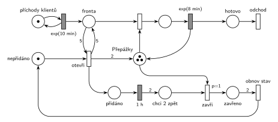

# Cestovní kancelář

## Zadání

> Do pobočky cestovní kanceláře přichází klienti v intervalech exponenciálně se středem 10 minut. Pobočka má 3 přepážky pro obsluhu klientů. Doba obsluhy klienta je exponenciálně se středem 8 minut. Pokud je ve frontě alespoň 5 čekajících klientů, pak kancelář na dobu přesně 1 hodiny otevře dvě další přepážky, tj. tyto dodatečné přepážky se po hodině (a dokončení rozpracovaného klienta) opět uzavřou.

Podobné úlohy: [Úřad s dodatečnými přepážkami](<../15 - Úřad s dodatečnými přepážkami/15 - Úřad s dodatečnými přepážkami.md>), [Úřad](<../01 - Úřad/01 - Úřad.md>), [Dočasně MM2 při dlouhé frontě](<../../05 - Délka fronty a kapacita/02 - Dočasně MM2 při dlouhé frontě/02 - Dočasně MM2 při dlouhé frontě.md>), [Natrvalo MM3 při dlouhé frontě](<../../05 - Délka fronty a kapacita/03 - Natrvalo MM3 při dlouhé frontě/03 - Natrvalo MM3 při dlouhé frontě.md>).

## Nápověda

<details>
<summary>Zobrazit nápovědu</summary>
<br>

- **Příchody** modeluje místo *příchody klientů* s jednou značkou ve smyčce s `exp(10 min)`; klient čeká v místě *fronta*.
- **3 přepážky** jsou sklad se 3 značkami (místo *Přepážky*); obsazení bere značku, `exp(8 min)` ji vrací (uvolnění je s ním sloučené). Otevření dvou dalších přidá do téhož místa 2 značky (hrana s váhou 2). Přepážky jsou stejné, takže nevadí, že se pak zavřou „nějaké“ dvě, ne nutně ty přidané.
- **„alespoň 5 čekajících“** je test hranami váhy 5 tam a zpět: přechod *otevři* frontu jen zkontroluje a nikoho z ní neodebere. Na „alespoň 5“ stačí váha 5, ne 6.
- **Stav nepřidáno / přidáno:** otevření potřebuje značku *nepřidáno*. Bez ní by se při frontě ≥ 5 přechod provedl znovu a znovu a přidával by další a další přepážky.
- **Po hodině** dá časovaný `1 h` dvě značky do místa *chci 2 zpět* („budu chtít dvě zpátky“). Přechod *zavři* s `p=1` vezme pokaždé jednu volnou přepážku. Je-li některá volná hned, zavře se hned. Jinak se zavře ta, kterou první uvolní dokončený klient: to je „(a dokončení rozpracovaného klienta)“. Priorita `p=1` zajistí, že uvolněnou přepážku nezabere další klient z fronty dřív, než se zavře.
- Po dvou zavřených přepážkách vrátí přechod *obnov stav* (hrana váhy 2) značku do *nepřidáno*. Pokud je fronta pořád ≥ 5, otevřou se přepážky hned znovu; zadání to nezakazuje.
- Klient, který je zrovna u přepážky, se vždy doobslouží. Přerušení obsluhy zadání nechce.
- Klient **opouští systém** přes místo *hotovo* okamžitým přechodem *odchod* bez výstupních hran.

</details>

## Petriho síť

<details>
<summary>Zobrazit Petriho síť</summary>
<br>



</details>

## Časté chyby

<details>
<summary>Zobrazit časté chyby</summary>
<br>

- Test fronty jen jednou hranou váhy 5 bez zpětné hrany: přechod pak 5 klientů z fronty odebere.
- Chybějící stav *nepřidáno*: při frontě ≥ 5 se přepážky přidávají opakovaně a jejich počet roste bez omezení.
- Zavření po hodině tak, že přechod vezme rozpracované klienty z obsluhy (přeruší je), nebo že čeká, až budou dvě přepážky volné najednou (hrana váhy 2 z *Přepážky*).
- Zavírání bez priority nad obsazením: uvolněnou přepážku hned zabere další klient z fronty a zavření se odkládá.
- Odpočet 1 h, který se při každém obsazení přepážky spustí znovu (časovač na místě, které testuje obsazení, viz varianta B v Existujících řešeních).

</details>

## SIMLIB

<details>
<summary>Zobrazit SIMLIB kód</summary>
<br>

Model je izomorfní k Petriho síti výše: každé místo, přechod a značka mají svůj protějšek v kódu.

```cpp
// Cestovní kancelář – model v SIMLIB/C++
#define I_REALLY_KNOW_HOW_TO_USE_WAITUNTIL  // zpřístupní makro WaitUntil (test podmínky)
#include "simlib.h"

// místo „Přepážky“ = sklad s kapacitou 5 (3 základní + 2 dočasné);
// dočasné přepážky, které zrovna nejsou otevřené, drží obsazené řízení
Store Prepazky("Přepážky", 5);
Histogram Doba("Doba klienta v kanceláři [min]", 0, 5, 20);
int otevreni = 0;                      // kolikrát se provedl přechod „otevři“

class Klient : public Process {        // transakce = značka, která prochází sítí
  void Behavior() {
    double prichod = Time;
    Enter(Prepazky, 1);                // „Fronta“ + obsazení přepážky
    Wait(Exponential(8));              // časovaný přechod exp(8 min) ...
    Leave(Prepazky, 1);                // ... který vrací značku přepážky
    Doba(Time - prichod);
  }                                    // konec Behavior = místo „hotovo“ + přechod „odchod“
};

class Rizeni : public Process {        // značka řízení (nepřidáno / přidáno / chci 2 zpět / zavřeno)
  void Behavior() {
    Enter(Prepazky, 2);                // na začátku jsou dočasné přepážky zavřené
    for (;;) {                         // značka v „nepřidáno“
      WaitUntil(Prepazky.QueueLen() >= 5);  // test fronty dvojicí hran s váhou 5
      otevreni++;
      Leave(Prepazky, 2);              // přechod „otevři“: 2 značky do „Přepážek“ → „přidáno“
      Wait(60);                        // časovaný přechod 1 h → „chci 2 zpět“
      Enter(Prepazky, 1);              // „zavři“: jednu přepážku ...
      Enter(Prepazky, 1);              // ... a pak druhou, až klient dokončí obsluhu
    }                                  // „obnov stav“ (váha 2 ze „zavřeno“) → „nepřidáno“
  }
 public:
  Rizeni() : Process(1) {}             // priorita 1 = p=1 u „zavři“ (ve frontě skladu je první)
};

class Generator : public Event {       // místo „příchody klientů“ ve smyčce s exp(10 min)
  void Behavior() {
    (new Klient)->Activate();          // nová značka v místě „Fronta“
    Activate(Time + Exponential(10));  // další příchod
  }
};

int main() {
  Init(0, 60 * 100000);                // modelový čas v minutách: 100 000 hodin (otevření je vzácné)
  (new Rizeni)->Activate();
  (new Generator)->Activate();
  Run();
  Prepazky.Output();
  Doba.Output();
  Print("Dočasné přepážky otevřeny: %d krát\n", otevreni);
}
```

| Petriho síť | SIMLIB |
|---|---|
| *příchody klientů* ⇄ `exp(10 min)` | událost `Generator`, která se znovu plánuje za `Exponential(10)` |
| značka (klient) | proces `Klient` |
| místo *Přepážky* (3 značky, otevření přidá 2) | `Store Prepazky` s kapacitou 5, z níž 2 jednotky drží `Rizeni`, dokud jsou dočasné přepážky zavřené |
| *fronta* + obsazení | `Enter(Prepazky, 1)` (fronta je vnitřní fronta skladu) |
| `exp(8 min)` se sloučeným uvolněním | `Wait(Exponential(8)); Leave(Prepazky, 1);` |
| značka řízení (*nepřidáno* …) | proces `Rizeni` (jeden, takže se přepážky neotevřou dvakrát) |
| test fronty hranami s váhou 5 | `WaitUntil(Prepazky.QueueLen() >= 5)` |
| *otevři* → *Přepážky* (váha 2) + *přidáno* | `Leave(Prepazky, 2)` |
| *přidáno* → `1 h` → *chci 2 zpět* | `Wait(60)` |
| `p=1` *zavři* (po jedné) → *zavřeno* | dvakrát `Enter(Prepazky, 1)` s prioritou procesu 1 |
| *obnov stav* (váha 2) → *nepřidáno* | konec těla cyklu `for` |
| přechod *odchod* | konec metody `Behavior()` klienta |

**Kontrola simulací.** Petriho síť: platí *Přepážky* + obsluhovaní + 2 × *nepřidáno* + *zavřeno* = 5 (nikdy víc než 5 přepážek) a 2 × *nepřidáno* + 2 × *přidáno* + *chci 2 zpět* + *zavřeno* = 2 (řízení je vždy v jednom stavu). Kancelář je vytížená jen na 27 %, takže fronta 5 je vzácná (pár otevření na 100 000 událostí). Při zkušebně zrychlených příchodech `exp(2,5 min)` se přepážky otevřely a zavřely stovkykrát a pokaždé se vrátily na 3 (`make check`). SIMLIB model: v jednom běhu (100 000 h, asi 600 000 klientů) se dočasné přepážky otevřely 82krát, tedy zhruba jednou za 1200 hodin. Průměrně bylo obsazeno 2,80 jednotky skladu; po odečtení zhruba dvou jednotek, které řízení skoro pořád drží za zavřené přepážky, obsluhovalo průměrně 0,8 přepážky, tedy 27 % ze tří (teoreticky 8/10 = 0,8). Klient strávil v kanceláři průměrně 8,2 minuty, takže skoro nečekal (`make simlib`).

</details>

## Původ a zdroje

<details>
<summary>Zobrazit původ a zdroje</summary>
<br>

**Původ:** půlsemestrální písemka 2022/23, varianta D, 10 bodů.

**Původní znění:**

> Do pobočky cestovní kanceláře přichází klienti v intervalech daných exponenciálním rozložením se středem 10 minut. Pobočka má 3 přepážky pro obsluhu klientů. Doba obsluhy klienta se řídí exponenciálním rozložením se středem 8 minut. Pokud je ve frontě alespoň 5 čekajících klientů, pak kancelář na dobu 1 hodiny otevře dvě další přepážky, tj. tyto dodatečné přepážky se po hodině (a dokončení rozpracovaného klienta) opět uzavřou.
>
> **V modelu jednoznačně ukažte (přechodem) moment, kdy transakce opouští systém.**

**Zdroje:**

- `Fitcheats/Půlsemestrálky/Zadání z minulých let/2024-25 - Varianta A (fotky).pdf`, str. 7–8 (fotka promítnutého zadání a řešení kreslené na cvičení; jinde zadání v materiálech není)
- `Fitcheats/Půlsemestrálky/Hrubý - Řešení 2022-23.pdf`, str. 5 (řešení od Hrubého, varianta A) a str. 6 (varianta B)

**Existující řešení:**

- **Hrubý, varianta A (str. 5):** síť výše je jeho řešení překreslené: „nepřidáno“ → přechod s hranami váhy 5 na *fronta*, výstup s váhou 2 do *přepážky* (3) → místo → `1hod` → váha 2 → „budu chtít dvě zpátky“ → přechod, který bere přepážku → místo → váha 2 → přechod s poznámkou, že dostal dvě zpátky a obnovuje stav → *nepřidáno*. Ke skladu 3 + 2 přepážek si poznamenal, že takové míchání základních a dodatečných přepážek je přijatelné, a ke stavu *nepřidáno*, že je „nutno explicitně stavem odlišit přidáno/nepřidáno“. Rozdíl: u přechodu, který bere přepážku zpět, nemá napsanou prioritu. Bez `p=1` soupeří se zabráním přepážky klientem (náhodná volba), takže zavření se při dlouhé frontě může zbytečně odkládat. Generátor kreslí bez místa.
- **Hrubý, varianta B (str. 6), „Má odlišné chování od varianty A!“:** 3 základní přepážky a zvlášť místo se 2 dodatečnými přepážkami s vlastním obsazením a obsluhou, obě větve končí v *konec*. Otevření (značka v místě *lze otevřít* + test fronty váhou 5) vloží značku do místa *otevřeno*, které obsazení dodatečné přepážky testuje (hrana tam a zpět), a spustí „Nezávislý proces odpočtu 1h“. Ten je samostatný proto, že test značku *otevřeno* pokaždé vezme a vrátí, takže časovač přímo na tomto místě by se s každým klientem spouštěl znovu. Po hodině přechod odebere značku *otevřeno* a vrátí *lze otevřít*: noví klienti už k dodatečným přepážkám nejdou a rozpracovaní se doobslouží. Rozdíly oproti A:
  - zavírají se vždy právě ty dvě dodatečné přepážky (A zavře libovolné dvě, které se uvolní první);
  - nové otevření je možné hned po hodině, i když u dodatečných přepážek ještě někdo je (v A až po vrácení obou přepážek);
  - síť má víc prvků.

  Obě varianty zadání splňují. Hlavní síť je varianta A: je jednodušší, Hrubý ji kreslí jako první a stejná se kreslila na cvičení. Přepážky jsou stejné, takže míchání základních a dodatečných na chování fronty nic nemění. Varianta B odpovídá doslovněji slovům „tyto dodatečné přepážky“.
- **Řešení ze cvičení (fotky 2024/25, str. 8):** varianta A se stejnými prvky. Přechod, který bere přepážky zpět, má `p:1`.

</details>
