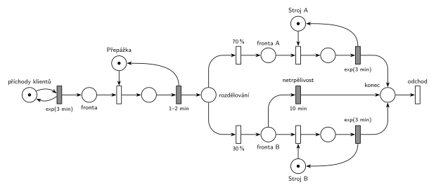

# 09-10 Kopírovací centrum

## Zadání

> Do kopírovacího centra přichází klienti v intervalech exponenciálně se středem 3 minuty. U přepážky registrují svůj požadavek, což zabere rovnoměrně 1–2 minuty. V centru jsou dva kopírovací stroje: stroj pro normální zakázky (A) a stroj pro speciální zakázky. 70% zakázek směřuje na stroj A. Klienti se speciální zakázkou jsou však netrpěliví, proto po přesně 10 minutách čekání ve frontě na stroj B opouští systém. Doba zpracování na obou strojích je exponenciálně se středem 3 minuty.

Podobné úlohy: [Kopírovací centrum s poruchami](<../11 - Kopírovací centrum s poruchami/11 - Kopírovací centrum s poruchami.md>) (2021/22), [Netrpělivé požadavky](<../../02 - Netrpělivost a omezená fronta/01 - Netrpělivé požadavky/01 - Netrpělivé požadavky.md>).

## Nápověda

<details>
<summary>Zobrazit nápovědu</summary>
<br>

- **Příchody:** místo *příchody klientů* ve smyčce s přechodem `exp(3 min)` vkládá klienty do *fronty*. Kratší varianta generátoru bez místa (jen přechod bez vstupu) je na slajdech také a u zkoušky projde.
- **Přepážka** je jedno zařízení (místo s 1 značkou). Registrace `1–2 min` je časovaný přechod, který značku přepážky vrací.
- **Uvolnění zařízení** je sloučené s časovaným přechodem obsluhy (hrana vede z časovaného přechodu zpět do místa zařízení), stejně jako na slajdu 164. Samostatný okamžitý přechod „Release“ by byl také správně, jen je to zbytečný prvek navíc.
- **70 % / 30 %:** z místa *rozdělování* vedou dva okamžité přechody s pravděpodobnostmi. Jsou to parametry přechodů, ne hran (slajd 135).
- **Stroje A a B** jsou zařízení, každé s vlastní frontou (*fronta A*, *fronta B*) a časovaným přechodem `exp(3 min)`, který značku stroje vrací.
- **Netrpělivost** je časovaný přechod `10 min` přímo na místě *fronta B*, vede rovnou do *konec*. Běžný časovaný přechod neomezuje počet současně čekajících (slajd 138), takže každý klient ve frontě má vlastní odpočet. Když klienta mezitím obsadí stroj B, jeho odpočet zanikne (značka z místa zmizí). Přesně to je „po 10 minutách čekání ve frontě opouští systém“.
- **Odchod:** obsloužení i netrpěliví klienti se sejdou v místě *konec* a opouštějí systém přechodem *odchod* bez výstupních hran.

</details>

## Petriho síť

<details>
<summary>Zobrazit Petriho síť</summary>
<br>



</details>

## Časté chyby

<details>
<summary>Zobrazit časté chyby</summary>
<br>

- Časovač netrpělivosti umístěný **až za obsazení stroje**. Pak omezuje délku obsluhy, ne čekání ve frontě.
- Netrpělivost i u stroje A; zadání ji má jen u speciálních zakázek.
- Chybějící hrana vracející značku stroji nebo přepážce. Zařízení se pak „ztratí“ a systém se zastaví.
- 70 %/30 % napsané na hranách místo na přechodech, nebo k pravděpodobnosti připsaná ještě priorita (slajd 135: přechod má jediný parametr).
- Chybějící výstupní přechod; zadání ho výslovně vyžaduje.

</details>

## SIMLIB

<details>
<summary>Zobrazit SIMLIB kód</summary>
<br>

Model je izomorfní k Petriho síti výše: každé místo, přechod a značka mají svůj protějšek v kódu.

```cpp
// Kopírovací centrum – model v SIMLIB/C++
#include "simlib.h"

Facility Prepazka("Přepážka");             // místo „Přepážka“ (1 značka)
Facility StrojA("Stroj A");                // místo „Stroj A“
Facility StrojB("Stroj B");                // místo „Stroj B“
long netrpelivych = 0;
Histogram Doba("Doba klienta v centru [min]", 0, 3, 15);

class Netrpelivost : public Event {        // časovaný přechod „10 min“ na místě „Fronta B“
  Process *klient;
 public:
  Netrpelivost(Process *k) : klient(k) { Activate(Time + 10); }
  void Behavior() {
    delete klient;                         // klient opustí frontu i systém (→ „konec“)
    netrpelivych++;
  }
};

class Klient : public Process {            // transakce
  void Behavior() {
    double prichod = Time;
    Seize(Prepazka);                       // Fronta + obsazení přepážky
    Wait(Uniform(1, 2));                   // registrace 1–2 min ...
    Release(Prepazka);                     // ... vrací značku přepážky
    if (Random() < 0.70) {                 // místo „rozdělování“: 70 % / 30 %
      Seize(StrojA);                       // Fronta A + obsazení stroje A
      Wait(Exponential(3));                // exp(3 min) vrací značku stroje A
      Release(StrojA);
    } else {
      Event *odpocet = new Netrpelivost(this);  // každý ve Frontě B má vlastní odpočet
      Seize(StrojB);                       // Fronta B + obsazení stroje B
      odpocet->Cancel();                   // značka opustila Frontu B: odpočet zaniká
      Wait(Exponential(3));
      Release(StrojB);
    }
    Doba(Time - prichod);
  }                                        // konec Behavior = „konec“ → přechod „odchod“
};

class Generator : public Event {           // „příchody klientů“ ve smyčce s exp(3 min)
  void Behavior() {
    (new Klient)->Activate();
    Activate(Time + Exponential(3));
  }
};

int main() {
  Init(0, 60 * 1000);                      // modelový čas v minutách: 1000 hodin
  (new Generator)->Activate();
  Run();
  Prepazka.Output();
  StrojA.Output();
  StrojB.Output();
  Doba.Output();
  Print("Netrpěliví klienti (odešli z Fronty B): %ld\n", netrpelivych);
}
```

| Petriho síť | SIMLIB |
|---|---|
| *příchody klientů* ⇄ `exp(3 min)` | událost `Generator`, která se znovu plánuje za `Exponential(3)` |
| značka (klient) | proces `Klient` |
| *fronta* + *Přepážka* (1 značka), `1–2 min` | `Seize(Prepazka); Wait(Uniform(1, 2)); Release(Prepazka);` |
| *rozdělování*, `70 %` / `30 %` | `if (Random() < 0.70)` |
| *fronta A* + *Stroj A*, `exp(3 min)` | `Seize(StrojA); Wait(Exponential(3)); Release(StrojA);` |
| *fronta B* + *Stroj B*, `exp(3 min)` | totéž se `StrojB` |
| `10 min` na *frontě B* (vlastní odpočet každého klienta) | událost `Netrpelivost(this)`; po obsazení stroje `Cancel()`, jinak `delete klient` |
| *konec* → *odchod* | konec metody `Behavior()` |

**Kontrola simulací.** Petriho síť (`make check`): značka každého zařízení se vždy vrátí (*Přepážka* + obsluhovaný = 1, totéž pro oba stroje), všechny přechody se provádějí, fronty nerostou do nekonečna. SIMLIB model (`make simlib`): za 1000 h byla přepážka vytížena na 50 %, stroj A na 70 % a stroj B na 29 %, netrpělivě odešlo 74 klientů z asi 6 000 se speciální zakázkou. Teorie: přepážka 1,5 min / 3 min = 50 %, stroj A 0,7 × 3 min / 3 min = 70 %, stroj B nejvýš 30 % (bez netrpělivých).

</details>

## Původ a zdroje

<details>
<summary>Zobrazit původ a zdroje</summary>
<br>

**Původ:** půlsemestrální písemka 2022/23, varianta A, 10 bodů.

**Původní znění:**

> Do kopírovacího centra přichází klienti v intervalech daných exponenciálním rozložením se středem 3 minuty. U přepážky registrují svůj požadavek, což zabere 1-2 minuty rovnoměrně. V centru jsou dva kopírovací stroje: stroj pro normální zakázky (A) a stroj pro speciální zakázky. 70% zakázek směřuje na stroj A. Klienti se speciální zakázkou jsou však netrpěliví, proto po 10 minutách čekání ve frontě na stroj B opouští systém. Doba zpracování na obou strojích se řídí exponenciálním rozložením se středem 3 minuty.
>
> **V modelu jednoznačně ukažte (přechodem) moment, kdy transakce opouští systém.**

**Zdroje:**

- `Fitcheats/Půlsemestrálky/Zadání z minulých let/2022-23.pdf`, str. 1 (fotka zadání)
- `Fitcheats/Půlsemestrálky/Zadání z minulých let/2024-25 - Varianta A (fotky).pdf`, str. 1–2 (zadání a řešení kreslené na cvičení)
- `Fitcheats/Půlsemestrálky/Hrubý - Řešení 2022-23.pdf`, str. 1 (řešení od Hrubého)

**Existující řešení:**

- **Hrubý (str. 1):** stejná struktura (k přepážce si připsal „jedno zařízení“): *fronta* → přepážka → *fronta – rozdělování* → 70 %/30 % → *fronta A* / *fronta B* → stroj → *konec* → výstupní přechod. Netrpělivost kreslí také jako časovaný přechod `10min` z *fronta B* do *konec*. Jediný rozdíl: generátor kreslí bez místa.
- **Řešení ze cvičení (fotky 2024/25, str. 2):** totéž, jen každá větev končí vlastním výstupním přechodem. Obojí je správně; zadání chce jen, aby byl odchod jednoznačně vidět.

</details>

## Reference

- [Jak síť funguje](<../../../basics/Jak síť funguje.md>)
- [Notace a vzory](<../../../basics/Notace a vzory.md>)

<!-- -->

- [Studijní plán](<../../Studijní plán.md>)
- [Seznam úloh](<../../Seznam úloh.md>)
