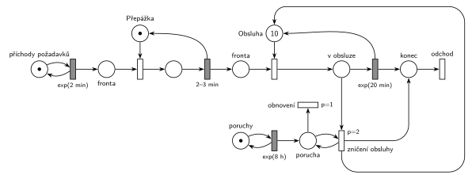

# Kopírovací centrum s poruchami

Úloha 09/11

## Zadání

> Do kopírovacího centra přichází požadavky v intervalech exponenciálně se středem 2 minuty. Požadavky jsou nejprve registrovány u přepážky, což zabere rovnoměrně 2–3 minuty. Pak čekají ve frontě na obsluhu. Kapacita obsluhy je 10 požadavků. Doba obsluhy je exponenciálně se středem 20 minut. V intervalech exponenciálně se středem 8 hodin dochází v centru k poruše, která nenávratně zničí všechny rozpracované obsluhy, které systém okamžitě opouští. Po zničení všech rozpracovaných obsluh systém normálně pokračuje v práci.

Podobné úlohy: [Kopírovací centrum](<../10 - Kopírovací centrum/10 - Kopírovací centrum.md>) (2022/23), [Porucha zruší obsluhu](<../../03 - Poruchy/01 - Porucha zruší obsluhu/01 - Porucha zruší obsluhu.md>), [Kritická havárie](<../../03 - Poruchy/05 - Kritická havárie/05 - Kritická havárie.md>), [Psí salon](<../03 - Psí salon/03 - Psí salon.md>).

## Nápověda

<details>
<summary>Zobrazit nápovědu</summary>
<br>

- **Příchody:** místo *příchody požadavků* ve smyčce s přechodem `exp(2 min)` vkládá požadavky do *fronty* před přepážkou.
- **Přepážka** je jedno zařízení, registrace trvá `2–3 min` rovnoměrně a vrací značku přepážky. Pak požadavek čeká v druhé *frontě*, na obsluhu.
- **Obsluha s kapacitou 10** je sklad: místo s 10 značkami. Časovaný přechod `exp(20 min)` má pro každou obsluhovanou zakázku vlastní odpočet (slajd 138), takže běží až 10 obsluh současně. Po dokončení vrací jednotku kapacity a zakázka jde do *konec*.
- **Porucha:** místo *poruchy* ve smyčce s `exp(8 h)` vloží značku do místa *porucha*. Smyčka *zničení obsluhy* (`p=2`) pak bere rozpracované obsluhy po jedné, „dokud je co ničit“. Každé zničení vrací jednotku kapacity *Obsluze* (dlouhá hrana kolem sítě) a posílá zakázku do *zničená*. Odebrání značky z *v obsluze* zruší její odpočet `exp(20 min)` (slajd 139).
- **Obnovení** (`p=1`) přijde na řadu, až když už není co ničit (priorita), a odebere značku *porucha*. Bez něj by značka zůstala a *zničení obsluhy* by zničilo i každou další obsluhu.
- **Pořadí priorit** ničení `p=2` > obnovení `p=1` > obsazení obsluhy p=0 zajistí, že během ničení nezačne nová obsluha. Kdyby mělo obnovení p=0, soupeřilo by s obsazením a nově zahájenou obsluhu by ničení hned zrušilo. Místo „systém je OK“ testované při obsazení (jako u Hrubého) tak není potřeba.
- Porucha, která přijde, když nic neběží, projde rovnou *obnovením* bez účinku. Poruchy se tedy nehromadí.
- Porucha ničí jen rozpracované obsluhy. Zakázky ve frontách a na přepážce zůstávají.
- **Odchod:** dokončené zakázky opouštějí systém přes *konec* a přechod *odchod*, zničené přes *zničená* a *odchod bez obsluhy*. Oddělené výstupy rozliší obsloužené a neobsloužené požadavky (např. pro statistiku, kolik zakázek poruchy zničily).
- **Přetížení:** registrace trvá v průměru 2,5 min, požadavky chodí po 2 min, takže fronta k přepážce roste do nekonečna. To je vlastnost zadání, ne chyba sítě. Obsluha (10 × 20 min) je pak vytížená asi na 80 %.

</details>

## Petriho síť

<details>
<summary>Zobrazit Petriho síť</summary>
<br>



</details>

## Časté chyby

<details>
<summary>Zobrazit časté chyby</summary>
<br>

- Porucha, která zničí jen jednu obsluhu (chybí smyčka), nebo hrana s váhou 10 (provede se, jen když běží přesně 10 obsluh).
- Zničení bez vrácení kapacity *Obsluze*: kapacita se s každou poruchou zmenší.
- Ničení bez nejvyšší priority: *obnovení* (nebo nová obsluha) se může provést dřív, než se zničí všechny rozpracované obsluhy.
- Chybějící *obnovení*: značka poruchy v síti zůstane a ničí i obsluhy zahájené po poruše.
- Obnovení se stejnou prioritou jako obsazení obsluhy (p=0): nová obsluha může začít ještě před obnovením a ničení ji hned zruší.
- Zničené zakázky ve stejném výstupu jako dokončené: obsloužené a neobsloužené požadavky pak nejdou rozlišit.
- Ničení i zakázek ve frontě; zadání mluví jen o rozpracovaných obsluhách.
- Obsluha modelovaná jako jedno zařízení (1 značka), nebo zakázka, která obsadí všech 10 jednotek najednou.

</details>

## SIMLIB

<details>
<summary>Zobrazit SIMLIB kód</summary>
<br>

Model je izomorfní k Petriho síti výše: každé místo, přechod a značka mají svůj protějšek v kódu.

```cpp
// Kopírovací centrum s poruchami – model v SIMLIB/C++
#include "simlib.h"
#include <set>

Facility Prepazka("Přepážka");             // místo „Přepážka“ (1 značka)
Store Obsluha("Obsluha", 10);              // místo „Obsluha“ (10 značek)
long zniceno = 0, dokonceno = 0, poruch = 0;

class Pozadavek;
std::set<Pozadavek *> vObsluze;            // místo „v obsluze“ (rozpracované obsluhy)

class Pozadavek : public Process {         // transakce
  void Behavior() {
    Seize(Prepazka);                       // Fronta + obsazení přepážky
    Wait(Uniform(2, 3));                   // registrace 2–3 min
    Release(Prepazka);
    Enter(Obsluha, 1);                     // Fronta + obsazení jednotky obsluhy
                                           // (událost poruchy je atomická,
                                           //  během ničení nikdo nezačne)
    vObsluze.insert(this);
    Wait(Exponential(20));                 // exp(20 min) – každý má vlastní odpočet
    vObsluze.erase(this);
    Leave(Obsluha, 1);                     // vrací jednotku obsluhy
    dokonceno++;
  }                                        // „konec“ → přechod „odchod“
};

class Porucha : public Event {             // „poruchy“ ve smyčce s exp(8 h)
  void Behavior() {
    poruch++;
    while (!vObsluze.empty()) {            // smyčka „zničení obsluhy“ (p=2), dokud je co ničit
      Pozadavek *p = *vObsluze.begin();
      vObsluze.erase(p);
      delete p;                            // odpočet exp(20 min) zaniká, zakázka odchází
                                           // přes „zničená“ → „odchod bez obsluhy“
      Obsluha.Leave(1);                    // jednotka kapacity zpět do „Obsluha“
      zniceno++;
    }                                      // „obnovení“ (p=1) odebere značku „porucha“
    Activate(Time + Exponential(8 * 60));
  }
};

class Generator : public Event {           // „příchody požadavků“ ve smyčce s exp(2 min)
  void Behavior() {
    (new Pozadavek)->Activate();
    Activate(Time + Exponential(2));
  }
};

int main() {
  Init(0, 60 * 24 * 100);                  // modelový čas v minutách: 100 dní
  (new Generator)->Activate();
  (new Porucha)->Activate(Exponential(8 * 60));
  Run();
  Prepazka.Output();
  Obsluha.Output();
  Print("Poruch: %ld, zničených obsluh: %ld (%.1f na poruchu), dokončených: %ld\n",
        poruch, zniceno, poruch ? double(zniceno) / poruch : 0.0, dokonceno);
}
```

| Petriho síť | SIMLIB |
|---|---|
| *příchody požadavků* ⇄ `exp(2 min)` | událost `Generator`, která se znovu plánuje za `Exponential(2)` |
| značka (požadavek) | proces `Pozadavek` |
| *fronta* + *Přepážka* (1 značka), `2–3 min` | `Seize(Prepazka); Wait(Uniform(2, 3)); Release(Prepazka);` |
| *fronta* + *Obsluha* (10 značek) | `Enter(Obsluha, 1)`, `Store Obsluha("Obsluha", 10)` |
| *v obsluze* | `std::set<Pozadavek *> vObsluze` |
| `exp(20 min)` se sloučeným uvolněním | `Wait(Exponential(20)); … Leave(Obsluha, 1);` |
| *poruchy* ⇄ `exp(8 h)` | událost `Porucha`, plánuje se za `Exponential(8 * 60)` |
| *porucha*, *obnovení* (`p=1`) | začátek a konec metody `Behavior()` události `Porucha` (je atomická, takže priority není potřeba psát) |
| smyčka *zničení obsluhy* (`p=2`) | `while (!vObsluze.empty())`: `delete p; Obsluha.Leave(1);` |
| *konec* → *odchod* | konec metody `Behavior()`, čítač `dokonceno` |
| *zničená* → *odchod bez obsluhy* | `delete p`, čítač `zniceno` |

**Kontrola simulací.** Petriho síť (`make check`): *Přepážka* + registrace = 1, *Obsluha* + *v obsluze* = 10, v místě *porucha* je nejvýš 1 značka. Porucha přichází zhruba po 8 h a zničí v průměru asi 7 obsluh. Fronta k přepážce podle očekávání roste. SIMLIB model (`make simlib`): za 100 dní přišlo 285 poruch, zničily 2 201 obsluh (7,7 na poruchu), obsluha měla v průměru obsazeno 7,7 z 10 jednotek a přepážka byla vytížená na 100 %, fronta před ní narostla na 14 000 požadavků. Teorie: přepážka propustí 1/2,5 = 0,4 požadavku za minutu, obsluha je tedy vytížená nejvýš 0,4 × 20 = 8 jednotek; zničené obsluhy končí dřív, proto vychází o něco méně. Poruchy přicházejí nezávisle na stavu centra (Poissonův proces), takže zastihnou v průměru tolik rozpracovaných obsluh, kolik je jich obsazeno v průměru času: 7,7.

</details>

## Původ a zdroje

<details>
<summary>Zobrazit původ a zdroje</summary>
<br>

**Původ:** půlsemestrální písemka 2021/22, varianta D, 10 bodů.

**Původní znění:**

> Do kopírovacího centra přichází požadavky v intervalech daných exponenciálním rozložením se středem 2 minuty. Požadavky jsou nejprve registrovány u přepážky, což zabere 2-3 minuty rovnoměrně. Pak čekají ve frontě na obsluhu. Kapacita obsluhy je 10 požadavků. Doba obsluhy je exponenciálně 20 minut. V intervalech 8 hodin exponenciálně dochází v centru k poruše, která nenávratně zničí všechny rozpracované obsluhy, které systém okamžitě opouští. Po zničení všech rozpracovaných obsluh systém normálně pokračuje v práci.
>
> *Zadaný systém modelujte formou Petriho sítě s vyznačením všech potřebných parametrů.*

**Zdroje:**

- `Fitcheats/Půlsemestrálky/Zadání z minulých let/2021-22.pdf`, str. 4 (zadání)
- `Fitcheats/Půlsemestrálky/Hrubý - Řešení 2021-22.pdf`, str. 4 (řešení od Hrubého)

**Existující řešení:**

- **Hrubý (str. 4):** stejná struktura. `exp(2min)` → „Fronta“ → „Přepážka“ → `2-3min` → „Fronta“ → obsazení místa s 10 značkami (s testem „SYSTÉM JE OK“) → `exp(20min)` → uvolnění. Porucha: `exp(8h)` → „Vznik poruchy“ → `p=1` „vyprázdni systém“ → místo → smyčka `p=1` „Ničení transakcí v obsluze“ (červeně „dokud je co ničit“) → přechod „Obnovení“ zpět do „SYSTÉM JE OK“. Místo „SYSTÉM JE OK“ kreslí, i když by se při vhodných prioritách obešel bez něj (viz rozdíl níže). Dlouhá hrana ze smyčky zpět ke kapacitě obsluhy má červený popisek „release“. Generátory jsou bez míst.
  - Rozdíl: dokončené i zničené zakázky u Hrubého zanikají v přechodech, výstupní přechod se tehdy nevyžadoval. Síť výše je odvádí dvěma výstupy, zvlášť obsloužené a zničené.
  - Rozdíl: síť výše vynechává místo „SYSTÉM JE OK“ i přechod „vyprázdni systém“. Ničení má `p=2` a obnovení `p=1`, takže během ničení nová obsluha nezačne ani bez testu.

</details>

## Reference

- [Jak síť funguje](<../../../basics/Jak síť funguje.md>)
- [Notace a vzory](<../../../basics/Notace a vzory.md>)

<!-- -->

- [Studijní plán](<../../Studijní plán.md>)
- [Seznam úloh](<../../Seznam úloh.md>)
