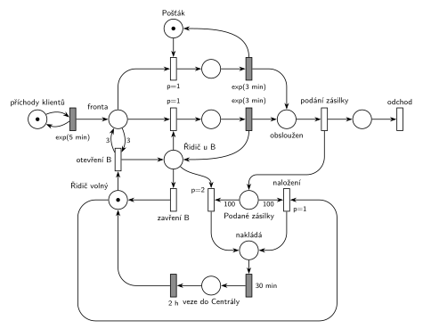

# Pošta

## Zadání

> Do pobočky pošty přichází klienti podat zásilku v intervalech exponenciálně se středem 5 minut. Pobočka má dvě podací přepážky (A a B) a dva zaměstnance (pošťáka a řidiče). Pošťák obsluhuje přepážku A. Řidič je primárně určen pro náklad a odvážení podaných zásilek do Centrály. Doba obsluhy jednoho klienta je exponenciálně se středem 3 minuty. Po překročení počtu 100 podaných zásilek řidič zásilky naloží do auta (trvá přesně 30 minut) a veze je do Centrály. Vrací se přesně po dvou hodinách. Pokud fronta k přepážkám dosáhne délky 3 klienti, pak řidič otevře přepážku B a obsluhuje ji, dokud se fronta nevyprázdní (tj. přepážku opustí po vyprázdnění fronty k přepážkám nebo když se naplní kapacita 100 pro odvoz podaných zásilek).

Podobné úlohy: [Cestovní kancelář](<../08 - Cestovní kancelář/08 - Cestovní kancelář.md>), [Úřad s dodatečnými přepážkami](<../15 - Úřad s dodatečnými přepážkami/15 - Úřad s dodatečnými přepážkami.md>), [Dočasně MM2 při dlouhé frontě](<../../05 - Délka fronty a kapacita/02 - Dočasně MM2 při dlouhé frontě/02 - Dočasně MM2 při dlouhé frontě.md>).

## Interpretace

<details>
<summary>Zobrazit interpretaci (nápověda)</summary>
<br>

- **Příchody:** místo *příchody klientů* ve smyčce s přechodem `exp(5 min)` vkládá klienty do *fronty*.
- **Jedna fronta** k oběma přepážkám („fronta k přepážkám“). Přepážka A (horní řada) je zařízení *Pošťák*. Přepážka B (prostřední řada) je zařízení *Řidič u B*, jehož značka existuje, jen když řidič u B sedí. Obsazení obou přepážek má `p=1` a obsluha `exp(3 min)` vrací značku zařízení.
- Klienti mezi přepážkami nevolí: když jsou obě volné, vezme klienta kterákoli.
- **Zásilky:** po obsluze klient odchází a jeho zásilka zůstává na poště. Přechod *podání zásilky* rozdělí transakci na klienta (→ *odchod*) a značku v *Podaných zásilkách*. Zásilka vznikne až dokončením obsluhy.
- **Řidič má tři stavy:** *Řidič volný*, *Řidič u B* a odvoz (*nakládá* `30 min` → *veze do Centrály* `2 h` → zpět *Řidič volný*). „Vrací se po dvou hodinách“ beru jako 2 h od odjezdu po naložení.
- **Otevření B:** volný řidič + test *fronty* hranami s váhou 3 tam i zpět („dosáhne délky 3“ = aspoň 3 čekající).
- **Zavření B:** přechod *zavření B* (`p=0`) vrací řidiče do *Řidič volný*. Obsazení B má `p=1`, takže zavření se provede, jen když ve *frontě* nikdo není („po vyprázdnění fronty“). Prázdnou frontu tedy pozná priorita, žádný čítač fronty není potřeba.
- **„Po překročení počtu 100“ vs. „naplní se kapacita 100“:** obojí čtu jako „jakmile je podaných zásilek 100“. Naloží se právě 100 zásilek (hrana s váhou 100), případné další zůstanou na příští odvoz. Kdyby se trvalo na doslovném „překročení“, byla by váha 101, ale auto má kapacitu 100.
- **Odvoz má přednost** („primárně určen pro náklad“): naložení z volného stavu má `p=1` a vyhraje nad otevřením B (`p=0`). Naložení od přepážky B má `p=2` a vyhraje nad obsazením B dalším klientem (`p=1`). Rozpracovaného klienta řidič doobslouží, zadání přerušení nezmiňuje.

</details>

## Petriho síť

<details>
<summary>Zobrazit Petriho síť</summary>
<br>



</details>

## Časté chyby

<details>
<summary>Zobrazit časté chyby</summary>
<br>

- Řidič jako druhá stálá linka (MM2). Přepážka B je otevřená jen od fronty 3 do vyprázdnění fronty.
- Odvoz bez přednosti: řidič by u B obsluhoval dál, i když je 100 zásilek připraveno.
- Čítač zásilek plněný při příchodu klienta (ne až po obsluze), nebo jen z přepážky A.
- Test fronty jen vstupní hranou s váhou 3 bez hrany zpět: tři klienti zmizí.
- Zavření B bez nižší priority než obsazení B: řidič by mohl odejít, i když ve frontě někdo čeká.
- Řidič, který se po odvozu nevrátí (chybí hrana z `2 h` zpět do *Řidič volný*).

</details>

## SIMLIB

<details>
<summary>Zobrazit SIMLIB kód</summary>
<br>

Model je izomorfní k Petriho síti výše: každé místo, přechod a značka mají svůj protějšek v kódu.

```cpp
// Pošta – model v SIMLIB/C++
#include "simlib.h"

Queue Fronta("Fronta");                    // místo „Fronta“ (jedna fronta k oběma přepážkám)
Facility PrepazkaA("Přepážka A (pošťák)"); // obsazení pošťáka (jen pro statistiku vytížení)
Facility PrepazkaB("Přepážka B (řidič)");  // obsazení řidiče u B (jen pro statistiku)
int zasilky = 0;                           // místo „Podané zásilky“
long odvozu = 0, otevreniB = 0, obslouzenoB = 0, klientu = 0;

class Klient : public Process {            // transakce
  void Behavior();
};

class Postak : public Process {            // místo „Pošťák“ (1 značka) a jeho obsluha
 public:
  bool volny = true;
  void Behavior() {
    for (;;) {
      while (Fronta.Empty()) {             // značka v „Pošťák“, nikdo nečeká
        volny = true;
        Passivate();
      }
      volny = false;
      Process *k = (Process *)Fronta.GetFirst();  // obsazení A (p=1)
      Seize(PrepazkaA);
      Wait(Exponential(3));                // exp(3 min) vrací pošťáka
      Release(PrepazkaA);
      k->Activate();                       // klient → „obsloužen“
    }
  }
};

class Ridic : public Process {             // řidič: „Řidič volný“ / „Řidič u B“ / odvoz
 public:
  bool volny = true;                       // značka v „Řidič volný“
  void Odvoz() {                           // naložení (bere 100 zásilek)
    volny = false;
    zasilky -= 100;
    odvozu++;
    Wait(30);                              // „nakládá“ 30 min
    Wait(2 * 60);                          // „veze do Centrály“ 2 h → zpět „Řidič volný“
  }
  void Behavior() {
    for (;;) {
      while (zasilky < 100 && Fronta.Length() < 3) {
        volny = true;
        Passivate();                       // čeká ve „Řidič volný“
      }
      volny = false;
      if (zasilky >= 100) {                // naložení p=1 má přednost před otevřením B
        Odvoz();
        continue;
      }
      otevreniB++;                         // otevření B: test Fronty vahou 3 → „Řidič u B“
      for (;;) {                           // značka v „Řidič u B“
        if (zasilky >= 100) {              // naložení od B (p=2)
          Odvoz();
          break;
        }
        if (Fronta.Empty())                // zavření B (p=0): fronta je prázdná
          break;
        Process *k = (Process *)Fronta.GetFirst();  // obsazení B (p=1)
        Seize(PrepazkaB);
        Wait(Exponential(3));              // exp(3 min) vrací značku „Řidič u B“
        Release(PrepazkaB);
        obslouzenoB++;
        k->Activate();
      }
    }
  }
};

Postak *postak;
Ridic *ridic;

void Klient::Behavior() {
  klientu++;
  Into(Fronta);                            // značka v místě „Fronta“
  if (postak->volny)
    postak->Activate();                    // pošťák je volný: obsadí ho hned
  else if (ridic->volny && Fronta.Length() >= 3)
    ridic->Activate();                     // fronta dosáhla 3: řidič otevře B
  Passivate();                             // čeká ve frontě a během obsluhy
  zasilky++;                               // „podání zásilky“: zásilka zůstává na poště
  if (ridic->volny && zasilky >= 100)
    ridic->Activate();
}                                          // konec Behavior = klient „odchod“

class Generator : public Event {           // „příchody klientů“ ve smyčce s exp(5 min)
  void Behavior() {
    (new Klient)->Activate();
    Activate(Time + Exponential(5));
  }
};

int main() {
  Init(0, 60 * 24 * 365);                  // modelový čas v minutách: 1 rok nepřetržitého provozu
  postak = new Postak;
  ridic = new Ridic;
  postak->Activate();
  ridic->Activate();
  (new Generator)->Activate();
  Run();
  Fronta.Output();
  PrepazkaA.Output();
  PrepazkaB.Output();
  Print("Klientů: %ld, obslouženo u B: %ld (%.1f %%), otevření B: %ld, odvozů: %ld (každých %.1f h)\n",
        klientu, obslouzenoB, 100.0 * obslouzenoB / klientu, otevreniB, odvozu,
        Time / 60 / odvozu);
}
```

| Petriho síť | SIMLIB |
|---|---|
| *příchody klientů* ⇄ `exp(5 min)` | událost `Generator`, která se znovu plánuje za `Exponential(5)` |
| značka (klient) v *frontě* | proces `Klient`: `Into(Fronta); Passivate();` |
| *Pošťák* (1 značka), obsazení A `p=1`, `exp(3 min)` | proces `Postak`: `Fronta.GetFirst()`, `Wait(Exponential(3))`, `k->Activate()` |
| *Řidič volný* / *Řidič u B* / *nakládá*, *veze do Centrály* | proces `Ridic`: `Passivate()` ve volném stavu, vnitřní cyklus u B, metoda `Odvoz()` |
| *otevření B* (test *fronty* vahou 3) | `Fronta.Length() >= 3` (klient budí volného řidiče) |
| obsazení B `p=1` / *zavření B* `p=0` | `if (Fronta.Empty()) break;` jinak obsluha dalšího klienta |
| *naložení* `p=1` / od B `p=2` (100 zásilek) | `if (zasilky >= 100) Odvoz();` testované před otevřením i před další obsluhou u B |
| *Podané zásilky* | `int zasilky` |
| *podání zásilky* → *odchod* | `zasilky++` a konec metody `Behavior()` klienta |

**Kontrola simulací.** Petriho síť (`make check`): *Pošťák* + obsluha A = 1, řidič je vždy právě v jednom stavu (volný, u B, obsluhuje u B, nakládá, veze). Odvoz probíhá asi každých 8,5 hodiny, asi pětina naložení začíná od přepážky B. Přepážka B se otevírá zhruba jednou za dvě hodiny a obslouží asi 10 % klientů. Fronta zůstává krátká (nejvýš asi 14 klientů). SIMLIB model (`make simlib`): za rok přišlo 104 874 klientů, přepážka B se otevřela 3 875× (jednou za 2,3 h) a obsloužila 9,8 % klientů, odvozů bylo 1 048 (jednou za 8,4 h), nejdelší fronta 18 klientů. Teorie: 100 zásilek vznikne za 100 × 5 min = 8,3 h; pošťák je vytížený na 54 % (90 % klientů × 3 min / 5 min).

</details>

## Původ a zdroje

<details>
<summary>Zobrazit původ a zdroje</summary>
<br>

**Původ:** půlsemestrálky 2014–19 (přehled zadání), úloha Z19. Rok, varianta ani body nejsou známé.

**Původní znění:**

> Do pobočky pošty přichází klienti podat zásilku v intervalech daných exp. rozložením se středem 5 minut. Pobočka má dvě podací přepážky (A a B) a dva zaměstnance (pošťáka a řidiče). Pošťák obsluhuje přepážku A. Řidič je primárně určen pro náklad a odvážení podaných zásilek do Centrály. Doba obsluhy jednoho klienta se řídí exp(3min). Po překročení počtu 100 podaných zásilek řidič zásilky naloží do auta (trvá 30 minut) a veze je do Centrály. Vrací se po dvou hodinách. Pokud fronta k přepážkám dosáhne délky 3 klienti, pak řidič otevře přepážku B a obsluhuje ji, dokud se fronta nevyprázdní (tj. přepážku opustí po vyprázdnění fronty k přepážkám nebo když se naplní kapacita 100 pro odvoz podaných zásilek).
>
> *Zadaný systém modelujte formou Petriho sítě s vyznačením všech potřebných parametrů.*

**Zdroje:**

- `Fitcheats/Půlsemestrálky/Zadání z minulých let/Přehled zadání 2014-19.pdf`, str. 5 (zadání)
- `Fitcheats/Půlsemestrálky/FIT - Příprava 2021-22.pdf`, str. 21 (studentské řešení, bez hlasů)

**Existující řešení:**

- **Studentské řešení (Příprava 2021/22, str. 21, bez hlasů):** pozor, používá obrácenou konvenci: šrafovaný obdélník je okamžitý přechod a prázdný časovaný (u Hrubého je to naopak). Pošťák a řidič jsou místa se značkou, řidič se po každé obsluze u B vrací do svého místa. Otevření B (`P=2`) testuje frontu vahou 3 a bere značku z řídicího místa. Vzniká tak značka „B otevřena“, kterou obsazení B testuje. Odvoz: *zásilky* vahou 100 + řidič, `P=3` → `30m` → `2h` → zpět řidič. Rozdíly a slabiny:
  - Délku fronty počítá zvláštním čítačem (každý příchod přidá značku, každé obsazení ji odebere) a zavření B řeší smyčkou přechodů s `P=1` vlevo dole. Je to zbytečně složité, prázdnou frontu pozná priorita. Kresba je navíc nepřehledná: z místa za oběma obsluhami vedou hrany k výstupnímu přechodu i do této smyčky, takže by si o značku konkurovaly.
  - Odvoz nebere značku „B otevřena“. Po návratu z Centrály tak řidič může dál obsluhovat B, i když fronta mezitím klesla pod 3. Zadání říká, že při naplnění 100 zásilek přepážku opouští.

</details>
