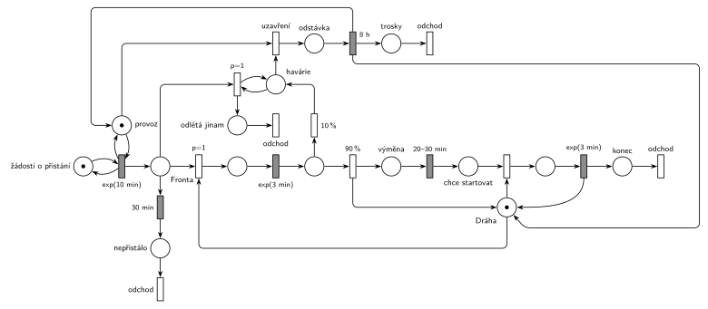

# 09-13 Letiště

## Zadání

> Letiště má k dispozici jednu dráhu, která slouží pro starty a přistání letadel. V intervalech exponenciálně se středem 10 minut požádá o přistání nové letadlo. Přistávající letadla mají prioritu v přístupu na dráhu před startujícími letadly. Pokud letadlo nezíská dráhu pro přistání do 30 minut od žádosti, pak systém opouští. Letadlo po přistání vymění cestující (rovnoměrně 20–30 minut) a žádá o dráhu pro start. V 10% případů přistávající letadlo havaruje, což způsobí odstávku dráhy na přesně 8 hodin. V případě odstávky dráhy všechna letadla čekající na přistání odletí a v průběhu odstávky nová k letišti nepřilétají. Doba přistání i startu je exponenciálně se středem 3 minuty.

Podobné úlohy: [Psí salon](<../03 - Psí salon/03 - Psí salon.md>) (vyprázdnění fronty a zastavení příchodů), [Netrpělivé požadavky](<../../02 - Netrpělivost a omezená fronta/01 - Netrpělivé požadavky/01 - Netrpělivé požadavky.md>), [Dva proudy příchodů](<../../07 - Priority/04 - Dva proudy příchodů/04 - Dva proudy příchodů.md>).

## Nápověda

<details>
<summary>Zobrazit nápovědu</summary>
<br>

- **Žádosti o přistání:** místo *žádosti o přistání* ve smyčce s `exp(10 min)` vkládá letadla do *fronty*. Celý let jde v hlavní řadě zleva doprava: přistání, výměna cestujících, start, odchod.
- **Dráha** (místo pod hlavní řadou) je zařízení s jednou značkou. Přistání ji obsazuje s `p=1`, start s `p=0`: když se dráha uvolní a čekají oba druhy letadel, dostane ji přistávající. Přistání i start trvají `exp(3 min)`; start dráhu vrací.
- **30 min na přistání:** časovaný přechod `30 min` přímo na *frontě*; každé letadlo má vlastní odpočet (slajd 138) a zaniká, když letadlo dostane dráhu. Letadlo, kterému odpočet vyprší, odchází přes *nepřistálo*.
- **Havárie** se rozhoduje po přistání `exp(3 min)`: 90 % uvolní dráhu a jde na *výměnu* cestujících (`20–30 min`), pak *chce startovat*; 10 % havaruje. Havárie dráhu nevrací, značka zůstane v místě *havárie*, takže dráha je odstavená.
- **Čekající odlétají:** smyčka `p=1` na *havárii* vyprázdní *frontu* (→ *odlétá jinam* → *odchod*). Teprve potom (`p=0`) *uzavření* odstartuje *odstávku* `8 h`.
- **Nová letadla nepřilétají:** generátor má test na místo *provoz* (smyčka do časovaného přechodu). Uzavření mu značku vezme, odpočet příchodu zanikne a po 8 h se *provoz* vrátí. Stejně dobře lze vzít značku přímo generátoru.
- **Konec odstávky:** `8 h` vrací *provoz* i *Dráhu*. Dráha má tak pět hran (dvě obsazení, tři návraty), a proto do ní hrana od odstávky vstupuje šikmo.
- **Havarované letadlo:** zadání neříká, co s ním. Tady zůstane na dráze jako *odstávka* a po 8 h odchází ze systému jako *trosky*.
- Letadla, která už přistála, během odstávky normálně vymění cestující a čekají na start.
- 10 % havárií je hodně: letiště je v simulaci asi 80 % času zavřené. To plyne přímo ze zadaných čísel.

</details>

## Petriho síť

<details>
<summary>Zobrazit Petriho síť</summary>
<br>



</details>

## Časté chyby

<details>
<summary>Zobrazit časté chyby</summary>
<br>

- Havárie, která vrátí dráhu (pak žádná odstávka není), nebo odstávka, která dráhu vezme podruhé, i když ji havarované letadlo už drží.
- Zastavení příchodů odebráním značky z *fronty* místo z generátoru (nebo z místa, které generátor testuje).
- Vyprázdnění fronty jedním přechodem s váhou hrany; „všechna letadla“ potřebují smyčku s prioritou.
- Netrpělivost i u letadel čekajících na start; zadání ji má jen pro přistání.
- Start se stejnou prioritou jako přistání.

</details>

## SIMLIB

<details>
<summary>Zobrazit SIMLIB kód</summary>
<br>

Model je izomorfní k Petriho síti výše: každé místo, přechod a značka mají svůj protějšek v kódu.

```cpp
// Letiště – model v SIMLIB/C++
#include "simlib.h"
#include <set>

Facility Draha("Dráha");                   // místo „Dráha“ (1 značka)
long havarii = 0, netrpelivych = 0, odletloJinam = 0, odstartovalo = 0;
double zavreno = 0;                        // součet dob odstávek

class Letadlo;
std::set<Letadlo *> cekajiNaPristani;      // značky v místě „Fronta“

class Netrpelivost : public Event {        // časovaný přechod „30 min“ na „Frontě“
  Letadlo *letadlo;
 public:
  Netrpelivost(Letadlo *l) : letadlo(l) { Activate(Time + 30); }
  void Behavior();
};

class Generator : public Event {           // „žádosti o přistání“ ve smyčce s exp(10 min)
  void Behavior();
};
Generator *generator;                      // jeho značku testuje „provoz“

class Letadlo : public Process {           // transakce
 public:
  Event *odpocet = nullptr;
  void Behavior() {
    cekajiNaPristani.insert(this);
    odpocet = new Netrpelivost(this);      // každé letadlo má vlastní odpočet 30 min
    Priority = 1;                          // přistání obsazuje dráhu s p=1
    Seize(Draha);
    cekajiNaPristani.erase(this);
    odpocet->Cancel();                     // dostalo dráhu: odpočet zaniká
    Wait(Exponential(3));                  // přistání exp(3 min)
    if (Random() < 0.10) {                 // 10 %: havárie, dráha zůstane obsazená
      Havarie();
      return;                              // trosky → „odchod“
    }
    Release(Draha);                        // 90 %: vrací dráhu
    Wait(Uniform(20, 30));                 // „výměna“ 20–30 min
    Priority = 0;                          // start obsazuje dráhu s p=0
    Seize(Draha);                          // „chce startovat“ + obsazení
    Wait(Exponential(3));                  // start exp(3 min) ...
    Release(Draha);                        // ... vrací dráhu
    odstartovalo++;
  }                                        // „konec“ → přechod „odchod“
  void Havarie() {
    havarii++;
    while (!cekajiNaPristani.empty()) {    // smyčka p=1: čekající odlétají jinam
      Letadlo *l = *cekajiNaPristani.begin();
      cekajiNaPristani.erase(l);
      l->odpocet->Cancel();
      delete l;                            // „odlétá jinam“ → „odchod“
      odletloJinam++;
    }
    generator->Passivate();                // „uzavření“ vezme „provoz“: odpočet příchodu zaniká
    Wait(8 * 60);                          // „odstávka“ 8 h
    zavreno += 8 * 60;
    generator->Activate(Time + Exponential(10));  // „provoz“ zpět, nový odpočet příchodu
    Release(Draha);                        // dráha zpět
  }
};

void Netrpelivost::Behavior() {
  cekajiNaPristani.erase(letadlo);
  delete letadlo;                          // bez dráhy do 30 min: odlétá
  netrpelivych++;
}

void Generator::Behavior() {
  (new Letadlo)->Activate();
  Activate(Time + Exponential(10));
}

int main() {
  Init(0, 60 * 24 * 365);                  // modelový čas v minutách: 1 rok
  generator = new Generator;
  generator->Activate();
  Run();
  Draha.Output();
  Print("Havárií: %ld, odstartovalo: %ld, netrpělivých: %ld, odletělo jinam: %ld\n",
        havarii, odstartovalo, netrpelivych, odletloJinam);
  Print("Letiště zavřené %.0f %% času\n", 100 * zavreno / Time);
}
```

| Petriho síť | SIMLIB |
|---|---|
| *žádosti o přistání* ⇄ `exp(10 min)` s testem *provoz* | událost `Generator`; uzavření `generator->Passivate()`, po odstávce `Activate(Time + Exponential(10))` |
| značka (letadlo) | proces `Letadlo` |
| *fronta* | `Seize(Draha)` s `Priority = 1` a množina `cekajiNaPristani` (pro vyprázdnění) |
| `30 min` na *frontě* → *nepřistálo* | událost `Netrpelivost(this)`; po obsazení dráhy `Cancel()`, jinak `delete letadlo` |
| *Dráha* (1 značka), přistání `p=1`, start `p=0` | `Facility Draha`, priorita procesu `Priority = 1` / `0` (pořadí ve frontě) |
| `exp(3 min)`, `90 %` vrací *Dráhu* | `Wait(Exponential(3)); if (Random() < 0.10) … Release(Draha);` |
| *výměna* `20–30 min`, *chce startovat* | `Wait(Uniform(20, 30)); Priority = 0; Seize(Draha);` |
| `10 %` → *havárie* (dráha zůstane obsazená) | metoda `Havarie()` bez `Release` |
| smyčka `p=1` → *odlétá jinam* | `while (!cekajiNaPristani.empty())`: `Cancel()` odpočtu a `delete l` |
| *uzavření* → *odstávka* `8 h` → *provoz*, *Dráha*, *trosky* | `Passivate()` generátoru, `Wait(8 * 60)`, `Activate`, `Release(Draha)`, konec procesu |
| *konec* → *odchod* | konec metody `Behavior()` |

**Kontrola simulací.** Petriho síť (`make check`): *Dráha* + letadla na ní + *havárie* + *odstávka* = 1, *provoz* + *odstávka* = 1. Za 202 dní 495 havárií, každá zavře letiště na 8 h; netrpělivost se projeví jen výjimečně, protože dráha je mimo odstávky volná. SIMLIB model (`make simlib`): za rok 904 havárií, letiště bylo 82 % času zavřené, odstartovalo 7 735 letadel, 466 odletělo jinam při havárii a netrpělivé bylo jediné. Teorie: mezi haváriemi přistane v průměru 10 letadel (10 %), na což je při otevřeném letišti potřeba asi 100 min; k tomu 8 h odstávky, takže zavřeno je asi 480 / 580 = 83 % času.

</details>

## Původ a zdroje

<details>
<summary>Zobrazit původ a zdroje</summary>
<br>

**Původ:** půlsemestrálky 2014–19 (přehled zadání), úloha Z17.

**Původní znění:**

> Letiště má k dispozici jednu dráhu, která slouží pro starty a přistání letadel. V intervalech daných exp(10min) požádá o přistání nové letadlo. Přistávající letadla mají prioritu v přístupu na dráhu před startujícími letadly. Pokud letadlo nezíská dráhu pro přistání do 30 minut od žádosti, pak systém opouští. Letadlo po přistání vymění cestující (za 20-30 minut) a žádá o dráhu pro start. V 10% případů přistávající letadlo havaruje, což způsobí odstávku dráhy na 8 hodin. V případě odstávky dráhy všechna letadla čekající na přistání odletí a v průběhu odstávky nová k letišti nepřilétají. Doba přistání i startu se řídí exponenciálním rozložením se středem 3 minuty.
>
> *Zadaný systém modelujte formou Petriho sítě s vyznačením všech potřebných parametrů.*

**Zdroje:**

- `Fitcheats/Půlsemestrálky/Zadání z minulých let/Přehled zadání 2014-19.pdf`, str. 4 (zadání)
- `Fitcheats/Půlsemestrálky/Democvičení 2020-21 - Z4 zadání a řešení.pdf`, str. 5 (zadání a řešení z democvičení)
- `Fitcheats/Půlsemestrálky/Democvičení 2020-21 - Z4 řešení.pdf` (totéž řešení s poznámkou pod ním)
- `Fitcheats/Půlsemestrálky/FIT - Příprava 2021-22.pdf`, str. 20 (studentské řešení s hlasováním)

**Existující řešení:**

- **Democvičení 2020/21 (str. 5):** generátor `exp(10m)` s testem na místo „OK“ → fronta s časovaným `30m` k výstupu → `p=1` obsazení dráhy → `exp(3m)` → `90%` (vrací dráhu) → `20-30m` → obsazení dráhy pro start (bez priority) → start → výstup. `10%` → přechod, který vezme „OK“ → stav havárie → smyčka `p=1` vyprázdní frontu k výstupu → `8h` vrací dráhu a „OK“. Struktura je stejná jako tady (i test generátoru na místo „OK“). Rozdíly: trosky ze systému neodcházejí (poznámka pod řešením: „Zadani neosetruje co se stane s letadlem co shavarovalo“) a netrpělivá letadla i letadla odlétající při havárii jdou ke společnému výstupu; tady má netrpělivost vlastní místo *nepřistálo*, aby se hrany nekřížily.
- **Příprava 2021/22 (str. 20):** o havárii rozhoduje už hned za generátorem (`10%` / `90%`), havarující letadlo pak obsadí dráhu s `P=2` a vůbec nepřistává `exp(3m)`. Obě fronty mají `30m`, vyprázdnění front a odstávka `8h` (vrací dráhu a generátor) tam jsou. Chybí výstupní přechody. Hlasy: 0 souhlasí, 1 nesouhlasí („why“).

</details>

## Reference

- [Jak síť funguje](<../../../basics/Jak síť funguje.md>)
- [Notace a vzory](<../../../basics/Notace a vzory.md>)

<!-- -->

- [Studijní plán](<../../Studijní plán.md>)
- [Seznam úloh](<../../Seznam úloh.md>)
