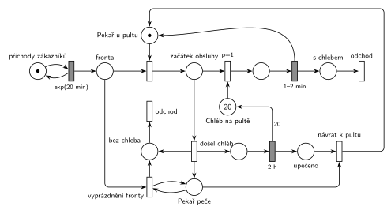

# Pekárna

## Zadání

> Uvažujme pekárnu spojenou s obchodem, ve které pracuje jeden pekař. Pekař buď vyrábí chleba nebo se věnuje zákazníkům u pultu. Do obchodu přichází zákazníci v intervalech exponenciálně se středem 20 minut. Každý zákazník kupuje jeden chleba. V počátečním stavu je na pultě obchodu 20 bochníků chleba a pekař je přítomen u pultu. Obsluha jednoho zákazníka zabere rovnoměrně 1–2 minuty. Pokud se na počátku obsluhy zákazníka ukáže, že na pultě došel chleba, pak se pekař přesune do výrobny a peče chleba. Doba pečení chleba je přesně 2 hodiny. Rozpracovaný zákazník a všichni zákazníci ve frontě odejdou z obchodu. Výsledkem pečení chleba je 20 bochníků na pult prodejny. Po upečení chleba se pekař vrací k pultu. V průběhu pečení chleba nově příchozí zákazníci okamžitě opouští obchod.
>
> *Zadaný systém modelujte formou Petriho sítě s vyznačením všech potřebných parametrů.*

Věta „V modelu jednoznačně ukažte (přechodem) moment, kdy transakce opouští systém“ přibyla až v roce 2022/23. Výstupní přechody jsou v síti přesto, dnes se vyžadují.

Podobné úlohy: [Psí salon](<../03 - Psí salon/03 - Psí salon.md>), [Pizza stánek](<../05 - Pizza stánek/05 - Pizza stánek.md>), [Výletní loď](<../../11 - Doprava a dávky/04 - Výletní loď/04 - Výletní loď.md>).

## Interpretace

<details>
<summary>Zobrazit interpretaci (nápověda)</summary>
<br>

- **Příchody:** místo *příchody zákazníků* ve smyčce s `exp(20 min)` vkládá zákazníky do *Fronty*.
- **Pekař** je zařízení (*Pekař u pultu*, 1 značka). **Chléb** je sklad s 20 značkami (*Chléb na pultě*), každý zákazník bere jeden bochník. Obsluha `1–2 min` (rovnoměrně) vrací pekaře k pultu a zákazník odchází *s chlebem*.
- **Kontrola chleba až na začátku obsluhy:** pekař nejdřív obsadí zákazníka (*začátek obsluhy*), pak se rozhodne. Je-li chléb, vezme bochník přechod `p=1`, jinak se provede *došel chléb* (`p=0`). Když se prodá poslední bochník, pekař tedy zůstane u pultu a péct jde až s dalším zákazníkem, přesně jak to zadání popisuje.
- **Došel chléb:** rozpracovaný zákazník odchází (*bez chleba*), pekař jde péct `2 h` a zároveň vznikne stav *Pekař peče*. Stav je oddělený od místa před přechodem `2 h`: testuje ho smyčka vyprázdnění fronty (vezme a vrátí značku), a kdyby byl vstupem `2 h`, každý odchod zákazníka by odpočet pečení spustil znovu (slajd 139).
- **Vyprázdnění fronty:** smyčka na *Pekař peče* bere zákazníky z *Fronty*, dokud tam někdo je. Protože stav trvá celé 2 h, odejdou i zákazníci, kteří přijdou během pečení, hned po příchodu („okamžitě opouští obchod“).
- **Po upečení** přibude 20 bochníků (hrana s váhou 20) a *návrat k pultu* vezme *upečeno* i *Pekař peče* a vrátí značku *Pekař u pultu*.
- **Odchod** je ve dvou místech: *s chlebem* a *bez chleba* (rozpracovaný zákazník i zákazníci z fronty).

</details>

## Petriho síť

<details>
<summary>Zobrazit Petriho síť</summary>
<br>



</details>

## Časté chyby

<details>
<summary>Zobrazit časté chyby</summary>
<br>

- Kontrola chleba před obsazením pekaře nebo hned po prodeji posledního bochníku. Zadání říká „na počátku obsluhy“.
- Rozpracovaný zákazník, který po zjištění, že chléb došel, nikam neodejde (zůstane v *začátku obsluhy*).
- Vyprázdnění fronty jen jednou v okamžiku odchodu pekaře; nově příchozí by pak během pečení čekali.
- Stav pečení jako vstup časovaného přechodu `2 h`, který zároveň testuje smyčka vyprázdnění: odpočet se s každým odchodem zákazníka spustí znovu.
- Upečení, které vrátí jen 1 bochník (chybí váha 20), nebo zapomenutý návrat pekaře k pultu.

</details>

## SIMLIB

<details>
<summary>Zobrazit SIMLIB kód</summary>
<br>

Model je izomorfní k Petriho síti výše: každé místo, přechod a značka mají svůj protějšek v kódu.

```cpp
// Pekárna – model v SIMLIB/C++
#include "simlib.h"

Queue Fronta("Fronta");                    // místo „Fronta“
Facility Pekar("Pekař u pultu", &Fronta);  // místo „Pekař u pultu“ (1 značka)
int chleba = 20;                           // místo „Chléb na pultě“ (20 značek)
bool pece = false;                         // místo „Pekař peče“
long prodano = 0, bezChleba = 0, peceni = 0;

class Peceni : public Process {            // pekař ve výrobně
  void Behavior() {
    Seize(Pekar);                          // pekař není u pultu
    Wait(2 * 60);                          // pečení 2 h
    chleba += 20;                          // hrana s váhou 20 do „Chléb na pultě“
    pece = false;                          // „návrat k pultu“ vezme „Pekař peče“ ...
    Release(Pekar);                        // ... a vrátí pekaře k pultu
  }
};

class Zakaznik : public Process {          // transakce
  void Behavior() {
    if (pece) {                            // smyčka „vyprázdnění fronty“ na „Pekař peče“:
      bezChleba++;                         // příchozí během pečení hned odchází
      return;
    }
    Seize(Pekar);                          // Fronta + obsazení → „začátek obsluhy“
    if (chleba > 0) {                      // p=1: bere bochník
      chleba--;
      Wait(Uniform(1, 2));                 // obsluha 1–2 min vrací pekaře
      Release(Pekar);
      prodano++;
      return;                              // „s chlebem“ → „odchod“
    }
    // p=0 „došel chléb“: zákazník odchází, pekař jde péct
    peceni++;
    pece = true;
    while (!Fronta.Empty()) {              // vyprázdnění fronty (dokud tam někdo je)
      delete Fronta.GetFirst();            // „bez chleba“ → „odchod“
      bezChleba++;
    }
    bezChleba++;                           // i rozpracovaný zákazník odchází bez chleba
    Release(Pekar);
    (new Peceni)->Activate();
  }
};

class Generator : public Event {           // „příchody zákazníků“ ve smyčce s exp(20 min)
  void Behavior() {
    (new Zakaznik)->Activate();
    Activate(Time + Exponential(20));
  }
};

int main() {
  Init(0, 60 * 24 * 365);                  // modelový čas v minutách: 1 rok
  (new Generator)->Activate();
  Run();
  Pekar.Output();
  Print("Pečení: %ld, prodaných bochníků: %ld (%.1f na pečení), bez chleba odešlo: %ld\n",
        peceni, prodano, double(prodano) / peceni, bezChleba);
}
```

| Petriho síť | SIMLIB |
|---|---|
| *příchody zákazníků* ⇄ `exp(20 min)` | událost `Generator`, která se znovu plánuje za `Exponential(20)` |
| značka (zákazník) | proces `Zakaznik` |
| *Fronta* + *Pekař u pultu* (1 značka) → *začátek obsluhy* | `Seize(Pekar)`, `Facility Pekar("Pekař u pultu", &Fronta)` |
| *Chléb na pultě* (20), `p=1` vezme bochník | `int chleba = 20`, `if (chleba > 0) chleba--;` |
| `1–2 min` vrací pekaře, *s chlebem* → *odchod* | `Wait(Uniform(1, 2)); Release(Pekar); return;` |
| *došel chléb* (`p=0`) → *bez chleba*, *Pekař peče* | větev `else`: `pece = true`, `bezChleba++`, proces `Peceni` |
| smyčka *vyprázdnění fronty* | `while (!Fronta.Empty()) delete Fronta.GetFirst();` a test `if (pece)` u příchozích |
| *Pekař peče* | `bool pece` |
| `2 h` → 20 bochníků, *upečeno* → *návrat k pultu* | proces `Peceni`: `Seize(Pekar); Wait(2 * 60); chleba += 20; pece = false; Release(Pekar);` |

**Kontrola simulací.** Petriho síť (`make check`): *Pekař u pultu* + obsluha + pečení = 1, *Pekař peče* existuje právě během pečení, chleba je nejvýš 20. Na 418 pečení připadá 8 362 prodaných bochníků (přesně 20 na jedno pečení), fronta má nejvýš 3 zákazníky. SIMLIB model (`make simlib`): za rok 973 pečení a 19 466 prodaných bochníků (20,0 na pečení), 6 888 zákazníků odešlo bez chleba. Teorie: jeden cyklus je 21 zákazníků (20 s chlebem a ten, kdo zjistí, že chléb došel) po 20 min, tedy asi 7 h, plus 2 h pečení, během nichž přijde asi 6 dalších; to dává asi 970 cyklů za rok a 26 % zákazníků bez chleba (simulace: 26 %).

</details>

## Původ a zdroje

<details>
<summary>Zobrazit původ a zdroje</summary>
<br>

**Původ:** půlsemestrálky 2014–19 (přehled zadání), úloha Z14.

**Původní znění:**

> Uvažujme pekárnu spojenou s obchodem, ve které pracuje jeden pekař. Pekař buď vyrábí chleba nebo se věnuje zákazníkům u pultu. Do obchodu přichází zákazníci v intervalech daných exp 20 minut. Každý zákazník kupuje jeden chleba. V počátečním stavu je na pultě obchodu 20 bochníků chleba a pekař je přítomen u pultu. Obsluha jednoho zákazníka zabere 1-2 minuty. Pokud se na počátku obsluhy zákazníka ukáže, že na pultě došel chleba, pak se pekař přesune do výrobny a peče chleba. Doba pečení chleba je 2 hodiny. Rozpracovaný zákazník a všichni zákazníci ve frontě odejdou z obchodu. Výsledkem pečení chleba je 20 bochníků na pult prodejny. Po upečení chleba se pekař vrací k pultu. V průběhu pečení chleba nově příchozí zákazníci okamžitě opouští obchod.
>
> *Zadaný systém modelujte formou Petriho sítě s vyznačením všech potřebných parametrů.*

**Zdroje:**

- `Fitcheats/Půlsemestrálky/Zadání z minulých let/Přehled zadání 2014-19.pdf`, str. 4 (zadání)
- `Fitcheats/Půlsemestrálky/FIT - Příprava 2021-22.pdf`, str. 17 (studentské řešení, bez hlasů)

**Existující řešení:**

- **Příprava 2021/22 (str. 17):** stejná struktura: obsazení pekaře (`p=1`), přechod „když je chleba“ (`p=1`) s místem *chleba* (20), `1-2m`, jinak přechod, který pošle zákazníka na „odchod zákazníka“ a pekaře na `2h`; stav „peče?“, ze kterého smyčka vyprazdňuje frontu („odchod z obchodu“); po pečení 20 bochníků a „dopekl“ + „peče?“ → `P=1` → pekař u pultu. Řešení je správně, liší se jen rozložením (a zbytečnou prioritou na obsazení pekaře). Nikdo pro něj nehlasoval.

</details>
