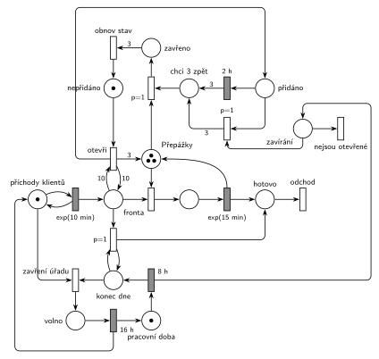

# Úřad s dodatečnými přepážkami

Úloha 09/15

## Zadání

> Pracovní doba úřadu je přesně 8 hodin, po kterých následuje přesně 16 hodin volna. Do úřadovny přichází klienti v období pracovní doby v intervalech exponenciálně se středem 10 minut. Agendu klientů vyřizují úředníci na třech přepážkách. Zpracování jednoho klienta trvá exponenciálně se středem 15 minut. Pokud počet klientů ve frontě k přepážkám dosáhne počtu 10 klientů, úřad na dobu přesně 2 hodin otevře tři další dodatečné přepážky. Po ukončení pracovní doby opouští všichni klienti ve frontě úřad (rozpracovaní klienti jsou dokončeni) a po uvolnění klientem se taky okamžitě uzavřou případné dodatečné přepážky.

Podobné úlohy: [Cestovní kancelář](<../08 - Cestovní kancelář/08 - Cestovní kancelář.md>) (stejný mechanismus dodatečných přepážek), [Úřad](<../01 - Úřad/01 - Úřad.md>), [Dočasně MM2 při dlouhé frontě](<../../05 - Délka fronty a kapacita/02 - Dočasně MM2 při dlouhé frontě/02 - Dočasně MM2 při dlouhé frontě.md>), [Překladiště s jeřábem](<../../11 - Doprava a dávky/09 - Překladiště s jeřábem/09 - Překladiště s jeřábem.md>) (pracovní doba 8 h / 16 h).

## Nápověda

<details>
<summary>Zobrazit nápovědu</summary>
<br>

- **Příchody:** místo *příchody klientů* ve smyčce s `exp(10 min)` vkládá klienty do *fronty*. Mimo pracovní dobu nemá místo značku, takže nikdo nepřichází.
- **Přepážky** jsou sklad s 3 značkami. Obsazení bere jednu, `exp(15 min)` ji vrací a klient odchází přes *hotovo*.
- **Dodatečné přepážky** tvoří cyklus nad hlavní řadou: *otevři* vezme *nepřidáno*, otestuje frontu hranami s váhou 10 tam a zpět a přidá 3 značky do *Přepážek* a značku do *přidáno*. Po `2 h` přijdou 3 značky do *chci 3 zpět* a přechod *zavři* (`p=1`) zavírá po jedné každou volnou přepážku (→ *zavřeno*), rozpracovaný klient se dokončí. Po třech zavřených vrátí *obnov stav* značku *nepřidáno*.
- **„Dosáhne počtu 10“** = alespoň 10, tedy váha 10, ne 11.
- **Pracovní doba** je cyklus pod hlavní řadou: *pracovní doba* → `8 h` → *konec dne* → … → *volno* → `16 h`. Začíná se ráno, na začátku pracovní doby.
- **Konec pracovní doby** (vše v nulovém čase):
  - klienti ve frontě odcházejí: smyčka `p=1` na *konec dne*, dokud je fronta neprázdná. Obsluhovaní klienti se dokončí, protože jejich značky jsou v *obsluze*, ne ve frontě;
  - pak (p=0) *zavření úřadu* vezme značku místu *příchody klientů*, příchody se zastaví. `16 h` značku vrátí;
  - dodatečné přepážky: `8 h` pošle signál do *zavírání* (dlouhá hrana kolem pravého okraje). Jsou-li přepážky otevřené (*přidáno*), přechod `p=1` zruší zbývající část dvou hodin (vezme značku, na které běží odpočet `2 h`) a rovnou dá 3 značky do *chci 3 zpět*. Volné přepážky se tak zavřou hned, obsazené po dokončení klienta. Nejsou-li otevřené (nebo se už zavírají), signál zanikne přechodem *nejsou otevřené* (p=0).
- Testovací hrany vedou jen na místa bez vlastního odpočtu (*fronta*, *konec dne*). Odpočet `8 h` je na *pracovní době*, kterou nic netestuje, takže se nepřerušuje.

</details>

## Petriho síť

<details>
<summary>Zobrazit Petriho síť</summary>
<br>



</details>

## Časté chyby

<details>
<summary>Zobrazit časté chyby</summary>
<br>

- Chybějící stav *nepřidáno*: při frontě ≥ 10 se přepážky přidávají znovu a znovu.
- Zavření dodatečných přepážek hranou s váhou 3 z *Přepážky*: čeká se, až budou volné tři najednou, místo zavírání po jedné.
- Konec pracovní doby, který vezme i obsluhované klienty. Zadání chce dokončit rozpracované.
- Vyprázdnění fronty bez priority nad zavřením úřadu, nebo jediným přechodem s váhou (váha bere přesný počet, ne „všechny“).
- Časovač `8 h` na místě, které testují jiné přechody (např. generátor testující „pracovní dobu“). Každý test značku vezme a vrátí a odpočet by se spouštěl znovu.

</details>

## SIMLIB

<details>
<summary>Zobrazit SIMLIB kód</summary>
<br>

Model je izomorfní k Petriho síti výše: každé místo, přechod a značka mají svůj protějšek v kódu.

```cpp
// Úřad s dodatečnými přepážkami – model v SIMLIB/C++
#define I_REALLY_KNOW_HOW_TO_USE_WAITUNTIL  // WaitUntil = test hranami s váhou
#include "simlib.h"
#include <vector>

Queue Fronta("Fronta");                    // místo „Fronta“
Store Prepazky("Přepážky", 6, &Fronta);    // 3 + 3 přepážky; dodatečné drží řízení (níže)
long otevreni = 0, zruseni = 0, poslanoDomu = 0;

class Klient : public Process {            // transakce
  void Behavior() {
    Enter(Prepazky, 1);                    // Fronta + obsazení přepážky
    Wait(Exponential(15));                 // exp(15 min) vrací přepážku
    Leave(Prepazky, 1);
  }                                        // „hotovo“ → přechod „odchod“
};

class Dodatecne : public Process {         // cyklus „nepřidáno“ → … → „obnov stav“
 public:
  enum { NEPRIDANO, PRIDANO, ZAVIRANI } stav = NEPRIDANO;
  Dodatecne() : Process(1) {}              // p=1: zavírání má přednost před klienty
  void Behavior() {
    Enter(Prepazky, 3);                    // „nepřidáno“: 3 přepážky jsou mimo provoz
    for (;;) {
      stav = NEPRIDANO;
      WaitUntil(Fronta.Length() >= 10);    // test Fronty hranami s váhou 10
      stav = PRIDANO;                      // „otevři“ (test Fronty vahou 10)
      otevreni++;
      Leave(Prepazky, 3);                  // +3 značky do „Přepážky“, „přidáno“
      Wait(2 * 60);                        // 2 h (konec pracovní doby je může zkrátit)
      stav = ZAVIRANI;                     // „chci 3 zpět“
      for (int i = 0; i < 3; i++)
        Enter(Prepazky, 1);                // „zavři“ (p=1): bere po jedné volnou přepážku
    }                                      // 3× „zavřeno“ → „obnov stav“
  }
};
Dodatecne *dodatecne;

class Prichody : public Event {            // „příchody klientů“ ve smyčce s exp(10 min)
  void Behavior() {
    (new Klient)->Activate();
    Activate(Time + Exponential(10));
  }
};
Prichody *prichody;

class PracovniDoba : public Event {        // cyklus „pracovní doba“ 8 h / „volno“ 16 h
  bool prace = true;
  void Behavior() {
    if (prace) {                           // `8 h` → „konec dne“
      std::vector<Entity *> cekajici;
      for (Queue::iterator i = Fronta.begin(); i != Fronta.end(); ++i)
        cekajici.push_back((Entity *)*i);
      for (Entity *e : cekajici)           // smyčka p=1: klienti ve frontě odcházejí
        if (e != dodatecne) {              // (zavírání přepážek ve frontě zůstává)
          delete e;
          poslanoDomu++;
        }
      if (dodatecne->stav == Dodatecne::PRIDANO) {
        zruseni++;                         // „zruš“ (p=1): zbytek 2 h zaniká,
        dodatecne->Activate();             // přepážky se zavírají hned
      }                                    // jinak signál zanikne („nejsou otevřené“)
      prichody->Passivate();               // „zavření úřadu“ vezme značku generátoru
      Activate(Time + 16 * 60);
    } else {                               // `16 h` vrací generátor a „pracovní doba“
      prichody->Activate(Time + Exponential(10));
      Activate(Time + 8 * 60);
    }
    prace = !prace;
  }
};

int main() {
  Init(0, 60 * 24 * 3000);                 // modelový čas v minutách: 3000 dní
  dodatecne = new Dodatecne;
  dodatecne->Activate();
  prichody = new Prichody;
  prichody->Activate();
  (new PracovniDoba)->Activate(Time + 8 * 60);
  Run();
  Prepazky.Output();
  Print("Otevření dodatečných přepážek: %ld (z toho zkrácených koncem dne: %ld), "
        "klientů poslaných domů: %ld\n", otevreni, zruseni, poslanoDomu);
}
```

| Petriho síť | SIMLIB |
|---|---|
| *příchody klientů* ⇄ `exp(10 min)` | událost `Prichody`, která se znovu plánuje za `Exponential(10)` |
| značka (klient) | proces `Klient` |
| *fronta* + *Přepážky* | `Enter(Prepazky, 1)`, `Store Prepazky("Přepážky", 6, &Fronta)` |
| `exp(15 min)` se sloučeným uvolněním, *hotovo* → *odchod* | `Wait(Exponential(15)); Leave(Prepazky, 1);` a konec `Behavior()` |
| *nepřidáno* (3 přepážky mimo provoz) | proces `Dodatecne` drží 3 jednotky skladu (`Enter(Prepazky, 3)`) |
| *otevři* (test *fronty* vahou 10) → *přidáno* | `WaitUntil(Fronta.Length() >= 10); Leave(Prepazky, 3);` |
| `2 h` → *chci 3 zpět* | `Wait(2 * 60)` |
| *zavři* (`p=1`) → *zavřeno*, *obnov stav* | `for (…) Enter(Prepazky, 1);` s prioritou procesu 1 (předbíhá klienty ve frontě) |
| *pracovní doba* `8 h` / *volno* `16 h` | událost `PracovniDoba`, střídá se po `8 * 60` a `16 * 60` |
| smyčka `p=1` na *konec dne* | `delete` všech klientů ve `Fronta` |
| *zavírání* + *přidáno* → *zruš* (`p=1`) / *nejsou otevřené* | `if (dodatecne->stav == PRIDANO) dodatecne->Activate();` (zkrátí `Wait`) |
| *zavření úřadu* / `16 h` vrací značku generátoru | `prichody->Passivate()` / `prichody->Activate(Time + Exponential(10))` |

**Kontrola simulací.** Petriho síť (`make check`): *Přepážky* + obsluhovaní + 3 × *nepřidáno* + *zavřeno* = 6 (nikdy víc než 3 + 3 přepážek), 3 × *nepřidáno* + 3 × *přidáno* + *chci 3 zpět* + *zavřeno* = 3, *příchody klientů* + *volno* = 1. Úřad je vytížený na 50 %, takže fronta 10 je vzácná: za asi 3 000 simulovaných dní se přepážky otevřely 10–16krát a třetinu z toho zavřel konec pracovní doby dřív než za 2 h. Fronta nikdy nepřekročila 10. SIMLIB model (`make simlib`): za 3 000 dní se dodatečné přepážky otevřely 12×, 2× je zavřel konec pracovní doby, domů bylo posláno 636 klientů. Průměrně obsazená kapacita skladu 3,49 obsahuje 3 jednotky „nepřidáno“; klienti tedy obsadí v průměru 0,49 přepážky, teoreticky 15 min / 10 min × 8 h / 24 h = 0,5.

</details>

## Původ a zdroje

<details>
<summary>Zobrazit původ a zdroje</summary>
<br>

**Původ:** půlsemestrálky 2014–19 (přehled zadání), úloha Z10.

**Původní znění:**

> Pracovní doba úřadu je 8 hodin, po kterých následuje 16 hodin volna. Do úřadovny přichází klienti v období pracovní doby v intervalech exp(10min). Agendu klientů vyřizují úředníci na třech přepážkách. Zpracování jednoho klienta trvá dobu exp(15min). Pokud počet klientů ve frontě k přepážkám dosáhne počtu 10 klientů, úřad na dobu 2 hodin otevře tři další dodatečné přepážky. Po ukončení pracovní doby opouští všichni klienti ve frontě úřad (rozpracovaní klienti jsou dokončeni) a po uvolnění klientem se taky okamžitě uzavřou případné dodatečné přepážky.
>
> Zadaný systém modelujte formou Petriho sítě s vyznačením všech potřebných parametrů.

**Zdroje:**

- `Fitcheats/Půlsemestrálky/Zadání z minulých let/Přehled zadání 2014-19.pdf`, str. 3 (zadání)
- `Fitcheats/Půlsemestrálky/FIT - Příprava 2021-22.pdf`, str. 14 (studentské řešení, v komentáři „100% spatne“)
- `Fitcheats/Příprava na zkoušku/luppo - Tabule.png` (studentské řešení na tabuli)

**Existující řešení:**

- **Příprava 2021/22 (str. 14), komentář „100% spatne“:** obrácené značení (šrafovaně okamžité přechody). Pracovní doba je udělaná dobře: stavy *pracovní doba*/*volno* přepínají přechody `P=1` podle signálů z časovačů `8h`/`16h` v samostatném cyklu. Klienti se generují i v noci a v době volna je okamžitý přechod hned zahodí, což by šlo. Dodatečné přepážky jsou ale samostatné místo, ze kterého druhý `exp(15)` značku jen bere a nevrací, a po `2h` je přechod `P=1` bere zpátky všechny 3 najednou. Zavření dodatečných přepážek po konci pracovní doby v síti není vidět.
- **Studentská tabule:** pracovní doba jako stav *Work*/*Rest* odděleně od časovačů `8h`/`16h` (testy nepřerušují odpočty). Test fronty váhami 10, *Noví úředníci* → `2h`, odebrání přechodem `P=3`, vyprázdnění fronty na konci dne přechodem `P=1000`. Detaily hran z fotky nejdou spolehlivě přečíst.
- Hrubého řešení této úlohy v materiálech není. Mechanismus přepážek odpovídá jeho řešení varianty A úlohy [Cestovní kancelář](<../08 - Cestovní kancelář/08 - Cestovní kancelář.md>).

</details>

## Reference

- [Jak síť funguje](<../../../basics/Jak síť funguje.md>)
- [Notace a vzory](<../../../basics/Notace a vzory.md>)

<!-- -->

- [Studijní plán](<../../Studijní plán.md>)
- [Seznam úloh](<../../Seznam úloh.md>)
