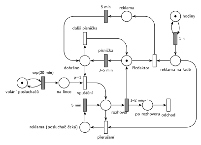

# Hudební rádio

Úloha 09/17

## Zadání

> Hudební rádio pouští písničky, reklamy a rozhovory s posluchači, kteří si přejí přehrát oblíbenou písničku. Písnička hraje rovnoměrně 3–5 minut. Redaktor rádia přehrává písničky ze svého seznamu a kromě toho musí každou hodinu začít přehrávat reklamní stopu o délce přesně 5 minut. Posluchači volají do rádia v intervalech exponenciálně se středem 20 minut. Posluchač je vpuštěn do vysílání až potom, kdy dohraje písnička, případně reklama (reklama má přednost před posluchačem). Rozhovor s posluchačem trvá rovnoměrně 1–2 minuty. Reklama přeruší přehrávání písničky i rozhovor s posluchačem. Přerušená písnička se neopakuje. Přerušený rozhovor se opakuje od začátku.

Podobné úlohy: [Porucha zruší obsluhu](<../../03 - Poruchy/01 - Porucha zruší obsluhu/01 - Porucha zruší obsluhu.md>) (přerušení bez opakování), [Porucha vrací transakci do fronty](<../../03 - Poruchy/02 - Porucha vrací transakci do fronty/02 - Porucha vrací transakci do fronty.md>), [Zahradnictví a bouřka](<../../12 - Výroba a sklady/01 - Zahradnictví a bouřka/01 - Zahradnictví a bouřka.md>) (přerušená práce se opakuje od začátku).

## Nápověda

<details>
<summary>Zobrazit nápovědu</summary>
<br>

- **Posluchači** přicházejí z místa *volání posluchačů* ve smyčce s `exp(20 min)` a čekají v místě *na lince*. Netrpělivost zadání nezmiňuje, na lince čekají libovolně dlouho.
- **Redaktor** je jediný zdroj (místo s 1 značkou). Je vždy právě v jednom stavu: pouští písničku (*Redaktor*), vede rozhovor, pouští reklamu, nebo se rozhoduje (*dohráno*).
- **Písnička** je časovaný přechod `3–5 min` přímo na místě *Redaktor*. Během písničky značka zůstává v *Redaktorovi* (slajd 137), takže reklama ji může kdykoli vzít a písnička zanikne. Po reklamě jde redaktor do *dohráno*, přerušená písnička se neopakuje.
- **„Vpuštěn až potom, kdy dohraje písnička, případně reklama“:** po písničce i po reklamě jde značka do *dohráno*. Tam se rozhoduje: čeká-li posluchač, přechod *vpuštění* (`p=1`) ho pustí do vysílání, jinak (p=0) hraje *další písnička*.
- **Rozhovor** `1–2 min` vrací značku *Redaktor*, takže po rozhovoru jde redaktor rovnou na písničku a dva rozhovory za sebou bez písničky nejsou. Posluchač jde do *po rozhovoru* a opouští systém přechodem *odchod*.
- Posluchač „si přeje přehrát oblíbenou písničku“: písnička po rozhovoru je ta jeho. V síti je to obyčejná písnička `3–5 min`, protože se nijak neliší.
- **Reklama každou hodinu** je deterministický generátor: *hodiny* ve smyčce s `1 h`. Značka *reklama na řadě* se hned spotřebuje: buď vezme *Redaktora* (přeruší písničku), nebo vezme *rozhovor* (přeruší rozhovor). Reklama se tak spustí vždy přesně v celou hodinu a na nic nečeká. Tím je splněno i „reklama má přednost před posluchačem“: rozhovor reklamu nezdrží, naopak ho reklama přeruší.
- **Přerušený rozhovor:** posluchač zůstane na lince (*reklama (posluchač čeká)*), po `5 min` se značka vrátí do *rozhovor* a odpočet `1–2 min` začne znovu, tedy rozhovor od začátku.

</details>

## Petriho síť

<details>
<summary>Zobrazit Petriho síť</summary>
<br>



</details>

## Časté chyby

<details>
<summary>Zobrazit časté chyby</summary>
<br>

- Písnička jako obsazení redaktora okamžitým přechodem a teprve pak časovaný přechod, ale reklama bere značku z místa *Redaktor*. Ten je v tu chvíli prázdný a reklama čeká na konec písničky, takže nic nepřeruší.
- Reklama jako generátor `exp(60 min)`. Zadání chce „každou hodinu“, tedy deterministicky `1 h`.
- Přerušený rozhovor vrácený do fronty posluchačů. Zadání chce opakování hned po reklamě, posluchač zůstává ve vysílání.
- Posluchač vpouštěný kdykoli, i uprostřed písničky. Musí čekat na *dohráno*, proto `p=1` na tomto místě, ne na čekajících posluchačích.
- Chybějící vrácení redaktora po reklamě nebo po rozhovoru: rádio pak „ztichne“.

</details>

## SIMLIB

<details>
<summary>Zobrazit SIMLIB kód</summary>
<br>

Model je izomorfní k Petriho síti výše: každé místo, přechod a značka mají svůj protějšek v kódu.

```cpp
// Hudební rádio – model v SIMLIB/C++
#include "simlib.h"

Queue NaLince("Posluchači na lince");  // místo na lince
Histogram Doba("Doba posluchače v systému [min]", 0, 5, 20);
bool reklamaNaRade = false;            // místo reklama na řadě (nejvýš 1 značka)
int reklamy = 0, prerusenePisne = 0, preruseneRozhovory = 0;

class Posluchac : public Process {     // transakce = značka posluchače
  void Behavior() override {
    double prichod = Time;
    Into(NaLince);                     // místo na lince
    Passivate();                       // čeká na vpuštění a konec rozhovoru (řídí redaktor)
    Doba(Time - prichod);
  }                                    // místo po rozhovoru + přechod odchod
};

class Redaktor : public Process {      // značka redaktora: je vždy v právě jednom místě
  void Reklama() {                     // místo reklama, přechod 5 min
    reklamaNaRade = false;             // spuštění reklamy spotřebuje značku „na řadě“
    reklamy++;
    Wait(5);
  }
  void Behavior() override {
    for (;;) {
      Wait(Uniform(3, 5));             // místo Redaktor, přechod písnička 3–5 min
      if (reklamaNaRade) {             // reklama vzala redaktora uprostřed písničky
        prerusenePisne++;
        Reklama();                     // přerušená písnička se neopakuje
      }
      // místo dohráno: vpuštění (p=1), jinak další písnička (p=0)
      if (!NaLince.Empty()) {
        Process *p = (Process *)NaLince.GetFirst();
        Wait(Uniform(1, 2));           // místo rozhovor, přechod 1–2 min
        while (reklamaNaRade) {        // přechod přerušení
          preruseneRozhovory++;
          Reklama();                   // místo reklama (posluchač čeká), přechod 5 min
          Wait(Uniform(1, 2));         // rozhovor od začátku
        }
        p->Activate();                 // 1–2 min vrací redaktora, posluchač odchází
      }
    }
  }
};
Redaktor *redaktor;

class Hodiny : public Event {          // místo hodiny ve smyčce s přechodem 1 h
  void Behavior() override {
    reklamaNaRade = true;              // značka do místa reklama na řadě
    redaktor->Activate();              // přeruší probíhající Wait (písničku nebo rozhovor)
    Activate(Time + 60);
  }
};

class Volani : public Event {          // místo volání posluchačů ve smyčce s exp(20 min)
  void Behavior() override {
    (new Posluchac)->Activate();
    Activate(Time + Exponential(20));
  }
};

int main() {
  Init(0, 1000 * 60);                  // modelový čas v minutách: 1000 hodin vysílání
  redaktor = new Redaktor;
  redaktor->Activate();
  (new Hodiny)->Activate(60);          // první reklama v celou hodinu
  (new Volani)->Activate();
  Run();
  Print("Reklamy: %d, z toho přerušily písničku: %d, rozhovor: %d\n",
        reklamy, prerusenePisne, preruseneRozhovory);
  NaLince.Output();
  Doba.Output();
}
```

| Petriho síť | SIMLIB |
|---|---|
| *volání posluchačů* ⇄ `exp(20 min)` | událost `Volani`, která se znovu plánuje za `Exponential(20)` |
| značka posluchače, místo *na lince* | proces `Posluchac`, `Into(NaLince); Passivate();` |
| značka redaktora | proces `Redaktor`; místo, ve kterém je, odpovídá místu v kódu |
| *Redaktor* → `3–5 min` → *dohráno* | `Wait(Uniform(3, 5))` |
| *vpuštění* (`p=1`) / *další písnička* (p=0) | `if (!NaLince.Empty())` / další průchod cyklem `for` |
| *rozhovor* → `1–2 min` (vrací redaktora) | `Wait(Uniform(1, 2))`, pak `p->Activate()` |
| *po rozhovoru* + *odchod* | konec `Behavior()` posluchače |
| *hodiny* ⇄ `1 h` → *reklama na řadě* | událost `Hodiny`: `reklamaNaRade = true`, znovu za 60 min |
| odebrání značky, na které běží odpočet (slajd 139) | `redaktor->Activate()` ukončí probíhající `Wait` |
| spuštění reklamy → *reklama* → `5 min` → *dohráno* | `if (reklamaNaRade) Reklama();` po písničce |
| *přerušení* → *reklama (posluchač čeká)* → `5 min` → *rozhovor* | `while (reklamaNaRade) { Reklama(); Wait(Uniform(1, 2)); }` |

**Kontrola simulací.** Petriho síť: redaktor je vždy v právě jednom stavu (*Redaktor* + *dohráno* + *rozhovor* + obě reklamní místa = 1) a v *reklama na řadě* je nejvýš jedna značka (`make check`). Za 2 491 simulovaných hodin bylo 2 491 reklam, 170 z nich přerušilo rozhovor (rozhovory zabírají asi 7 % času). Na lince čekali nejvýš 4 posluchači. SIMLIB model: za 1000 hodin bylo 1000 reklam, 924 přerušilo písničku a 76 rozhovor. To odpovídá podílu času v rozhovoru: 3028 posluchačů × 1,5 min / 60 000 min ≈ 7,6 %. Posluchač čekal na lince v průměru 3,5 minuty (nejvýš 5 posluchačů najednou).

</details>

## Původ a zdroje

<details>
<summary>Zobrazit původ a zdroje</summary>
<br>

**Původ:** půlsemestrálky 2014–19 (přehled zadání), úloha Z7.

**Původní znění:**

> Hudební rádio pouští písničky, reklamy a rozhovory s posluchači, kteří si přejí přehrát oblíbenou písničku. Písnička hraje po dobu 3-5 minut. Redaktor rádia přehrává písničky ze svého seznamu a kromě toho musí každou hodinu začít přehrávat reklamní stopu o délce 5 minut. Posluchači volají do rádia v intervalech daných exp. rozložením se středem 20 minut. Posluchač je vpuštěn do vysílání až potom, kdy dohraje písnička, případně reklama (reklama má přednost před posluchačem). Rozhovor s posluchačem trvá 1-2 minuty. Reklama přeruší přehrávání písničky i rozhovor s posluchačem. Přerušená písnička se neopakuje. Přerušený rozhovor se opakuje od začátku.
>
> Zadaný systém modelujte formou Petriho sítě s vyznačením všech potřebných parametrů.

**Zdroje:**

- `Fitcheats/Půlsemestrálky/Zadání z minulých let/Přehled zadání 2014-19.pdf`, str. 2 (zadání)
- `Fitcheats/Půlsemestrálky/Democvičení 2020-21 - Z4 zadání a řešení.pdf`, str. 3 (řešení z democvičení)
- `Fitcheats/Půlsemestrálky/FIT - Příprava 2021-22.pdf`, str. 11 (studentské řešení, 5 hlasů pro)
- `Fitcheats/Příprava na zkoušku/luppo - Tabule.png` (studentské řešení na tabuli, označené „This cesi good“)

**Existující řešení:**

- **Democvičení 2020/21 (str. 3):** stejná struktura. *Redaktor* → `3-5min` → místo, odkud `P=1` pustí posluchače do *Rozh* a zelený přechod jinak vrací redaktora k písničce. Rozhovor `1-2m` vrací *Redaktora*. Reklama: generátor `1h` → místo → přechod, který vezme *Redaktora* → *PP* → `5m` → *Redaktor*. Modře přerušení rozhovoru: reklama + *Rozh* → *DP* → `5m` → zpět do *Rozh*. Rozdíly: po reklamě jde redaktor rovnou na písničku, takže posluchač se po reklamě do vysílání nedostane (zadání to dovoluje: „případně reklama“). Generátory jsou bez míst a výstup posluchače po rozhovoru není jednoznačně zakreslený (`1-2m` vrací jen *Redaktora*).
- **Příprava 2021/22 (str. 11, 5 pro / 0 proti):** v podstatě totéž. Pozor na obrácené značení: šrafované obdélníky jsou tu okamžité přechody a prázdné časované, v IMS je to naopak. Písnička je obsazení *redaktora* → místo → `3-5m`, reklama bere značku z místa mezi nimi. Posluchač má `p=1` přímo na *redaktorovi*, takže po rozhovoru může hned následovat další rozhovor bez písničky.
- **Studentská tabule (zeleně „This cesi good“):** posluchač po rozhovoru `1-2min` dostane svou písničku (místo *Písnička* → `3,5`), reklama `1hod` má dva přechody: přeruší rozhovor (pak se opakuje) nebo písničku. Písničky ze seznamu nejsou na fotce zřetelně zakreslené.

</details>

## Reference

- [Jak síť funguje](<../../../basics/Jak síť funguje.md>)
- [Notace a vzory](<../../../basics/Notace a vzory.md>)

<!-- -->

- [Studijní plán](<../../Studijní plán.md>)
- [Seznam úloh](<../../Seznam úloh.md>)
