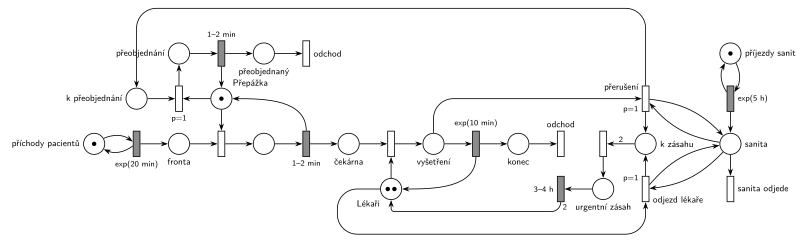

# Nemocniční ambulance

## Zadání

> Do nemocniční ambulace přicházejí stále pacienti v intervalech exponenciálně se středem 20 minut. Po příchodu jsou registrováni u přepážky objednávání a registrace pacientů (rovnoměrně 1–2 minuty). Ambulance obsahuje dva lékaře, kteří vyšetřují čekající pacienty. Vyšetření trvá exponenciálně se středem 10 minut. V intervalech exponenciálně se středem 5 hodin sanita přiveze do nemocnice dodávku urgentních pacientů. Oba lékaři přeruší svou případnou práci v ambulanci a opouští ordinace rovnoměrně na 3–4 hodiny k urgentnímu zásahu. Aktuálně rozpracovaní pacienti u registrační přepážky prioritně provedou přeobjednání (rovnoměrně 1–2 minuty) a opuští systém. Ostatní pacienti v čekárně čekají dále.

Podobné úlohy: [Porucha s opravou, transakce odchází](<../../03 - Poruchy/04 - Porucha s opravou, transakce odchází/04 - Porucha s opravou, transakce odchází.md>), [Porucha vrací transakci do fronty](<../../03 - Poruchy/02 - Porucha vrací transakci do fronty/02 - Porucha vrací transakci do fronty.md>), [Hudební rádio](<../17 - Hudební rádio/17 - Hudební rádio.md>) (Z7, přerušení reklamou).

## Nápověda

<details>
<summary>Zobrazit nápovědu</summary>
<br>

- **Příchody** modeluje místo *příchody pacientů* ve smyčce s `exp(20 min)`. **Přepážka** je jedno zařízení (registrace `1–2 min`), **Lékaři** jsou sklad se 2 značkami (vyšetření `exp(10 min)`). Mezi nimi je *čekárna*. Vyšetřený pacient odchází přes *konec* přechodem *odchod*.
- **Sanity** přijíždějí z místa *příjezdy sanit* ve smyčce s `exp(5 h)` do místa *sanita*.
- **„Aktuálně rozpracovaní pacienti“** jsou ti, jejichž vyšetření lékaři přerušili. Jdou k registrační přepážce, přednostně se přeobjednají a odejdou. Druhé čtení (přeobjednává se pacient, kterého sanita zastihne u přepážky) nechává osud přerušených pacientů nevyřešený a slovo „prioritně“ by nedávalo smysl, protože ten pacient už přepážku má.
- **Lékaři opouštějí ambulanci jednotlivě** dvěma přechody `p=1`, oba se smyčkou na *sanitě*:
  - *přerušení* vezme vyšetřovaného pacienta (odpočet `exp(10 min)` zanikne, slajd 139), lékaře pošle do *k zásahu* a pacienta do *k přeobjednání*;
  - *odjezd lékaře* vezme volného lékaře z *Lékařů*. Priorita zajistí, že ho mezitím neobsadí čekající pacient.
- **Zásah začne**, až jsou v *k zásahu* oba lékaři (hrana s váhou 2). Po `3–4 h` se do *Lékařů* vrátí 2 značky. Urgentní pacienti nejsou transakce tohoto systému.
- **Sanita odjede** přechodem s p=0, tedy až po odjezdu obou lékařů. Když přijede během zásahu (lékaři už jsou pryč), zadání to neřeší: tady nemá žádný účinek. Jiné rozumné čtení: sanita počká a lékaři odjedou znovu hned po návratu. Pak stačí přechod *sanita odjede* vynechat.
- **Přeobjednání** obsadí *Přepážku* s `p=1`, tedy před pacienty z běžné *fronty* (p=0). To je „prioritně“. Pacient, který se právě registruje, registraci normálně dokončí. Přeobjednaný pacient odchází vlastním výstupním přechodem.
- **Pacienti v čekárně** čekají dál a pacienti dál přicházejí a registrují se i během zásahu.

</details>

## Petriho síť

<details>
<summary>Zobrazit Petriho síť</summary>
<br>



</details>

## Časté chyby

<details>
<summary>Zobrazit časté chyby</summary>
<br>

- Registrace jen jako časovaný přechod bez místa *Přepážka*: neomezuje počet současně registrovaných (slajd 138).
- Odjezd lékařů, který bere 2 značky z *Lékařů* bez přerušení vyšetření: když lékař právě vyšetřuje, sanita čeká, až skončí.
- Odjezd bez priority před obsazením lékaře: volného lékaře mezitím obsadí další pacient z čekárny.
- Návrat lékařů, který se může spustit vícekrát (každá sanita přidá 2 lékaře).
- Přeobjednání bez přepážky nebo bez priority před běžnou registrací.

</details>

## SIMLIB

<details>
<summary>Zobrazit SIMLIB kód</summary>
<br>

Model je izomorfní k Petriho síti výše: každé místo, přechod a značka mají svůj protějšek v kódu.

```cpp
// Nemocniční ambulance – model v SIMLIB/C++
#include "simlib.h"
#include <set>

const double HOD = 60;                 // časová jednotka: minuta

Facility Prepazka("Přepážka");         // místo Přepážka (1 značka)
Store Lekari("Lékaři", 2);             // místo Lékaři (2 značky)
Histogram Doba("Doba vyšetřeného pacienta v ambulanci [min]", 0, 30, 20);
bool naZasahu = false;                 // značka v místě urgentní zásah
int zasahy = 0, sanityBezUcinku = 0, preobjednani = 0;

class Pacient;
std::set<Pacient *> vysetrovani;       // značky v místě vyšetření

class Pacient : public Process {
 public:
  bool prerusen = false;
  void Behavior() override {
    double prichod = Time;
    Seize(Prepazka);                   // fronta + obsazení přepážky
    Wait(Uniform(1, 2));               // registrace 1–2 min ...
    Release(Prepazka);                 // ... vrací přepážku
    Enter(Lekari, 1);                  // čekárna + obsazení lékaře
    vysetrovani.insert(this);
    Wait(Exponential(10));             // vyšetření exp(10 min)
    vysetrovani.erase(this);
    if (!prerusen) {
      Leave(Lekari, 1);                // vrací lékaře
      Doba(Time - prichod);
      return;                          // místo konec + přechod odchod
    }
    // přerušený pacient: místo k přeobjednání (lékaře si vzal zásah)
    Priority = 1;                      // obsazení přepážky p=1: před běžnou frontou
    Seize(Prepazka);
    Wait(Uniform(1, 2));               // přeobjednání 1–2 min, vrací přepážku
    Release(Prepazka);
    preobjednani++;
  }                                    // místo přeobjednaný + přechod odchod
};

class Zasah : public Process {         // sanita, která zastihne lékaře v ambulanci
  void Behavior() override {
    naZasahu = true;
    zasahy++;
    for (Pacient *p : std::set<Pacient *>(vysetrovani)) {
      p->prerusen = true;              // přerušení (p=1): lékař rovnou do „k zásahu“,
      p->Activate();                   // odpočet vyšetření zanikne
    }
    unsigned long volni = Lekari.Free();
    if (volni > 0)
      Enter(Lekari, volni);            // odjezd lékaře (p=1) pro každého volného
    // teď jsou oba lékaři „k zásahu“: zahájení zásahu (váha 2)
    Wait(Uniform(3 * HOD, 4 * HOD));   // urgentní zásah 3–4 h
    Leave(Lekari, 2);                  // vrací 2 lékaře
    naZasahu = false;
  }
};

class Sanity : public Event {          // místo příjezdy sanit ve smyčce s exp(5 h)
  void Behavior() override {
    if (!naZasahu)
      (new Zasah)->Activate();
    else
      sanityBezUcinku++;               // sanita odjede (p=0), lékaři jsou pryč
    Activate(Time + Exponential(5 * HOD));
  }
};

class Prichody : public Event {        // místo příchody pacientů ve smyčce s exp(20 min)
  void Behavior() override {
    (new Pacient)->Activate();
    Activate(Time + Exponential(20));
  }
};

int main() {
  Init(0, 1000 * 24 * HOD);            // modelový čas v minutách: 1000 dní
  (new Prichody)->Activate();
  (new Sanity)->Activate(Exponential(5 * HOD));
  Run();
  Print("Zásahy: %d, sanity během zásahu: %d, přeobjednaní pacienti: %d\n",
        zasahy, sanityBezUcinku, preobjednani);
  Prepazka.Output();
  Lekari.Output();
  Doba.Output();
}
```

| Petriho síť | SIMLIB |
|---|---|
| *příchody pacientů* ⇄ `exp(20 min)` | událost `Prichody`, znovu za `Exponential(20)` |
| značka (pacient) | proces `Pacient` |
| *fronta* + obsazení *Přepážky*, `1–2 min` vrací značku | `Seize(Prepazka); Wait(Uniform(1, 2)); Release(Prepazka);` |
| *čekárna* + obsazení *Lékařů* (2 značky) | `Store Lekari("Lékaři", 2)`, `Enter(Lekari, 1)` |
| *vyšetření* → `exp(10 min)` vrací lékaře | `Wait(Exponential(10)); Leave(Lekari, 1);` |
| *příjezdy sanit* ⇄ `exp(5 h)` → *sanita* | událost `Sanity`, znovu za `Exponential(5 * HOD)` |
| *přerušení* (`p=1`) | `p->prerusen = true; p->Activate();` (pacient lékaře nevrací) |
| *odjezd lékaře* (`p=1`) | `Enter(Lekari, volni)` v procesu `Zasah` |
| *k zásahu* (váha 2) → *urgentní zásah* → `3–4 h` | `Wait(Uniform(3 * HOD, 4 * HOD)); Leave(Lekari, 2);` |
| *sanita odjede* (p=0) během zásahu | `if (!naZasahu) … else sanityBezUcinku++;` |
| *k přeobjednání* → obsazení přepážky `p=1` | `Priority = 1; Seize(Prepazka);` (priorita procesu řadí frontu, nepřerušuje) |
| *přeobjednaný* / *konec* + *odchod* | konec metody `Behavior()` |

V síti se lékař přerušeného pacienta do *Lékařů* nevrací, jde rovnou do *k zásahu*. V kódu proto pacient po přerušení `Leave` nevolá a jeho jednotku skladu „převezme“ zásah. Kdyby ji vrátil, `Store` by ji hned přidělil dalšímu pacientovi z čekárny.

**Kontrola simulací.** Petriho síť: *Přepážka* + registrovaný + přeobjednávající = 1, *Lékaři* + vyšetřovaní + *k zásahu* + 2 · *urgentní zásah* = 2, v místě *sanita* je nejvýš 1 značka; všechny přechody se provádějí (`make check`). SIMLIB model: za 1000 dní (24 000 h) proběhlo 2821 zásahů, teoreticky 24 000 h / (5 h čekání na sanitu + 3,5 h zásahu) ≈ 2820. Dalších 2093 sanit přijelo během zásahu. Přeobjednáno bylo 2345 pacientů. Lékaři byli obsazení (pacientem nebo zásahem) v průměru 1,31 ze 2; pacienti po návratu lékařů čekají dlouho (průměrná doba v ambulanci 83 minut, v čekárně nejvýš 41 pacientů).

</details>

## Původ a zdroje

<details>
<summary>Zobrazit původ a zdroje</summary>
<br>

**Původ:** půlsemestrálky 2014–19 (přehled zadání), úloha Z6. Přesný rok a varianta nejsou známé.

**Původní znění:**

> Do nemocniční ambulace přicházejí stále pacienti v intervalech daných exp. rozložením se středem 20 minut. Po příchodu jsou registrováni u přepážky objednávání a registrace pacientů (1-2 minuty). Ambulance obsahuje dva lékaře, kteří vyšetřují čekající pacienty. Doba vyšetření se řídí exp. rozložením se středem 10 minut. V intervalech daných exp. rozložením se středem 5 hodin sanita přiveze do nemocnice dodávku urgentních pacientů. Oba lékaři přeruší svou případnou práci v ambulanci a opouští ordinace na dobu 3-4 hodiny k urgentnímu zásahu. Aktuálně rozpracovaní pacienti u registrační přepážky prioritně provedou přeobjednání (1-2 minuty) a opuští systém. Ostatní pacienti v čekárně čekají dále.
>
> *Zadaný systém modelujte formou Petriho sítě s vyznačením všech potřebných parametrů.*

**Zdroje:**

- `Fitcheats/Půlsemestrálky/Zadání z minulých let/Přehled zadání 2014-19.pdf`, str. 2 (zadání)
- `Fitcheats/Půlsemestrálky/Democvičení 2020-21 - Z4 zadání a řešení.pdf`, str. 2 (řešení z democvičení; totéž v `Democvičení 2020-21 - Z4 řešení.pdf`)
- `Fitcheats/Půlsemestrálky/FIT - Příprava 2021-22.pdf`, str. 10 (studentské řešení s hlasováním)
- `Fitcheats/Příprava na zkoušku/luppo - Tabule.png` (studentské řešení na tabuli)

**Existující řešení:**

- **Řešení z democvičení 2020/21 (str. 2):** červeně generátor `exp(20m)` (bez místa) → *Fp* → obsazení přepážky *P* → `1-2m` → *F* → obsazení *Lékaři* (2 značky) → `exp(10)` → odchod. Modře `exp(5h)` → místo sanity se dvěma smyčkami `p=1`: jedna odebírá volné lékaře, druhá přerušená vyšetření a posílá pacienty do *Přeobjednat*. Odtud přechod obsadí *P*, časovaný přechod pak vrátí *P* a pacient odchází. Přechod bez priority vezme sanitu → `3-4h` → vrací 2 lékaře. Výklad „rozpracovaných pacientů“ je stejný jako tady a síť tady má stejnou strukturu (dvě smyčky `p=1` na sanitě). Liší se v tom, že lékaři se nejdřív sejdou v místě *k zásahu* a zásah začne, až jsou tam oba (hrana s váhou 2). Chyba řešení z democvičení: přechod před `3-4h` bere jen sanitu, takže sanita, která přijede během zásahu, spustí další „zásah“ bez lékařů a po něm přibudou 2 lékaři navíc.
- **Studentské řešení (Příprava 2021/22, str. 10, souhlasí 0, nesouhlasí 3):** registrace je jen časovaný přechod `1-2m` bez zařízení, takže se registruje libovolně mnoho pacientů najednou (to vytýká komentář). Přerušená vyšetření jdou do *přeregistrace* `1-2m`, také bez přepážky. Zásah `3-4h` s váhou 2, místo *je sanita?* a priority `P=1`, `P=2`. Komentáře upozorňují na chyby zápisu u `3-4h` a `p=2`.
- **Tabule luppo:** `Exp(20min)` → přechod *Přepážka* → `1-2min` → *Čekárna* → `Exp(10min)` s *Lékaři* (2). Sanita `Exp(5hodin)` → `p=2` vezme 2 lékaře → `3-4h`. Přeobjednání bere pacienta od přepážky (druhé čtení zadání) a má dobu „1-2h“ místo minut. Vyšetření nemá místo „probíhá“, takže ho nelze přerušit, a přepážka není zařízení.

</details>
