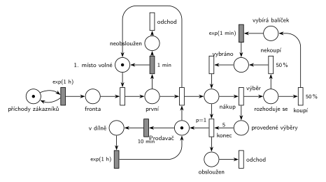

# Pražírna kávy

## Zadání

> Do pražírny kávy příchází zákazníci v intervalech exponenciálně se středem 1 hodina. V pražírně pracuje jeden prodavač. Prodavač se přemisťuje mezi prodejnou a dílnou na pražení kávy. Zákazníci se řadí do fronty a čekají na prodavače s tím specifikem, že vždy první ve frontě po přesně 1 minutě čekání opouští prodejnu neobsloužen (tzn. netrpělivý je pouze první zákazník ve frontě). Pokud je prodavač v prodejně, obsluhuje zákazníky do vyčerpání fronty. Pokud je prodavač v prodejně, pak po přesně 10 minutách čekání na zákazníka odchází do dílny, kde praží kávu. Pražení trvá exponenciálně se středem 1 hodina. Po dokončení práce se prodavač vrací do prodejny (doby přesunu zanedbáváme). Zákazník si kupuje 0 až 5 balíčků kávy. Výběr a zakoupení každého jednotlivého balíčku mu zabere exponenciálně se středem 1 minuta.
>
> Poznámka: Zákazník tedy provede právě 5 iterací nákupu, kde každý z nich je pravděpodobnostní.

Podobné úlohy: [Netrpělivý první ve frontě](<../../02 - Netrpělivost a omezená fronta/02 - Netrpělivý první ve frontě/02 - Netrpělivý první ve frontě.md>), [Spánek po nečinnosti](<../../04 - Údržba a spánek/08 - Spánek po nečinnosti/08 - Spánek po nečinnosti.md>), [Výpočetní služba se spánkem](<../../10 - Počítačové systémy/02 - Výpočetní služba se spánkem/02 - Výpočetní služba se spánkem.md>), [Trafika](<../09 - Trafika/09 - Trafika.md>).

## Nápověda

<details>
<summary>Zobrazit nápovědu</summary>
<br>

- **Příchody** modeluje místo *příchody zákazníků* ve smyčce s `exp(1 h)`; zákazník čeká ve *frontě*.
- **Netrpělivý je jen první ve frontě.** Časovaný přechod přímo na *frontě* by dal odpočet každému čekajícímu (slajd 138). Proto má první čekající vlastní místo *první* s doplňkem *1. místo volné* (1 značka). Do *první* se dostane jen jeden zákazník a odpočet `1 min` (deterministicky, „po minutě“) běží jen jemu. Když odejde (*neobsloužen* → *odchod*) nebo ho prodavač začne obsluhovat, uvolní se místo pro dalšího a jeho odpočet začíná od nuly.
- Obsluhovaný zákazník už ve frontě není, takže kdo čeká za ním, je „první ve frontě“ a po minutě odchází. Jiné čtení (zákazník u pultu zůstává „první“, netrpělivost se uplatní jen při prodavači v dílně) by znamenalo vracet značku *1. místo volné* až přechodem *konec*. Při příchodech jednou za hodinu se obě varianty liší jen výjimečně.
- **Prodavač** je místo *Prodavač* (1 značka, prodavač v prodejně). Časovaný `10 min` na tomto místě je odpočet nečinnosti: když přijde zákazník, okamžité obsazení značku vezme a odpočet zanikne. Po návratu z obsluhy začíná odpočet znovu. Po `10 min` jde prodavač do *v dílně* a po `exp(1 h)` se vrací.
- „Obsluhuje zákazníky do vyčerpání fronty“ zajišťuje sémantika: okamžité obsazení má přednost před časovaným `10 min`, takže do dílny prodavač odejde, až když nikdo nečeká 10 minut.
- **5 iterací nákupu** je čítač (vzor „každá N-tá“): každý *výběr* přidá značku do *provedené výběry*. Pak se 50 % / 50 % rozhodne, jestli si zákazník balíček koupí (`exp(1 min)`), nebo ne (nulový čas). Obě větve vedou do *vybráno* a odtud zpět do *nákup*. Po pátém výběru má *konec* (`p=1`) přednost před dalším výběrem (p=0): hranou s váhou 5 vyprázdní čítač, vrátí prodavače a zákazník odchází přes *obsloužen*. Zákazník tak koupí 0 až 5 balíčků (binomicky).
- Místo *vybráno* s okamžitým přechodem zpět je jen kvůli kresbě (do *nákupu* by jinak vedly dvě hrany zpět); v nulovém čase se tím nic nemění.
- **Pravděpodobnost nákupu v zadání chybí.** Je zvolena 50 %, v síti stačí napsat jiné číslo.

</details>

## Petriho síť

<details>
<summary>Zobrazit Petriho síť</summary>
<br>



</details>

## Časté chyby

<details>
<summary>Zobrazit časté chyby</summary>
<br>

- Časovaný přechod netrpělivosti přímo na *frontě*: pak je netrpělivý každý čekající, ne jen první.
- Odpočet 10 minut, který nezanikne s příchodem zákazníka (např. na samostatném místě, které obsluha nebere). Prodavač by odešel uprostřed provozu.
- Iterace bez čítače (zákazník nakupuje donekonečna) nebo *konec* se stejnou prioritou jako výběr (nákup skončí náhodně dřív).
- Pravděpodobnost i priorita u stejného přechodu. Proto je mezi *výběrem* a rozhodnutím `50 %`/`50 %` místo *rozhoduje se*.
- Chybějící návrat prodavače z dílny nebo po obsluze.

</details>

## SIMLIB

<details>
<summary>Zobrazit SIMLIB kód</summary>
<br>

Model je izomorfní k Petriho síti výše: každé místo, přechod a značka mají svůj protějšek v kódu.

```cpp
// Pražírna kávy – model v SIMLIB/C++
#include "simlib.h"

const double HOD = 60;                 // časová jednotka: minuta

Facility Misto1("1. místo ve frontě"); // místo první a jeho doplněk 1. místo volné
Facility Prodavac("Prodavač");         // značka prodavače; kdo ji drží, tam prodavač je
Histogram Balicky("Počet koupených balíčků", 0, 1, 6);
int obslouzeni = 0, neobslouzeni = 0, prazeni = 0;

class Necinnost : public Event {       // přechod 10 min na místě Prodavač
  void Behavior() override;
};
Necinnost *necinnost;

void Uvolneni() {                      // prodavač je v prodejně
  if (!Prodavac.Busy())                // nikdo nečeká: začíná odpočet 10 min
    necinnost->Activate(Time + 10);
}

class Dilna : public Process {         // místo v dílně
  void Behavior() override {
    Seize(Prodavac);                   // prodavač je volný (odpočet 10 min doběhl)
    prazeni++;
    Wait(Exponential(1 * HOD));        // přechod pražení exp(1 h)
    Release(Prodavac);                 // čekající první zákazník ho hned dostane
    Uvolneni();
  }
};

void Necinnost::Behavior() { (new Dilna)->Activate(); }

class Netrpelivost : public Event {    // přechod 1 min na místě první
  Process *zakaznik;
 public:
  Netrpelivost(Process *z) : zakaznik(z) { Activate(Time + 1); }
  void Behavior() override {
    Misto1.Release(zakaznik);          // vrací 1. místo volné (postoupí další)
    zakaznik->Cancel();                // místo neobsloužen + přechod odchod
    neobslouzeni++;
  }
};

class Zakaznik : public Process {      // transakce = značka zákazníka
  void Behavior() override {
    Seize(Misto1);                     // místo fronta + postup na 1. místo
    Event *netrp = new Netrpelivost(this);
    necinnost->Passivate();            // obsazení vezme prodavače, odpočet 10 min zanikne
    Seize(Prodavac);                   // začátek obsluhy (čeká, je-li prodavač v dílně)
    delete netrp;                      // odpočet 1 min zanikne
    Release(Misto1);                   // začátek obsluhy uvolní 1. místo
    int koupeno = 0;
    for (int i = 0; i < 5; i++)        // výběr (čítač provedené výběry, konec po 5)
      if (Random() < 0.5) {            // koupí 50 % / nekoupí 50 %
        Wait(Exponential(1));          // vybírá balíček, přechod exp(1 min)
        koupeno++;
      }                                // místo vybráno, přechod další
    Balicky(koupeno);
    obslouzeni++;
    Release(Prodavac);                 // konec nákupu: prodavač zpět v prodejně
    Uvolneni();
  }                                    // místo obsloužen + přechod odchod
};

class Prichody : public Event {        // místo příchody zákazníků ve smyčce s exp(1 h)
  void Behavior() override {
    (new Zakaznik)->Activate();
    Activate(Time + Exponential(1 * HOD));
  }
};

int main() {
  Init(0, 10000 * HOD);                // modelový čas v minutách: 10 000 hodin
  necinnost = new Necinnost;
  Uvolneni();                          // prodavač začíná v prodejně
  (new Prichody)->Activate();
  Run();
  Print("Obsloužení: %d, neobsloužení: %d, pražení: %d\n",
        obslouzeni, neobslouzeni, prazeni);
  Prodavac.Output();
  Balicky.Output();
}
```

| Petriho síť | SIMLIB |
|---|---|
| *příchody zákazníků* ⇄ `exp(1 h)` | událost `Prichody`, znovu za `Exponential(1 * HOD)` |
| značka zákazníka | proces `Zakaznik` |
| *fronta* + postup, *první* / *1. místo volné* | `Facility Misto1`: `Seize(Misto1)`, fronta je vnitřní fronta zařízení |
| `1 min` na místě *první* | událost `Netrpelivost`: `Misto1.Release(zakaznik); zakaznik->Cancel();` |
| *Prodavač* + začátek obsluhy (uvolní 1. místo) | `Seize(Prodavac); delete netrp; Release(Misto1);` |
| `10 min` na místě *Prodavač* | událost `Necinnost`: `Activate(Time + 10)` po uvolnění, `Passivate()` při obsazení |
| *v dílně* → `exp(1 h)` | proces `Dilna`: `Seize(Prodavac); Wait(Exponential(1 * HOD)); Release(Prodavac);` |
| *výběr* + čítač *provedené výběry*, *konec* (`p=1`, váha 5) | `for (int i = 0; i < 5; i++)` |
| `50 %` koupí / `50 %` nekoupí | `if (Random() < 0.5)` |
| *vybírá balíček* → `exp(1 min)` | `Wait(Exponential(1))` |
| *konec* vrací prodavače, *obsloužen* + *odchod* | `Release(Prodavac); Uvolneni();`, konec `Behavior()` |

**Kontrola simulací.** Petriho síť: platí *1. místo volné* + *první* = 1 a prodavač je vždy právě v jednom stavu (*Prodavač*, *v dílně*, nebo obsluhuje: *nákup*, *rozhoduje se*, *vybírá balíček*, *vybráno*); v *provedené výběry* je nejvýš 5 značek (`make check`). SIMLIB model: za 10 000 hodin přišlo asi 10 000 zákazníků, obslouženo bylo 1773 (18 %), 8251 odešlo po minutě neobslouženo a prodavač šel 8502× pražit. Prodavač tráví v dílně většinu času (cyklus 10 min čekání + 60 min pražení), takže většina zákazníků odchází neobsloužena; to odpovídá číslům v zadání. Počet koupených balíčků odpovídá binomickému rozdělení Bi(5; 0,5): průměr 2,49 (teoreticky 2,5), 0 balíčků 2,7 % (teoreticky 1/32 ≈ 3,1 %).

</details>

## Původ a zdroje

<details>
<summary>Zobrazit původ a zdroje</summary>
<br>

**Původ:** půlsemestrální písemka 2010/11 (bodování neuvedeno).

**Původní znění:**

> Do pražírny kávy příchází zákazníci v intervalech daných exponenciálním rozložením se středem 1 hodina. V pražírně pracuje jeden prodavač. Prodavač se přemisťuje mezi prodejnou a dílnou na pražení kávy. Zákazníci se řadí do fronty a čekají na prodavače s tím specifikem, že vždy první ve frontě po minutě čekání opouští prodejnu neobsloužen (tzn. netrpělivý je pouze první zákazník ve frontě). Pokud je prodavač v prodejně, obsluhuje zákazníky do vyčerpání fronty. Pokud je prodavač v prodejně, pak po 10 minutách čekání na zákazníka odchází do dílny, kde praží kávu. Doba pražení se řídí exponenciálním rozložením se středem 1 hodina. Po dokončení práce se prodavač vrací do prodejny (doby přesunu zanedbáváme). Zákazník si kupuje 0 až 5 balíčků kávy. Výběr a zakoupení každého jednotlivého balíčku mu zabere dobu, která se řídí exponenciálním rozložením se středem 1 minuta.
>
> Poznámka: Zákazník tedy provede právě 5 iterací nákupu, kde každý z nich je pravděpodobnostní.

**Zdroje:**

- `Fitcheats/Půlsemestrálky/Zadání z minulých let/2010-11.pdf`, str. 2 (zadání, úloha 4)
- `Fitcheats/Skripta/FIT - Studentská skripta 2015-16.pdf`, str. 46–47 (zadání a studentské řešení s komentáři)

**Existující řešení:**

- **Studentská skripta, str. 47 (kresleno na počítači, „Zase bez záruky“):** v podstatě stejná struktura jako tady: „fronta“ → „prvý“ → obsazení prodavače „v predajni“ → „predávač + zákazník“, váha 5 do „počet výberov“ a přechod `p=1` (tady naopak čítač *provedené výběry*, který *konec* vyprázdní hranou s váhou 5; obojí je správně), „kúpi“ → `exp(1m)` / „nekúpi“, „ukončenie nákupu“ vrací prodavače. Prodavač má smyčku `exp(10m)` → „v dielni“ → `exp(1h)`. Rozdíly a chyby:
  - „prvý“ je místo s „kapacita = 1“. V notaci kurzu se kapacity míst nepoužívají; nahradí je doplňkové místo;
  - `exp(1m)` u netrpělivosti a `exp(10m)` u nečinnosti. Zadání má pevné časy („po minutě“, „po 10 minutách“);
  - „kúpi“/„nekúpi“ nemají pravděpodobnosti;
  - přechod `p=1` je nakreslený bíle jako časované přechody, přestože je okamžitý (časovaný přechod prioritu mít nemůže).
- Komentáře pod řešením: námitka, že zákazník může iterovat donekonečna, neplatí (odpověď pod ní: iterace jsou jen 5, pak dojdou značky v „počet výberov“). Druhá námitka („Omezení kapacity pro prvního zákazníka je špatně…“) je druhé čtení popsané v nápovědě.

</details>

## Reference

- [Jak síť funguje](<../../../basics/Jak síť funguje.md>)
- [Notace a vzory](<../../../basics/Notace a vzory.md>)

<!-- -->

- [Studijní plán](<../../Studijní plán.md>)
- [Seznam úloh](<../../Seznam úloh.md>)
