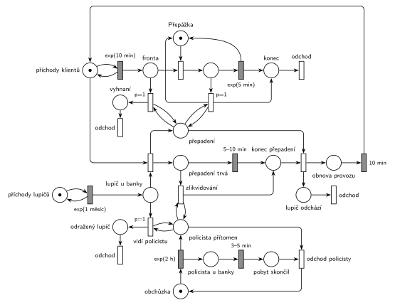

# Banka a lupič

## Zadání

> Do banky přichází klienti v intervalech exponenciálně se středem 10 minut. V bance je jedna přepážka. Doba obsluhy klienta u přepážky je exponenciálně se středem 5 minut. Po obsloužení opouští klient banku. V intervalech exponenciálně se středem 1 měsíc přepadne banku lupič. V okamžiku přepadení opouští případný klient u přepážky banku, všichni klienti ve frontě na přepážku opouští banku a po dobu přepadení nepřichází žádní další klienti. Přepadení banky trvá rovnoměrně 5–10 minut. V systému se pohybuje jeden policista, který v intervalech exponenciálně se středem 2 hodiny prochází kolem banky. U banky se zdrží vždy rovnoměrně 3–5 minut. Pokud uvidí přicházející lupič policistu u banky, opouští systém. Pokud policista přijde v době, kdy je banka v přepadení, lupiče okamžitě zlikviduje. Po přesně 10 minutách po ukončení přepadení banky (nebo po zlikvidování lupiče) se v bance obnoví normální provoz.
>
> Poznámka: Po dobu přepadení banky je proces příchodů transakcí přerušen.

Podobné úlohy: [Psí salon](<../03 - Psí salon/03 - Psí salon.md>) (vyprázdnění fronty a pauza příchodů), [Výletní loď](<../../11 - Doprava a dávky/04 - Výletní loď/04 - Výletní loď.md>) (vyprázdnění fronty v jednom okamžiku), [Porucha zruší obsluhu](<../../03 - Poruchy/01 - Porucha zruší obsluhu/01 - Porucha zruší obsluhu.md>), [Banka se třemi pracovníky](<../19 - Banka se třemi pracovníky/19 - Banka se třemi pracovníky.md>).

## Nápověda

<details>
<summary>Zobrazit nápovědu</summary>
<br>

- **Klienti** jsou běžné M/M/1: *příchody klientů* ve smyčce s `exp(10 min)`, *fronta*, *Přepážka*, `exp(5 min)`; obsloužený klient odchází přes *konec* přechodem *odchod*.
- **Lupič** má vlastní generátor (*příchody lupičů*, `exp(1 měsíc)`) a přichází do místa *lupič u banky*. Simulátor počítá měsíc jako 30 dní.
  - *vidí policistu* (`p=1`): testovací dvojice hran na *policista přítomen*. Lupič odchází ze systému přes *odražený lupič* vlastním výstupním přechodem.
  - jinak přechod přepadení (`p=0`): vezme lupiče a **značku příchodů klientů**. Odpočet příchodu tím zanikne a do konce obnovy nikdo nepřichází (vzor zastavení příchodů, jako u psího salonu). Přechod dá značku do dvou míst: *přepadení* (stav, který testují přechody vyhnání) a *přepadení trvá* (odpočet `5–10 min`).
- **V okamžiku přepadení** odcházejí klienti dvěma přechody `p=1` s testem na *přepadení*: klient u přepážky (vrací *Přepážku*, jeho `exp(5 min)` zanikne) a smyčka, která vyprázdní *frontu*. Priorita zajistí, že vše proběhne v okamžiku přepadení, před případným obsazením přepážky. Nově nikdo nepřichází, takže test na *přepadení* už potom nic dalšího nevyhodí.
- Klient vyhnaný z fronty odchází přes *vyhnaní* vlastním výstupním přechodem, klient od přepážky přes *konec*. Obojí je odchod ze systému; dva přechody jsou tu jen kvůli přehlednosti kresby.
- **Konec přepadení** nastane jedním ze dvou způsobů:
  - časovaný `5–10 min` na *přepadení trvá*;
  - *zlikvidování*: okamžitý přechod *přepadení trvá* + test na *policista přítomen*. Když policista přijde, vezme značku *přepadení trvá* a odpočet `5–10 min` zanikne.

  Oba vedou do místa *konec přepadení*. Následující okamžitý přechod vezme i stav *přepadení*; *lupič odchází* (ze systému) a začíná *obnova provozu*: po `10 min` se značka vrátí do *příchodů klientů*.
- **Policista** je jedna značka v cyklu *obchůzka* → `exp(2 h)` → *policista přítomen* (+ *policista u banky*) → `3–5 min` → *pobyt skončil* → *odchod policisty* → *obchůzka*. Příchod dá značku do dvou míst: *policista přítomen* testují lupičovy přechody, na *policista u banky* běží odpočet `3–5 min`. Po odpočtu okamžitý *odchod policisty* vezme obě značky (*pobyt skončil* i *policista přítomen*) a vrátí policistu na obchůzku. Interval 2 h se počítá od odchodu od banky.
- Přepadení nezačne, když je policista u banky (lupič odejde s `p=1`). *Zlikvidování* se proto provede, jen když policista přijde během přepadení, přesně podle zadání.
- **Neřešený případ:** lupič, který přijde během přepadení nebo obnovy, počká v *lupič u banky*, až se obnoví provoz (nebo odejde, když uvidí policistu). Při středu 1 měsíc to prakticky nenastane.
- **Proč jsou přítomnost policisty a přepadení samostatná místa:** testovací hrana značku na okamžik vezme a vrátí. Kdyby *vidí policistu* a *zlikvidování* testovaly přímo místo, ze kterého bere časovaný `3–5 min`, každý test by jeho odpočet zrušil a spustil znovu (slajdy 137–139) a policista by u banky zůstal déle. Proto se testuje *policista přítomen*, které časovaný přechod nebere, a odpočet běží na *policista u banky*. Stejně je stav *přepadení*, testovaný přechody vyhnání, oddělený od odpočtu *přepadení trvá*. Tam by to na chování nic neměnilo (vyhnání proběhne v okamžiku přepadení, kdy odpočet teprve začíná), ale síť je tak čistá: nic, co se testuje, není vstupem časovaného přechodu.

</details>

## Petriho síť

<details>
<summary>Zobrazit Petriho síť</summary>
<br>



</details>

## Časté chyby

<details>
<summary>Zobrazit časté chyby</summary>
<br>

- Zastavení příchodů odebráním značky z *fronty* místo z *příchodů klientů*.
- Vyprázdnění fronty hranou s váhou: váha bere přesný počet; na „všechny“ je potřeba smyčka s prioritou.
- Klient u přepážky, který při přepadení odejde, ale nevrátí značku *Přepážce*. Po přepadení by se banka zastavila.
- Policista jako generátor nových policistů místo jedné značky v cyklu. V systému je jen jeden.
- Zlikvidování bez návaznosti na obnovu: zadání chce 10 minut i po zlikvidování lupiče.
- Lupič, který přepadne banku, i když je policista u banky (chybí priorita testu na policistu).
- Jediné místo „policista u banky“, které je vstupem `3–5 min` a zároveň ho testují *vidí policistu* a *zlikvidování*. Test odpočet zruší a spustí znovu, takže policista u banky zůstane déle. Testovaný stav patří do samostatného místa (*policista přítomen*).
- Odpočet obnovy, který vrací značku příchodů dřív, než přepadení skončí, nebo ji vrací dvakrát (po konci přepadení i po zlikvidování).

</details>

## SIMLIB

<details>
<summary>Zobrazit SIMLIB kód</summary>
<br>

Model je izomorfní k Petriho síti výše: každé místo, přechod a značka mají svůj protějšek v kódu.

```cpp
// Banka a lupič – model v SIMLIB/C++
#define I_REALLY_KNOW_HOW_TO_USE_WAITUNTIL
#include "simlib.h"
#include <set>

const double HOD = 60, DEN = 24 * HOD; // časová jednotka: minuta (měsíc = 30 dní)

Facility Prepazka("Přepážka");         // místo Přepážka (1 značka)
Histogram Doba("Doba obslouženého klienta [min]", 0, 5, 20);
bool vProvozu = true;                  // značka v místě příchody klientů
bool prepadeni = false;                // značka v místě přepadení
bool policistaPritomen = false;       // značka v místě policista přítomen
int prepadeniPocet = 0, zlikvidovani = 0, odradeni = 0, vyhnani = 0;

class Klient;
std::set<Klient *> vBance;             // značky v místech fronta a obsluha

class Klient : public Process {        // transakce = značka klienta
 public:
  bool uPrepazky = false;
  Klient() { vBance.insert(this); }
  ~Klient() { vBance.erase(this); }
  void Behavior() override {
    double prichod = Time;
    Seize(Prepazka);                   // fronta + obsazení přepážky
    uPrepazky = true;                  // místo obsluha
    Wait(Exponential(5));              // exp(5 min) ...
    Release(Prepazka);                 // ... vrací přepážku
    Doba(Time - prichod);
  }                                    // místo konec + přechod odchod
};

class Prichody : public Event {        // místo příchody klientů ve smyčce s exp(10 min)
  void Behavior() override {
    (new Klient)->Activate();
    Activate(Time + Exponential(10));
  }
};
Prichody *prichody;

class Obnova : public Event {          // místo obnova provozu, přechod 10 min
  void Behavior() override {
    vProvozu = true;                   // vrací značku příchodů klientů
    prichody->Activate(Time + Exponential(10));
  }
};

class Lupic : public Process {         // transakce = lupič
  void Behavior() override {
    WaitUntil(policistaPritomen || vProvozu); // místo lupič u banky
    if (policistaPritomen) {           // vidí policistu (p=1): odražený lupič odchází
      odradeni++;
      return;
    }
    // přepadení: vezme značku příchodů klientů, odpočet příchodu zanikne
    vProvozu = false;
    prichody->Passivate();
    prepadeni = true;                  // místo přepadení (stav)
    prepadeniPocet++;
    // přechody p=1 s testem na přepadení: nejdřív celá fronta, pak klient u přepážky
    for (int u : {0, 1})
      for (Klient *k : std::set<Klient *>(vBance))
        if (k->uPrepazky == bool(u)) {
          if (u)
            Prepazka.Release(k);       // klient od přepážky ji vrací
          k->Cancel();                 // odchod vyhnaného klienta
          vyhnani++;
        }
    Wait(Uniform(5, 10));              // přepadení trvá, přechod 5–10 min (zlikvidování ho ukončí dřív)
    prepadeni = false;                 // konec přepadení: přechod bere i stav přepadení
    (new Obnova)->Activate(Time + 10); // lupič odchází, začíná obnova provozu
  }                                    // místo lupič odchází + přechod odchod
};
Lupic *lupic = nullptr;

class PrichodyLupicu : public Event { // místo příchody lupičů ve smyčce s exp(1 měsíc)
  void Behavior() override {
    lupic = new Lupic;
    lupic->Activate();
    Activate(Time + Exponential(30 * DEN));
  }
};

class Policista : public Process {     // značka policisty: obchůzka / u banky
  void Behavior() override {
    for (;;) {
      Wait(Exponential(2 * HOD));      // místo obchůzka, přechod exp(2 h)
      policistaPritomen = true;        // místo policista přítomen
      if (prepadeni) {                 // zlikvidování: přepadení hned končí
        zlikvidovani++;
        lupic->Activate();
      }
      Wait(Uniform(3, 5));             // místo policista u banky, přechod 3–5 min
      policistaPritomen = false;       // pobyt skončil, přechod odchod policisty
    }
  }
};

int main() {
  Init(0, 10 * 365 * DEN);             // modelový čas v minutách: 10 let
  prichody = new Prichody;
  prichody->Activate();
  (new PrichodyLupicu)->Activate(Exponential(30 * DEN));
  (new Policista)->Activate();
  Run();
  Print("Přepadení: %d, zlikvidovaní lupiči: %d, odradění lupiči: %d, vyhnaní klienti: %d\n",
        prepadeniPocet, zlikvidovani, odradeni, vyhnani);
  Prepazka.Output();
  Doba.Output();
}
```

| Petriho síť | SIMLIB |
|---|---|
| *příchody klientů* ⇄ `exp(10 min)` | událost `Prichody`, znovu za `Exponential(10)`; `vProvozu` = značka v místě |
| značka klienta | proces `Klient` |
| *fronta* + *Přepážka*, `exp(5 min)` vrací přepážku | `Seize(Prepazka); Wait(Exponential(5)); Release(Prepazka);` |
| *příchody lupičů* ⇄ `exp(1 měsíc)` → *lupič u banky* | událost `PrichodyLupicu`, proces `Lupic`, `WaitUntil(policistaPritomen \|\| vProvozu)` |
| *vidí policistu* (`p=1`) → *odražený lupič* → *odchod* | `if (policistaPritomen) return;` |
| přepadení bere značku příchodů, dává *přepadení* | `vProvozu = false; prichody->Passivate(); prepadeni = true;` |
| vyhnání z fronty a od přepážky (`p=1`, test na *přepadení*) | cyklus přes `vBance`: `Cancel()`, u přepážky navíc `Prepazka.Release(k)` |
| *přepadení trvá* → `5–10 min` | `Wait(Uniform(5, 10))` v procesu `Lupic` |
| *zlikvidování* (bere *přepadení trvá*, test na *policista přítomen*) | `lupic->Activate()` z procesu `Policista` ukončí `Wait` |
| *konec přepadení* (bere i stav *přepadení*) → *lupič odchází* + *odchod* | `prepadeni = false;`, konec `Behavior()` lupiče |
| *obnova provozu* → `10 min` → *příchody klientů* | událost `Obnova` za 10 min: `vProvozu = true`, příchody znovu |
| *obchůzka* → `exp(2 h)` → *policista přítomen* + *policista u banky* → `3–5 min` → *pobyt skončil* → *odchod policisty* | proces `Policista`: `policistaPritomen = true; Wait(Uniform(3, 5)); policistaPritomen = false;` |

**Kontrola simulací.** Petriho síť (300 000 událostí, asi 2,6 roku): *Přepážka* + obsluhovaný = 1, příchody klientů + *přepadení* + *obnova provozu* = 1, *přepadení* = *přepadení trvá* + *konec přepadení*, *obchůzka* + *policista přítomen* = 1 a *policista přítomen* = *policista u banky* + *pobyt skončil*; všechny přechody se provádějí (`make check`). Za běh proběhne kolem 30 přepadení; lupič, který vidí policistu, a zlikvidování nastanou jen párkrát (policista je u banky asi 3 % času). SIMLIB model: za 10 let proběhlo 136 přepadení (teoreticky 3650 / 30 ≈ 122), 12 lupičů policista zlikvidoval (přijde-li během přepadení: asi 7,5 min / 2 h ≈ 6 %) a 3 lupiče odradil (≈ 3 %). Vyhnáno bylo 140 klientů, v průměru jeden na přepadení, což odpovídá střednímu počtu klientů v M/M/1 s vytížením ρ = 0,5: ρ / (1 − ρ) = 1. Přepážka byla vytížena na 50 %.

</details>

## Původ a zdroje

<details>
<summary>Zobrazit původ a zdroje</summary>
<br>

**Původ:** půlsemestrální písemka 2010/11 (bodování neuvedeno).

**Původní znění:**

> Do banky přichází klienti v intervalech daných exponenciálním rozložením se středem 10 minut. V bance je jedna přepážka. Doba obsluhy klienta u přepážky se řídí exponenciálním rozložením se středem 5 minut. Po obsloužení opouští klient banku. V intervalech daných exponenciálním rozložením se středem 1 měsíc přepadne banku lupič. V okamžiku přepadení opouští případný klient u přepážky banku, všichni klienti ve frontě na přepážku opouští banku a po dobu přepadení nepřichází žádní další klienti. Přepadení banky trvá rovnoměrně 5 až 10 minut. V systému se pohybuje jeden policista, který v intervalech daných exponenciálním rozložením se středem 2 hodiny prochází kolem banky. U banky se zdrží vždy 3-5 minut rovnoměrně. Pokud uvidí přicházející lupič policistu u banky, opouští systém. Pokud policista přijde v době, kdy je banka v přepadení, lupiče okamžitě zlikviduje. Po deseti minutách po ukončení přepadení banky (nebo po zlikvidování lupiče) se v bance obnoví normální provoz.
>
> Poznámka: Po dobu přepadení banky je proces příchodů transakcí přerušen.

**Zdroje:**

- `Fitcheats/Půlsemestrálky/Zadání z minulých let/2010-11.pdf`, str. 1 (zadání, úloha 1 „Banka“)

**Existující řešení:**

- V materiálech k této úloze žádné řešení není (ani Hrubého, ani studentské). Banka ve Studentských skriptech (str. 48–49) je jiná úloha, [Banka se třemi pracovníky](<../19 - Banka se třemi pracovníky/19 - Banka se třemi pracovníky.md>).

</details>

## Reference

- [Jak síť funguje](<../../../basics/Jak síť funguje.md>)
- [Notace a vzory](<../../../basics/Notace a vzory.md>)
- [Seznam úloh](<../../Seznam úloh.md>)
