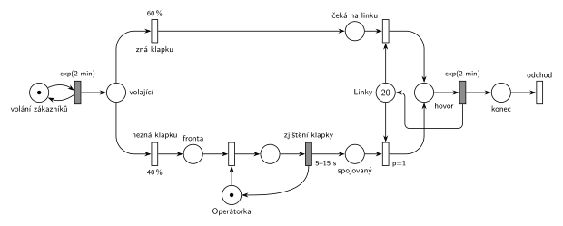

# 09-22 Telefonní ústředna

## Zadání

> Firma F používá telefonní ústřednu s kapacitou 20 současných telefonních hovorů. Zákazníci volají různým zaměstnancům firmy průměrně 30krát za hodinu (Poissonův proces příchodů).
> Existují dvě možnosti: 60 procent telefonujících zná místní telefonní číslo zaměstnance (klapku) a ústředna mu přidělí volnou linku automaticky.
> Zbylých 40 procent volajících klapku nezná a jsou přepojeni na operátorku.
> Zjištění klapky u operátorky trvá rovnoměrně 5–15 sekund. Poté má volající spojovaný přes operátorku vyšší prioritu při obsazování některé z linek.
> Hovor trvá exponenciálně se středem 2 minuty.
> Po skončení hovoru a uvolnění linky volající požadavek opouští systém.

Podobné úlohy: [Dva proudy příchodů](<../../07 - Priority/04 - Dva proudy příchodů/04 - Dva proudy příchodů.md>), [Opravářská dílna](<../../01 - Základní modely/01 - Opravářská dílna/01 - Opravářská dílna.md>).

## Nápověda

<details>
<summary>Zobrazit nápovědu</summary>
<br>

- **30 volání za hodinu** v Poissonově procesu znamená exponenciální intervaly se středem 60/30 = **2 minuty**: místo *volání zákazníků* ve smyčce s `exp(2 min)`.
- **Rozdělení** z místa *volající*: `60 %` nahoru (*zná klapku*), `40 %` dolů (*nezná klapku*).
- **Operátorka** je jedno zařízení. Volající na ni čekají ve *frontě* a po `5–15 s` (rovnoměrně) ji uvolní. Že by operátorku držel až do přidělení linky, zadání neříká.
- **Ústředna s kapacitou 20 hovorů** je sklad: místo *Linky* s 20 značkami mezi oběma řadami. Hovor zabere jednu značku a `exp(2 min)` ji vrací. Běžný časovaný přechod má pro každou značku v místě *hovor* vlastní odpočet (slajd 138), takže 20 hovorů běží souběžně.
- **Vyšší priorita při obsazování linek:** oba proudy mají vlastní místo čekajících (*čeká na linku*, *spojovaný*) a vlastní obsazovací přechod. Přechod spojovaných má `p=1`, takže když se linka uvolní a čekají oba druhy volajících, dostane ji spojovaný.
- Hovor s operátorkou linku z dvaceti nezabírá: podle zadání se linka přiděluje až po zjištění klapky.
- Po hovoru volající odchází přes *konec* přechodem *odchod*.
- Při zatížení 1 Erlang (30/h × 2 min) jsou linky skoro vždy volné, takže priorita se uplatní jen výjimečně. Na struktuře sítě to nic nemění.

</details>

## Petriho síť

<details>
<summary>Zobrazit Petriho síť</summary>
<br>



</details>

## Časté chyby

<details>
<summary>Zobrazit časté chyby</summary>
<br>

- Přepočet „30krát za hodinu“ na `exp(30 min)` nebo `exp(20 min)`. Správně je střed 2 minuty.
- Jedno společné místo čekajících pro oba druhy volajících. Pak priorita spojovaných nejde vyjádřit.
- Priorita napsaná u přechodu `40 %` místo u obsazení linky. Přechod má jen jeden parametr a priorita má rozhodovat o lince.
- *Linky* s jednou značkou nebo hovor jako zařízení: ústředna zvládne 20 hovorů současně.
- Chybějící návrat značky operátorce nebo lince.

</details>

## SIMLIB

<details>
<summary>Zobrazit SIMLIB kód</summary>
<br>

Model je izomorfní k Petriho síti výše: každé místo, přechod a značka mají svůj protějšek v kódu.

```cpp
// Telefonní ústředna – model v SIMLIB/C++
#include "simlib.h"

const double SEK = 1.0 / 60;           // časová jednotka: minuta

Store Linky("Linky", 20);              // místo Linky (20 značek)
Facility Operatorka("Operátorka");     // místo Operátorka (1 značka)
Histogram Cekani("Čekání na linku [min]", 0, 0.01, 10);
int znaji = 0, pres_operatorku = 0;

class Volajici : public Process {      // transakce = značka volajícího
  void Behavior() override {
    if (Random() < 0.6) {              // zná klapku 60 %: místo čeká na linku
      znaji++;
    } else {                           // nezná klapku 40 %
      pres_operatorku++;
      Seize(Operatorka);               // fronta + obsazení operátorky
      Wait(Uniform(5 * SEK, 15 * SEK)); // zjištění klapky 5–15 s, vrací operátorku
      Release(Operatorka);
      Priority = 1;                    // místo spojovaný: obsazení linky p=1
    }
    double cekani = Time;
    Enter(Linky, 1);                   // obsazení linky (priorita procesu řadí frontu)
    Cekani(Time - cekani);
    Wait(Exponential(2));              // místo hovor, přechod exp(2 min) ...
    Leave(Linky, 1);                   // ... vrací linku
  }                                    // místo konec + přechod odchod
};

class Prichody : public Event {        // místo volání zákazníků ve smyčce s exp(2 min)
  void Behavior() override {
    (new Volajici)->Activate();
    Activate(Time + Exponential(2));   // 30 volání za hodinu
  }
};

int main() {
  Init(0, 1000 * 60);                  // modelový čas v minutách: 1000 hodin
  (new Prichody)->Activate();
  Run();
  Print("Znali klapku: %d, přes operátorku: %d\n", znaji, pres_operatorku);
  Linky.Output();
  Operatorka.Output();
  Cekani.Output();
}
```

| Petriho síť | SIMLIB |
|---|---|
| *volání zákazníků* ⇄ `exp(2 min)` | událost `Prichody`, znovu za `Exponential(2)` |
| značka volajícího | proces `Volajici` |
| `60 %` / `40 %` | `if (Random() < 0.6)` |
| *fronta* + *Operátorka* (1 značka), `5–15 s` vrací značku | `Seize(Operatorka); Wait(Uniform(5 * SEK, 15 * SEK)); Release(Operatorka);` |
| *čeká na linku* / *spojovaný* + obsazení linky (`p=1` u spojovaných) | `Enter(Linky, 1)`, spojovaný má `Priority = 1` (řadí ho ve frontě skladu dopředu) |
| *Linky* (20 značek) | `Store Linky("Linky", 20)` |
| *hovor* → `exp(2 min)` vrací linku | `Wait(Exponential(2)); Leave(Linky, 1);` |
| *konec* + *odchod* | konec metody `Behavior()` |

**Kontrola simulací.** Petriho síť: *Linky* + *hovor* = 20 a *Operátorka* + obsluhovaný = 1 (`make check`). Současně běží nejvýš kolem 7 hovorů, fronta na operátorku zůstává krátká. SIMLIB model: za 1000 hodin přišlo 29 992 volání (teoreticky 30 000), 40 % přes operátorku. Obsazených linek bylo v průměru 1,00 (teoreticky 1 Erlang = 1/2 volání za minutu × 2 min), nejvýš 8, takže na linku nikdo nečekal a priorita spojovaných se neuplatnila. Operátorka byla vytížena na 3,3 % (0,4 · 1/2 za minutu × 10 s = 1/30).

</details>

## Původ a zdroje

<details>
<summary>Zobrazit původ a zdroje</summary>
<br>

**Původ:** půlsemestrální písemka, rok neznámý (zadání zapsané ve Studentských skriptech 2015/16).

**Původní znění** (zápis studentů ve skriptech, nadepsaný „možná jiné konstanty“; oficiální zadání v materiálech není):

> Firma F používá telefonní ústřednu s kapacitou 20 současných telefonních hovorů. Zákazníci volají různým zaměstnancům firmy průměrně 30krát za hodinu (Poissonův proces příchodů).
> Existují dvě možnosti: 60 procent telefonujících zná místní telefonní číslo zaměstnance (klapku) a ústředna mu přidělí volnou linku automaticky.
> Zbylých 40 procent volajících klapku nezná a jsou přepojeni na operátorku.
> Zjištění klapky u operátorky trvá dobu danou rovnoměrným rozložením od 5 do 15 sekund. Poté má volající spojovaný přes operátorku vyšší prioritu při obsazování některé z linek.
> Doba hovoru se řídí exponenciálním rozložením se střední hodnotou 2 minuty.
> Po skončení hovoru a uvolnění linky volající požadavek opouští systém.

**Zdroje:**

- `Fitcheats/Skripta/FIT - Studentská skripta 2015-16.pdf`, str. 42–43 (zadání „Příklad ústředna (možná jiné konstanty)“ a ručně kreslené studentské řešení)

**Existující řešení:**

- **Studentská skripta, str. 43 (ručně kreslené):** stejná kostra: `60%`/`40%`, místo „linka“ s 20 značkami, `exp(2min)` vrací linku, „operátorka“ s jednou značkou, obsazení linky `p=1` (přímo) a `p=2` (přes operátorku). Rozdíly a chyby:
  - generátor `exp(20min)` s otazníkem; 30 volání za hodinu je střed **2 minuty**;
  - časovaný `5-15s` bere značku operátorky přímo (bez okamžitého obsazení). To ještě funguje, protože operátorka je jen jedna;
  - operátorka se vrací až přechodem `p=2`, tedy až když volající dostane linku. Pokud by byly všechny linky obsazené, operátorka by zbytečně čekala s ním;
  - za `exp(2min)` šipka mizí za okrajem fotky, výstupní přechod není vidět.
- Pod řešením je dotaz „Neni to spíš takhle, protože by mel cekat na volnou operátorku?“ s odkazem na obrázek, který už není dostupný. Ve fotce volající na operátorku čeká už teď (přechod `5-15s` potřebuje její značku).

</details>

## Reference

- [Jak síť funguje](<../../../basics/Jak síť funguje.md>)
- [Notace a vzory](<../../../basics/Notace a vzory.md>)

<!-- -->

- [Studijní plán](<../../Studijní plán.md>)
- [Seznam úloh](<../../Seznam úloh.md>)
