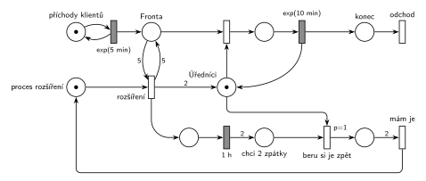

# 09–01 – Úřad

**Původ:** půlsemestrální písemka 2025/26, varianta D, 10 bodů (bodování podle ostatních let).

**Zdroj:**

- `Fitcheats/Půlsemestrálky/Hrubý - Řešení 2025-26.pdf`, str. 4

## Zadání

> ⚠️ **Rekonstrukce.** Zadání z roku 2025/26 v materiálech chybí, existuje jen Hrubého řešení. Text níže je odvozený z jeho sítě a poznámek („proces rozšíření kapacity“, „2 „extra““, „chci 2 zpátky“, „beru si je zpět“). Čísla jsou převzatá z řešení.
>
> Na úřad přichází klienti v intervalech daných exponenciálním rozložením se středem 5 minut. Klienty obsluhuje jeden úředník, vyřízení klienta trvá dobu danou exponenciálním rozložením se středem 10 minut. Pokud ve frontě čeká alespoň 5 klientů, přijdou na pomoc dva další úředníci na dobu 1 hodiny. Po uplynutí hodiny odcházejí, rozpracované klienty ale nejdřív dokončí. V modelu jednoznačně ukažte (přechodem) moment, kdy transakce opouští systém.

Všimni si: jeden úředník (10 min) na příchody každých 5 minut nestačí, fronta by bez posil rostla do nekonečna. Se třemi úředníky se zase zkracuje.

Podobné úlohy: [09–15 – Úřad s dodatečnými přepážkami](<../09–15 - Úřad s dodatečnými přepážkami/09–15 - Úřad s dodatečnými přepážkami.md>), [05–02 – Dočasně MM2 při dlouhé frontě](<../05–02 - Dočasně MM2 při dlouhé frontě/05–02 - Dočasně MM2 při dlouhé frontě.md>), [05–08 – Sklad s dočasně větší kapacitou](<../05–08 - Sklad s dočasně větší kapacitou/05–08 - Sklad s dočasně větší kapacitou.md>), [05–10 – Pomocník přidá kapacitu](<../05–10 - Pomocník přidá kapacitu/05–10 - Pomocník přidá kapacitu.md>).

## Interpretace

Zobrazit interpretaci (nápověda)

- **Úředníci** jsou jedna linka typu sklad: místo *Úředníci* má na začátku jednu značku, posily do něj přidají další dvě (hrana s váhou 2).
- **„Alespoň 5 ve frontě“** je test dvojicí hran s váhou 5 (do přechodu a zpět), fronta se tím nezmění. Kdyby zadání znělo „víc než 5“, byla by váha 6.
- **Proces rozšíření** je samostatná značka. Dokud jsou posily na úřadě, značka v *proces rozšíření* chybí, takže se posily nepřivolají podruhé.
- **Návrat posil:** po `1 h` vznikne v místě *chci 2 zpátky* dvojice značek. Přechod *beru si je zpět* vezme jednu volnou značku *Úředníků*, takže pracující úředník nejdřív dokončí klienta. Úředníci se vrací po jednom, *mám je* čeká (váha 2), až se vrátí oba. Pak je proces připravený na další přivolání.
- **`p=1` na *beru si je zpět*:** když úředník dokončí klienta a ve frontě někdo čeká, jsou proveditelné oba přechody, *beru si je zpět* i obsazení linky. Priorita zajistí, že posila po hodině nezačne nového klienta. Hrubý prioritu nepsal, bez ní by se konflikt řešil náhodně.
- Značky v místě *Úředníci* jsou nerozlišitelné: je jedno, jestli odejde „posila“, nebo „původní“ úředník, důležitý je jen počet.

## Řešení

Zobrazit řešení

| Požadavek | Prvek sítě |
|---|---|
| příchody exp(5 min) | *generátor* ⇄ `exp(5 min)` → *Fronta* |
| jeden úředník, exp(10 min) | *Úředníci* (1 značka), obsazení, `exp(10 min)` vrací značku |
| ve frontě alespoň 5 klientů | *rozšíření*: hrany s váhou 5 z *Fronty* a zpět + značka *procesu rozšíření* |
| dva další úředníci | *rozšíření* → *Úředníci* s váhou 2 |
| po 1 h odcházejí | `1 h` → 2 značky v *chci 2 zpátky* → `p=1` *beru si je zpět* (bere volného úředníka) → *mám je* (váha 2) → *proces rozšíření* |
| odchod ze systému | *konec* → přechod *odchod* bez výstupu |

Kontrola simulací: platí *Úředníci* + obsluhovaní = 1 + dosud nevrácené posily a značka procesu rozšíření se nikdy neztratí. Posily přichází zhruba každou hodinu a půl, fronta zůstává omezená (nejvýš kolem 25).

## Existující řešení

Zobrazit srovnání s existujícími řešeními

- **Hrubý (str. 4):** stejná síť: *proces rozšíření kapacity* s testem fronty vahou 5, hrana „2 „extra““ do linky, `1h`, váha 2 do *chci 2 zpátky*, *beru si je zpět* po jednom a *mám je* s váhou 2 zpět do procesu. Rozdíly: linku kreslí nad hlavní řadou (tady je pod ní, aby se hrany posil nekřížily s frontou) a nepíše prioritu u *beru si je zpět* (viz Interpretace).

## Časté chyby

Zobrazit časté chyby

- Odebrání obou posil jedním přechodem s váhou 2: čeká, až budou volné dvě značky naráz. Mezitím si každou uvolněnou značku může vzít další klient, takže posily mohou zůstat mnohem déle než hodinu.
- Odebrání posil hned po hodině i s rozpracovaným klientem: značka v *Úřednících* v tu chvíli není, takže to bez přerušení obsluhy ani nejde. Zadání chce, aby klienta dokončili.
- Test fronty jednou hranou s váhou 5 bez návratu: přechod pět klientů z fronty odebere.
- Chybějící procesní značka: přechod rozšíření by se prováděl znovu a znovu, dokud je ve frontě aspoň 5 klientů, a přidával by další úředníky.
- Zapomenutý návrat značky procesu po *mám je*: posily by přišly jen jednou.

