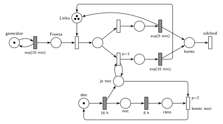

# 09–02 – Obslužné centrum

**Původ:** půlsemestrální písemka 2025/26, varianta B, 10 bodů (bodování podle ostatních let).

**Zdroj:**

- `Fitcheats/Půlsemestrálky/Hrubý - Řešení 2025-26.pdf`, str. 2

## Zadání

> ⚠️ **Rekonstrukce.** Zadání z roku 2025/26 v materiálech chybí, existuje jen Hrubého řešení. Text níže je odvozený z jeho sítě a poznámek („if-else“, „je noc“, „proces den/noc“). Čísla jsou převzatá z řešení. Že délka obsluhy závisí na denní době v okamžiku jejího začátku, je odvozené ze sítě.
>
> Do obslužného centra přichází zákazníci v intervalech daných exponenciálním rozložením se středem 10 minut. Zákazníky obsluhují tři linky. Ve dne trvá obsluha dobu danou exponenciálním rozložením se středem 5 minut, v noci se středem 10 minut. Den trvá 16 hodin, noc 8 hodin, model začíná ráno. V modelu jednoznačně ukažte (přechodem) moment, kdy transakce opouští systém.

Podobné úlohy: [09–04 – Centrum MM1 s rychlým režimem](<../09–04 - Centrum MM1 s rychlým režimem/09–04 - Centrum MM1 s rychlým režimem.md>) (délka obsluhy podle režimu), [12–11 – Přečerpávací elektrárna](<../12–11 - Přečerpávací elektrárna/12–11 - Přečerpávací elektrárna.md>) (cyklus den/noc 16 h/8 h), [11–09 – Překladiště s jeřábem](<../11–09 - Překladiště s jeřábem/11–09 - Překladiště s jeřábem.md>).

## Interpretace

Zobrazit interpretaci (nápověda)

- **Tři linky** jsou jeden sklad: místo *Linka* se třemi značkami (Hrubý je kreslí jako tři tečky). Každý zákazník zabere jednu.
- **Délka obsluhy** se rozhodne v okamžiku začátku obsluhy (if-else za obsazením linky). Obsluha začatá ve dne doběhne s `exp(5 min)`, i když mezitím nastane noc. Přepínat rychlost uprostřed obsluhy by vyžadovalo přerušení, to zadání (v rekonstrukci) nechce.
- **If-else přes prioritu:** přechod *v noci* s `p=1` testuje místo *je noc* smyčkou (značku vezme a hned vrátí). Ve dne proveditelný není, takže se provede přechod *ve dne* (p=0). Inhibiční hranu („není noc“) Hrubý nepoužívá.
- **Proces den/noc** je samostatná značka: *den* → `16 h` → *noc* → `8 h` → *ráno* → *konec noci* → *den*. Přechod `16 h` zároveň označí *je noc*, *konec noci* tuto značku odebere.
- **Proč dvě místa *noc* a *je noc*:** kdyby se testovalo přímo místo *noc*, smyčka přechodu *v noci* by značku na okamžik odebrala a probíhající odpočet `8 h` by podle sémantiky časovaného přechodu (slajd 139) zanikl a začal znovu. Stavové místo *je noc* proto do žádného časovaného přechodu nevede.
- **`p=2` na *konci noci*** zajistí, že noc skončí dřív, než se ve stejném okamžiku rozhoduje zákazník. Hrubý si k tomu připsal, že „priorita zde není ESENCIÁLNÍ“: v zásadě je jedno, jak by taková souběžná situace dopadla.

## Řešení

Zobrazit řešení

| Požadavek | Prvek sítě |
|---|---|
| příchody exp(10 min) | *generátor* ⇄ `exp(10 min)` → *Fronta* |
| tři linky | *Linka* (3 značky), obsazení; oba časované přechody obsluhy vrací značku |
| ve dne exp(5 min) | přechod *ve dne* (p=0) → `exp(5 min)` |
| v noci exp(10 min) | přechod *v noci* (`p=1`, smyčka s *je noc*) → `exp(10 min)` |
| den 16 h, noc 8 h | *den* → `16 h` → *noc* (+ *je noc*) → `8 h` → *ráno* → `p=2` (bere *je noc*) → *den* |
| odchod ze systému | *konec* → přechod *odchod* bez výstupu |

Kontrola simulací: platí *Linka* + obsluhovaní = 3, *den* + *noc* + *ráno* = 1 a *den* + *je noc* = 1. V noční větvi skončí asi třetina zákazníků (8 h z 24 h), fronta zůstává krátká (nejvýš asi 5).

## Existující řešení

Zobrazit srovnání s existujícími řešeními

- **Hrubý (str. 2):** stejná síť: tři značky v *Lince*, if-else s `p=1` a smyčkou na *je noc*, proces den/noc `16h` → `8h` → `p=2`. Rozdíl je jen v uvolnění linky: obě obsluhy u něj vedou do společného místa a teprve přechod za ním vrací značku *Lince* a zároveň ukončuje transakci. Tady je uvolnění sloučené s oběma časovanými přechody (jako na slajdu 164) a odchod je samostatný přechod bez výstupu. Obojí je správně.

## Časté chyby

Zobrazit časté chyby

- Test „je noc“ obyčejnou hranou bez návratu: první noční zákazník značku spotřebuje a další už jdou denní větví.
- Testování místa, ze kterého vede časovaný přechod `8 h`: každý noční zákazník by odpočet noci restartoval.
- Noc modelovaná pravděpodobností (např. 33 % na `exp(10 min)`): zadání závisí na čase, ne na náhodě.
- Zapomenutý návrat značky *Lince* z jedné z větví: linky postupně „zmizí“.
- Jedna linka místo tří (značka navíc v místě *Linka* je celý rozdíl mezi M/M/1 a M/M/3).

