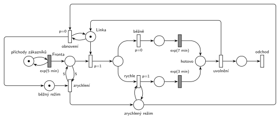

# 09–04 – Centrum MM1 s rychlým režimem

## Zadání

> Zákazníci přichází do obslužného Centra typu M/M/1 v intervalech daných exponenciálním rozložením (EXP) se středem 5 minut. Doba obsluhy se v běžném režimu řídí EXP(7min). Pokud však délka fronty dosáhne 5 čekajících zákazníků, pak se Centrum přepne do zrychleného režimu, ve kterém provádí obsluhu v době EXP(3min), což se projeví na nově zahájené obsluze. Centrum setrvá ve zrychleném režimu, dokud se fronta nevyprázdní.
>
> Zadaný systém modelujte formou Petriho sítě s vyznačením všech potřebných parametrů. **V modelu jednoznačně ukažte (přechodem) moment, kdy transakce opouští systém.**

Všimni si: v běžném režimu je obsluha (7 min) pomalejší než příchody (5 min). Bez zrychleného režimu by fronta rostla do nekonečna.

Podobné úlohy: [05–01 – Doba obsluhy podle délky fronty](<../05–01 - Doba obsluhy podle délky fronty/05–01 - Doba obsluhy podle délky fronty.md>), [05–02 – Dočasně MM2 při dlouhé frontě](<../05–02 - Dočasně MM2 při dlouhé frontě/05–02 - Dočasně MM2 při dlouhé frontě.md>), [09–06 – Klientské centrum](<../09–06 - Klientské centrum/09–06 - Klientské centrum.md>) (přepnutí režimu podle délky fronty, 2023/24).

## Interpretace

Zobrazit interpretaci (nápověda)

 

- **Režim** je stav: jedna značka buď v *běžném režimu*, nebo v *zrychleném režimu*.
- **„Dosáhne 5 čekajících“:** přechod *zrychlení* bere značku *běžného režimu* a testuje *Frontu* dvojicí hran s váhou 5. Přechod se provede hned, jak je ve frontě aspoň 5 zákazníků („dosáhne 5“ = váha 5, ne 6).
- **„Projeví se na nově zahájené obsluze“:** doba se volí až po obsazení linky. Z místa za obsazením vedou dva přechody. *Rychle* (`p=1`) testuje *zrychlený režim* a vede na `exp(3 min)`, *běžně* (`p=0`) vede na `exp(7 min)`. Probíhající obsluhu přepnutí nijak nemění.
- **„Dokud se fronta nevyprázdní“:** *obnovení* vrací *běžný režim*, když je linka volná a nikdo nečeká. Prázdnou frontu nejde přímo otestovat (bez inhibiční hrany). Proto *obnovení* (p=0) soupeří o *Linku* s obsazením (`p=1`). Když někdo čeká, vyhraje obsazení. *Obnovení* se tedy provede, jen když je linka volná a fronta prázdná. Hrubý si k lince poznamenal, že nejdřív proběhne seize a teprve potom obnovení.
- Toto čtení má jemný důsledek. Pokud se fronta vyprázdní zahájením poslední obsluhy a během ní někdo přijde, režim zůstane zrychlený. Přesnější čtení by přepnulo zpět hned při zahájení obsluhy, po které je fronta prázdná. To by ale potřebovalo pomocnou kontrolní značku a další přechody. Hrubého řešení je jednodušší a u písemky postačí.
- **Uvolnění linky** je tady samostatný okamžitý přechod (plný tvar ze slajdu 154), stejně jako u Hrubého. Obě větve obsluhy se sejdou v *hotovo* a linku stačí vracet jedinou hranou. Vracet ji z obou časovaných přechodů zvlášť je také správně.

## Petriho síť

Zobrazit Petriho síť

 

| Požadavek | Prvek sítě |
|---|---|
| M/M/1, příchody exp(5 min) | *generátor* ⇄ `exp(5 min)` → *Fronta* → obsazení *Linky* (`p=1`) |
| běžná obsluha exp(7 min) | *běžně* (`p=0`) → `exp(7 min)` |
| zrychlená obsluha exp(3 min) u nově zahájené obsluhy | *rychle* (`p=1`, test *zrychlený režim*) → `exp(3 min)` |
| fronta dosáhne 5 → zrychlený režim | *zrychlení*: *běžný režim* + test 5 na *Frontě* → *zrychlený režim* |
| fronta prázdná → zpět běžný režim | *obnovení* (`p=0`): *zrychlený režim* + test *Linky* → *běžný režim* |
| odchod ze systému | *hotovo* → *uvolnění* (vrací *Linku*) → *odchod* |

Kontrola simulací: *Linka* + obsluhovaný zákazník = 1, *běžný režim* + *zrychlený režim* = 1. Režim se přepíná zhruba každých 120 minut. Asi dvě třetiny obsluh probíhají zrychleně a fronta zůstává omezená (nejvýš kolem 18), i když by běžný režim sám frontu neudržel.

## Časté chyby

Zobrazit časté chyby

 

- Přepnutí režimu napojené na časovaný přechod probíhající obsluhy (přerušení obsluhy). Zadání mění jen nově zahájené obsluhy.
- Test délky fronty jednou hranou s váhou 5 bez zpětné hrany. Přechod by pak 5 zákazníků z fronty odebral.
- Návrat do běžného režimu bez podmínky prázdné fronty, nebo s inhibiční hranou. Hrubý inhibiční hrany nechce, podmínka se dělá prioritou (obsazení `p=1` před obnovením `p=0`).
- Volba doby obsluhy před obsazením linky (rozdělení už z fronty). Režim se pak určí v okamžiku příchodu, ne při zahájení obsluhy.
- Obě větve `p=0` a `p=1` bez testu režimu u rychlé větve: pak by se vždy obsluhovalo rychle.

## Původ a zdroje

Zobrazit původ a zdroje

 

**Původ:** půlsemestrální písemka 2024/25, varianta D, 10 bodů.

**Zdroje:**

- `Fitcheats/Půlsemestrálky/Zadání z minulých let/2024-25.pdf`, str. 1 (koláž zadání všech čtyř variant)
- `Fitcheats/Půlsemestrálky/Hrubý - Řešení 2024-25.pdf`, str. 4 (řešení od Hrubého)

**Existující řešení:**

- **Hrubý (str. 4):** síť výše je jeho řešení překreslené: *seize* s `p=1` → místo → větvení `p=0` na `exp(7m)` a `p=1` (s testem *rychlo režimu*) na `exp(3m)` → společné místo → *release* zpět k *lince*. *Normální režim* → přechod s testem 5 na frontě → *rychlo režim*. *Obnovení* bere *rychlo režim* a je napojené na *linku*. Generátor kreslí jako přechod `exp` bez místa. Výstupní přechod nekreslí, za *release* je jen šipka ven.

