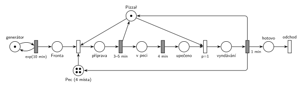

# 09–05 – Pizza stánek

## Zadání

> ⚠️ **Parafráze.** Oficiální text varianty B v materiálech chybí. V koláži je místo něj přepis od studenta (podepsaný „credits to mav_“), který zachycuje čísla, ale ne přesné znění. Text níže je ten přepis, jen časy jsou přepsané do jednotného tvaru (přepis beze změn je v Původu a zdrojích).
>
> stánek s pizzou, jeden pizzař to celé řídí, zákazníci chodí exponenciálně se středem 10 minut a co zákazník to objednávka pizzy, pizzař ho obslouží rovnoměrně 3–5 minut (zahrnuje objednávku, přípravu pizzy a vložení pizzy do peci), je tam pec která má 4 místa, pizza se pak peče přesně 4 minuty a zákazník mezitím čeká, k pečení neni třeba pizzaře (ten mezitím obsluhuje další zákazníky), peče se přesně 4 minuty a pak pizzař vyndá pizzu a dá ji zákazníkovi, což trvá přesně 1 minutu a má prioritu před obsluhou nových zákazníků (credits to mav_)

Ostatní varianty téhož termínu mají na konci větu „V modelu jednoznačně ukažte (přechodem) moment, kdy transakce opouští systém.“, takže ji počítej i tady.

Podobné úlohy: [11–03 – Pizzerie s rozvozem](<../11–03 - Pizzerie s rozvozem/11–03 - Pizzerie s rozvozem.md>) (2022/23).

## Interpretace

<details>
<summary>Zobrazit interpretaci (nápověda)</summary>
<br>

- **Příchody** modeluje místo *příchody zákazníků* s jednou značkou ve smyčce s `exp(10 min)`; zákazník čeká v místě *Fronta*.
- **Transakce** je zákazník spolu se svou pizzou: čeká u stánku, dokud pizzu nedostane, pak odchází.
- **Pizzař** je jedno zařízení, které se zabírá dvakrát: na přípravu (`3–5 min`, vrací ho) a na vyndání a předání (`1 min`). Mezi tím ho pizza nepotřebuje, pečení je časovaný přechod bez pizzaře.
- **Pec** je sklad se 4 značkami. Místo v peci se zabírá **už při zahájení přípravy** spolu s pizzařem (jeden přechod *objednávka* bere obojí). Pizzař tak nikdy nezačne připravovat pizzu, kterou by pak neměl kam dát. Místo v peci se vrací až po předání (`1 min` vrací pizzaře i místo v *Peci*).
- **Pečení 4 min** je obyčejný časovaný přechod. Každá pizza v místě *v peci* má vlastní odpočet (slajd 138) a souběh omezuje jen pec.
- **Priorita vyndání:** obsazení pizzaře pro vyndání má `p=1`, obsazení pro nového zákazníka `p=0`. Když se pizzař uvolní a čeká upečená pizza i zákazník ve frontě, jde nejdřív k peci. Probíhající přípravu priorita nepřerušuje.
- Zákazník s pizzou **opouští systém** přes místo *hotovo* okamžitým přechodem *odchod* bez výstupních hran.

</details>

## Petriho síť

<details>
<summary>Zobrazit Petriho síť</summary>
<br>



</details>

## Časté chyby

<details>
<summary>Zobrazit časté chyby</summary>
<br>

- Pizzař držený i během pečení (hrana zpět do *Pizzaře* až po vyndání). Zadání výslovně říká, že mezitím obsluhuje další zákazníky.
- Pec jako jedno zařízení místo skladu se 4 značkami, nebo časovaný přechod pečení s kapacitou 4 bez místa *Pec*.
- Priorita `p=1` na špatném přechodu: patří k obsazení pizzaře pro vyndání, ne k časovanému přechodu (ten parametr priority mít nemůže).
- Zákazník odchází hned po objednávce. Podle zadání čeká, než pizzu dostane, takže odchod je až po předání.

</details>

## SIMLIB

<details>
<summary>Zobrazit SIMLIB kód</summary>
<br>

Model je izomorfní k Petriho síti výše: každé místo, přechod a značka mají svůj protějšek v kódu. Jediný rozdíl: přechod *objednávka* bere pizzaře i místo v peci naráz, v SIMLIB se zabírají postupně (nejdřív pec, pak pizzař, viz tabulka).

```cpp
// 09–05 Pizza stánek – model v SIMLIB/C++
#include "simlib.h"

Facility Pizzar("Pizzař");             // místo „Pizzař“ (1 značka), jeho fronta = „Fronta“
Store Pec("Pec", 4);                   // místo „Pec“ se 4 značkami
Histogram Doba("Doba zákazníka u stánku [min]", 0, 2, 20);

class Zakaznik : public Process {      // transakce = zákazník se svou pizzou
  void Behavior() {
    double prichod = Time;
    Enter(Pec, 1);                     // „objednávka“ bere místo v peci ...
    Seize(Pizzar);                     // ... a pizzaře („Fronta“)
    Wait(Uniform(3, 5));               // „příprava“ → časovaný přechod 3–5 min ...
    Release(Pizzar);                   // ... který vrací pizzaře
    Wait(4);                           // „v peci“ → časovaný přechod 4 min → „upečeno“
    Priority = 1;                      // „vyndání“ p=1: ve frontě pizzaře před novými zákazníky
    Seize(Pizzar);                     // (bez přerušení probíhající přípravy)
    Wait(1);                           // „vyndávání“ → časovaný přechod 1 min ...
    Release(Pizzar);                   // ... který vrací pizzaře
    Leave(Pec, 1);                     // ... i místo v peci
    Doba(Time - prichod);
  }                                    // konec Behavior = místo „hotovo“ + přechod „odchod“
};

class Generator : public Event {       // místo „příchody zákazníků“ ve smyčce s exp(10 min)
  void Behavior() {
    (new Zakaznik)->Activate();        // nová značka v místě „Fronta“
    Activate(Time + Exponential(10));  // další příchod
  }
};

int main() {
  Init(0, 60 * 1000);                  // modelový čas v minutách: 1000 hodin provozu
  (new Generator)->Activate();
  Run();
  Pizzar.Output();
  Pec.Output();
  Doba.Output();
}
```

| Petriho síť | SIMLIB |
|---|---|
| *příchody zákazníků* ⇄ `exp(10 min)` | událost `Generator`, která se znovu plánuje za `Exponential(10)` |
| značka (zákazník s pizzou) | proces `Zakaznik` |
| místo *Pizzař* (1 značka), *Fronta* | `Facility Pizzar` a jeho vnitřní fronta |
| místo *Pec* (4 značky) | `Store Pec("Pec", 4)` |
| *objednávka* (bere pizzaře i místo v peci) | `Enter(Pec, 1); Seize(Pizzar);`: postupně, protože SIMLIB neumí zabrat dvě zařízení naráz. Opačné pořadí by mohlo uváznout: pizzař by čekal na místo v plné peci, které uvolní jen on sám. |
| `3–5 min` se sloučeným uvolněním pizzaře | `Wait(Uniform(3, 5)); Release(Pizzar);` |
| *v peci* → `4 min` → *upečeno* | `Wait(4)` |
| *vyndání* `p=1` | `Priority = 1; Seize(Pizzar);` (priorita procesu řadí ve frontě, nepřerušuje; `Seize(Pizzar, 1)` by přípravu přerušilo) |
| `1 min` vrací *Pizzaře* i místo v *Peci* | `Wait(1); Release(Pizzar); Leave(Pec, 1);` |
| *hotovo* → přechod *odchod* | konec metody `Behavior()` |

**Kontrola simulací.** Petriho síť: *Pizzař* + *příprava* + *vyndávání* = 1, *Pec* + pizzy od přípravy po vyndání = 4; fronta zůstává krátká (nejvýš kolem 9) a pizzař je vytížen asi na 50 % (`make check`). SIMLIB model: v jednom běhu (1000 h) byl pizzař vytížen na 50,3 %; teoreticky 0,1 zákazníka za minutu × (4 + 1) min = 50 %. V peci byla průměrně 1,2 pizzy a zákazník strávil u stánku průměrně 12 minut (nejméně 8 = 3 + 4 + 1). Na místo v peci čekalo 278 zákazníků z 6033 (4,6 %): v SIMLIB drží místo v peci už během čekání na pizzaře, v síti až od zahájení přípravy, takže SIMLIB model pec mírně přetěžuje (`make simlib`).

</details>

## Původ a zdroje

<details>
<summary>Zobrazit původ a zdroje</summary>
<br>

**Původ:** půlsemestrální písemka 2024/25, varianta B, 10 bodů (bodování podle ostatních variant téhož termínu).

**Původní znění:** (studentský přepis, viz ⚠️ v zadání)

> stánek s pizzou, jeden pizzař to celé řídí, zákazníci chodí exp(10') a co zákazník to objednávka pizzy, pizzař ho obslouží 3-5' (zahrnuje objednávku, přípravu pizzy a vložení pizzy do peci), je tam pec která má 4 místa, pizza se pak peče 4' a zákazník mezitím čeká, k pečení neni třeba pizzaře (ten mezitím obsluhuje další zákazníky), peče se 4' a pak pizzař vyndá pizzu a dá ji zákazníkovi, což trvá 1' a má prioritu před obsluhou nových zákazníků (credits to mav_)

**Zdroje:**

- `Fitcheats/Půlsemestrálky/Zadání z minulých let/2024-25.pdf`, str. 1 (koláž zadání; varianta B jen jako studentská parafráze)
- `Fitcheats/Půlsemestrálky/Hrubý - Řešení 2024-25.pdf`, str. 2 (řešení od Hrubého)

**Existující řešení:**

- **Hrubý (str. 2):** stejná síť. Generátor kreslí jako přechod `exp(10min)` bez místa. Na časovaných přechodech má jen názvy (*příprava*, *pečení*, *vytažení*), časy 3–5, 4 a 1 min nedopsal. Místa *obsluha* (pizzař) a *kapacita pece* (4) jdou do společného obsazení („Dává smysl alokovat si prostor v peci hned na začátku.“), vytažení má `p=1` a vrací obojí.
- **Hrubý, „Alternativně“ (str. 2 dole):** pec se zabírá až po přípravě. Pizza čeká v místě *Fronta na pec* a pec obsadí přechod s `p=1`. Je to také přípustné, ale pizza pak může čekat „mimo pec“, dokud se místo neuvolní. Hrubý proto doporučuje první variantu.

</details>
