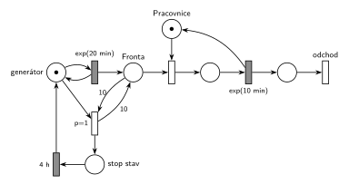

# 09–06 – Klientské centrum

## Zadání

> Do klientského centra přichází klienti v intervalech daných exponenciálním rozložením se středem 20 minut. Požadavky obsluhuje jedna pracovnice. Doba obsluhy se řídí exponenciálním rozložením se středem 10 minut. Pokud fronta k obsluze dosáhne délky 10 čekajících, pak centrum vyhlásí dočasný "stop stav", během kterého se zastaví proces příchodu požadavků. Stop stav trvá 4 hodiny.
>
> **V modelu jednoznačně ukažte (přechodem) moment, kdy transakce opouští systém.**

Podobné úlohy: [05–05 – Přerušení příchodů při plné frontě](<../05–05 - Přerušení příchodů při plné frontě/05–05 - Přerušení příchodů při plné frontě.md>), [05–06 – MM3 – zastavení příchodů](<../05–06 - MM3 – zastavení příchodů/05–06 - MM3 – zastavení příchodů.md>), [09–03 – Psí salon](<../09–03 - Psí salon/09–03 - Psí salon.md>), [09–04 – Centrum MM1 s rychlým režimem](<../09–04 - Centrum MM1 s rychlým režimem/09–04 - Centrum MM1 s rychlým režimem.md>), [12–03 – Výrobní hala](<../12–03 - Výrobní hala/12–03 - Výrobní hala.md>).

## Interpretace

Zobrazit interpretaci (nápověda)

 

- **Délka fronty** jsou jen čekající klienti v místě *Fronta*. Obsluhovaný klient je v jiném místě, takže se nepočítá („10 čekajících“).
- **„Dosáhne délky 10“** = test, že je ve *Frontě* aspoň 10 značek: hrana s váhou 10 do přechodu a hrana s váhou 10 zpět. Z fronty se nic neodebere. (Kdyby zadání říkalo „přesáhne 10“, byla by váha 11.)
- **Zastavení příchodů:** přechod stop stavu odebere značku *generátoru*, takže probíhající odpočet `exp(20 min)` zanikne a nikdo nepřichází. Po `4 h` se značka vrátí a příchody pokračují.
- **Generátor slouží i jako pojistka:** během stop stavu značka *generátoru* chybí, a proto se stop stav nemůže vyhlásit znovu, i když je ve frontě pořád 10 klientů. Samostatné řídicí místo (jako u vzoru „dočasné zastavení příchodů“) by bylo také správně, jen je to prvek navíc.
- **Priorita `p=1`** na vyhlášení stop stavu říká, že se podmínka „fronta dosáhla 10“ vyhodnotí dřív než cokoli jiného v tomtéž okamžiku (např. obsazení pracovnice). V téhle úloze ke střetu prakticky nedojde, protože fronta roste, jen když je pracovnice obsazená. Priorita ale nic nezkazí a odpovídá vzoru testu fronty.
- Obsluha během stop stavu normálně pokračuje a fronta se vyprazdňuje. Po 4 h je fronta prakticky vždy kratší než 10.

## Petriho síť

Zobrazit Petriho síť

 

| Požadavek | Prvek sítě |
|---|---|
| příchody exp(20 min) | *generátor* ⇄ `exp(20 min)` → *Fronta* |
| jedna pracovnice, obsluha exp(10 min) | *Pracovnice* (1 značka), obsazení, `exp(10 min)` vrací značku |
| fronta dosáhne 10 čekajících | hrany s váhou 10 z *Fronty* a zpět |
| stop stav zastaví příchody | `p=1`: *generátor* + test *Fronty* → *stop stav* |
| stop stav trvá 4 h | *stop stav* → `4 h` → *generátor* |
| odchod ze systému | *odchod* |

Kontrola simulací: *Pracovnice* + obsluhovaný = 1, *generátor* + *stop stav* = 1, ve *Frontě* nikdy není víc než 10 klientů. Pracovnice je vytížena jen na 50 %, takže stop stav je vzácný: v simulaci zhruba jednou za 3700 klientů (asi jednou za 50 dní nepřetržitého provozu).

## Časté chyby

Zobrazit časté chyby

 

- Hrana s váhou 10 jen do přechodu, bez hrany zpět. Přechod by pak z fronty odebral 10 klientů.
- Zastavení příchodů odebráním klientů z *Fronty* místo odebrání značky *generátoru*.
- Zapomenutý návrat značky *generátoru* po 4 h: příchody by se zastavily natrvalo.
- Vyhlášení stop stavu, které nebere značku generátoru ani jinou řídicí značku. Test fronty pak zůstává splněný a přechod se provádí pořád dokola.
- Váha 11 („přesáhne“) místo 10 („dosáhne“), nebo započítání obsluhovaného klienta do délky fronty.

## Původ a zdroje

Zobrazit původ a zdroje

 

**Původ:** půlsemestrální písemka 2023/24, varianta D, 10 bodů.

**Zdroje:**

- `Fitcheats/Půlsemestrálky/Zadání z minulých let/2023-24.pdf`, str. 4 (fotka zadání; v plném rozlišení čitelná celá)

**Existující řešení:**

- K této variantě v materiálech žádné řešení není (ani od Hrubého, ani studentské).

