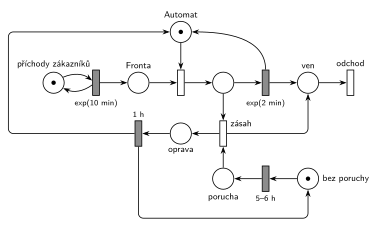

# 09–07 – Automat na kávu

## Zadání

> K automatu na kávu přichází zákazníci v intervalech daných exponenciálním rozložení se středem 10 minut. Doba obsluhy se řídí exponenciálním rozložením se středem 2 minuty. V automatu se cyklicky projevuje porucha, a to vždy rovnoměrně 5-6 hodin od okamžiku poslední opravy poruchy (nebo od počátku času). Porucha se projeví na právě probíhající obsluze nebo na další následující transakci. Požadavek zasažený poruchou opouští systém bez obsluhy. Oprava poruchy zabere 1 hodinu.
>
> **V modelu jednoznačně ukažte (přechodem) moment, kdy transakce opouští systém.**

Podobné úlohy: [03–06 – Porucha zničí obsluhu nebo počká](<../03–06 - Porucha zničí obsluhu nebo počká/03–06 - Porucha zničí obsluhu nebo počká.md>), [03–04 – Porucha s opravou, transakce odchází](<../03–04 - Porucha s opravou, transakce odchází/03–04 - Porucha s opravou, transakce odchází.md>), [03–02 – Porucha vrací transakci do fronty](<../03–02 - Porucha vrací transakci do fronty/03–02 - Porucha vrací transakci do fronty.md>), [12–07 – Spalovna](<../12–07 - Spalovna/12–07 - Spalovna.md>), [12–14 – Výroba hrášku](<../12–14 - Výroba hrášku/12–14 - Výroba hrášku.md>).

## Interpretace

Zobrazit interpretaci (nápověda)

 

- **Cyklus poruchy** je jedna značka, která obíhá: *bez poruchy* → `5–6 h` (rovnoměrně) → *porucha* → zásah → *oprava* → `1 h` → zpět *bez poruchy*. Další porucha se tak počítá od konce opravy, jak chce zadání. Počáteční značka v *bez poruchy* odpovídá „nebo od počátku času“.
- **Zásah** je okamžitý přechod se vstupy *porucha* a obsluhovaný zákazník. Když automat právě obsluhuje, provede se hned a odpočet `exp(2 min)` zanikne (slajd 139). Když automat stojí, porucha čeká a zasáhne prvního zákazníka, který automat obsadí, ve stejném okamžiku, kdy ho obsadí. To je „na další následující transakci“.
- Na rozdíl od úloh, kde porucha bez obsluhy zaniká ([03–02](<../03–02 - Porucha vrací transakci do fronty/03–02 - Porucha vrací transakci do fronty.md>)), tady porucha **nezaniká**, takže žádný přechod „porucha bez účinku“ není.
- **Zasažený zákazník** jde z přechodu zásah rovnou do místa *ven* a odchází stejným výstupním přechodem jako obsloužení.
- **Oprava drží automat:** zásah nevrací značku *Automatu*. Ta je po dobu opravy v místě *oprava* a vrátí ji až přechod `1 h`. Zákazníci mezitím čekají ve *Frontě*.
- Priorita není potřeba: o obsluhovaného zákazníka soupeří jen zásah (okamžitý) a `exp(2 min)` (časovaný), a okamžitý přechod má vždy přednost.

## Petriho síť

Zobrazit Petriho síť

 

| Požadavek | Prvek sítě |
|---|---|
| příchody exp(10 min) | *generátor* ⇄ `exp(10 min)` → *Fronta* |
| obsluha exp(2 min) | *Automat* (1 značka), obsazení, `exp(2 min)` vrací značku *Automatu* |
| porucha 5–6 h od poslední opravy | *bez poruchy* → `5–6 h` → *porucha* |
| zasáhne probíhající nebo další obsluhu | *zásah*: *porucha* + obsluhovaný zákazník |
| zasažený odchází bez obsluhy | *zásah* → *ven* → *odchod* |
| oprava 1 h | *zásah* → *oprava* → `1 h` → *Automat* a *bez poruchy* |

Kontrola simulací: *Automat* + obsluhovaný + *oprava* = 1 a *bez poruchy* + *porucha* + *oprava* = 1. Porucha přichází v průměru asi jednou za 6,6 h (5,5 h + 1 h opravy + čekání na dalšího zákazníka). Fronta naroste jen během opravy.

## Časté chyby

Zobrazit časté chyby

 

- Generátor poruch ve smyčce `5–6 h` nezávislý na opravě. Interval se pak počítá od minulé poruchy, ne od konce opravy.
- Porucha, která při nečinném automatu zanikne (vzor z jiných úloh). Tady má počkat na dalšího zákazníka.
- Zásah, který vrací značku *Automatu* hned. Automat by pak během opravy dál obsluhoval.
- Zásah, který bere zákazníka z *Fronty*. Když je ve frontě někdo, automat zrovna obsluhuje, a porucha má zasáhnout toho obsluhovaného.
- Zasažený zákazník, který nikam neodejde (chybí hrana do odchodu).

## Původ a zdroje

Zobrazit původ a zdroje

 

**Původ:** půlsemestrální písemka 2023/24, varianta C, 10 bodů.

**Zdroje:**

- `Fitcheats/Půlsemestrálky/Zadání z minulých let/2023-24.pdf`, str. 3 (fotka zadání)
- `Fitcheats/Půlsemestrálky/Zadání z minulých let/2024-25 - Varianta A (fotky).pdf`, str. 3–4 (zadání a řešení kreslené na cvičení)

**Existující řešení:**

- **Řešení ze cvičení (fotky 2024/25, str. 4):** stejná síť. Automat kreslí nad hlavní linkou, a proto hrana z `1 hod.` zpět do automatu kříží hlavní linku. Zasaženého zákazníka posílá červenou hranou do koncového místa před výstupním přechodem. Generátor poruch je místo se značkou → `Rovn(5-6 hodin)`, návrat z `1 hod.` vede dlouhou hranou dole.
- Hrubého řešení k ročníku 2023/24 v materiálech není.

