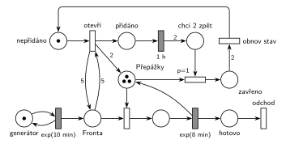

# 09–08 – Cestovní kancelář

## Zadání

> Do pobočky cestovní kanceláře přichází klienti v intervalech daných exponenciálním rozložením se středem 10 minut. Pobočka má 3 přepážky pro obsluhu klientů. Doba obsluhy klienta se řídí exponenciálním rozložením se středem 8 minut. Pokud je ve frontě alespoň 5 čekajících klientů, pak kancelář na dobu 1 hodiny otevře dvě další přepážky, tj. tyto dodatečné přepážky se po hodině (a dokončení rozpracovaného klienta) opět uzavřou.
>
> **V modelu jednoznačně ukažte (přechodem) moment, kdy transakce opouští systém.**

Podobné úlohy: [09–15 – Úřad s dodatečnými přepážkami](<../09–15 - Úřad s dodatečnými přepážkami/09–15 - Úřad s dodatečnými přepážkami.md>), [09–01 – Úřad](<../09–01 - Úřad/09–01 - Úřad.md>), [05–02 – Dočasně MM2 při dlouhé frontě](<../05–02 - Dočasně MM2 při dlouhé frontě/05–02 - Dočasně MM2 při dlouhé frontě.md>), [05–03 – Natrvalo MM3 při dlouhé frontě](<../05–03 - Natrvalo MM3 při dlouhé frontě/05–03 - Natrvalo MM3 při dlouhé frontě.md>).

## Interpretace

Zobrazit interpretaci (nápověda)

- **3 přepážky** jsou sklad se 3 značkami. Otevření dvou dalších přidá do téhož místa 2 značky (Hrubého *varianta A*). Přepážky jsou stejné, takže nevadí, že se pak zavřou „nějaké“ dvě, ne nutně ty přidané. Hrubý si k tomu poznamenal, že takové míchání 3 + 2 přepážek je přijatelné.
- **„alespoň 5 čekajících“** je test hranami váhy 5 tam a zpět: přechod frontu jen zkontroluje a nikoho z ní neodebere. Na „alespoň 5“ stačí váha 5, ne 6.
- **Stav nepřidáno / přidáno:** otevření potřebuje značku *nepřidáno*. Bez ní by se při frontě ≥ 5 přechod provedl znovu a znovu a přidával by další a další přepážky (Hrubý: „nutno explicitně stavem odlišit přidáno/nepřidáno“).
- **Po hodině** dá časovaný `1 h` dvě značky do místa *chci 2 zpět* („budu chtít dvě zpátky“). Přechod *zavři* s `p=1` vezme pokaždé jednu volnou přepážku. Je-li některá volná hned, zavře se hned. Jinak se zavře ta, kterou první uvolní dokončený klient: to je „(a dokončení rozpracovaného klienta)“. Priorita `p=1` zajistí, že uvolněnou přepážku nezabere další klient z fronty dřív, než se zavře.
- Po dvou zavřených přepážkách vrátí přechod *obnov stav* (hrana váhy 2) značku do *nepřidáno*. Pokud je fronta pořád ≥ 5, otevřou se přepážky hned znovu; zadání to nezakazuje.
- Klient, který je zrovna u přepážky, se vždy doobslouží. Přerušení obsluhy zadání nechce.

## Petriho síť

Zobrazit Petriho síť

| Požadavek | Prvek sítě |
|---|---|
| příchody exp(10 min) | *generátor* ⇄ `exp(10 min)` → *Fronta* |
| 3 přepážky, obsluha exp(8 min) | *Přepážky* (3 značky), obsazení, `exp(8 min)` vrací značku |
| ve frontě alespoň 5 → otevřít 2 přepážky | *otevři*: *nepřidáno* + test *Fronta* (váha 5 tam a zpět) → 2 × *Přepážky* + *přidáno* |
| na 1 hodinu | *přidáno* → `1 h` → 2 × *chci 2 zpět* |
| zavření po dokončení rozpracovaného klienta | *zavři* (`p=1`): *chci 2 zpět* + volná přepážka → *zavřeno* |
| obnovení stavu | *obnov stav*: 2 × *zavřeno* → *nepřidáno* |
| odchod ze systému | *hotovo* → přechod *odchod* bez výstupu |

Kontrola simulací: platí *Přepážky* + obsluhovaní + 2 × *nepřidáno* + *zavřeno* = 5 (nikdy víc než 5 přepážek) a 2 × *nepřidáno* + 2 × *přidáno* + *chci 2 zpět* + *zavřeno* = 2 (řízení je vždy v jednom stavu). Kancelář je vytížená jen na 27 %, takže fronta 5 je vzácná (pár otevření na 100 000 událostí). Při zkušebně zrychlených příchodech `exp(2,5 min)` se přepážky otevřely a zavřely stovkykrát a pokaždé se vrátily na 3.

## Časté chyby

Zobrazit časté chyby

- Test fronty jen jednou hranou váhy 5 bez zpětné hrany: přechod pak 5 klientů z fronty odebere.
- Chybějící stav *nepřidáno*: při frontě ≥ 5 se přepážky přidávají opakovaně a jejich počet roste bez omezení.
- Zavření po hodině tak, že přechod vezme rozpracované klienty z obsluhy (přeruší je), nebo že čeká, až budou dvě přepážky volné najednou (hrana váhy 2 z *Přepážky*).
- Zavírání bez priority nad obsazením: uvolněnou přepážku hned zabere další klient z fronty a zavření se odkládá.
- Odpočet 1 h, který se při každém obsazení přepážky spustí znovu (časovač na místě, které testuje obsazení, viz varianta B).

## Původ a zdroje

Zobrazit původ a zdroje

**Původ:** půlsemestrální písemka 2022/23, varianta D, 10 bodů.

**Zdroje:**

- `Fitcheats/Půlsemestrálky/Zadání z minulých let/2024-25 - Varianta A (fotky).pdf`, str. 7–8 (fotka promítnutého zadání a řešení kreslené na cvičení; jinde zadání v materiálech není)
- `Fitcheats/Půlsemestrálky/Hrubý - Řešení 2022-23.pdf`, str. 5 (řešení od Hrubého, varianta A) a str. 6 (varianta B)

**Existující řešení:**

- **Hrubý, varianta A (str. 5):** síť výše je jeho řešení překreslené: „nepřidáno“ → přechod s hranami váhy 5 na *Fronta*, výstup s váhou 2 do *přepážky* (3) → místo → `1hod` → váha 2 → „budu chtít dvě zpátky“ → přechod, který bere přepážku → místo → váha 2 → přechod s poznámkou, že dostal dvě zpátky a obnovuje stav → *nepřidáno*. Rozdíl: u přechodu, který bere přepážku zpět, nemá napsanou prioritu. Bez `p=1` soupeří se zabráním přepážky klientem (náhodná volba), takže zavření se při dlouhé frontě může zbytečně odkládat. Generátor kreslí bez místa.
- **Hrubý, varianta B (str. 6), „Má odlišné chování od varianty A!“:** 3 základní přepážky a zvlášť místo se 2 dodatečnými přepážkami s vlastním obsazením a obsluhou, obě větve končí v *konec*. Otevření (značka v místě *lze otevřít* + test fronty váhou 5) vloží značku do místa *otevřeno*, které obsazení dodatečné přepážky testuje (hrana tam a zpět), a spustí „Nezávislý proces odpočtu 1h“. Ten je samostatný proto, že test značku *otevřeno* pokaždé vezme a vrátí, takže časovač přímo na tomto místě by se s každým klientem spouštěl znovu. Po hodině přechod odebere značku *otevřeno* a vrátí *lze otevřít*: noví klienti už k dodatečným přepážkám nejdou a rozpracovaní se doobslouží. Rozdíly oproti A:
  - zavírají se vždy právě ty dvě dodatečné přepážky (A zavře libovolné dvě, které se uvolní první);
  - nové otevření je možné hned po hodině, i když u dodatečných přepážek ještě někdo je (v A až po vrácení obou přepážek);
  - síť má víc prvků.

  Obě varianty zadání splňují. Hlavní síť je varianta A: je jednodušší, Hrubý ji kreslí jako první a stejná se kreslila na cvičení. Přepážky jsou stejné, takže míchání základních a dodatečných na chování fronty nic nemění. Varianta B odpovídá doslovněji slovům „tyto dodatečné přepážky“.
- **Řešení ze cvičení (fotky 2024/25, str. 8):** varianta A se stejnými prvky. Přechod, který bere přepážky zpět, má `p:1`.

