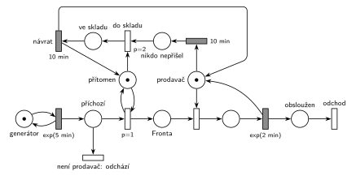

# 09–09 – Trafika

## Zadání

> Do trafiky přichází zákazníci v intervalech exponenciálně se středem 5 minut. V trafice pracuje jeden prodavač. Doba obsluhy zákazníka je exponenciálně se středem 2 minuty. Pokud prodavač nemá zákazníky 10 minut, pak odchází do skladu a vrací se přesně po 10 minutách. Příchozí zákazník okamžitě z trafiky odchází, pokud u pultu není přítomen prodavač.
>
> **V modelu jednoznačně ukažte (přechodem) moment, kdy transakce opouští systém.**

Podobné úlohy: [04–01 – Automat na kávu – údržba po nečinnosti](<../04–01 - Automat na kávu – údržba po nečinnosti/04–01 - Automat na kávu – údržba po nečinnosti.md>), [04–08 – Spánek po nečinnosti](<../04–08 - Spánek po nečinnosti/04–08 - Spánek po nečinnosti.md>), [04–04 – Údržba při prázdné frontě](<../04–04 - Údržba při prázdné frontě/04–04 - Údržba při prázdné frontě.md>).

## Interpretace

<details>
<summary>Zobrazit interpretaci (nápověda)</summary>
<br>

- **Příchody** modeluje místo *příchody zákazníků* ve smyčce s přechodem `exp(5 min)`. Nový zákazník se objeví v místě *příchozí*.
- **Prodavač má dvě role, a proto dvě místa.** *prodavač* je zařízení pro obsluhu (značka = volný). *přítomen* říká, že stojí u pultu. Jedno místo nestačí: když prodavač obsluhuje, je obsazený, ale přítomný, takže nový zákazník se má postavit do fronty, ne odejít.
- **Vstup zákazníka** je podmínka přes prioritu: přechod `p=1` otestuje *přítomen* (hrana tam a zpět) a pustí zákazníka do *Fronty*. Když prodavač chybí, zbude jen přechod s `p=0` a zákazník hned odchází (vlastní výstupní přechod *odchod (prodavač chybí)*).
- **Obsluha:** obsazení vezme značku *prodavač*, časovaný přechod `exp(2 min)` ji vrací. Obsloužený zákazník odchází přes místo *obsloužen* a přechod *odchod*.
- **„Nemá zákazníky 10 minut“** je časovaný přechod `10 min`, jehož jediným vstupem je *prodavač*. Odpočet začne, jakmile je prodavač volný. Přijde-li zákazník, obsazení mu značku vezme a odpočet zanikne (slajd 139). Když je prodavač volný, je fronta vždy prázdná (obsazení je okamžité), takže značka v *prodavač* znamená přesně „nemá zákazníky“.
- **Odchod do skladu:** po vypršení odpočtu (*nikdo nepřišel*) okamžitý přechod *do skladu* vezme i značku *přítomen* (→ *ve skladu*). Od té chvíle odcházejí všichni příchozí. Po `10 min` (*návrat*) se vrátí obě značky, *přítomen* i *prodavač*, a odpočet nečinnosti běží znovu; když zase nikdo nepřijde, jde prodavač do skladu znovu.
- **Proč `p=2`:** kdyby zákazník přišel přesně v okamžiku, kdy vyprší 10 minut, musí se nejdřív provést odchod do skladu, jinak by se zákazník zařadil do fronty k nepřítomnému prodavači. Se spojitým rozložením to prakticky nenastane, je to jen pojistka.
- Ve skladu nikdo nečeká ve frontě: prodavač odchází jen s prázdnou frontou a příchozí během jeho nepřítomnosti hned odcházejí.

</details>

## Petriho síť

<details>
<summary>Zobrazit Petriho síť</summary>
<br>



</details>

## Časté chyby

<details>
<summary>Zobrazit časté chyby</summary>
<br>

- Jedno místo pro prodavače, které slouží zároveň jako test přítomnosti. Pak odchází i zákazník, který přijde během obsluhy, přestože prodavač u pultu je.
- Odpočet nečinnosti, který zákazník nepřeruší (např. časovač na samostatném místě, nezávislém na obsluze). „Nemá zákazníky 10 minut“ znamená 10 minut v kuse bez zákazníka.
- Časovač nečinnosti se vstupem z *přítomen*: ten běží i během obsluhy, protože prodavač je přítomen i tehdy.
- Zákazník, který přijde během nepřítomnosti, čeká ve frontě. Podle zadání musí okamžitě odejít, a to přes výstupní přechod.
- Po návratu ze skladu se vrátí jen jedna ze dvou značek (*přítomen* nebo *prodavač*). Trafika pak buď nikoho nepustí dovnitř, nebo nikoho neobslouží.

</details>

## SIMLIB

<details>
<summary>Zobrazit SIMLIB kód</summary>
<br>

Model je izomorfní k Petriho síti výše: každé místo, přechod a značka mají svůj protějšek v kódu.

```cpp
// 09–09 Trafika – model v SIMLIB/C++
#include "simlib.h"

Facility Prodavac("Prodavač");             // místo „prodavač“ (značka = volný pro obsluhu)
bool pritomen = true;                      // místo „přítomen“ (značka = stojí u pultu)
long neobslouzeno = 0, doSkladu = 0;       // čítače pro výstup
Histogram Doba("Doba obslouženého zákazníka v trafice [min]", 0, 2, 15);

void SpustOdpocet();                       // odpočet „10 min“ na místě „prodavač“

class Navrat : public Event {              // časovaný přechod „návrat“ 10 min
  void Behavior() {
    pritomen = true;                       // vrací značku do „přítomen“ ...
    SpustOdpocet();                        // ... i do „prodavač“: nečinnost se počítá znovu
  }
};

class Necinnost : public Event {           // časovaný přechod „10 min“ (nikdo nepřišel)
  void Behavior();
};
Necinnost *odpocet = nullptr;              // běžící odpočet (nullptr = prodavač nemá značku)

void Necinnost::Behavior() {
  odpocet = nullptr;
  pritomen = false;                        // „do skladu“ (p=2) vezme i značku „přítomen“
  doSkladu++;
  (new Navrat)->Activate(Time + 10);       // místo „ve skladu“, návrat za 10 min
}

void SpustOdpocet() {
  odpocet = new Necinnost;
  odpocet->Activate(Time + 10);
}

class Zakaznik : public Process {          // transakce
  void Behavior() {
    if (!pritomen) {                       // p=0 „odchod (prodavač chybí)“
      neobslouzeno++;
      return;
    }
    double prichod = Time;                 // p=1: test „přítomen“, zařazení do Fronty
    if (odpocet) {                         // obsazení vezme značku prodavače,
      odpocet->Cancel();                   // takže odpočet nečinnosti zaniká
      odpocet = nullptr;
    }
    Seize(Prodavac);                       // Fronta + obsazení
    Wait(Exponential(2));                  // časovaný přechod exp(2 min) ...
    Release(Prodavac);                     // ... který vrací značku prodavači
    if (!Prodavac.Busy())                  // značka zůstala v „prodavač“ (fronta je prázdná):
      SpustOdpocet();                      // začíná nový odpočet 10 min
    Doba(Time - prichod);
  }                                        // konec Behavior = přechod „odchod“
};

class Generator : public Event {           // „příchody zákazníků“ ve smyčce s exp(5 min)
  void Behavior() {
    (new Zakaznik)->Activate();
    Activate(Time + Exponential(5));
  }
};

int main() {
  Init(0, 60 * 1000);                      // modelový čas v minutách: 1000 hodin provozu
  (new Generator)->Activate();
  SpustOdpocet();                          // na začátku je prodavač volný a u pultu
  Run();
  Prodavac.Output();
  Doba.Output();
  Print("Prodavač šel do skladu: %ld×, neobsloužení zákazníci: %ld\n", doSkladu, neobslouzeno);
}
```

| Petriho síť | SIMLIB |
|---|---|
| *příchody zákazníků* ⇄ `exp(5 min)` | událost `Generator`, která se znovu plánuje za `Exponential(5)` |
| značka (zákazník) | proces `Zakaznik` |
| *přítomen* | `bool pritomen` |
| `p=1` s testem *přítomen* / `p=0` *odchod (prodavač chybí)* | `if (!pritomen) { …; return; }` |
| *Fronta* + obsazení, *prodavač* (1 značka) | `Seize(Prodavac)`, `Facility Prodavac` |
| `exp(2 min)` se sloučeným uvolněním | `Wait(Exponential(2)); Release(Prodavac);` |
| odpočet `10 min` na místě *prodavač* | událost `Necinnost`: plánuje se, když prodavač zůstane volný, obsazení ji ruší (`Cancel()`) |
| *do skladu* (`p=2`) → *ve skladu* | `Necinnost::Behavior()`: `pritomen = false` a naplánování `Navrat` |
| *návrat* `10 min` | událost `Navrat`: `pritomen = true` a nový odpočet nečinnosti |
| *obsloužen* → *odchod* | konec metody `Behavior()` |

**Kontrola simulací.** Petriho síť (`make check`): platí *prodavač* + obsluha + *nikdo nepřišel* + *ve skladu* = 1 a *přítomen* + *ve skladu* = 1. Na 10 000 příchodů jde prodavač zhruba 790× do skladu a asi 1 580 zákazníků (16 %) odejde neobslouženo; fronta zůstává krátká (nejvýš 9). SIMLIB model (`make simlib`): za 1000 h přišlo asi 11 950 zákazníků, prodavač šel 954× do skladu a 1 924 zákazníků (16,1 %) odešlo neobslouženo, nejdelší fronta byla 9, prodavač byl vytížen na 33 %. Obě simulace se shodují; vytížení odpovídá teorii: obsloužených je asi 84 % z 12 zákazníků za hodinu, tedy 10 × 2 min = 20 min z hodiny.

</details>

## Původ a zdroje

<details>
<summary>Zobrazit původ a zdroje</summary>
<br>

**Původ:** půlsemestrální písemka 2022/23, varianta B, 10 bodů.

**Původní znění:**

> Do trafiky přichází zákazníci v intervalech daných exponenciálním rozložením se středem 5 minut. V trafice pracuje jeden prodavač. Doba obsluhy zákazníka se řídí exponenciálním rozložením se středem 2 minuty. Pokud prodavač nemá zákazníky 10 minut, pak odchází do skladu a vrací se po 10 minutách. Příchozí zákazník okamžitě z trafiky odchází, pokud u pultu není přítomen prodavač.
>
> **V modelu jednoznačně ukažte (přechodem) moment, kdy transakce opouští systém.**

**Zdroje:**

- `Fitcheats/Půlsemestrálky/Zadání z minulých let/2022-23.pdf`, str. 2 (fotka zadání, spodek listu je zakrytý)
- `Fitcheats/Půlsemestrálky/Zadání z minulých let/2024-25 - Varianta A (fotky).pdf`, str. 5–6 (celé zadání a řešení kreslené na cvičení)
- `Fitcheats/Půlsemestrálky/Hrubý - Řešení 2022-23.pdf`, str. 2 (řešení od Hrubého)

**Existující řešení:**

- **Hrubý (str. 2):** síť výše je jeho řešení překreslené (dvě místa pro prodavače i `p=2` u odchodu do skladu jsou od něj; k `p=2` si poznamenal, že souběh se zákazníkem je velmi hypotetická možnost). Místo *přítomen* testuje přechod `p=1` do *Fronty*, z téhož místa vede výstupní přechod pro zákazníka, který prodavače nezastihne. Místo *prodavač* má označené jako „Facility“, z něj vede `10min` (poznámka „nikdo nepřichází“) → místo → `p=2` odchod do skladu (bere *přítomen*) → místo → `10min` návrat, který vrací obě značky. Obsloužený odchází přes vlastní výstupní přechod. Jediný rozdíl: generátor kreslí bez místa.
- **Řešení ze cvičení (fotky 2024/25, str. 6):** stejná stavba. Vstup do *FRONTA* je `p=1` s testem místa přítomnosti (zakroužkované modře), odchod nepřítomnému prodavači je vodorovný výstupní přechod nad místem příchodu. Obsazení *L* má `P=1`. Úsek mezi prvním `10 min` a vysokým okamžitým přechodem je přeškrtaný a zakroužkovaný, takže ho nelze spolehlivě přečíst; písmeno „F“ u tohoto přechodu možná znamená test prázdné fronty. Ten není potřeba, protože při volném prodavači je fronta vždy prázdná.

</details>
