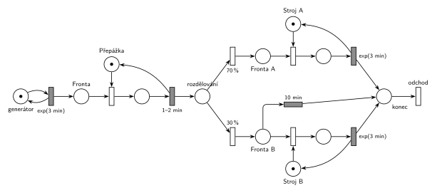

# 09–10 – Kopírovací centrum

## Zadání

> Do kopírovacího centra přichází klienti v intervalech daných exponenciálním rozložením se středem 3 minuty. U přepážky registrují svůj požadavek, což zabere 1-2 minuty rovnoměrně. V centru jsou dva kopírovací stroje: stroj pro normální zakázky (A) a stroj pro speciální zakázky. 70% zakázek směřuje na stroj A. Klienti se speciální zakázkou jsou však netrpěliví, proto po 10 minutách čekání ve frontě na stroj B opouští systém. Doba zpracování na obou strojích se řídí exponenciálním rozložením se středem 3 minuty.
>
> **V modelu jednoznačně ukažte (přechodem) moment, kdy transakce opouští systém.**

Podobné úlohy: [09–11 – Kopírovací centrum s poruchami](<../09–11 - Kopírovací centrum s poruchami/09–11 - Kopírovací centrum s poruchami.md>) (2021/22), [02–01 – Netrpělivé požadavky](<../02–01 - Netrpělivé požadavky/02–01 - Netrpělivé požadavky.md>).

## Interpretace

Zobrazit interpretaci (nápověda)

- **Přepážka** je jedno zařízení (Hrubý si k ní připsal „jedno zařízení“). Před ní čekají klienti ve frontě.
- **Uvolnění zařízení** je sloučené s časovaným přechodem obsluhy (hrana vede z časovaného přechodu zpět do místa zařízení), stejně jako na slajdu 164 a v Hrubého řešení. Samostatný okamžitý přechod „Release“ by byl také správně, jen je to zbytečný prvek navíc.
- **Netrpělivost** je časovaný přechod `10 min` přímo na místě *Fronta B*. Běžný časovaný přechod neomezuje počet současně čekajících (slajd 138), takže každý klient ve frontě má vlastní odpočet. Když klienta mezitím obsadí stroj B, jeho odpočet zanikne (značka z místa zmizí). Přesně to je „po 10 minutách čekání ve frontě opouští systém“.
- **70 % / 30 %** jsou parametry přechodů, ne hran (slajd 135).
- Generátor je místo se značkou ve smyčce s přechodem `exp(3 min)`. Kratší varianta bez místa (jen přechod bez vstupu) je na slajdech také a u zkoušky projde.

## Petriho síť

Zobrazit Petriho síť

| Požadavek ze zadání | Prvek sítě |
|---|---|
| příchody exp(3 min) | *generátor* ⇄ `exp(3 min)` → *Fronta* |
| registrace u přepážky 1–2 min | *Přepážka* (1 značka), obsazení, časovaný `1–2 min` vrací značku do *Přepážka* |
| 70 % na stroj A, 30 % na stroj B | z místa *rozdělování* dva okamžité přechody `70 %` a `30 %` |
| zpracování na stroji exp(3 min) | *Stroj A* / *Stroj B* (1 značka), obsazení, časovaný `exp(3 min)` vrací značku stroji |
| netrpěliví klienti u stroje B | časovaný `10 min` z *Fronta B* rovnou do *konec* |
| moment odchodu ze systému | přechod *odchod* bez výstupních hran |

Kontrola simulací (`make check`): značka každého zařízení se vždy vrátí (*Přepážka* + obsluhovaný = 1, totéž pro oba stroje), všechny přechody se provádějí, fronty nerostou do nekonečna (stroj A je vytížen asi na 70 %).

## Časté chyby

Zobrazit časté chyby

- Časovač netrpělivosti umístěný **až za obsazení stroje**. Pak omezuje délku obsluhy, ne čekání ve frontě.
- Netrpělivost i u stroje A; zadání ji má jen u speciálních zakázek.
- Chybějící hrana vracející značku stroji nebo přepážce. Zařízení se pak „ztratí“ a systém se zastaví.
- 70 %/30 % napsané na hranách místo na přechodech, nebo k pravděpodobnosti připsaná ještě priorita (slajd 135: přechod má jediný parametr).
- Chybějící výstupní přechod; zadání ho výslovně vyžaduje.

## Původ a zdroje

**Původ:** půlsemestrální písemka 2022/23, varianta A, 10 bodů.

**Zdroje:**

- `Fitcheats/Půlsemestrálky/Zadání z minulých let/2022-23.pdf`, str. 1 (fotka zadání)
- `Fitcheats/Půlsemestrálky/Zadání z minulých let/2024-25 - Varianta A (fotky).pdf`, str. 1–2 (zadání a řešení kreslené na cvičení)
- `Fitcheats/Půlsemestrálky/Hrubý - Řešení 2022-23.pdf`, str. 1 (řešení od Hrubého)

**Existující řešení:**

Zobrazit existující řešení

- **Hrubý (str. 1):** stejná struktura: *Fronta* → přepážka → *Fronta – rozdělování* → 70 %/30 % → *Fronta A* / *Fronta B* → stroj → *konec* → výstupní přechod. Netrpělivost kreslí také jako časovaný přechod `10min` z *Fronta B* do *konec*. Jediný rozdíl: generátor kreslí bez místa.
- **Řešení ze cvičení (fotky 2024/25, str. 2):** totéž, jen každá větev končí vlastním výstupním přechodem. Obojí je správně; zadání chce jen, aby byl odchod jednoznačně vidět.

