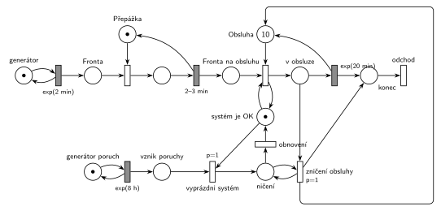

# 09–11 – Kopírovací centrum s poruchami

## Zadání

> Do kopírovacího centra přichází požadavky v intervalech daných exponenciálním rozložením se středem 2 minuty. Požadavky jsou nejprve registrovány u přepážky, což zabere 2-3 minuty rovnoměrně. Pak čekají ve frontě na obsluhu. Kapacita obsluhy je 10 požadavků. Doba obsluhy je exponenciálně 20 minut. V intervalech 8 hodin exponenciálně dochází v centru k poruše, která nenávratně zničí všechny rozpracované obsluhy, které systém okamžitě opouští. Po zničení všech rozpracovaných obsluh systém normálně pokračuje v práci.
>
> *Zadaný systém modelujte formou Petriho sítě s vyznačením všech potřebných parametrů.*

Věta „V modelu jednoznačně ukažte (přechodem) moment, kdy transakce opouští systém“ přibyla až v roce 2022/23. Výstupní přechod je v síti přesto, dnes se vyžaduje.

Podobné úlohy: [09–10 – Kopírovací centrum](<../09–10 - Kopírovací centrum/09–10 - Kopírovací centrum.md>) (2022/23), [03–01 – Porucha zruší obsluhu](<../03–01 - Porucha zruší obsluhu/03–01 - Porucha zruší obsluhu.md>), [03–05 – Kritická havárie](<../03–05 - Kritická havárie/03–05 - Kritická havárie.md>), [09–03 – Psí salon](<../09–03 - Psí salon/09–03 - Psí salon.md>).

## Interpretace

Zobrazit interpretaci (nápověda)

- **Přepážka** je jedno zařízení, registrace trvá `2–3 min` rovnoměrně.
- **Obsluha s kapacitou 10** je sklad: místo s 10 značkami. Časovaný přechod `exp(20 min)` má pro každou obsluhovanou zakázku vlastní odpočet (slajd 138), takže běží až 10 obsluh současně.
- **Porucha:** generátor `exp(8 h)` vloží značku do *vznik poruchy*. Přechod *vyprázdni systém* (`p=1`) vezme značku *systém je OK*. Smyčka *zničení obsluhy* (`p=1`) pak bere rozpracované obsluhy po jedné, „dokud je co ničit“. Každé zničené vrací jednotku kapacity *Obsluze* a posílá zakázku na *odchod*. Odebrání značky z *v obsluze* zruší její odpočet `exp(20 min)` (slajd 139).
- **Obnovení** (p=0) přijde na řadu, až když už není co ničit (priorita), a vrátí značku *systém je OK*.
- **Systém je OK** se testuje (hrana tam i zpět) při zahájení obsluhy, takže během ničení nezačne nová obsluha. Díky prioritám (ničení `p=1` před obsazením p=0) by to platilo i bez tohoto místa. Hrubý ho přesto kreslí, protože fázi poruchy dělá v síti dobře viditelnou.
- Porucha, která přijde, když nic neběží, projde *vyprázdni systém* a *obnovení* hned bez účinku. Poruchy se tedy nehromadí.
- Porucha ničí jen rozpracované obsluhy. Zakázky ve frontách a na přepážce zůstávají.
- **Přetížení:** registrace trvá v průměru 2,5 min, požadavky chodí po 2 min, takže fronta k přepážce roste do nekonečna. To je vlastnost zadání, ne chyba sítě. Obsluha (10 × 20 min) je pak vytížená asi na 80 %.

## Řešení

Zobrazit řešení

| Požadavek | Prvek sítě |
|---|---|
| příchody exp(2 min) | *generátor* ⇄ `exp(2 min)` → *Fronta* |
| registrace u přepážky 2–3 min | *Přepážka* (1 značka), obsazení, `2–3 min` vrací značku → *Fronta na obsluhu* |
| obsluha s kapacitou 10, exp(20 min) | *Obsluha* (10 značek), obsazení (test *systém je OK*), `exp(20 min)` vrací značku → *konec* |
| porucha po exp(8 h) | *generátor poruch* ⇄ `exp(8 h)` → *vznik poruchy* → `p=1` *vyprázdni systém* |
| zničení všech rozpracovaných obsluh | smyčka `p=1` *zničení obsluhy*: *v obsluze* → *konec*, kapacita zpět do *Obsluha* |
| pak systém normálně pokračuje | *obnovení* (p=0) vrací *systém je OK* |
| odchod ze systému | *konec* → *odchod* (dokončené i zničené zakázky) |

Kontrola simulací: *Přepážka* + registrace = 1, *Obsluha* + *v obsluze* = 10, *systém je OK* + *ničení* = 1, ve *vznik poruchy* je nejvýš 1 značka. Porucha přichází zhruba po 8 h a zničí v průměru asi 7 obsluh. Fronta k přepážce podle očekávání roste.

## Časté chyby

Zobrazit časté chyby

- Porucha, která zničí jen jednu obsluhu (chybí smyčka), nebo hrana s váhou 10 (provede se, jen když běží přesně 10 obsluh).
- Zničení bez vrácení kapacity *Obsluze*: kapacita se s každou poruchou zmenší.
- Ničení bez `p=1`: *obnovení* (nebo nová obsluha) se může provést dřív, než se zničí všechny rozpracované obsluhy.
- Ničení i zakázek ve frontě; zadání mluví jen o rozpracovaných obsluhách.
- Obsluha modelovaná jako jedno zařízení (1 značka), nebo zakázka, která obsadí všech 10 jednotek najednou.

## Původ a zdroje

**Původ:** půlsemestrální písemka 2021/22, varianta D, 10 bodů.

**Zdroje:**

- `Fitcheats/Půlsemestrálky/Zadání z minulých let/2021-22.pdf`, str. 4 (zadání)
- `Fitcheats/Půlsemestrálky/Hrubý - Řešení 2021-22.pdf`, str. 4 (řešení od Hrubého)

**Existující řešení:**

Zobrazit existující řešení

- **Hrubý (str. 4):** stejná struktura. `exp(2min)` → „Fronta“ → „Přepážka“ → `2-3min` → „Fronta“ → obsazení místa s 10 značkami (s testem „SYSTÉM JE OK“) → `exp(20min)` → uvolnění. Porucha: `exp(8h)` → „Vznik poruchy“ → `p=1` „vyprázdni systém“ → místo → smyčka `p=1` „Ničení transakcí v obsluze“ (červeně „dokud je co ničit“) → přechod „Obnovení“ zpět do „SYSTÉM JE OK“. Dlouhá hrana ze smyčky zpět ke kapacitě obsluhy má červený popisek „release“. Generátory jsou bez míst.
  - Rozdíl: dokončené i zničené zakázky u Hrubého zanikají v přechodech, výstupní přechod se tehdy nevyžadoval.

