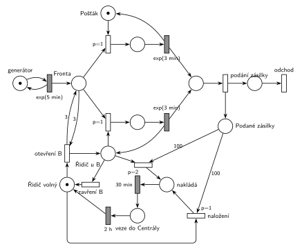

# 09–12 – Pošta

**Původ:** půlsemestrálky 2014–19 (přehled zadání), úloha Z19. Rok, varianta ani body nejsou známé.

**Zdroje:**

- `Fitcheats/Půlsemestrálky/Zadání z minulých let/Přehled zadání 2014-19.pdf`, str. 5 (zadání)
- `Fitcheats/Půlsemestrálky/FIT - Příprava 2021-22.pdf`, str. 21 (studentské řešení, bez hlasů)

## Zadání

> Do pobočky pošty přichází klienti podat zásilku v intervalech daných exp. rozložením se středem 5 minut. Pobočka má dvě podací přepážky (A a B) a dva zaměstnance (pošťáka a řidiče). Pošťák obsluhuje přepážku A. Řidič je primárně určen pro náklad a odvážení podaných zásilek do Centrály. Doba obsluhy jednoho klienta se řídí exp(3min). Po překročení počtu 100 podaných zásilek řidič zásilky naloží do auta (trvá 30 minut) a veze je do Centrály. Vrací se po dvou hodinách. Pokud fronta k přepážkám dosáhne délky 3 klienti, pak řidič otevře přepážku B a obsluhuje ji, dokud se fronta nevyprázdní (tj. přepážku opustí po vyprázdnění fronty k přepážkám nebo když se naplní kapacita 100 pro odvoz podaných zásilek).
>
> *Zadaný systém modelujte formou Petriho sítě s vyznačením všech potřebných parametrů.*

Věta „V modelu jednoznačně ukažte (přechodem) moment, kdy transakce opouští systém“ v tehdejších zadáních ještě nebyla. Výstupní přechod je v síti přesto, dnes se vyžaduje.

Podobné úlohy: [09–08 – Cestovní kancelář](<../09–08 - Cestovní kancelář/09–08 - Cestovní kancelář.md>), [09–15 – Úřad s dodatečnými přepážkami](<../09–15 - Úřad s dodatečnými přepážkami/09–15 - Úřad s dodatečnými přepážkami.md>), [05–02 – Dočasně MM2 při dlouhé frontě](<../05–02 - Dočasně MM2 při dlouhé frontě/05–02 - Dočasně MM2 při dlouhé frontě.md>).

## Interpretace

Zobrazit interpretaci (nápověda)

- **Jedna fronta** k oběma přepážkám („fronta k přepážkám“). Přepážka A je zařízení *Pošťák*. Přepážka B je zařízení *Řidič u B*, jehož značka existuje, jen když řidič u B sedí.
- **Zásilky:** po obsluze klient odchází a jeho zásilka zůstává na poště. Přechod *podání zásilky* rozdělí transakci na klienta (→ *odchod*) a značku v *Podaných zásilkách*. Zásilka vznikne až dokončením obsluhy.
- **„Po překročení počtu 100“ vs. „naplní se kapacita 100“:** obojí čtu jako „jakmile je podaných zásilek 100“. Naloží se právě 100 zásilek (hrana s váhou 100), případné další zůstanou na příští odvoz. Kdyby se trvalo na doslovném „překročení“, byla by váha 101, ale auto má kapacitu 100.
- **Řidič má tři stavy:** *Řidič volný*, *Řidič u B* a odvoz (*nakládá* `30 min` → *veze do Centrály* `2 h` → zpět *volný*). „Vrací se po dvou hodinách“ beru jako 2 h od odjezdu po naložení.
- **Odvoz má přednost** („primárně určen pro náklad“): naložení z volného stavu má `p=1` a vyhraje nad otevřením B (`p=0`). Naložení od přepážky B má `p=2` a vyhraje nad obsazením B dalším klientem (`p=1`). Rozpracovaného klienta řidič doobslouží, zadání přerušení nezmiňuje.
- **Otevření B:** volný řidič + test *Fronty* hranami s váhou 3 tam i zpět („dosáhne délky 3“ = aspoň 3 čekající).
- **Zavření B:** přechod *zavření B* (`p=0`) vrací řidiče do *volný*. Obsazení B má `p=1`, takže zavření se provede, jen když ve *Frontě* nikdo není („po vyprázdnění fronty“). Prázdnou frontu tedy pozná priorita, žádný čítač fronty není potřeba.
- Klienti mezi přepážkami nevolí: když jsou obě volné, vezme klienta kterákoli.

## Řešení

Zobrazit řešení

| Požadavek | Prvek sítě |
|---|---|
| klienti exp(5 min) | *generátor* ⇄ `exp(5 min)` → *Fronta* |
| pošťák u přepážky A, exp(3 min) | *Pošťák* (1 značka), obsazení `p=1`, `exp(3 min)` vrací pošťáka |
| řidič u přepážky B, exp(3 min) | *Řidič u B*, obsazení `p=1`, `exp(3 min)` vrací značku *Řidič u B* |
| klient odchází, zásilka zůstává | *podání zásilky* → *odchod*; → *Podané zásilky* |
| fronta dosáhne 3 → řidič otevře B | *otevření B*: *Řidič volný* + test *Fronty* vahou 3 → *Řidič u B* |
| B opustí po vyprázdnění fronty | *zavření B* (`p=0` < obsazení `p=1`) → *Řidič volný* |
| 100 zásilek → naložení 30 min | *naložení* `p=1` (volný řidič) nebo `p=2` (od přepážky B) + 100 zásilek → *nakládá* → `30 min` |
| odvoz, návrat po 2 h | *veze do Centrály* → `2 h` → *Řidič volný* |

Kontrola simulací: *Pošťák* + obsluha A = 1, řidič je vždy právě v jednom stavu (volný, u B, obsluhuje u B, nakládá, veze). Odvoz probíhá asi každých 8,5 hodiny, asi pětina naložení začíná od přepážky B. Přepážka B se otevírá zhruba jednou za dvě hodiny a obslouží asi 10 % klientů. Fronta zůstává krátká (nejvýš asi 14 klientů).

## Existující řešení

Zobrazit srovnání s existujícími řešeními

- **Studentské řešení (Příprava 2021/22, str. 21, bez hlasů):** pozor, používá obrácenou konvenci: šrafovaný obdélník je okamžitý přechod a prázdný časovaný (u Hrubého je to naopak). Pošťák a řidič jsou místa se značkou, řidič se po každé obsluze u B vrací do svého místa. Otevření B (`P=2`) testuje frontu vahou 3 a bere značku z řídicího místa. Vzniká tak značka „B otevřena“, kterou obsazení B testuje. Odvoz: *zásilky* vahou 100 + řidič, `P=3` → `30m` → `2h` → zpět řidič. Rozdíly a slabiny:
  - Délku fronty počítá zvláštním čítačem (každý příchod přidá značku, každé obsazení ji odebere) a zavření B řeší smyčkou přechodů s `P=1` vlevo dole. Je to zbytečně složité, prázdnou frontu pozná priorita. Kresba je navíc nepřehledná: z místa za oběma obsluhami vedou hrany k výstupnímu přechodu i do této smyčky, takže by si o značku konkurovaly.
  - Odvoz nebere značku „B otevřena“. Po návratu z Centrály tak řidič může dál obsluhovat B, i když fronta mezitím klesla pod 3. Zadání říká, že při naplnění 100 zásilek přepážku opouští.

## Časté chyby

Zobrazit časté chyby

- Řidič jako druhá stálá linka (MM2). Přepážka B je otevřená jen od fronty 3 do vyprázdnění fronty.
- Odvoz bez přednosti: řidič by u B obsluhoval dál, i když je 100 zásilek připraveno.
- Čítač zásilek plněný při příchodu klienta (ne až po obsluze), nebo jen z přepážky A.
- Test fronty jen vstupní hranou s váhou 3 bez hrany zpět: tři klienti zmizí.
- Zavření B bez nižší priority než obsazení B: řidič by mohl odejít, i když ve frontě někdo čeká.
- Řidič, který se po odvozu nevrátí (chybí hrana z `2 h` zpět do *Řidič volný*).

