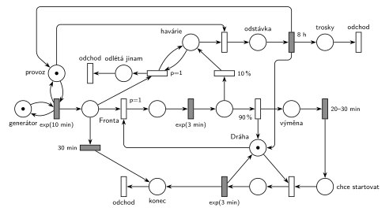

# 09–13 – Letiště

**Původ:** půlsemestrálky 2014–19 (přehled zadání), úloha Z17.

**Zdroje:**

- `Fitcheats/Půlsemestrálky/Zadání z minulých let/Přehled zadání 2014-19.pdf`, str. 4 (zadání)
- `Fitcheats/Půlsemestrálky/Democvičení 2020-21 - Z4 zadání a řešení.pdf`, str. 5 (zadání a řešení z democvičení)
- `Fitcheats/Půlsemestrálky/Democvičení 2020-21 - Z4 řešení.pdf` (totéž řešení s poznámkou pod ním)
- `Fitcheats/Půlsemestrálky/FIT - Příprava 2021-22.pdf`, str. 20 (studentské řešení s hlasováním)

## Zadání

> Letiště má k dispozici jednu dráhu, která slouží pro starty a přistání letadel. V intervalech daných exp(10min) požádá o přistání nové letadlo. Přistávající letadla mají prioritu v přístupu na dráhu před startujícími letadly. Pokud letadlo nezíská dráhu pro přistání do 30 minut od žádosti, pak systém opouští. Letadlo po přistání vymění cestující (za 20-30 minut) a žádá o dráhu pro start. V 10% případů přistávající letadlo havaruje, což způsobí odstávku dráhy na 8 hodin. V případě odstávky dráhy všechna letadla čekající na přistání odletí a v průběhu odstávky nová k letišti nepřilétají. Doba přistání i startu se řídí exponenciálním rozložením se středem 3 minuty.
>
> *Zadaný systém modelujte formou Petriho sítě s vyznačením všech potřebných parametrů.*

Věta „V modelu jednoznačně ukažte (přechodem) moment, kdy transakce opouští systém“ přibyla až v roce 2022/23. Výstupní přechody jsou v síti přesto, dnes se vyžadují.

Podobné úlohy: [09–03 – Psí salon](<../09–03 - Psí salon/09–03 - Psí salon.md>) (vyprázdnění fronty a zastavení příchodů), [02–01 – Netrpělivé požadavky](<../02–01 - Netrpělivé požadavky/02–01 - Netrpělivé požadavky.md>), [07–04 – Dva proudy příchodů](<../07–04 - Dva proudy příchodů/07–04 - Dva proudy příchodů.md>).

## Interpretace

Zobrazit interpretaci (nápověda)

- **Dráha** je zařízení s jednou značkou. Přistání ji obsazuje s `p=1`, start s `p=0`: když se dráha uvolní a čekají oba druhy letadel, dostane ji přistávající.
- **30 min na přistání:** časovaný přechod `30 min` přímo na *Frontě*; každé letadlo má vlastní odpočet (slajd 138) a zaniká, když letadlo dostane dráhu.
- **Havárie** se rozhoduje po přistání `exp(3 min)`: 90 % uvolní dráhu a jde na výměnu cestujících, 10 % havaruje. Dráhu nevrací, značka zůstane v místě *havárie*, takže dráha je odstavená.
- **Čekající odlétají:** smyčka `p=1` na *havárii* vyprázdní *Frontu*. Teprve potom (`p=0`) *uzavření dráhy* odstartuje odstávku `8 h`.
- **Nová letadla nepřilétají:** generátor má test na místo *provoz* (smyčka do časovaného přechodu, stejně jako v řešení z democvičení). Uzavření mu značku vezme, odpočet příchodu zanikne a po 8 h se *provoz* vrátí. Stejně dobře lze vzít značku přímo *generátoru*.
- **Havarované letadlo:** zadání neříká, co s ním (poznámka pod řešením z democvičení: „Zadani neosetruje co se stane s letadlem co shavarovalo“). Tady zůstane na dráze jako *odstávka* a po 8 h odchází ze systému jako *trosky*.
- Letadla, která už přistála, během odstávky normálně vymění cestující a čekají na start.
- 10 % havárií je hodně: letiště je v simulaci asi 80 % času zavřené. To plyne přímo ze zadaných čísel.

## Řešení

Zobrazit řešení

| Požadavek | Prvek sítě |
|---|---|
| žádosti o přistání po exp(10 min) | *generátor* ⇄ `exp(10 min)` (test *provoz*) → *Fronta* |
| bez dráhy do 30 min odlétá | `30 min` z *Fronty* → *konec* |
| jedna dráha, přistání má přednost | *Dráha* (1), přistání `p=1`, start `p=0` |
| přistání a start exp(3 min) | `exp(3 min)` při přistání i startu |
| výměna cestujících 20–30 min | `20–30 min` → *chce startovat* |
| 10 % havaruje | `90 %` vrací *Dráhu*, `10 %` → *havárie* (dráha zůstane obsazená) |
| čekající odletí | smyčka `p=1` *havárie* + *Fronta* → *odlétá jinam* |
| odstávka 8 h, nepřilétají nová | *uzavření* bere *provoz* → `8 h` vrací *Dráhu* a *provoz* |
| odchod ze systému | *odchod* po startu nebo po 30 min, *odchod* z *odlétá jinam*, *odchod* trosek |

Kontrola simulací: *Dráha* + letadla na ní + *havárie* + *odstávka* = 1, *provoz* + *odstávka* = 1. Za 202 dní 495 havárií, každá zavře letiště na 8 h; netrpělivost se projeví jen výjimečně, protože dráha je mimo odstávky volná.

## Existující řešení

Zobrazit srovnání s existujícími řešeními

- **Democvičení 2020/21 (str. 5):** generátor `exp(10m)` s testem na místo „OK“ → fronta s časovaným `30m` k výstupu → `p=1` obsazení dráhy → `exp(3m)` → `90%` (vrací dráhu) → `20-30m` → obsazení dráhy pro start (bez priority) → start → výstup. `10%` → přechod, který vezme „OK“ → stav havárie → smyčka `p=1` vyprázdní frontu k výstupu → `8h` vrací dráhu a „OK“. Struktura je stejná jako tady; trosky ze systému neodcházejí (viz poznámka výše).
- **Příprava 2021/22 (str. 20):** o havárii rozhoduje už hned za generátorem (`10%` / `90%`), havarující letadlo pak obsadí dráhu s `P=2` a vůbec nepřistává `exp(3m)`. Obě fronty mají `30m`, vyprázdnění front a odstávka `8h` (vrací dráhu a generátor) tam jsou. Chybí výstupní přechody. Hlasy: 0 souhlasí, 1 nesouhlasí („why“).

## Časté chyby

Zobrazit časté chyby

- Havárie, která vrátí dráhu (pak žádná odstávka není), nebo odstávka, která dráhu vezme podruhé, i když ji havarované letadlo už drží.
- Zastavení příchodů odebráním značky z *Fronty* místo z generátoru (nebo z místa, které generátor testuje).
- Vyprázdnění fronty jedním přechodem s váhou hrany; „všechna letadla“ potřebují smyčku s prioritou.
- Netrpělivost i u letadel čekajících na start; zadání ji má jen pro přistání.
- Start se stejnou prioritou jako přistání.

