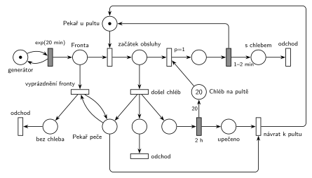

# 09–14 – Pekárna

## Zadání

> Uvažujme pekárnu spojenou s obchodem, ve které pracuje jeden pekař. Pekař buď vyrábí chleba nebo se věnuje zákazníkům u pultu. Do obchodu přichází zákazníci v intervalech daných exp 20 minut. Každý zákazník kupuje jeden chleba. V počátečním stavu je na pultě obchodu 20 bochníků chleba a pekař je přítomen u pultu. Obsluha jednoho zákazníka zabere 1-2 minuty. Pokud se na počátku obsluhy zákazníka ukáže, že na pultě došel chleba, pak se pekař přesune do výrobny a peče chleba. Doba pečení chleba je 2 hodiny. Rozpracovaný zákazník a všichni zákazníci ve frontě odejdou z obchodu. Výsledkem pečení chleba je 20 bochníků na pult prodejny. Po upečení chleba se pekař vrací k pultu. V průběhu pečení chleba nově příchozí zákazníci okamžitě opouští obchod.
>
> *Zadaný systém modelujte formou Petriho sítě s vyznačením všech potřebných parametrů.*

Věta „V modelu jednoznačně ukažte (přechodem) moment, kdy transakce opouští systém“ přibyla až v roce 2022/23. Výstupní přechody jsou v síti přesto, dnes se vyžadují.

Podobné úlohy: [09–03 – Psí salon](<../09–03 - Psí salon/09–03 - Psí salon.md>), [09–05 – Pizza stánek](<../09–05 - Pizza stánek/09–05 - Pizza stánek.md>), [11–04 – Výletní loď](<../11–04 - Výletní loď/11–04 - Výletní loď.md>).

## Interpretace

Zobrazit interpretaci (nápověda)

- **Pekař** je zařízení (*Pekař u pultu*, 1 značka). **Chléb** je sklad s 20 značkami.
- **Kontrola chleba až na začátku obsluhy:** pekař nejdřív obsadí zákazníka (*začátek obsluhy*), pak se rozhodne. Je-li chléb, vezme bochník přechod `p=1`, jinak se provede *došel chléb* (`p=0`). Když se prodá poslední bochník, pekař tedy zůstane u pultu a péct jde až s dalším zákazníkem, přesně jak to zadání popisuje.
- **Došel chléb:** rozpracovaný zákazník odchází, pekař jde péct `2 h` a zároveň vznikne stav *Pekař peče*. Stav je oddělený od místa před přechodem `2 h`: testuje ho smyčka vyprázdnění fronty (vezme a vrátí značku), a kdyby byl vstupem `2 h`, každý odchod zákazníka by odpočet pečení spustil znovu (slajd 139).
- **Vyprázdnění fronty:** smyčka na *Pekař peče* bere zákazníky z *Fronty*, dokud tam někdo je. Protože stav trvá celé 2 h, odejdou i zákazníci, kteří přijdou během pečení, hned po příchodu („okamžitě opouští obchod“).
- **Po upečení** přibude 20 bochníků (hrana s váhou 20) a *návrat k pultu* vezme *upečeno* i *Pekař peče* a vrátí značku *Pekař u pultu*.
- Odchod je ve třech místech (s chlebem, rozpracovaný zákazník, zákazníci z fronty). Šlo by je svést do jednoho místa, jen by se v obrázku křížily hrany.

## Petriho síť

Zobrazit Petriho síť

| Požadavek | Prvek sítě |
|---|---|
| zákazníci po exp(20 min) | *generátor* ⇄ `exp(20 min)` → *Fronta* |
| jeden pekař u pultu, obsluha 1–2 min | *Pekař u pultu* (1), obsazení, `1–2 min` vrací pekaře |
| 20 bochníků, každý kupuje jeden | *Chléb na pultě* (20), `p=1` vezme bochník |
| na začátku obsluhy došel chléb | *došel chléb* (`p=0`): zákazník → *odchod*, pekař → `2 h` a *Pekař peče* |
| fronta i nově příchozí odcházejí | smyčka *vyprázdnění fronty* na *Pekař peče* → *bez chleba* → *odchod* |
| pečení 2 h, 20 bochníků, návrat k pultu | `2 h` → *Chléb na pultě* (váha 20) a *upečeno* → *návrat k pultu* |

Kontrola simulací: *Pekař u pultu* + obsluha + pečení = 1, *Pekař peče* existuje právě během pečení, chleba je nejvýš 20. Na 418 pečení připadá 8 362 prodaných bochníků (přesně 20 na jedno pečení), fronta má nejvýš 3 zákazníky.

## Časté chyby

Zobrazit časté chyby

- Kontrola chleba před obsazením pekaře nebo hned po prodeji posledního bochníku. Zadání říká „na počátku obsluhy“.
- Rozpracovaný zákazník, který po zjištění, že chléb došel, nikam neodejde (zůstane v *začátku obsluhy*).
- Vyprázdnění fronty jen jednou v okamžiku odchodu pekaře; nově příchozí by pak během pečení čekali.
- Stav pečení jako vstup časovaného přechodu `2 h`, který zároveň testuje smyčka vyprázdnění: odpočet se s každým odchodem zákazníka spustí znovu.
- Upečení, které vrátí jen 1 bochník (chybí váha 20), nebo zapomenutý návrat pekaře k pultu.

## Původ a zdroje

**Původ:** půlsemestrálky 2014–19 (přehled zadání), úloha Z14.

**Zdroje:**

- `Fitcheats/Půlsemestrálky/Zadání z minulých let/Přehled zadání 2014-19.pdf`, str. 4 (zadání)
- `Fitcheats/Půlsemestrálky/FIT - Příprava 2021-22.pdf`, str. 17 (studentské řešení, bez hlasů)

**Existující řešení:**

Zobrazit existující řešení

- **Příprava 2021/22 (str. 17):** stejná struktura: obsazení pekaře (`p=1`), přechod „když je chleba“ (`p=1`) s místem *chleba* (20), `1-2m`, jinak přechod, který pošle zákazníka na „odchod zákazníka“ a pekaře na `2h`; stav „peče?“, ze kterého smyčka vyprazdňuje frontu („odchod z obchodu“); po pečení 20 bochníků a „dopekl“ + „peče?“ → `P=1` → pekař u pultu. Řešení je správně, liší se jen rozložením (a zbytečnou prioritou na obsazení pekaře). Nikdo pro něj nehlasoval.

