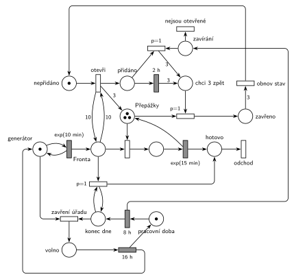

# 09–15 – Úřad s dodatečnými přepážkami

**Původ:** půlsemestrálky 2014–19 (přehled zadání), úloha Z10.

**Zdroje:**

- `Fitcheats/Půlsemestrálky/Zadání z minulých let/Přehled zadání 2014-19.pdf`, str. 3 (zadání)
- `Fitcheats/Půlsemestrálky/FIT - Příprava 2021-22.pdf`, str. 14 (studentské řešení, v komentáři „100% spatne“)
- `Fitcheats/Příprava na zkoušku/luppo - Tabule.png` (studentské řešení na tabuli)

## Zadání

> Pracovní doba úřadu je 8 hodin, po kterých následuje 16 hodin volna. Do úřadovny přichází klienti v období pracovní doby v intervalech exp(10min). Agendu klientů vyřizují úředníci na třech přepážkách. Zpracování jednoho klienta trvá dobu exp(15min). Pokud počet klientů ve frontě k přepážkám dosáhne počtu 10 klientů, úřad na dobu 2 hodin otevře tři další dodatečné přepážky. Po ukončení pracovní doby opouští všichni klienti ve frontě úřad (rozpracovaní klienti jsou dokončeni) a po uvolnění klientem se taky okamžitě uzavřou případné dodatečné přepážky.
>
> Zadaný systém modelujte formou Petriho sítě s vyznačením všech potřebných parametrů.

Podobné úlohy: [09–08 – Cestovní kancelář](<../09–08 - Cestovní kancelář/09–08 - Cestovní kancelář.md>) (stejný mechanismus dodatečných přepážek), [09–01 – Úřad](<../09–01 - Úřad/09–01 - Úřad.md>), [05–02 – Dočasně MM2 při dlouhé frontě](<../05–02 - Dočasně MM2 při dlouhé frontě/05–02 - Dočasně MM2 při dlouhé frontě.md>), [11–09 – Překladiště s jeřábem](<../11–09 - Překladiště s jeřábem/11–09 - Překladiště s jeřábem.md>) (pracovní doba 8 h / 16 h).

## Interpretace

Zobrazit interpretaci (nápověda)

- **Dodatečné přepážky** jsou udělané stejně jako v [09–08](<../09–08 - Cestovní kancelář/09–08 - Cestovní kancelář.md>) (Hrubého varianta A): *otevři* vezme *nepřidáno*, otestuje frontu hranami s váhou 10 tam a zpět a přidá 3 značky do *Přepážky*. Po `2 h` přijdou 3 značky do *chci 3 zpět* a přechod `p=1` zavírá po jedné každou volnou přepážku, rozpracovaný klient se dokončí. Po třech zavřených vrátí *obnov stav* značku *nepřidáno*.
- **„Dosáhne počtu 10“** = alespoň 10, tedy váha 10, ne 11.
- **Pracovní doba** je cyklus *pracovní doba* → `8 h` → *konec dne* → … → *volno* → `16 h`. Začíná se ráno, na začátku pracovní doby.
- **Konec pracovní doby** (vše v nulovém čase):
  - klienti ve frontě odcházejí: smyčka `p=1` na *konec dne*, dokud je fronta neprázdná. Obsluhovaní klienti se dokončí, protože jejich značky jsou v *obsluze*, ne ve frontě;
  - pak (p=0) *zavření úřadu* vezme značku *generátoru*, příchody se zastaví (klienti chodí jen v pracovní době). `16 h` značku vrátí;
  - dodatečné přepážky: `8 h` pošle signál do *zavírání*. Jsou-li přepážky otevřené (*přidáno*), přechod `p=1` zruší zbývající část dvou hodin (vezme značku, na které běží odpočet `2 h`) a rovnou dá 3 značky do *chci 3 zpět*. Volné přepážky se tak zavřou hned, obsazené po dokončení klienta. Nejsou-li otevřené (nebo se už zavírají), signál zanikne přechodem *nejsou otevřené* (p=0).
- Testovací hrany vedou jen na místa bez vlastního odpočtu (*Fronta*, *konec dne*). Odpočet `8 h` je na *pracovní době*, kterou nic netestuje, takže se nepřerušuje.

## Řešení

Zobrazit řešení

| Požadavek | Prvek sítě |
|---|---|
| klienti exp(10 min) jen v pracovní době | *generátor* ⇄ `exp(10 min)` → *Fronta*; mimo pracovní dobu nemá generátor značku |
| 3 přepážky, zpracování exp(15 min) | *Přepážky* (3), obsazení, `exp(15 min)` vrací přepážku |
| fronta dosáhne 10 → 3 další přepážky na 2 h | *otevři*: *nepřidáno* + test *Fronta* (váha 10) → 3 × *Přepážky* + *přidáno* → `2 h` → 3 × *chci 3 zpět* |
| zavření po uvolnění klientem | *zavři* (`p=1`): *chci 3 zpět* + volná přepážka → *zavřeno*; 3 × *zavřeno* → *obnov stav* |
| pracovní doba 8 h, volno 16 h | *pracovní doba* → `8 h` → *konec dne* → *zavření úřadu* → *volno* → `16 h` |
| po pracovní době fronta odchází | `p=1`: *konec dne* (smyčka) + *Fronta* → *hotovo* → *odchod* |
| dodatečné přepážky se po pracovní době zavřou hned | `8 h` → *zavírání*; `p=1`: *zavírání* + *přidáno* → 3 × *chci 3 zpět* |

Kontrola simulací: *Přepážky* + obsluhovaní + 3 × *nepřidáno* + *zavřeno* = 6 (nikdy víc než 3 + 3 přepážek), 3 × *nepřidáno* + 3 × *přidáno* + *chci 3 zpět* + *zavřeno* = 3, *generátor* + *volno* = 1. Úřad je vytížený na 50 %, takže fronta 10 je vzácná: za asi 3 000 simulovaných dní se přepážky otevřely 10–16krát a třetinu z toho zavřel konec pracovní doby dřív než za 2 h. Fronta nikdy nepřekročila 10.

## Existující řešení

Zobrazit srovnání s existujícími řešeními

- **Příprava 2021/22 (str. 14), komentář „100% spatne“:** obrácené značení (šrafovaně okamžité přechody). Pracovní doba je udělaná dobře: stavy *pracovní doba*/*volno* přepínají přechody `P=1` podle signálů z časovačů `8h`/`16h` v samostatném cyklu. Klienti se generují i v noci a v době volna je okamžitý přechod hned zahodí, což by šlo. Dodatečné přepážky jsou ale samostatné místo, ze kterého druhý `exp(15)` značku jen bere a nevrací, a po `2h` je přechod `P=1` bere zpátky všechny 3 najednou. Zavření dodatečných přepážek po konci pracovní doby v síti není vidět.
- **Tabule luppo:** pracovní doba jako stav *Work*/*Rest* odděleně od časovačů `8h`/`16h` (testy nepřerušují odpočty). Test fronty váhami 10, *Noví úředníci* → `2h`, odebrání přechodem `P=3`, vyprázdnění fronty na konci dne přechodem `P=1000`. Detaily hran z fotky nejdou spolehlivě přečíst.
- Hrubého řešení této úlohy v materiálech není. Mechanismus přepážek odpovídá jeho řešení [09–08](<../09–08 - Cestovní kancelář/09–08 - Cestovní kancelář.md>).

## Časté chyby

Zobrazit časté chyby

- Chybějící stav *nepřidáno*: při frontě ≥ 10 se přepážky přidávají znovu a znovu.
- Zavření dodatečných přepážek hranou s váhou 3 z *Přepážky*: čeká se, až budou volné tři najednou, místo zavírání po jedné.
- Konec pracovní doby, který vezme i obsluhované klienty. Zadání chce dokončit rozpracované.
- Vyprázdnění fronty bez priority nad zavřením úřadu, nebo jediným přechodem s váhou (váha bere přesný počet, ne „všechny“).
- Časovač `8 h` na místě, které testují jiné přechody (např. generátor testující „pracovní dobu“). Každý test značku vezme a vrátí a odpočet by se spouštěl znovu.

