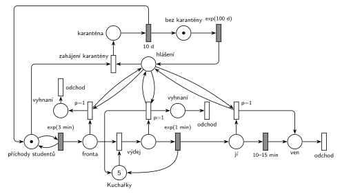

# 09–16 – Menza

## Zadání

> Do školní menzy přichází studenti v intervalech exp(3 min). Jídlo vydává 5 kuchařek. Doba obsluhy jednoho studenta kuchařkou se řídí exp(1min). Po obdržení jídla student konzumuje po dobu 10-15 minut rovnoměrně. V intervalech exp(100 dní) dostává menza hlášení o žloutenkové karanténě. Po příchodu hlášení se ukončí okamžitě všechny činnosti (výdej, konzumace) a úplně všichni studenti opustí menzu. Po odchodu všech studentů z menzy se zahájí karanténa trvající 10 dní. Příchodem hlášení se zastaví proces příchodu studentů do menzy.
>
> Zadaný systém modelujte formou Petriho sítě s vyznačením všech potřebných parametrů.

Podobné úlohy: [09–03 – Psí salon](<../09–03 - Psí salon/09–03 - Psí salon.md>) (vyprázdnění fronty smyčkou s prioritou a zastavení příchodů), [05–07 – Každá 100. transakce vyprázdní frontu](<../05–07 - Každá 100. transakce vyprázdní frontu/05–07 - Každá 100. transakce vyprázdní frontu.md>), [12–12 – Uhelný mlýn](<../12–12 - Uhelný mlýn/12–12 - Uhelný mlýn.md>) (havárie exp(100 dní)).

## Interpretace

Zobrazit interpretaci (nápověda)

 

- **5 kuchařek** je sklad s 5 značkami (obsazení, `exp(1 min)` vrací kuchařku). **Konzumace** `10–15 min` je časovaný přechod bez omezení: každý jedící student má vlastní odpočet (slajd 138), jedí souběžně.
- **Hlášení** je proces *bez karantény* → `exp(100 d)` → *hlášení*. Generátor se vrací až po karanténě, takže hlášení během karantény nepřijde. Zadání to neřeší; interval exp(100 dní) se tu počítá od konce poslední karantény.
- **Všichni ven:** tři vyhazovací přechody s `p=1`, každý se smyčkou na *hlášení* (hrana tam a zpět). Opakují se, dokud je ve *Frontě*, ve *výdeji* nebo mezi *jí* nějaký student. Student vyhozený z výdeje vrací kuchařku. Rozpracovaný výdej i konzumace se tím přeruší, protože okamžitý přechod vezme značku, na které běží odpočet (slajd 139).
- **„Po odchodu všech studentů se zahájí karanténa“:** *zahájení karantény* má p=0, takže přijde na řadu, až když žádný vyhazovací přechod (`p=1`) není proveditelný, tedy když je menza prázdná. Vše proběhne v nulovém čase v okamžiku hlášení.
- **Zastavení příchodů:** *zahájení karantény* vezme značku *generátoru*, tím zanikne odpočet `exp(3 min)`. Po `10 d` se vrátí značka generátoru i *bez karantény*. Že se příchody zastaví až s nulovým zpožděním po vyprázdnění, nevadí: mezitím neuplyne žádný čas.
- Vyhození studenti z fronty odcházejí přes *vyhnaní*, ostatní přes *ven*. Obě místa končí výstupním přechodem *odchod*.

## Petriho síť

Zobrazit Petriho síť

 

| Požadavek | Prvek sítě |
|---|---|
| příchody exp(3 min) | *generátor* ⇄ `exp(3 min)` → *Fronta* |
| 5 kuchařek, výdej exp(1 min) | *Kuchařky* (5), obsazení → *výdej* → `exp(1 min)` vrací kuchařku |
| konzumace 10–15 min | *jí* → `10–15 min` → *ven* → *odchod* |
| hlášení exp(100 dní) | *bez karantény* → `exp(100 d)` → *hlášení* |
| okamžitě všichni ven | `p=1` smyčky: *hlášení* + student z *Fronty* / *výdeje* (+ kuchařka zpět) / *jí* → ven |
| po odchodu všech karanténa 10 dní | *zahájení karantény* (p=0) → *Karanténa* → `10 d` |
| hlášení zastaví příchody | *zahájení karantény* bere značku *generátoru*, `10 d` ji vrací |

Kontrola simulací: *Kuchařky* + *výdej* = 5, *generátor* + *Karanténa* = 1, *bez karantény* + *hlášení* + *Karanténa* = 1. Hlášení chodí jednou za 100 dní, takže i 300 000 událostí (asi 200 dní) dá jen 0–3 karantény a fronta k 5 kuchařkám je v tu chvíli skoro vždy prázdná. Vyhazování proto ověřil zrychlený běh (hlášení po `exp(1 h)`, karanténa `1 h`, příchody po `exp(0,15 min)`): všechny tři vyhazovací přechody se provedly tisíckrát a invarianty platily.

## Časté chyby

Zobrazit časté chyby

 

- Vyhození jedním přechodem s váhou hrany. Váha bere přesný počet, „všichni“ se dělá smyčkou s prioritou.
- Vyhození studenta z výdeje bez vrácení kuchařky: po karanténě by kuchařek bylo méně.
- Karanténa spuštěná přímo hlášením bez priorit. Zadání chce karanténu až po odchodu všech, proto vyhazování `p=1` a zahájení karantény p=0.
- Zapomenuté zastavení generátoru studentů: během karantény by se fronta plnila.
- Generátor hlášení ve smyčce bez ohledu na karanténu: druhé hlášení během karantény by spustilo další, souběžnou karanténu.

## Původ a zdroje

Zobrazit původ a zdroje

 

**Původ:** půlsemestrálky 2014–19 (přehled zadání), úloha Z9.

**Zdroje:**

- `Fitcheats/Půlsemestrálky/Zadání z minulých let/Přehled zadání 2014-19.pdf`, str. 3 (zadání)
- `Fitcheats/Půlsemestrálky/FIT - Příprava 2021-22.pdf`, str. 13 (studentské řešení, 0 pro / 2 proti)
- `Fitcheats/Příprava na zkoušku/luppo - Tabule.png` (studentské řešení na tabuli)

**Existující řešení:**

- **Příprava 2021/22 (str. 13, 0 pro / 2 proti):** obrácené značení (šrafovaně okamžité přechody). Výdej je jediný časovaný přechod `exp(1m)` se vstupy z fronty a z *kuchařek* (kuchařku hned vrací), takže obsluhovaní studenti zůstávají ve frontě a vyhazovací přechod `P=2` je bere spolu s čekajícími. Konzumující vyhazuje `P=1`. Chyby, které vytkly i komentáře: příchody studentů se nezastaví a karanténa `10d` startuje přímo z generátoru hlášení, ne až po vyprázdnění. Studenti nemají výstupní přechod.
- **Tabule luppo:** *Studenti* → `Exp(3min)` → *Příchod* → obsazení kuchařek (5) → *Obsluha* → `Exp(1min)` → *Žere* → `Rav(10-15)` → *Odchod*. *hlášení* má smyčky na vyhazovací přechody z fronty (`p=2`), z obsluhy (vrací kuchařku) i z *Žere*. Časovač `10dní` je přímo na místě *hlášení*. Hrana, která by brala značku generátoru studentů, na fotce není vidět.

