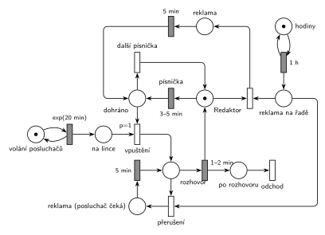

# 09–17 – Hudební rádio

## Zadání

> Hudební rádio pouští písničky, reklamy a rozhovory s posluchači, kteří si přejí přehrát oblíbenou písničku. Písnička hraje po dobu 3-5 minut. Redaktor rádia přehrává písničky ze svého seznamu a kromě toho musí každou hodinu začít přehrávat reklamní stopu o délce 5 minut. Posluchači volají do rádia v intervalech daných exp. rozložením se středem 20 minut. Posluchač je vpuštěn do vysílání až potom, kdy dohraje písnička, případně reklama (reklama má přednost před posluchačem). Rozhovor s posluchačem trvá 1-2 minuty. Reklama přeruší přehrávání písničky i rozhovor s posluchačem. Přerušená písnička se neopakuje. Přerušený rozhovor se opakuje od začátku.
>
> Zadaný systém modelujte formou Petriho sítě s vyznačením všech potřebných parametrů.

Podobné úlohy: [03–01 – Porucha zruší obsluhu](<../03–01 - Porucha zruší obsluhu/03–01 - Porucha zruší obsluhu.md>) (přerušení bez opakování), [03–02 – Porucha vrací transakci do fronty](<../03–02 - Porucha vrací transakci do fronty/03–02 - Porucha vrací transakci do fronty.md>), [12–01 – Zahradnictví a bouřka](<../12–01 - Zahradnictví a bouřka/12–01 - Zahradnictví a bouřka.md>) (přerušená práce se opakuje od začátku).

## Interpretace

Zobrazit interpretaci (nápověda)

- **Redaktor** je jediný zdroj (místo s 1 značkou). Je vždy právě v jednom stavu: pouští písničku (*Redaktor*), vede rozhovor, pouští reklamu, nebo se rozhoduje (*dohráno*).
- **Písnička** je časovaný přechod `3–5 min` přímo na místě *Redaktor*. Během písničky značka zůstává v *Redaktorovi* (slajd 137), takže reklama ji může kdykoli vzít a písnička zanikne. Po reklamě začne nová písnička, ta přerušená se neopakuje.
- **„Vpuštěn až potom, kdy dohraje písnička, případně reklama“:** po písničce i po reklamě jde značka do *dohráno*. Tam se rozhoduje: čeká-li posluchač, přechod *vpuštění* (`p=1`) ho pustí do vysílání, jinak (p=0) hraje *další písnička*. Po rozhovoru jde redaktor rovnou na písničku, takže dva rozhovory za sebou bez písničky nejsou.
- Posluchač „si přeje přehrát oblíbenou písničku“: písnička po rozhovoru je ta jeho. V síti je to obyčejná písnička `3–5 min`, protože se nijak neliší.
- **Reklama každou hodinu** je deterministický generátor `1 h`. Značka *reklama na řadě* se hned spotřebuje: buď vezme *Redaktora* (přeruší písničku), nebo vezme *Rozhovor* (přeruší rozhovor). Reklama se tak spustí vždy přesně v celou hodinu a na nic nečeká. Tím je splněno i „reklama má přednost před posluchačem“: rozhovor reklamu nezdrží, naopak ho reklama přeruší.
- **Přerušený rozhovor:** posluchač zůstane na lince (*Reklama (posluchač čeká)*), po `5 min` se značka vrátí do *Rozhovor* a odpočet `1–2 min` začne znovu, tedy rozhovor od začátku.
- Posluchač odchází ze systému po rozhovoru přechodem *odchod*. Jinak zadání netrpělivost posluchačů nezmiňuje, na lince čekají libovolně dlouho.

## Řešení

Zobrazit řešení

| Požadavek | Prvek sítě |
|---|---|
| písnička 3–5 min | *Redaktor* → `3–5 min` → *dohráno* |
| posluchači volají exp(20 min) | *generátor* ⇄ `exp(20 min)` → *Posluchači na lince* |
| vpuštění až po písničce nebo reklamě | *vpuštění* (`p=1`): *dohráno* + posluchač → *Rozhovor*; jinak *další písnička* (p=0) |
| rozhovor 1–2 min | *Rozhovor* → `1–2 min` → *Redaktor* + *po rozhovoru* → *odchod* |
| každou hodinu reklama 5 min | *hodiny* ⇄ `1 h` → *reklama na řadě* |
| reklama přeruší písničku (neopakuje se) | *reklama na řadě* + *Redaktor* → *Reklama* → `5 min` → *dohráno* |
| reklama přeruší rozhovor (opakuje se) | *přerušení*: *reklama na řadě* + *Rozhovor* → `5 min` → *Rozhovor* |

Kontrola simulací: redaktor je vždy v právě jednom stavu (*Redaktor* + *dohráno* + *Rozhovor* + obě reklamní místa = 1) a v *reklama na řadě* je nejvýš jedna značka. Za 2 491 simulovaných hodin bylo 2 491 reklam, 170 z nich přerušilo rozhovor (rozhovory zabírají asi 7 % času). Na lince čekali nejvýš 4 posluchači.

## Časté chyby

Zobrazit časté chyby

- Písnička jako obsazení redaktora okamžitým přechodem a teprve pak časovaný přechod, ale reklama bere značku z místa *Redaktor*. Ten je v tu chvíli prázdný a reklama čeká na konec písničky, takže nic nepřeruší.
- Reklama jako generátor `exp(60 min)`. Zadání chce „každou hodinu“, tedy deterministicky `1 h`.
- Přerušený rozhovor vrácený do fronty posluchačů. Zadání chce opakování hned po reklamě, posluchač zůstává ve vysílání.
- Posluchač vpouštěný kdykoli, i uprostřed písničky. Musí čekat na *dohráno*, proto `p=1` na tomto místě, ne na čekajících posluchačích.
- Chybějící vrácení redaktora po reklamě nebo po rozhovoru: rádio pak „ztichne“.

## Původ a zdroje

**Původ:** půlsemestrálky 2014–19 (přehled zadání), úloha Z7.

**Zdroje:**

- `Fitcheats/Půlsemestrálky/Zadání z minulých let/Přehled zadání 2014-19.pdf`, str. 2 (zadání)
- `Fitcheats/Půlsemestrálky/Democvičení 2020-21 - Z4 zadání a řešení.pdf`, str. 3 (řešení z democvičení)
- `Fitcheats/Půlsemestrálky/FIT - Příprava 2021-22.pdf`, str. 11 (studentské řešení, 5 hlasů pro)
- `Fitcheats/Příprava na zkoušku/luppo - Tabule.png` (studentské řešení na tabuli, označené „This cesi good“)

**Existující řešení:**

Zobrazit existující řešení

- **Democvičení 2020/21 (str. 3):** stejná struktura. *Redaktor* → `3-5min` → místo, odkud `P=1` pustí posluchače do *Rozh* a zelený přechod jinak vrací redaktora k písničce. Rozhovor `1-2m` vrací *Redaktora*. Reklama: generátor `1h` → místo → přechod, který vezme *Redaktora* → *PP* → `5m` → *Redaktor*. Modře přerušení rozhovoru: reklama + *Rozh* → *DP* → `5m` → zpět do *Rozh*. Rozdíly: po reklamě jde redaktor rovnou na písničku, takže posluchač se po reklamě do vysílání nedostane (zadání to dovoluje: „případně reklama“). Generátory jsou bez míst a výstup posluchače po rozhovoru není jednoznačně zakreslený (`1-2m` vrací jen *Redaktora*).
- **Příprava 2021/22 (str. 11, 5 pro / 0 proti):** v podstatě totéž. Pozor na obrácené značení: šrafované obdélníky jsou tu okamžité přechody a prázdné časované, v IMS je to naopak. Písnička je obsazení *redaktora* → místo → `3-5m`, reklama bere značku z místa mezi nimi. Posluchač má `p=1` přímo na *redaktorovi*, takže po rozhovoru může hned následovat další rozhovor bez písničky.
- **Tabule luppo (zeleně „This cesi good“):** posluchač po rozhovoru `1-2min` dostane svou písničku (místo *Písnička* → `3,5`), reklama `1hod` má dva přechody: přeruší rozhovor (pak se opakuje) nebo písničku. Písničky ze seznamu nejsou na fotce zřetelně zakreslené.

