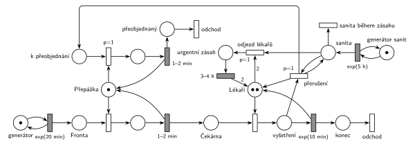

# 09–18 – Nemocniční ambulance

## Zadání

> Do nemocniční ambulace přicházejí stále pacienti v intervalech daných exp. rozložením se středem 20 minut. Po příchodu jsou registrováni u přepážky objednávání a registrace pacientů (1-2 minuty). Ambulance obsahuje dva lékaře, kteří vyšetřují čekající pacienty. Doba vyšetření se řídí exp. rozložením se středem 10 minut. V intervalech daných exp. rozložením se středem 5 hodin sanita přiveze do nemocnice dodávku urgentních pacientů. Oba lékaři přeruší svou případnou práci v ambulanci a opouští ordinace na dobu 3-4 hodiny k urgentnímu zásahu. Aktuálně rozpracovaní pacienti u registrační přepážky prioritně provedou přeobjednání (1-2 minuty) a opuští systém. Ostatní pacienti v čekárně čekají dále.
>
> *Zadaný systém modelujte formou Petriho sítě s vyznačením všech potřebných parametrů.*

Podobné úlohy: [03–04 – Porucha s opravou, transakce odchází](<../03–04 - Porucha s opravou, transakce odchází/03–04 - Porucha s opravou, transakce odchází.md>), [03–02 – Porucha vrací transakci do fronty](<../03–02 - Porucha vrací transakci do fronty/03–02 - Porucha vrací transakci do fronty.md>), [09–17 – Hudební rádio](<../09–17 - Hudební rádio/09–17 - Hudební rádio.md>) (Z7, přerušení reklamou).

## Interpretace

Zobrazit interpretaci (nápověda)

 

- **Přepážka** je jedno zařízení (registrace `1–2 min`), **Lékaři** jsou sklad se 2 značkami (vyšetření `exp(10 min)`). Mezi nimi je *Čekárna*.
- **„Aktuálně rozpracovaní pacienti“** jsou ti, jejichž vyšetření lékaři přerušili. Jdou k registrační přepážce, přednostně se přeobjednají a odejdou. Tak to čte řešení z democvičení i studentské řešení z Přípravy. Druhé čtení (přeobjednává se pacient, kterého sanita zastihne u přepážky) nechává osud přerušených pacientů nevyřešený a slovo „prioritně“ by nedávalo smysl, protože ten pacient už přepážku má.
- **Přerušení** (`p=1`) se provede pro každého vyšetřovaného pacienta zvlášť (smyčka se *sanitou*): odpočet `exp(10 min)` zanikne (slajd 139), lékař se vrátí do *Lékařů* a pacient jde do fronty *k přeobjednání*.
- **Odjezd lékařů** (`p=1`) vezme sanitu a 2 značky z *Lékařů*. Proveditelný je, až jsou oba lékaři volní, tedy po přerušení všech vyšetření. Priorita zajistí, že volného lékaře mezitím neobsadí čekající pacient. Po `3–4 h` se vrátí oba lékaři. Urgentní pacienti nejsou transakce tohoto systému.
- **Přeobjednání** obsadí *Přepážku* s `p=1`, tedy před pacienty z běžné *Fronty* (p=0). To je „prioritně“. Pacient, který se právě registruje, registraci normálně dokončí.
- **Pacienti v čekárně** čekají dál a pacienti dál přicházejí a registrují se i během zásahu.
- **Sanita během zásahu** (lékaři už jsou pryč) zadání neřeší. Tady nemá žádný účinek (*sanita během zásahu*, p=0). Jiné rozumné čtení: sanita počká a lékaři odjedou znovu hned po návratu. Pak stačí přechod *sanita během zásahu* vynechat.

## Petriho síť

Zobrazit Petriho síť

 

| Požadavek | Prvek sítě |
|---|---|
| příchody exp(20 min) | *generátor* ⇄ `exp(20 min)` → *Fronta* |
| registrace u přepážky 1–2 min | *Přepážka* (1), obsazení, `1–2 min` vrací značku → *Čekárna* |
| dva lékaři, vyšetření exp(10 min) | *Lékaři* (2), obsazení, `exp(10 min)` vrací značku → *konec* → *odchod* |
| sanita exp(5 h) | *generátor sanit* ⇄ `exp(5 h)` → *sanita* |
| lékaři přeruší práci | *přerušení* (p=1): *sanita* (smyčka) + *vyšetření* → *Lékaři* + *k přeobjednání* |
| oba lékaři odjíždí na 3–4 h | *odjezd lékařů* (p=1): *sanita* + 2 × *Lékaři* → *urgentní zásah* → `3–4 h` → 2 × *Lékaři* |
| přednostní přeobjednání 1–2 min, odchod | *k přeobjednání* → obsazení *Přepážky* (p=1) → `1–2 min` → *přeobjednaný* → *odchod* |
| sanita během zásahu | *sanita během zásahu* (p=0) |

Kontrola simulací (88 dní): *Přepážka* + registrovaný + přeobjednávající = 1, *Lékaři* + vyšetřovaní + 2 · *urgentní zásah* = 2, v místě *sanita* je nejvýš 1 značka. Z 426 sanit 251 odvezlo lékaře a 175 přijelo během zásahu. Přerušeno a přeobjednáno bylo 232 pacientů, protože po návratu lékařů je čekárna plná (nejvýš 33 pacientů).

## Časté chyby

Zobrazit časté chyby

 

- Registrace jen jako časovaný přechod bez místa *Přepážka*: neomezuje počet současně registrovaných (slajd 138).
- Odjezd lékařů, který bere 2 značky z *Lékařů* bez přerušení vyšetření: když lékař právě vyšetřuje, sanita čeká, až skončí.
- Odjezd bez priority před obsazením lékaře: volného lékaře mezitím obsadí další pacient z čekárny.
- Návrat lékařů, který se může spustit vícekrát (každá sanita přidá 2 lékaře).
- Přeobjednání bez přepážky nebo bez priority před běžnou registrací.

## Původ a zdroje

Zobrazit původ a zdroje

 

**Původ:** půlsemestrálky 2014–19 (přehled zadání), úloha Z6. Přesný rok a varianta nejsou známé.

**Zdroje:**

- `Fitcheats/Půlsemestrálky/Zadání z minulých let/Přehled zadání 2014-19.pdf`, str. 2 (zadání)
- `Fitcheats/Půlsemestrálky/Democvičení 2020-21 - Z4 zadání a řešení.pdf`, str. 2 (řešení z democvičení; totéž v `Democvičení 2020-21 - Z4 řešení.pdf`)
- `Fitcheats/Půlsemestrálky/FIT - Příprava 2021-22.pdf`, str. 10 (studentské řešení s hlasováním)
- `Fitcheats/Příprava na zkoušku/luppo - Tabule.png` (studentské řešení na tabuli)

**Existující řešení:**

- **Řešení z democvičení 2020/21 (str. 2):** červeně generátor `exp(20m)` (bez místa) → *Fp* → obsazení přepážky *P* → `1-2m` → *F* → obsazení *Lékaři* (2 značky) → `exp(10)` → odchod. Modře `exp(5h)` → místo sanity se dvěma smyčkami `p=1`: jedna odebírá volné lékaře, druhá přerušená vyšetření a posílá pacienty do *Přeobjednat*. Odtud přechod obsadí *P*, časovaný přechod pak vrátí *P* a pacient odchází. Přechod bez priority vezme sanitu → `3-4h` → vrací 2 lékaře. Výklad „rozpracovaných pacientů“ je stejný jako tady. Chyba: přechod před `3-4h` bere jen sanitu, takže sanita, která přijede během zásahu, spustí další „zásah“ bez lékařů a po něm přibudou 2 lékaři navíc.
- **Studentské řešení (Příprava 2021/22, str. 10, souhlasí 0, nesouhlasí 3):** registrace je jen časovaný přechod `1-2m` bez zařízení, takže se registruje libovolně mnoho pacientů najednou (to vytýká komentář). Přerušená vyšetření jdou do *přeregistrace* `1-2m`, také bez přepážky. Zásah `3-4h` s váhou 2, místo *je sanita?* a priority `P=1`, `P=2`. Komentáře upozorňují na chyby zápisu u `3-4h` a `p=2`.
- **Tabule luppo:** `Exp(20min)` → přechod *Přepážka* → `1-2min` → *Čekárna* → `Exp(10min)` s *Lékaři* (2). Sanita `Exp(5hodin)` → `p=2` vezme 2 lékaře → `3-4h`. Přeobjednání bere pacienta od přepážky (druhé čtení zadání) a má dobu „1-2h“ místo minut. Vyšetření nemá místo „probíhá“, takže ho nelze přerušit, a přepážka není zařízení.

