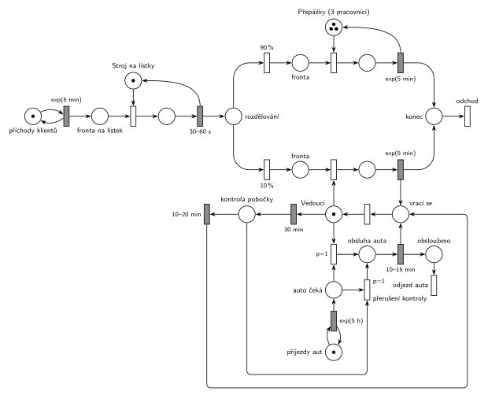

# 09–19 – Banka se třemi pracovníky

**Původ:** půlsemestrální písemka 2013/14, varianta A, 6 bodů (k příkladu patřila ještě otázka z teorie za 4 body).

**Zdroje:**

- `Fitcheats/Půlsemestrálky/Zadání z minulých let/2013-14.pdf`, str. 1 (zadání) a str. 3 (hlavička písemky s bodováním)
- `Fitcheats/Skripta/FIT - Studentská skripta 2015-16.pdf`, str. 48–49 (zadání zapsané po paměti a studentské řešení s komentáři)

## Zadání

> Do bankovní pobočky přicházejí klienti v intervalech daných exponenciálním rozložením se středem 5 minut. V pobočce pracují tři pracovníci na přepážce a jeden vedoucí pobočky. Klient si po příchodu do pobočky vezme lístek ze stroje pro evidenci pořadí. Použití stroje zabere 30-60 sekund rovnoměrně. Deset procent klientů požaduje speciální poradenství, které vykonává vedoucí pobočky. Ostatní klienti jsou obsluhováni na přepážkách. Obsluha na přepážce i speciální poradenství trvají dobu danou exponenciálním rozložením se středem 5 minut.
>
> Vedoucí pobočky je v počátečním stavu na své přepážce. Pokud je k jeho přepážce fronta klientů prázdná již 30 minut, vydává se na kontrolu pobočky, která mu zabere 10-20 minut. V intervalech daných exponenciálním rozložením se středem 5 hodin přijíždí do pobočky vozidlo s převozem hotovosti, které má pro vedoucího vysokou prioritu. Pokud momentálně neobsluhuje klienta, musí svou činnost přerušit a obsloužit auto. Pokud momentálně obsluhuje klienta, dokončí nejprve obsluhu klienta a pak započne obsluhu auta. Obsluha auta zabere 10-15 minut. Po obsluze auta se vrací k přepážce.
>
> *Zadaný systém modelujte formou Petriho sítě s vyznačením všech potřebných parametrů.*

Věta „V modelu jednoznačně ukažte (přechodem) moment, kdy transakce opouští systém“ přibyla až v roce 2022/23. Výstupní přechody jsou v síti přesto, dnes se vyžadují.

Podobné úlohy: [09–21 – Banka a lupič](<../09–21 - Banka a lupič/09–21 - Banka a lupič.md>), [04–08 – Spánek po nečinnosti](<../04–08 - Spánek po nečinnosti/04–08 - Spánek po nečinnosti.md>), [04–01 – Automat na kávu – údržba po nečinnosti](<../04–01 - Automat na kávu – údržba po nečinnosti/04–01 - Automat na kávu – údržba po nečinnosti.md>), [07–01 – Příklad s prioritou procesu](<../07–01 - Příklad s prioritou procesu/07–01 - Příklad s prioritou procesu.md>), [09–10 – Kopírovací centrum](<../09–10 - Kopírovací centrum/09–10 - Kopírovací centrum.md>).

## Interpretace

Zobrazit interpretaci (nápověda)

- **Stroj na lístky** je jedno zařízení (jeden stroj), před ním se čeká ve frontě. **Tři pracovníci** jsou sklad se 3 značkami, **vedoucí** je zařízení s 1 značkou. Všude je uvolnění sloučené s časovaným přechodem.
- **Vedoucí jako proces:** značka *Vedoucí* znamená „stojí u přepážky a nemá klienta“. Kromě obsazení klientem ji může vzít kontrola pobočky nebo auto, takže je to zároveň stav vedoucího.
- **„Fronta prázdná již 30 minut“:** časovaný přechod `30 min` jen se vstupem z *Vedoucí*. Odpočet běží, dokud vedoucí stojí u přepážky bez klienta. Přijde-li klient, obsazení (okamžitý přechod) značku vezme a odpočet zanikne (slajd 139). Doba, kdy vedoucí obsluhuje, se do 30 minut nepočítá; doslovné „fronta je prázdná 30 minut i během obsluhy“ by bez inhibiční hrany nešlo nakreslit a smysl zadání je „vedoucí nemá co dělat“.
- **Auto s vysokou prioritou:** dva okamžité přechody `p=1`. Jeden vezme volného vedoucího u přepážky, druhý *přeruší kontrolu pobočky* (vezme značku z *Kontrola pobočky*, takže odpočet `10–20 min` zanikne). Když vedoucí obsluhuje klienta, auto čeká v místě *Auto čeká*; po skončení obsluhy vyhraje `p=1` nad obsazením dalším klientem (p=0). Probíhající obsluhu klienta auto nepřerušuje.
- Přerušená kontrola se už nedokončuje: po obsluze auta se vedoucí vrací k přepážce.
- **Auto je samostatná transakce** s vlastním generátorem `exp(5 h)` a vlastním výstupním přechodem *odjezd auta*.

## Řešení

Zobrazit řešení

| Požadavek | Prvek sítě |
|---|---|
| klienti po exp(5 min) | *generátor* ⇄ `exp(5 min)` → *Fronta na lístek* |
| stroj na lístky 30–60 s | *Stroj na lístky* (1 značka), obsazení, `30–60 s` vrací značku |
| 10 % k vedoucímu, 90 % na přepážky | z *rozdělování* okamžité přechody `90 %` a `10 %` |
| tři pracovníci, obsluha exp(5 min) | *Přepážky* (3 značky), obsazení, `exp(5 min)` vrací značku |
| poradenství u vedoucího exp(5 min) | *Vedoucí* (1 značka), obsazení, `exp(5 min)` vrací značku |
| 30 min bez klienta → kontrola 10–20 min | *Vedoucí* → `30 min` → *Kontrola pobočky* → `10–20 min` → *Vedoucí* |
| auto po exp(5 h), obsluha 10–15 min | *generátor aut* ⇄ `exp(5 h)` → *Auto čeká* → `p=1` → *Obsluha auta* → `10–15 min` (vrací *Vedoucí*) |
| auto přeruší kontrolu | `p=1` *přerušení kontroly*: *Auto čeká* + *Kontrola pobočky* → *Obsluha auta* |
| odchod klienta / odjezd auta | *konec* → *odchod*, *obslouženo* → *odjezd auta* |

Kontrola simulací: stroj, přepážky (= 3) i vedoucí (*Vedoucí* + poradenství + kontrola + obsluha auta = 1) se vždy vrátí. Vedoucí chodí na kontrolu často (má jen 10 % klientů), zhruba každé páté auto přeruší kontrolu, fronty zůstávají krátké.

## Existující řešení

Zobrazit srovnání s existujícími řešeními

- **Studentská skripta (str. 49), fotka ručního řešení:** stejná struktura: 90 %/10 %, přepážky jako místo se 3 značkami, vedoucí jako místo s 1 značkou, cyklus vedoucí → `30min` → kontrola → `10-20min` → vedoucí, auto `EXP(5h)` a dva přechody `P=1` (auto + vedoucí, auto + místo kontroly) do obsluhy auta `10-15min`, výstupy „KLIENT ODCHÁZÍ“ a „AUTO ODJÍŽDÍ“. Výhrady:
  - Časované přechody nejsou graficky odlišené od okamžitých, poznají se jen podle připsaného času.
  - Za každou obsluhou je navíc místo a samostatný přechod uvolnění. Je to správně (plný tvar ze slajdu 154), jen delší; komentář pod řešením: „Souhlasím že ty místa za přechody s exp(5min) jsou navíc.“
  - Část kresby u stroje na lístky je přeškrtaná a špatně čitelná.
- Zadání ve skriptech (str. 48) je zapsané po paměti a zkrácené (chybí např. „dokončí nejprve obsluhu klienta“); platí text z `2013-14.pdf`.

## Časté chyby

Zobrazit časté chyby

- Časovač `30 min` nezávislý na vedoucím (vlastní generátor). Pak vedoucí odejde na kontrolu i od klienta nebo se odpočet nezruší, když klient přijde.
- Auto bez `p=1`: po skončení obsluhy klienta by vedoucího mohl obsadit další klient.
- Auto, které přeruší i probíhající poradenství; zadání chce obsluhu klienta nejprve dokončit.
- Chybějící přerušení kontroly: auto by čekalo až 20 minut, než se vedoucí vrátí.
- Přepážky jako tři samostatná zařízení s náhodným výběrem; stačí jeden sklad se 3 značkami.

