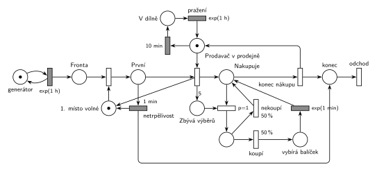

# 09–20 – Pražírna kávy

## Zadání

> Do pražírny kávy příchází zákazníci v intervalech daných exponenciálním rozložením se středem 1 hodina. V pražírně pracuje jeden prodavač. Prodavač se přemisťuje mezi prodejnou a dílnou na pražení kávy. Zákazníci se řadí do fronty a čekají na prodavače s tím specifikem, že vždy první ve frontě po minutě čekání opouští prodejnu neobsloužen (tzn. netrpělivý je pouze první zákazník ve frontě). Pokud je prodavač v prodejně, obsluhuje zákazníky do vyčerpání fronty. Pokud je prodavač v prodejně, pak po 10 minutách čekání na zákazníka odchází do dílny, kde praží kávu. Doba pražení se řídí exponenciálním rozložením se středem 1 hodina. Po dokončení práce se prodavač vrací do prodejny (doby přesunu zanedbáváme). Zákazník si kupuje 0 až 5 balíčků kávy. Výběr a zakoupení každého jednotlivého balíčku mu zabere dobu, která se řídí exponenciálním rozložením se středem 1 minuta.
>
> Poznámka: Zákazník tedy provede právě 5 iterací nákupu, kde každý z nich je pravděpodobnostní.

Věta „V modelu jednoznačně ukažte (přechodem) moment, kdy transakce opouští systém“ v zadání není (přibyla až v roce 2022/23). Výstupní přechod je v síti přesto, dnes se vyžaduje.

Podobné úlohy: [02–02 – Netrpělivý první ve frontě](<../02–02 - Netrpělivý první ve frontě/02–02 - Netrpělivý první ve frontě.md>), [04–08 – Spánek po nečinnosti](<../04–08 - Spánek po nečinnosti/04–08 - Spánek po nečinnosti.md>), [10–02 – Výpočetní služba se spánkem](<../10–02 - Výpočetní služba se spánkem/10–02 - Výpočetní služba se spánkem.md>), [09–09 – Trafika](<../09–09 - Trafika/09–09 - Trafika.md>).

## Interpretace

Zobrazit interpretaci (nápověda)

- **Netrpělivý je jen první ve frontě.** Časovaný přechod přímo na *Frontě* by dal odpočet každému čekajícímu (slajd 138). Proto má první čekající vlastní místo *První* s doplňkem *1. místo volné* (1 značka). Do *První* se dostane jen jeden zákazník a odpočet `1 min` (deterministicky, „po minutě“) běží jen jemu. Když odejde nebo ho prodavač začne obsluhovat, uvolní se místo pro dalšího a jeho odpočet začíná od nuly.
- Obsluhovaný zákazník už ve frontě není, takže kdo čeká za ním, je „první ve frontě“ a po minutě odchází. Jiné čtení (zákazník u pultu zůstává „první“, netrpělivost se uplatní jen při prodavači v dílně) by znamenalo vracet značku *1. místo volné* až přechodem *konec nákupu*. Při příchodech jednou za hodinu se obě varianty liší jen výjimečně.
- **Prodavač** je místo *Prodavač v prodejně* (1 značka). Časovaný `10 min` na tomto místě je odpočet nečinnosti: když přijde zákazník, okamžité obsazení značku vezme a odpočet zanikne. Po návratu z obsluhy začíná odpočet znovu. Po `10 min` jde prodavač do *V dílně* a po `exp(1 h)` se vrací.
- „Obsluhuje zákazníky do vyčerpání fronty“ zajišťuje sémantika: okamžité obsazení má přednost před časovaným `10 min`, takže do dílny prodavač odejde, až když nikdo nečeká 10 minut.
- **5 iterací nákupu:** obsazení prodavače vloží 5 značek do *Zbývá výběrů*. Přechod *výběr* (`p=1`) vždy jednu odebere. Pak se 50 % / 50 % rozhodne, jestli si zákazník balíček koupí (`exp(1 min)`), nebo ne (nulový čas). *Konec nákupu* (`p=0`) se provede až ve chvíli, kdy výběry došly. Zákazník tak koupí 0 až 5 balíčků (binomicky).
- **Pravděpodobnost nákupu v zadání chybí.** Je zvolena 50 %, v síti stačí napsat jiné číslo.
- Netrpěliví i obsloužení odcházejí stejným výstupním přechodem.

## Řešení

Zobrazit řešení

| Požadavek | Prvek sítě |
|---|---|
| příchody exp(1 h) | *generátor* ⇄ `exp(1 h)` → *Fronta* |
| netrpělivý je jen první ve frontě | *Fronta* → *První* (doplněk *1. místo volné*) → `1 min` → *konec* |
| jeden prodavač, obsluha do vyčerpání fronty | *Prodavač v prodejně* (1 značka), obsazení z *První* |
| po 10 min bez zákazníka do dílny | `10 min` na *Prodavač v prodejně* → *V dílně* → `exp(1 h)` zpět |
| 5 pravděpodobnostních iterací | obsazení vloží 5 značek do *Zbývá výběrů*, *výběr* `p=1`, pak `50 %` koupí / `50 %` nekoupí |
| každý balíček exp(1 min) | *koupí* → `exp(1 min)` → zpět do *Nakupuje* |
| konec nákupu, prodavač se vrací | *konec nákupu* (p=0) vrací značku *Prodavač v prodejně* |
| odchod ze systému | *konec* → *odchod* |

Kontrola simulací: platí *1. místo volné* + *První* = 1 a prodavač je vždy právě v jednom stavu (v prodejně, v dílně, nebo obsluhuje). *Zbývá výběrů* nepřesáhne 5. Prodavač tráví v dílně většinu času, takže většina zákazníků odchází po minutě neobsloužena. To odpovídá číslům v zadání.

## Časté chyby

Zobrazit časté chyby

- Časovaný přechod netrpělivosti přímo na *Frontě*: pak je netrpělivý každý čekající, ne jen první.
- Odpočet 10 minut, který nezanikne s příchodem zákazníka (např. na samostatném místě, které obsluha nebere). Prodavač by odešel uprostřed provozu.
- Iterace bez čítače (zákazník nakupuje donekonečna) nebo *konec nákupu* se stejnou prioritou jako výběr (nákup skončí náhodně dřív).
- Pravděpodobnost i priorita u stejného přechodu. Proto je mezi *výběrem* (`p=1`) a rozhodnutím `50 %`/`50 %` místo.
- Chybějící návrat prodavače z dílny nebo po obsluze.

## Původ a zdroje

**Původ:** půlsemestrální písemka 2010/11 (bodování neuvedeno).

**Zdroje:**

- `Fitcheats/Půlsemestrálky/Zadání z minulých let/2010-11.pdf`, str. 2 (zadání, úloha 4)
- `Fitcheats/Skripta/FIT - Studentská skripta 2015-16.pdf`, str. 46–47 (zadání a studentské řešení s komentáři)

**Existující řešení:**

Zobrazit existující řešení

- **Studentská skripta, str. 47 (kresleno na počítači, „Zase bez záruky“):** stejná struktura jako tady: „fronta“ → „prvý“ → obsazení prodavače „v predajni“ → „predávač + zákazník“, váha 5 do „počet výberov“, přechod `p=1`, „kúpi“ → `exp(1m)` / „nekúpi“, „ukončenie nákupu“ vrací prodavače. Prodavač má smyčku `exp(10m)` → „v dielni“ → `exp(1h)`. Rozdíly a chyby:
  - „prvý“ je místo s „kapacita = 1“. V notaci kurzu se kapacity míst nepoužívají; nahradí je doplňkové místo;
  - `exp(1m)` u netrpělivosti a `exp(10m)` u nečinnosti. Zadání má pevné časy („po minutě“, „po 10 minutách“);
  - „kúpi“/„nekúpi“ nemají pravděpodobnosti;
  - přechod `p=1` je nakreslený bíle jako časované přechody, přestože je okamžitý (časovaný přechod prioritu mít nemůže).
- Komentáře pod řešením: námitka, že zákazník může iterovat donekonečna, neplatí (odpověď pod ní: iterace jsou jen 5, pak dojdou značky v „počet výberov“). Druhá námitka („Omezení kapacity pro prvního zákazníka je špatně…“) je druhé čtení popsané v interpretaci.

