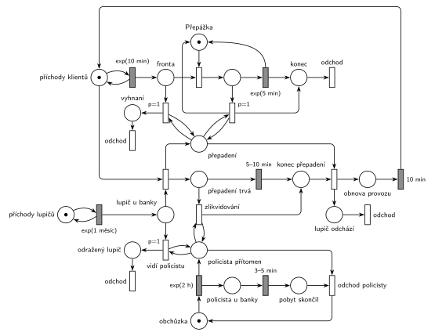

# 09–21 – Banka a lupič

## Zadání

> Do banky přichází klienti v intervalech daných exponenciálním rozložením se středem 10 minut. V bance je jedna přepážka. Doba obsluhy klienta u přepážky se řídí exponenciálním rozložením se středem 5 minut. Po obsloužení opouští klient banku. V intervalech daných exponenciálním rozložením se středem 1 měsíc přepadne banku lupič. V okamžiku přepadení opouští případný klient u přepážky banku, všichni klienti ve frontě na přepážku opouští banku a po dobu přepadení nepřichází žádní další klienti. Přepadení banky trvá rovnoměrně 5 až 10 minut. V systému se pohybuje jeden policista, který v intervalech daných exponenciálním rozložením se středem 2 hodiny prochází kolem banky. U banky se zdrží vždy 3-5 minut rovnoměrně. Pokud uvidí přicházející lupič policistu u banky, opouští systém. Pokud policista přijde v době, kdy je banka v přepadení, lupiče okamžitě zlikviduje. Po deseti minutách po ukončení přepadení banky (nebo po zlikvidování lupiče) se v bance obnoví normální provoz.
>
> Poznámka: Po dobu přepadení banky je proces příchodů transakcí přerušen.

Věta „V modelu jednoznačně ukažte (přechodem) moment, kdy transakce opouští systém“ v zadání není (přibyla až v roce 2022/23). Výstupní přechody jsou v síti přesto, dnes se vyžadují.

Podobné úlohy: [09–03 – Psí salon](<../09–03 - Psí salon/09–03 - Psí salon.md>) (vyprázdnění fronty a pauza příchodů), [11–04 – Výletní loď](<../11–04 - Výletní loď/11–04 - Výletní loď.md>) (vyprázdnění fronty v jednom okamžiku), [03–01 – Porucha zruší obsluhu](<../03–01 - Porucha zruší obsluhu/03–01 - Porucha zruší obsluhu.md>), [09–19 – Banka se třemi pracovníky](<../09–19 - Banka se třemi pracovníky/09–19 - Banka se třemi pracovníky.md>).

## Interpretace

Zobrazit interpretaci (nápověda)

- **Klienti** jsou běžné M/M/1: *generátor* `exp(10 min)`, *Fronta*, *Přepážka*, `exp(5 min)`.
- **Lupič** má vlastní generátor `exp(1 měsíc)` a přichází do místa *Lupič u banky*. Simulátor počítá měsíc jako 30 dní.
  - *vidí policistu* (`p=1`): testovací dvojice hran na *Policista u banky*. Lupič odchází ze systému.
  - jinak přechod přepadení (`p=0`): vezme lupiče a **značku generátoru klientů**. Odpočet příchodu tím zanikne a do konce obnovy nikdo nepřichází (vzor zastavení příchodů, jako u psího salonu).
- **V okamžiku přepadení** odcházejí klienti dvěma přechody `p=1` s testem na *Přepadení*: klient u přepážky (vrací *Přepážku*, jeho `exp(5 min)` zanikne) a smyčka, která vyprázdní *Frontu*. Priorita zajistí, že vše proběhne v okamžiku přepadení, před případným obsazením přepážky. Nově nikdo nepřichází, takže test na *Přepadení* už potom nic dalšího nevyhodí.
- **Konec přepadení** nastane jedním ze dvou způsobů:
  - časovaný `5–10 min` na *Přepadení*;
  - *zlikvidování*: okamžitý přechod *Přepadení* + test na *Policista u banky*. Když policista přijde, vezme značku *Přepadení* a odpočet `5–10 min` zanikne.
  
  Oba vedou do místa *konec přepadení*. Odtud *lupič odchází* (ze systému) a začíná *obnova provozu*: po `10 min` se značka vrátí generátoru klientů.
- **Policista** je jedna značka v cyklu *obchůzka* → `exp(2 h)` → *Policista u banky* → `3–5 min` → *obchůzka*. Interval 2 h se počítá od odchodu od banky.
- Přepadení nezačne, když je policista u banky (lupič odejde s `p=1`). *Zlikvidování* se proto provede, jen když policista přijde během přepadení, přesně podle zadání.
- **Neřešený případ:** lupič, který přijde během přepadení nebo obnovy, počká v *Lupič u banky*, až se obnoví provoz (nebo odejde, když uvidí policistu). Při středu 1 měsíc to prakticky nenastane.
- Klient vyhnaný z fronty odchází vlastním výstupním přechodem vlevo, klient od přepážky přes *konec*. Obojí je odchod ze systému; dva přechody jsou tu jen kvůli přehlednosti kresby.

- **Jemnost sémantiky:** přechody *vidí policistu* a *zlikvidování* testují místo *Policista u banky* hranou tam a zpět. To místo je zároveň vstupem časovaného přechodu `3–5 min`, takže test jeho odpočet formálně zruší a spustí znovu (slajdy 137–139): policista u banky zůstane o chvíli déle. Tady se to stane nejvýš jednou za přepadení (zhruba jednou za měsíc), takže to na chování nic nemění. Přesný model by měl stav „policista přítomen“ v samostatném místě, které časovaný přechod nebere.

## Řešení

Zobrazit řešení

| Požadavek | Prvek sítě |
|---|---|
| klienti exp(10 min), přepážka exp(5 min) | *generátor* ⇄ `exp(10 min)` → *Fronta* → *Přepážka* → `exp(5 min)` → *konec* → *odchod* |
| lupič po exp(1 měsíc) | *lupiči* ⇄ `exp(1 měsíc)` → *Lupič u banky* |
| lupič vidí policistu → odchází | *vidí policistu* (`p=1`, test *Policista u banky*) → *lupič odchází* → *odchod* |
| přepadení přeruší příchody | přepadení bere značku *generátoru* |
| klient u přepážky a fronta odcházejí | dva přechody `p=1` s testem na *Přepadení* (od přepážky → *konec*, z fronty → *vyhnaní* → *odchod*) |
| přepadení 5–10 min | `5–10 min` na *Přepadení* → *konec přepadení* |
| policista lupiče zlikviduje | *zlikvidování* (test *Policista u banky*) → *konec přepadení* |
| obnova provozu po 10 min | *lupič odchází* → *obnova provozu* → `10 min` → *generátor* |
| policista: obchůzka exp(2 h), u banky 3–5 min | *obchůzka* → `exp(2 h)` → *Policista u banky* → `3–5 min` → *obchůzka* |

Kontrola simulací (300 000 událostí, asi 2,6 roku): *Přepážka* + obsluhovaný = 1, *generátor* + *Přepadení* + *konec přepadení* + *obnova provozu* = 1 a policista je vždy právě na jednom místě. Za běh proběhne kolem 30 přepadení; lupič, který vidí policistu, a zlikvidování nastanou jen párkrát (policista je u banky asi 3 % času).

## Časté chyby

Zobrazit časté chyby

- Zastavení příchodů odebráním značky z *Fronty* místo z *generátoru*.
- Vyprázdnění fronty hranou s váhou: váha bere přesný počet; na „všechny“ je potřeba smyčka s prioritou.
- Klient u přepážky, který při přepadení odejde, ale nevrátí značku *Přepážce*. Po přepadení by se banka zastavila.
- Policista jako generátor nových policistů místo jedné značky v cyklu. V systému je jen jeden.
- Zlikvidování bez návaznosti na obnovu: zadání chce 10 minut i po zlikvidování lupiče.
- Lupič, který přepadne banku, i když je policista u banky (chybí priorita testu na policistu).
- Odpočet obnovy, který vrací značku generátoru dřív, než přepadení skončí, nebo ji vrací dvakrát (po konci přepadení i po zlikvidování).

## Původ a zdroje

**Původ:** půlsemestrální písemka 2010/11 (bodování neuvedeno).

**Zdroje:**

- `Fitcheats/Půlsemestrálky/Zadání z minulých let/2010-11.pdf`, str. 1 (zadání, úloha 1 „Banka“)

**Existující řešení:**

Zobrazit existující řešení

- V materiálech k této úloze žádné řešení není (ani Hrubého, ani studentské). Banka ve Studentských skriptech (str. 48–49) je jiná úloha, [09–19 – Banka se třemi pracovníky](<../09–19 - Banka se třemi pracovníky/09–19 - Banka se třemi pracovníky.md>).

