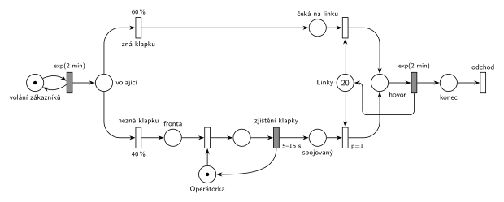

# 09–22 – Telefonní ústředna

## Zadání

> ⚠️ Text je zápis studentů ve skriptech, nadepsaný „možná jiné konstanty“. Oficiální zadání v materiálech není.
>
> Firma F používá telefonní ústřednu s kapacitou 20 současných telefonních hovorů. Zákazníci volají různým zaměstnancům firmy průměrně 30krát za hodinu (Poissonův proces příchodů).
> Existují dvě možnosti: 60 procent telefonujících zná místní telefonní číslo zaměstnance (klapku) a ústředna mu přidělí volnou linku automaticky.
> Zbylých 40 procent volajících klapku nezná a jsou přepojeni na operátorku.
> Zjištění klapky u operátorky trvá dobu danou rovnoměrným rozložením od 5 do 15 sekund. Poté má volající spojovaný přes operátorku vyšší prioritu při obsazování některé z linek.
> Doba hovoru se řídí exponenciálním rozložením se střední hodnotou 2 minuty.
> Po skončení hovoru a uvolnění linky volající požadavek opouští systém.

Věta „V modelu jednoznačně ukažte (přechodem) moment, kdy transakce opouští systém“ v zadání není (přibyla až v roce 2022/23). Výstupní přechod je v síti přesto, dnes se vyžaduje.

Podobné úlohy: [07–04 – Dva proudy příchodů](<../07–04 - Dva proudy příchodů/07–04 - Dva proudy příchodů.md>), [01–01 – Opravářská dílna](<../01–01 - Opravářská dílna/01–01 - Opravářská dílna.md>).

## Interpretace

Zobrazit interpretaci (nápověda)

- **30 volání za hodinu** v Poissonově procesu znamená exponenciální intervaly se středem 60/30 = **2 minuty**: `exp(2 min)`.
- **Ústředna s kapacitou 20 hovorů** je sklad: místo *Linky* s 20 značkami. Hovor zabere jednu značku a `exp(2 min)` ji vrací. Běžný časovaný přechod má pro každou značku v místě *Hovor* vlastní odpočet (slajd 138), takže 20 hovorů běží souběžně.
- **Operátorka** je jedno zařízení. Volající na ni čekají ve *Frontě* a po `5–15 s` (rovnoměrně) ji uvolní. Že by operátorku držel až do přidělení linky, zadání neříká.
- **Vyšší priorita při obsazování linek:** oba proudy mají vlastní místo čekajících a vlastní obsazovací přechod. Přechod spojovaných má `p=1`, takže když se linka uvolní a čekají oba druhy volajících, dostane ji spojovaný.
- Hovor s operátorkou linku z dvaceti nezabírá: podle zadání se linka přiděluje až po zjištění klapky.
- Při zatížení 1 Erlang (30/h × 2 min) jsou linky skoro vždy volné, takže priorita se uplatní jen výjimečně. Na struktuře sítě to nic nemění.

## Petriho síť

Zobrazit Petriho síť

| Požadavek | Prvek sítě |
|---|---|
| 30 volání za hodinu | *generátor* ⇄ `exp(2 min)` → *Volající* |
| 60 % zná klapku, 40 % ne | okamžité přechody `60 %` a `40 %` |
| operátorka, zjištění klapky 5–15 s | *Operátorka* (1 značka), obsazení, `5–15 s` vrací značku → *Spojovaný* |
| kapacita 20 hovorů | *Linky* (20 značek), dva obsazovací přechody |
| spojovaný má přednost | obsazení linky spojovaným má `p=1` |
| hovor exp(2 min), uvolnění linky | *Hovor* → `exp(2 min)` vrací značku do *Linky* |
| odchod ze systému | *konec* → *odchod* |

Kontrola simulací: *Linky* + *Hovor* = 20 a *Operátorka* + obsluhovaný = 1. Současně běží nejvýš kolem 7 hovorů, fronta na operátorku zůstává krátká.

## Časté chyby

Zobrazit časté chyby

- Přepočet „30krát za hodinu“ na `exp(30 min)` nebo `exp(20 min)`. Správně je střed 2 minuty.
- Jedno společné místo čekajících pro oba druhy volajících. Pak priorita spojovaných nejde vyjádřit.
- Priorita napsaná u přechodu `40 %` místo u obsazení linky. Přechod má jen jeden parametr a priorita má rozhodovat o lince.
- *Linky* s jednou značkou nebo hovor jako zařízení: ústředna zvládne 20 hovorů současně.
- Chybějící návrat značky operátorce nebo lince.

## Původ a zdroje

**Původ:** půlsemestrální písemka, rok neznámý (zadání zapsané ve Studentských skriptech 2015/16).

**Zdroje:**

- `Fitcheats/Skripta/FIT - Studentská skripta 2015-16.pdf`, str. 42–43 (zadání „Příklad ústředna (možná jiné konstanty)“ a ručně kreslené studentské řešení)

**Existující řešení:**

Zobrazit existující řešení

- **Studentská skripta, str. 43 (ručně kreslené):** stejná kostra: `60%`/`40%`, místo „linka“ s 20 značkami, `exp(2min)` vrací linku, „operátorka“ s jednou značkou, obsazení linky `p=1` (přímo) a `p=2` (přes operátorku). Rozdíly a chyby:
  - generátor `exp(20min)` s otazníkem; 30 volání za hodinu je střed **2 minuty**;
  - časovaný `5-15s` bere značku operátorky přímo (bez okamžitého obsazení). To ještě funguje, protože operátorka je jen jedna;
  - operátorka se vrací až přechodem `p=2`, tedy až když volající dostane linku. Pokud by byly všechny linky obsazené, operátorka by zbytečně čekala s ním;
  - za `exp(2min)` šipka mizí za okrajem fotky, výstupní přechod není vidět.
- Pod řešením je dotaz „Neni to spíš takhle, protože by mel cekat na volnou operátorku?“ s odkazem na obrázek, který už není dostupný. Ve fotce volající na operátorku čeká už teď (přechod `5-15s` potřebuje její značku).

