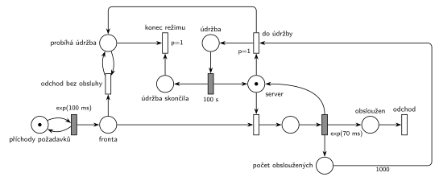

# Server s údržbou po 1000 požadavcích

Úloha 10/01

## Zadání

> Požadavky přicházejí v intervalech exponenciálně se středem 100 milisekund a čekají ve frontě na obsloužení serverem. Server má kapacitu 1 a obsluha jednoho požadavku trvá exponenciálně se středem 70 milisekund. Ihned po obsloužení každého 1000. požadavku se server přepne do režimu údržby, ve kterém zůstane přesně 100 sekund. V režimu údržby jsou všechny požadavky z fronty i nově příchozí vyhozeny bez obsluhy.

Podobné úlohy: [Údržba po každé 10. obsluze](<../../04 - Údržba a spánek/06 - Údržba po každé 10. obsluze/06 - Údržba po každé 10. obsluze.md>), [Automat na kávu – údržba po 50 obsluhách](<../../04 - Údržba a spánek/02 - Automat na kávu – údržba po 50 obsluhách/02 - Automat na kávu – údržba po 50 obsluhách.md>), [Každá 100. transakce vyprázdní frontu](<../../05 - Délka fronty a kapacita/07 - Každá 100. transakce vyprázdní frontu/07 - Každá 100. transakce vyprázdní frontu.md>), [Psí salon](<../../09 - Obsluha zákazníků/03 - Psí salon/03 - Psí salon.md>).

## Nápověda

<details>
<summary>Zobrazit nápovědu</summary>
<br>

- **Jednotky:** časy jsou v milisekundách i sekundách, u přechodů je proto vždy jednotka. „Rychlostí exp(70ms)“ znamená střední dobu obsluhy 70 ms (ne intenzitu). Server je vytížen asi na 70 %.
- **Příchody** modeluje místo *příchody požadavků* ve smyčce s `exp(100 ms)`, požadavky čekají v místě *fronta*.
- **Server s kapacitou 1** je místo *server* s jednou značkou. Uvolnění je sloučené s časovaným přechodem obsluhy `exp(70 ms)`, obsloužený požadavek odchází přechodem *odchod* vpravo.
- **Čítač:** každá dokončená obsluha přidá značku do místa *počet obsloužených*. Okamžitý přechod *do údržby* s hranou s váhou 1000 vezme všech 1000 značek (čítač se tím vynuluje) a k tomu značku *serveru*. Server tak přejde do *údržby* a po `100 s` se značka vrátí do *serveru*. Čítač je pod hlavní řadou, protože horní stranou obsluha vrací značku serveru; jeho hrana proto obchází odchod zprava.
- **„Ihned po obsloužení“:** v okamžiku 1000. obsluhy se značka vrátí do *serveru* a zároveň jsou proveditelné dva okamžité přechody: přechod do údržby a obsazení serveru dalším čekajícím. Priorita `p=1` zajistí, že vyhraje údržba. Bez ní by server mohl obsloužit ještě 1001. požadavek.
- **Vyhazování:** okamžitý přechod *odchod bez obsluhy* bere požadavky z *fronty* a testovacími hranami (hrana tam a zpět) kontroluje stav *probíhá údržba*. Provádí se opakovaně, takže na začátku údržby vyprázdní celou frontu a pak hned vyhazuje každý nově příchozí požadavek. Je to zároveň výstupní přechod: vyhozený požadavek v něm zaniká a vrací se jen testovaná značka stavu (stejně jako v úloze [Každá 100. transakce vyprázdní frontu](<../../05 - Délka fronty a kapacita/07 - Každá 100. transakce vyprázdní frontu/07 - Každá 100. transakce vyprázdní frontu.md>)).
- **Proč samostatné místo *probíhá údržba*:** testovací hrana značku na okamžik vezme a vrátí. Kdyby testovala přímo místo *údržba*, které je vstupem časovaného přechodu `100 s`, každé vyhození by odpočet zrušilo a spustilo znovu (slajdy 137–139) – s příchody každých 100 ms by údržba nikdy neskončila. Proto odpočet běží na *údržbě*, testuje se *probíhá údržba* a po skončení údržby ho okamžitý přechod *konec režimu* (`p=1`) spolu se značkou *údržba skončila* zruší.
- Příchody se během údržby **nezastavují**: požadavky dál přicházejí, jen hned odcházejí bez obsluhy.
- Zadání je převyprávěné. Pokud by originál říkal něco jiného (např. že se během údržby příchody zastaví), změní se jen část s vyhazováním.

</details>

## Petriho síť

<details>
<summary>Zobrazit Petriho síť</summary>
<br>



</details>

## Časté chyby

<details>
<summary>Zobrazit časté chyby</summary>
<br>

- Přechod do údržby bez priority. V okamžiku 1000. obsluhy pak může server obsadit další požadavek a údržba začne až po něm.
- Čítač testovaný hranami tam a zpět (váha 1000 v obou směrech). Čítač se nevynuluje a údržba by se spouštěla po každé další obsluze.
- Vyhození fronty jednorázově (jeden přechod nebo hrana s váhou). Požadavky, které přijdou během údržby, by pak čekaly; zadání chce vyhazovat i nově příchozí po celých 100 s.
- Zastavení generátoru místo vyhazování. Zadání říká, že požadavky přicházejí a jsou vyhozeny, ne že přestanou chodit.
- Údržba, která nevrátí značku *serveru*. Systém se po první údržbě zastaví.
- Počítání i vyhozených požadavků do tisíce. Počítají se jen obsloužené.

</details>

## SIMLIB

<details>
<summary>Zobrazit SIMLIB kód</summary>
<br>

Model je izomorfní k Petriho síti výše: každé místo, přechod a značka mají svůj protějšek v kódu. Fronta je samostatný objekt `Queue`, aby ji šlo při přechodu do údržby vyprázdnit (`delete` čekajícího procesu ho z fronty vyjme, jako v příkladu `model2-timeout.cc`). Údržbu modeluje proces `Udrzba`, který obsadí server hned po uvolnění 1000. požadavkem; nikdo jiný ho dostat nemůže, protože fronta je prázdná a nově příchozí vidí `udrzba == true`.

```cpp
// Server s údržbou po 1000 požadavcích – model v SIMLIB/C++
#include "simlib.h"

int obslouzeno = 0;                        // místo „počet obsloužených“
bool udrzba = false;                       // místo „probíhá údržba“
long vyhozeno = 0, udrzeb = 0;

Queue Fronta("Fronta");                    // místo „fronta“
Facility Server("Server", Fronta);         // místo „server“ s jednou značkou
Histogram Doba("Doba obsloužených požadavků v systému [s]", 0, 0.05, 20);

class Udrzba : public Process {            // značka serveru na cestě údržbou
  void Behavior() {
    Seize(Server);                         // server je volný a fronta prázdná
    Wait(100);                             // časovaný přechod 100 s
    udrzba = false;                        // „údržba skončila“ + „konec režimu“ (p=1)
    Release(Server);                       // značka se vrací serveru
  }
};

class Pozadavek : public Process {         // transakce = značka, která prochází sítí
  void Behavior() {
    double prichod = Time;
    if (udrzba) {                          // přechod „odchod bez obsluhy“ (test „probíhá údržba“)
      vyhozeno++;
      return;                              // požadavek opouští systém
    }
    Seize(Server);                         // fronta + obsazení
    Wait(Exponential(0.070));              // časovaný přechod exp(70 ms) ...
    if (++obslouzeno == 1000) {            // ... přidá značku do čítače; hrana váhy 1000
      obslouzeno = 0;                      // přechod „do údržby“ (p=1) čítač vynuluje
      udrzba = true;                       // a označí „probíhá údržba“
      udrzeb++;
      while (!Fronta.empty()) {            // „odchod bez obsluhy“ všech čekajících
        delete Fronta.GetFirst();
        vyhozeno++;
      }
      (new Udrzba)->Activate();            // server jde do údržby (Seize hned po Release)
    }
    Release(Server);                       // ... a vrací značku serveru
    Doba(Time - prichod);
  }                                        // konec Behavior = přechod „odchod“
};

class Prichody : public Event {            // místo „příchody požadavků“ ve smyčce s exp(100 ms)
  void Behavior() {
    (new Pozadavek)->Activate();
    Activate(Time + Exponential(0.100));
  }
};

int main() {
  Init(0, 100000);                         // modelový čas v sekundách: asi 28 hodin
  (new Prichody)->Activate();
  Run();
  Print("Údržeb: %ld, vyhozených požadavků: %ld\n", udrzeb, vyhozeno);
  Server.Output();
  Doba.Output();
}
```

| Petriho síť | SIMLIB |
|---|---|
| *příchody požadavků* ⇄ `exp(100 ms)` | událost `Prichody`, která se znovu plánuje za `Exponential(0.100)` |
| značka (požadavek) | proces `Pozadavek` |
| místo *fronta* | `Queue Fronta` (vstupní fronta serveru) |
| místo *server* (1 značka), obsazení | `Facility Server`, `Seize(Server)` |
| `exp(70 ms)` se sloučeným uvolněním | `Wait(Exponential(0.070)); ... Release(Server);` |
| místo *počet obsloužených* | `int obslouzeno`, `++obslouzeno` po obsluze |
| *do údržby* (`p=1`, váha 1000) | `if (++obslouzeno == 1000)` před `Release`: vynulování, `udrzba = true`, `new Udrzba` |
| místo *probíhá údržba* | `bool udrzba` |
| *odchod bez obsluhy* čekajících a nově příchozích | `delete Fronta.GetFirst()` pro všechny čekající; `if (udrzba) return;` u nově příchozího |
| *údržba* → `100 s` → *server* + *údržba skončila* → *konec režimu* | proces `Udrzba`: `Seize(Server); Wait(100); udrzba = false; Release(Server);` |
| přechody *odchod* a *odchod bez obsluhy* | konec metody `Behavior()` (`return` u vyhozeného) |

**Kontrola simulací.** Petriho síť: *server* + obsluhovaný + *údržba* = 1, *probíhá údržba* = *údržba* + *údržba skončila*, čítač nikdy nepřesáhne 1000, všechny přechody se provádějí (`make check`). Údržba nastane zhruba každých 200 s (asi 100 s na 1000 obsluh a 100 s údržby) a během ní se vyhodí asi 1000 požadavků. Fronta zůstává krátká (nejvýš kolem 16). SIMLIB model: za 100 000 s proběhlo 499 údržeb (jedna za 200 s), vyhozeno bylo 500 337 požadavků, tedy asi 1000 na údržbu a polovina všech. Server byl obsazený 85 % času: asi 50 % údržbou a 35 % obsluhou (polovina požadavků × 70 ms / 100 ms). Obsloužený požadavek byl v systému v průměru 0,23 s (`make simlib`).

</details>

## Původ a zdroje

<details>
<summary>Zobrazit původ a zdroje</summary>
<br>

**Původ:** půlsemestrální písemka 2023/24, varianta A. Body nejsou uvedené (ostatní varianty téhož roku mají 10 bodů).

**Původní znění** (převyprávěné zadání): Originální zadání v materiálech chybí. Text níže je zpráva studenta na Discordu z 1. 11. 2023, kterou autor po odeslání ještě upravil (Discord u ní ukazuje „(upraveno)“). Přesné znění, body a závěrečná věta o odchodu transakce nejsou známé. Řešení neexistuje.

> Zadání A: V intervalu exp(100ms) přicházejí požadavky a čekají ve fronte na obsloužení serverem. Ten má kapacitu 1 a požadavky obsluhuje rychlostí exp(70ms). Ihned po obsloužení každeho 1000. požadavku se přepne server do režimu údržby kde je 100s. V režimu údržby jsou všechny transakce z fronty i nově příchozí vyhozeny bez obsluhy.

**Zdroje:**

- `Fitcheats/Půlsemestrálky/Zadání z minulých let/2023-24.pdf`, str. 1 (snímek zprávy z Discordu, bez řešení)

**Existující řešení:**

- K této variantě v materiálech žádné řešení není (ani od Hrubého, ani studentské).

</details>

## Reference

- [Jak síť funguje](<../../../basics/Jak síť funguje.md>)
- [Notace a vzory](<../../../basics/Notace a vzory.md>)

<!-- -->

- [Studijní plán](<../../Studijní plán.md>)
- [Seznam úloh](<../../Seznam úloh.md>)
