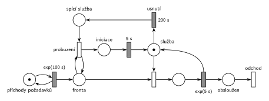

# Výpočetní služba se spánkem

## Zadání

> Do výpočetní služby přichází požadavky v intervalech exponenciálně se středem 100 sekund. Server má kapacitu jedna pro obsluhu požadavků. Obsluha trvá exponenciálně se středem 5 sekund. Pokud je služba nečinná po dobu přesně 200 sekund, pak je převedena do spacího režimu. Z režimu spánku službu probere až nově příchozí požadavek. Po probuzení však služba potřebuje přesně 5 sekund na iniciační proceduru, a až po jejím dokončení může zahájit obsluhu požadavku.

Podobné úlohy: [Spánek po nečinnosti](<../../04 - Údržba a spánek/08 - Spánek po nečinnosti/08 - Spánek po nečinnosti.md>), [Automat na kávu – uspání](<../../04 - Údržba a spánek/03 - Automat na kávu – uspání/03 - Automat na kávu – uspání.md>), [Automat na kávu – údržba po nečinnosti](<../../04 - Údržba a spánek/01 - Automat na kávu – údržba po nečinnosti/01 - Automat na kávu – údržba po nečinnosti.md>), [Trafika](<../../09 - Obsluha zákazníků/09 - Trafika/09 - Trafika.md>).

## Nápověda

<details>
<summary>Zobrazit nápovědu</summary>
<br>

- **Příchody** modeluje místo *příchody požadavků* ve smyčce s `exp(100 s)`, požadavky čekají v místě *fronta*.
- **Služba** je místo s jednou značkou (kapacita 1). Značka je vždy právě v jednom ze stavů: volná (*služba*), obsluhuje, spí (*spící služba*), nebo se probouzí (*iniciace*). Obsluha `exp(5 s)` značku po skončení vrací.
- **Nečinnost 200 s:** časovaný přechod *usnutí* `200 s` má jediný vstup, místo *služba*. Odpočet tedy běží přesně po dobu, kdy je služba volná. Když přijde požadavek, obsazení (okamžitý přechod) si značku vezme a odpočet zanikne (slajd 139). Po každé obsluze začíná odpočet znovu od nuly.
- Doba nečinnosti je pevných 200 s, ne exponenciální.
- **Probuzení:** okamžitý přechod potřebuje značku *spící služby* a požadavek ve *frontě*. K *frontě* je připojený testovacími hranami (tam a zpět), takže požadavek ve frontě zůstane a po probuzení normálně obsadí službu.
- **Iniciační procedura** `5 s` vrací značku do *služby* a teprve pak může proběhnout obsazení. Požadavky, které přijdou během probouzení, čekají ve *frontě*.
- Obsloužený požadavek **opouští systém** přechodem *odchod*. Odpovídá to větě „V modelu jednoznačně ukažte (přechodem) moment, kdy transakce opouští systém“, kterou mají ostatní varianty téhož roku.

</details>

## Petriho síť

<details>
<summary>Zobrazit Petriho síť</summary>
<br>



</details>

## Časté chyby

<details>
<summary>Zobrazit časté chyby</summary>
<br>

- Odpočet `200 s` řízený samostatným „hlídacím“ procesem, který má značku pořád. Pak měří čas od libovolného okamžiku, ne dobu nečinnosti, a příchod požadavku ho nezruší.
- Přechod probuzení bez vstupu ze *spící služby*. Spouštěl by se při každém příchodu, i když služba nespí.
- Probuzení, které požadavek z *fronty* odebere a nikam ho nepošle: požadavek se ztratí. Buď testovací hrany, nebo ho předat dál k obsazení.
- Obsluha zahájená hned po probuzení bez iniciace `5 s`.
- `exp(200 s)` místo pevných 200 s.
- V SIMLIBu odpočet usnutí, který se při příchodu požadavku nezruší (`Cancel()`), nebo který se nespustí znovu po každé obsluze.

</details>

## SIMLIB

<details>
<summary>Zobrazit SIMLIB kód</summary>
<br>

Model je izomorfní k Petriho síti výše: každé místo, přechod a značka mají svůj protějšek v kódu. Značka služby, která je mimo místo *služba* (spí nebo se probouzí), je v SIMLIBu proces `Spanek`, který drží zařízení `Sluzba`; požadavky zatím čekají v jeho frontě. Statistika vytížení zařízení proto zahrnuje i spánek a iniciaci.

```cpp
// Výpočetní služba se spánkem – model v SIMLIB/C++
#include "simlib.h"

Facility Sluzba("Služba");                 // místo „služba“ s jednou značkou
bool spi = false;                          // místo „spící služba“
long usnuti_pocet = 0;
Histogram Doba("Doba požadavku v systému [s]", 0, 2, 20);

class Spanek : public Process {            // značka služby na cestě spánkem a iniciací
  void Behavior() {
    Seize(Sluzba);                         // přechod „usnutí“ vezme značku volné služby
    spi = true;                            // ... a vloží ji do „spící služby“
    Passivate();                           // spí, dokud ji nevzbudí požadavek
    Wait(5);                               // „iniciace“ → časovaný přechod 5 s
    Release(Sluzba);                       // značka se vrací do „služby“
  }
};
Spanek *spanek = nullptr;

class Usnuti : public Event {              // časovaný přechod „usnutí“ (200 s)
  void Behavior();
};
Usnuti *odpocet = nullptr;                 // běžící odpočet, dokud je služba volná

void Usnuti::Behavior() {
  odpocet = nullptr;
  usnuti_pocet++;
  (spanek = new Spanek)->Activate();
}

void ZacniOdpocet() {                      // služba je volná: odpočet 200 s začíná
  if (!Sluzba.Busy())
    (odpocet = new Usnuti)->Activate(Time + 200);
}

class Pozadavek : public Process {         // transakce = značka, která prochází sítí
  void Behavior() {
    double prichod = Time;
    if (spi) {                             // přechod „probuzení“ (test „fronty“):
      spi = false;                         // požadavek ve frontě zůstává
      spanek->Activate();
    }
    if (odpocet) {                         // obsazení volné služby vezme její značku,
      odpocet->Cancel();                   // takže odpočet usnutí zaniká
      odpocet = nullptr;
    }
    Seize(Sluzba);                         // fronta + obsazení
    Wait(Exponential(5));                  // časovaný přechod exp(5 s) ...
    Release(Sluzba);                       // ... vrací značku službě
    ZacniOdpocet();                        // nikdo nečeká: služba je volná
    Doba(Time - prichod);
  }                                        // konec Behavior = přechod „odchod“
};

class Prichody : public Event {            // místo „příchody požadavků“ ve smyčce s exp(100 s)
  void Behavior() {
    (new Pozadavek)->Activate();
    Activate(Time + Exponential(100));
  }
};

int main() {
  Init(0, 10000000);                       // modelový čas v sekundách: asi 116 dní
  (new Prichody)->Activate();
  ZacniOdpocet();                          // na začátku je služba volná
  Run();
  Print("Usnutí: %ld z %ld obsluh\n", usnuti_pocet, Doba.stat.Number());
  Sluzba.Output();
  Doba.Output();
}
```

| Petriho síť | SIMLIB |
|---|---|
| *příchody požadavků* ⇄ `exp(100 s)` | událost `Prichody`, která se znovu plánuje za `Exponential(100)` |
| značka (požadavek) | proces `Pozadavek` |
| *fronta*, místo *služba* (1 značka), obsazení | `Facility Sluzba`, `Seize(Sluzba)` |
| `exp(5 s)` se sloučeným uvolněním | `Wait(Exponential(5)); Release(Sluzba);` |
| odpočet *usnutí* `200 s` na volné *službě* | událost `Usnuti` naplánovaná za 200 s, když po `Release` nikdo nečeká (`ZacniOdpocet`) |
| zánik odpočtu, když obsazení vezme značku | `odpocet->Cancel()` u příchozího požadavku |
| *usnutí* → *spící služba* | proces `Spanek`: `Seize(Sluzba); spi = true; Passivate();` |
| *probuzení* (test *fronty*) | `if (spi) { spi = false; spanek->Activate(); }` |
| *iniciace* → `5 s` → *služba* | `Wait(5); Release(Sluzba);` v procesu `Spanek` |
| přechod *odchod* | konec metody `Behavior()` |

**Kontrola simulací.** Petriho síť: *služba* + obsluha + *spící služba* + *iniciace* = 1, všechny přechody se provádějí, fronta zůstává krátká (`make check`). Služba usne asi po 13 % obsluh, což odpovídá pravděpodobnosti, že další požadavek nepřijde do 200 s (e⁻² ≈ 0,135). SIMLIB model: za 10⁷ s služba usnula 12 784krát na 100 175 obsluh (12,8 %; odpočet začíná jen po obsluze, za kterou nikdo nečeká, tedy asi v 95 % případů, 0,95 × 0,135 ≈ 0,128). Požadavek byl v systému v průměru 6,0 s: 5 s obsluha, asi 0,13 × 5 s iniciace a krátké čekání (`make simlib`).

</details>

## Původ a zdroje

<details>
<summary>Zobrazit původ a zdroje</summary>
<br>

**Původ:** půlsemestrální písemka 2023/24, varianta neoznačená (pravděpodobně B: varianty A, C a D jsou známé). Body nejsou uvedené (ostatní varianty téhož roku mají 10 bodů).

**Původní znění** (přepis): Originální list se zadáním v materiálech chybí, existuje jen ruční přepis od studenta. Písmeno varianty ani závěrečná věta o odchodu transakce na přepisu nejsou.

> Do výpočetní služby přichází požadavky v intervalech daných exponenciálním rozložením se středem 100s. Server má kapacitu jedna pro obsluhu požadavků. Doba obsluhy se řídí exp. rozložením se středem 5s. Pokud je služba nečinná po dobu 200s, pak je převedena do spacího režimu. Z režimu spánku službu probere až nově příchozí požadavek. Po probuzení však služba potřebuje 5s na iniciační proceduru, a až po jejím dokončení může zahájit obsluhu požadavku.

**Zdroje:**

- `Fitcheats/Půlsemestrálky/Zadání z minulých let/2023-24.pdf`, str. 2 (zadání přepsané rukou a pod ním studentské řešení)

**Existující řešení:**

- **Studentské řešení (str. 2, pod přepisem zadání):** stejná síť jako výše, jen zrcadlově (služba a spánek jsou pod hlavní linkou). Generátor ⇄ `exp(100s)` → *Příchozí* → obsazení → `exp(5s)` („řešení“) → *Odchod*; *Služba* (1 značka) → `200s` → *spící služba* → probuzení s dvojicí hran ↓↑ k *Příchozí* (test) → *Procedura* `5s` → *Služba*. Je správné.
- Pozor na kreslení: student má vyplněné obdélníky u okamžitých přechodů (obsazení, probuzení) a prázdné u časovaných. V notaci předmětu je to naopak: časovaný přechod je vyplněný obdélník, okamžitý tenká čárka.

</details>

## Reference

- [Jak síť funguje](<../../../basics/Jak síť funguje.md>)
- [Notace a vzory](<../../../basics/Notace a vzory.md>)
- [Seznam úloh](<../../Seznam úloh.md>)
