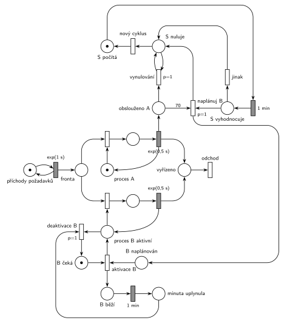

# Databázový server

## Zadání

> Do databázového serveru přichází vstupní požadavky v intervalech exponenciálně se středem 1 sekunda. Požadavky obsluhuje databázový proces A, případně i proces B. Vyřízení požadavku trvá exponenciálně se středem 0,5 sekundy. Nezávislý systémový proces S v cyklech: po dobu jedné minuty čítá počet dokončených obsluh na procesu A, a pak podle potřeb zapojuje do práce dočasně druhý proces B. Pokud za uplynulou minutu proces A obsloužil 70 a více vstupních požadavků, pak systémový proces S naplánuje aktivaci procesu B. Proces B obsluhuje požadavky po dobu jedné minuty, pak čeká na další naplánování procesem S. Proces B lze naplánovat, i když momentálně běží.

Podobné úlohy: [Dočasně MM2 při dlouhé frontě](<../../05 - Délka fronty a kapacita/02 - Dočasně MM2 při dlouhé frontě/02 - Dočasně MM2 při dlouhé frontě.md>), [Cestovní kancelář](<../../09 - Obsluha zákazníků/08 - Cestovní kancelář/08 - Cestovní kancelář.md>), [Server s údržbou po 1000 požadavcích](<../01 - Server s údržbou po 1000 požadavcích/01 - Server s údržbou po 1000 požadavcích.md>).

## Interpretace

<details>
<summary>Zobrazit interpretaci (nápověda)</summary>
<br>

- **Jednotky:** časy jsou v sekundách i minutách, u přechodů je proto vždy jednotka. `exp(0,5 s)` je střední doba vyřízení.
- **Příchody** modeluje místo *příchody požadavků* ve smyčce s `exp(1 s)`, požadavky čekají ve společné *frontě*.
- **Procesy A a B** jsou dvě zařízení nad společnou *frontou* (A nahoře, B dole). A je k dispozici stále: místo *proces A* s jednou značkou mezi řadami. Značka *procesu B aktivní* existuje, jen když je B aktivní. Když jsou volné oba, nerozhoduje se, který požadavek vezme (zadání pořadí neurčuje). Vyřízený požadavek jde do místa *vyřízeno* a **opouští systém** přechodem *odchod*.
- **Čítač:** každé vyřízení na A přidá značku do *obslouženo A*. Obsluhy na B se nepočítají. Hranu do čítače má vyřízení A horní stranou, proto je *proces A* pod řadou A.
- **Proces S** je cyklus *S počítá* → `1 min` → *S vyhodnocuje*. Přechod *naplánuj B* (`p=1`) vezme z čítače 70 značek („70 a více“ = váha 70) a vloží značku do *B naplánován*. Když to nejde, provede se *jinak* (`p=0`). Pak *S nuluje*: přechod *vynulování* s `p=1` ve smyčce odebírá po jedné zbylé značky čítače, dokud nějaké jsou, a teprve potom (`p=0`) proběhne *nový cyklus*. Vše proběhne v jednom okamžiku, takže se žádná obsluha neztratí ani nezapočítá dvakrát.
- **Aktivace B:** *B naplánován* + *B čeká* → *proces B aktivní* a spustí se samostatný odpočet `1 min` (místo *B běží*). Časovač nemůže být přímo na místě *proces B aktivní*, protože značka z něj při každé obsluze odchází a odpočet by začínal znovu.
- **Konec minuty:** *deaktivace B* (`p=1`) vezme značku *procesu B*, jakmile je volná. Rozpracovaný požadavek se tedy dokončí (zadání o přerušení nic neříká). Priorita zajistí, že B po uplynutí minuty už nový požadavek nevezme.
- **„Lze naplánovat, i když běží“:** plán počká v místě *B naplánován* a hned po deaktivaci B znovu aktivuje na další minutu. B tak běží nepřetržitě, dokud S každou minutu plánuje. (Jiný možný výklad: nové naplánování běžící minutu prodlouží od okamžiku plánu. Rozdíl je jen v tom, kdy přesně druhá minuta začne.)
- **Zatížení:** přichází v průměru 60 požadavků za minutu, A jich zvládne až 120. Hranice 70 se proto překročí jen při náhodném nahromadění (v simulaci asi v každé desáté minutě).

</details>

## Petriho síť

<details>
<summary>Zobrazit Petriho síť</summary>
<br>



</details>

## Časté chyby

<details>
<summary>Zobrazit časté chyby</summary>
<br>

- Čítač, který se po vyhodnocení nevynuluje (nebo se vynuluje jen odebráním 70 značek). Zbylé obsluhy by se pak započítaly do další minuty.
- Vynulování hranou s pevnou váhou. Počet obsluh za minutu je náhodný, na „všechny“ je potřeba smyčka s prioritou.
- Počítání i obsluh procesu B. Zadání čítá jen dokončené obsluhy na A.
- Časovač 1 min přímo na místě aktivního procesu B, kterým procházejí obsluhy: odpočet by se s každým požadavkem spouštěl znovu.
- Vyhodnocení ≥ 70 jako „přesáhne 70“ (váha 71).
- Plán, který se zahodí, když B právě běží. Zadání výslovně říká, že naplánovat lze i běžící B.

</details>

## SIMLIB

<details>
<summary>Zobrazit SIMLIB kód</summary>
<br>

Model je izomorfní k Petriho síti výše: každé místo, přechod a značka mají svůj protějšek v kódu. Dvě zařízení nad jednou frontou SIMLIB přímo nemá, proto fronta je samostatný objekt `Queue` a požadavek si sám vybere volný proces; uvolněný proces probudí prvního čekajícího (`Dalsi`). Značku B drží řídicí proces `ProcesB`, dokud B čeká, takže požadavky B dostanou jen během aktivace; statistika zařízení `B` by proto započítala i čekání, vypisuje se jen `A`.

```cpp
// Databázový server – model v SIMLIB/C++
#include "simlib.h"

Facility A("Proces A");                    // místo „proces A“ s jednou značkou
Facility B("Proces B");                    // značka B: drží ji řídicí proces, když B čeká
Queue Fronta("Fronta");                    // místo „fronta“ (společná pro A i B)
int obslouzenoA = 0;                       // místo „obslouženo A“ (čítač)
bool plan = false;                         // místo „B naplánován“
bool bBezi = false;                        // B je aktivní nebo čeká na deaktivaci
long naplanovano = 0, vyrizenoB = 0;
Histogram Doba("Doba požadavku v systému [s]", 0, 0.25, 20);

void Dalsi() {                             // uvolnil se proces: první čekající jde na obsazení
  if (!Fronta.empty() && (!A.Busy() || !B.Busy()))
    Fronta.GetFirst()->Activate();
}

class Pozadavek : public Process {         // transakce = značka, která prochází sítí
  void Behavior() {
    double prichod = Time;
    while (A.Busy() && B.Busy()) {         // A obsluhuje a B obsluhuje nebo není aktivní
      Into(Fronta);
      Passivate();
    }
    Facility &f = A.Busy() ? B             // obsazení A, nebo aktivního B;
                : B.Busy() ? A             // jsou-li volné oba, síť vybírá náhodně
                : Random() < 0.5 ? A : B;
    Seize(f);
    Wait(Exponential(0.5));                // časovaný přechod exp(0,5 s) ...
    Release(f);                            // ... vrací značku procesu A (B)
    if (&f == &A)
      obslouzenoA++;                       // vyřízení na A přidá značku do čítače
    else
      vyrizenoB++;
    Dalsi();
    Doba(Time - prichod);
  }                                        // „vyřízeno“ → přechod „odchod“
};

class ProcesB : public Process {           // značka „B čeká“ / „B běží“ (aktivace B)
  void Behavior() {
    Seize(B);                              // na začátku B čeká: nikdo jiný B nedostane
    for (;;) {
      Passivate();                         // čeká na naplánování procesem S
      bBezi = true;
      while (plan) {                       // přechod „aktivace B“: plán + B čeká
        plan = false;
        Release(B);                        // → „proces B aktivní“
        Dalsi();
        Wait(60);                          // „B běží“ → časovaný přechod 1 min
        Seize(B);                          // „deaktivace B“ (p=1): hned, jak je B volný,
      }                                    // dřív než ho vezme další požadavek
      bBezi = false;                       // → „B čeká“
    }
  }
};
ProcesB *procesB;

class ProcesS : public Process {           // cyklus S počítá → S vyhodnocuje → S nuluje
  void Behavior() {
    for (;;) {
      Wait(60);                            // „S počítá“ → časovaný přechod 1 min
      if (obslouzenoA >= 70) {             // „naplánuj B“ (p=1, hrana s váhou 70), jinak „jinak“
        plan = true;
        naplanovano++;
        if (!bBezi)                        // běžící B si plán vyzvedne po deaktivaci
          procesB->Activate();
      }
      obslouzenoA = 0;                     // „S nuluje“: vynulování zbytku čítače
    }                                      // „nový cyklus“
  }
};

class Prichody : public Event {            // místo „příchody požadavků“ ve smyčce s exp(1 s)
  void Behavior() {
    (new Pozadavek)->Activate();
    Activate(Time + Exponential(1));
  }
};

int main() {
  Init(0, 60 * 20000);                     // modelový čas v sekundách: 20 000 minut
  (procesB = new ProcesB)->Activate();
  (new ProcesS)->Activate();
  (new Prichody)->Activate();
  Run();
  Print("B naplánován %ld krát za 20 000 minut, B vyřídil %ld požadavků\n",
        naplanovano, vyrizenoB);
  A.Output();
  Fronta.Output();
  Doba.Output();
}
```

| Petriho síť | SIMLIB |
|---|---|
| *příchody požadavků* ⇄ `exp(1 s)` | událost `Prichody`, která se znovu plánuje za `Exponential(1)` |
| značka (požadavek), *fronta* | proces `Pozadavek`, `Queue Fronta` (`Into` + `Passivate`) |
| *proces A* (1 značka), obsazení | `Facility A`, `Seize(A)` |
| *proces B aktivní*, obsazení | `Facility B`, kterou řídicí proces během aktivace pustí (`Release(B)`) |
| `exp(0,5 s)` se sloučeným uvolněním | `Wait(Exponential(0.5)); Release(f);` |
| *obslouženo A* | `int obslouzenoA`, `obslouzenoA++` po vyřízení na A |
| cyklus *S počítá* → `1 min` → *S vyhodnocuje* | proces `ProcesS`: `Wait(60)` v nekonečné smyčce |
| *naplánuj B* (`p=1`, váha 70) / *jinak* | `if (obslouzenoA >= 70) { plan = true; ... }` |
| *S nuluje*, *vynulování*, *nový cyklus* | `obslouzenoA = 0;` a další průchod smyčkou |
| *B naplánován* | `bool plan` |
| *aktivace B*: *B naplánován* + *B čeká* | `ProcesB`: `plan = false; Release(B);` |
| *B běží* → `1 min` → *minuta uplynula* | `Wait(60)` |
| *deaktivace B* (`p=1`) → *B čeká* | `Seize(B)`: řídicí proces čeká ve frontě zařízení B, kam požadavky nechodí, takže B dostane hned po dokončení rozpracovaného požadavku |
| přechod *odchod* | konec metody `Behavior()` |

**Kontrola simulací.** Petriho síť: *proces A* + obsluha A = 1, *B čeká* + *proces B aktivní* + obsluha B = 1 a S je vždy právě v jednom stavu, všechny přechody se provádějí (`make check`). Za asi 1650 minut S naplánoval B zhruba 150–175krát, B vyřídil asi 5 % požadavků. Fronta zůstává krátká (nejvýš asi 20) a *B naplánován* má nejvýš jednu značku. SIMLIB model: za 20 000 minut S naplánoval B 1912krát (v 9,6 % minut), B vyřídil 4,9 % požadavků, proces A byl vytížen na 47,5 %, fronta měla nejvýš 21 požadavků a požadavek byl v systému v průměru 0,95 s (`make simlib`).

</details>

## Původ a zdroje

<details>
<summary>Zobrazit původ a zdroje</summary>
<br>

**Původ:** půlsemestrálky 2014–19 (přehled zadání), úloha Z22. Rok, varianta ani body nejsou známé.

**Původní znění:**

> Do databázového serveru přichází vstupní požadavky v intervalech exp(1s). Požadavky obsluhuje databázový proces A, případně i proces B. Doba vyřízení požadavku se řídí exp(0.5s). Nezávislý systémový proces S v cyklech: po dobu jedné minuty čítá počet dokončených obsluh na procesu A, a pak podle potřeb zapojuje do práce dočasně druhý proces B. Pokud za uplynulou minutu proces A obsloužil 70 a více vstupních požadavků, pak systémový proces S naplánuje aktivaci procesu B. Proces B obsluhuje požadavky po dobu jedné minuty, pak čeká na další naplánování procesem S. Proces B lze naplánovat, i když momentálně běží.
>
> *Zadaný systém modelujte formou Petriho sítě s vyznačením všech potřebných parametrů.*

**Zdroje:**

- `Fitcheats/Půlsemestrálky/Zadání z minulých let/Přehled zadání 2014-19.pdf`, str. 5 (zadání, bez řešení)

**Existující řešení:**

- K této úloze v materiálech žádné řešení není.

</details>
