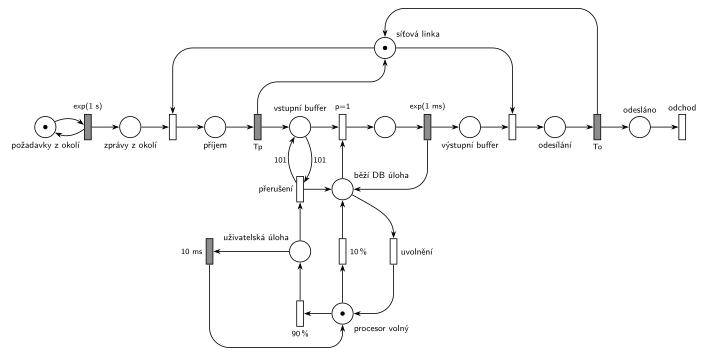

# Počítačový server (10/04)

## Zadání

> Počítačový server obsahuje jeden procesor a síťovou linku pro spojení s okolím. Operační systém počítače umožňuje multi-tasking úloh. V systému existuje 10 uživatelských úloh a speciální úloha provozující databázovou službu. Síťová linka počítače je v počítači samostatné zařízení obsahující vstupní a výstupní buffery s neomezenou kapacitou. Linka může v jednom okamžiku buď přijímat zprávu z okolí do vstupního bufferu nebo odesílat zprávu z výstupního bufferu. V okolním prostředí vznikají požadavky na databázovou službu serveru v intervalech exponenciálně se středem 1 sekunda.
>
> Plánovač operačního systému přiděluje v 90 procentech případů procesor jedné z uživatelských úloh a v 10 procentech případů úloze databázové služby. Kromě toho se databázová úloha aktivuje ještě v případě, že ve vstupním bufferu je více než 100 požadavků — v takové případě může být přerušena uživatelská úloha, které se odebere zcela přidělený procesor. Časové kvantum přidělené uživatelské úloze na procesoru je vždy přesně 10 milisekund. Databázová úloha drží přidělený procesor, dokud nezpracuje veškeré požadavky ze vstupního bufferu. Zpracování jednoho požadavku trvá exponenciálně se středem 1 milisekunda. Výsledek požadavku je umístěn do výstupního bufferu síťové linky.

Podobné úlohy: [Databázový server](<../03 - Databázový server/03 - Databázový server.md>), [Výpočetní služba se spánkem](<../02 - Výpočetní služba se spánkem/02 - Výpočetní služba se spánkem.md>), [Server s údržbou po 1000 požadavcích](<../01 - Server s údržbou po 1000 požadavcích/01 - Server s údržbou po 1000 požadavcích.md>), [Dočasně MM2 při dlouhé frontě](<../../05 - Délka fronty a kapacita/02 - Dočasně MM2 při dlouhé frontě/02 - Dočasně MM2 při dlouhé frontě.md>).

## Nápověda

<details>
<summary>Zobrazit nápovědu</summary>
<br>

- **Transakce je požadavek:** vznikne v okolí (místo *požadavky z okolí* ve smyčce s `exp(1 s)`), linka ho přijme ze *zpráv z okolí* do *vstupního bufferu*, DB úloha ho zpracuje do *výstupního bufferu*, linka výsledek odešle a požadavek přes místo *odesláno* **opouští systém** přechodem *odchod*. Buffery jsou místa bez omezení.
- **Síťová linka** je jedno zařízení (místo *síťová linka* s jednou značkou) sdílené příjmem a odesíláním, proto „buď přijímá, nebo odesílá“. Doby příjmu a odeslání zadání neuvádí, v síti jsou jako symboly `Tp` a `To` (pro simulaci 0,1 ms). Bez nějaké doby by vzájemné vyloučení nemělo smysl.
- **Procesor** je zařízení s 1 značkou *procesor volný*. Plánovač je pravděpodobnostní větvení `90 %` / `10 %` z tohoto místa. Uživatelská úloha drží procesor `10 ms` a vrátí ho.
- **10 uživatelských úloh** je stále připravených a navzájem nerozlišitelných, takže je nemodelujeme zvlášť: značka *uživatelská úloha* znamená „běží jedna z nich“. Místo s 10 značkami by chování nezměnilo (běží vždy nejvýš jedna).
- **DB úloha drží procesor, dokud je co zpracovávat:** z místa *běží DB úloha* vede okamžitý přechod `p=1`, který vezme požadavek z bufferu (zpracování `exp(1 ms)` značku vrátí), a přechod *uvolnění* s `p=0`, který procesor uvolní, až když je buffer prázdný. Zpracují se i požadavky, které přijdou během zpracování.
- **Víc než 100 požadavků:** okamžitý přechod *přerušení* testuje buffer dvojicí hran s váhou **101** („více než 100“) a vezme značku běžící uživatelské úlohy. Její kvantum `10 ms` tím zanikne (slajd 139) a procesor dostane DB úloha.
- Místo *běží DB úloha* má pět hran. Čtyři vedou svisle a vodorovně, hrana k *uvolnění* proto vychází šikmo dolů.
- S danými čísly se přerušení skoro neuplatní: DB úloha dostane procesor zhruba každých 100 ms, požadavky chodí po 1 s. Přechod v síti být musí, zadání ho výslovně popisuje.

</details>

## Petriho síť

<details>
<summary>Zobrazit Petriho síť</summary>
<br>



</details>

## Časté chyby

<details>
<summary>Zobrazit časté chyby</summary>
<br>

- Dvě samostatné linky pro příjem a odesílání; zadání chce jedno zařízení, které dělá jedno nebo druhé.
- Test bufferu váhou 100 místo 101 („více než 100“), nebo hrana s váhou 101 jen do přechodu (bez návratu): přerušení by pak smazalo 101 požadavků.
- DB úloha, která zpracuje jen jeden požadavek a procesor vrátí; zadání chce zpracovat celý buffer.
- Uvolnění procesoru DB úlohou bez nižší priority než odběr požadavku: procesor by se mohl vrátit, i když v bufferu ještě něco je.
- Přerušení i DB úlohy nebo přerušení, které nevezme značku běžící uživatelské úlohy (kvantum by pak doběhlo a procesor by se zdvojil).

</details>

## SIMLIB

<details>
<summary>Zobrazit SIMLIB kód</summary>
<br>

Model je izomorfní k Petriho síti výše: každé místo, přechod a značka mají svůj protějšek v kódu. Značka procesoru je proces `Planovac`, který střídá uživatelské kvantum a běh DB úlohy. Přerušení je předčasná aktivace plánovače, který čeká v kvantu (`planovac->Activate()` zkrátí jeho `Wait(10)`, stejně jako v síti zanikne odpočet). *Zprávy z okolí* a *výstupní buffer* jsou v SIMLIBu jedna fronta zařízení `Linka` (pořadí podle příchodu, v síti náhodný výběr mezi oběma obsazeními).

```cpp
// Počítačový server – model v SIMLIB/C++
#include "simlib.h"

const double Tp = 0.1, To = 0.1;           // doby příjmu a odeslání (zadání je neuvádí)
const double INTERVAL = 1000;              // příchody exp(1 s)

Facility Linka("Síťová linka");            // místo „síťová linka“ s jednou značkou
Queue BufIn("Vstupní buffer");             // místo „vstupní buffer“
bool uzivatel = false;                     // místo „běží uživatelská úloha“
long preruseni = 0;
Histogram Doba("Doba požadavku v systému [ms]", 0, 2, 20);

class Planovac;
Planovac *planovac;

class Pozadavek : public Process {         // transakce = značka, která prochází sítí
  void Behavior();
};

class Planovac : public Process {          // značka procesoru: volný → uživatelská / DB úloha
  void Behavior() {
    for (;;) {                             // „procesor volný“
      if (Random() < 0.9) {                // plánovač 90 %
        uzivatel = true;                   // „běží uživatelská úloha“
        if (BufIn.size() <= 100)
          Wait(10);                        // kvantum 10 ms; přerušení ho ukončí dřív
        uzivatel = false;
        if (BufIn.size() <= 100)
          continue;                        // kvantum doběhlo: procesor je volný
        preruseni++;                       // přechod „přerušení“ (test bufferu váhou 101)
      }                                    // jinak plánovač 10 %
      while (!BufIn.empty()) {             // „běží DB úloha“: vezmi (p=1)
        Process *p = static_cast<Process *>(BufIn.GetFirst());
        Wait(Exponential(1));              // zpracování exp(1 ms)
        p->Activate();                     // výsledek do výstupního bufferu
      }                                    // „uvolnění“ (p=0): buffer je prázdný
    }
  }
};

void Pozadavek::Behavior() {
  double prichod = Time;
  Seize(Linka);                            // „zprávy z okolí“ + obsazení linky
  Wait(Tp);                                // příjem Tp
  Release(Linka);
  Into(BufIn);                             // „vstupní buffer“
  if (uzivatel && BufIn.size() > 100)      // víc než 100 požadavků:
    planovac->Activate();                  // DB úloha přeruší uživatelskou
  Passivate();                             // čeká na zpracování DB úlohou
  Seize(Linka);                            // „výstupní buffer“ + obsazení linky
  Wait(To);                                // odesílání To
  Release(Linka);
  Doba(Time - prichod);
}                                          // „odesláno“ → přechod „odchod“

class Prichody : public Event {            // místo „požadavky z okolí“ ve smyčce s exp(1 s)
  void Behavior() {
    (new Pozadavek)->Activate();
    Activate(Time + Exponential(INTERVAL));
  }
};

int main() {
  Init(0, 1000.0 * 3600 * 10);             // modelový čas v milisekundách: 10 hodin
  (planovac = new Planovac)->Activate();
  (new Prichody)->Activate();
  Run();
  Print("Přerušení uživatelské úlohy: %ld\n", preruseni);
  Linka.Output();
  BufIn.Output();
  Doba.Output();
}
```

| Petriho síť | SIMLIB |
|---|---|
| *požadavky z okolí* ⇄ `exp(1 s)` | událost `Prichody`, která se znovu plánuje za `Exponential(1000)` |
| značka (požadavek) | proces `Pozadavek` |
| *síťová linka* (1 značka), příjem `Tp`, odesílání `To` | `Facility Linka`; `Seize(Linka); Wait(Tp); Release(Linka);` (a totéž s `To`) |
| *zprávy z okolí*, *výstupní buffer* | fronta zařízení `Linka` |
| *vstupní buffer* | `Queue BufIn` (`Into` + `Passivate`) |
| *procesor volný*, plánovač `90 %` / `10 %` | proces `Planovac`, `if (Random() < 0.9)` |
| *uživatelská úloha* → `10 ms` → *procesor volný* | `uzivatel = true; Wait(10);` |
| *přerušení* (test bufferu váhou 101) | `if (uzivatel && BufIn.size() > 100) planovac->Activate();` |
| *běží DB úloha*: vezmi (`p=1`), `exp(1 ms)`, zpět | `while (!BufIn.empty()) { ... Wait(Exponential(1)); p->Activate(); }` |
| *uvolnění* (`p=0`) | konec smyčky `while`: buffer je prázdný |
| přechod *odchod* | konec metody `Behavior()` požadavku |

**Kontrola simulací.** Petriho síť: platí *síťová linka* + příjem + odesílání = 1 a *procesor volný* + uživatelská + DB úloha + zpracovávaný požadavek = 1, buffery zůstávají malé (`make check`). Přerušení se s danými čísly neprovede; se zrychlenými příchody (exp(1,3 ms)) se provádí a vstupní buffer nepřesáhne asi 120 požadavků. SIMLIB model: za 10 hodin se přerušení neprovedlo ani jednou, ve vstupním bufferu bylo nejvýš 5 požadavků a požadavek byl v systému v průměru 96 ms, skoro celou dobu čekal, než plánovač vybere DB úlohu (v průměru 9 kvant po 10 ms). Se zrychlenými příchody exp(1,3 ms) se během minuty provedlo 53 přerušení a buffer měl nejvýš 119 požadavků, stejně jako v síti (`make simlib`).

</details>

## Původ a zdroje

<details>
<summary>Zobrazit původ a zdroje</summary>
<br>

**Původ:** půlsemestrální písemka 2013/14, varianta C, 6 bodů (k příkladu patřila ještě otázka z teorie za 4 body).

**Původní znění:**

> Počítačový server obsahuje jeden procesor a síťovou linku pro spojení s okolím. Operační systém počítače umožňuje multi-tasking úloh. V systému existuje 10 uživatelských úloh a speciální úloha provozující databázovou službu. Síťová linka počítače je v počítači samostatné zařízení obsahující vstupní a výstupní buffery s neomezenou kapacitou. Linka může v jednom okamžiku buď přijímat zprávu z okolí do vstupního bufferu nebo odesílat zprávu z výstupního bufferu. V okolním prostředí vznikají požadavky na databázovou službu serveru v intervalech daných exponenciálním rozložením se středem 1 sekunda.
>
> Plánovač operačního systému přiděluje v 90 procentech případů procesor jedné z uživatelských úloh a v 10 procentech případů úloze databázové služby. Kromě toho se databázová úloha aktivuje ještě v případě, že ve vstupním bufferu je více než 100 požadavků — v takové případě může být přerušena uživatelská úloha, které se odebere zcela přidělený procesor. Časové kvantum přidělené uživatelské úloze na procesoru je vždy 10 milisekund. Databázová úloha drží přidělený procesor, dokud nezpracuje veškeré požadavky ze vstupního bufferu. Zpracování jednoho požadavku trvá dobu danou exponenciálním rozložením se středem 1 milisekunda. Výsledek požadavku je umístěn do výstupního bufferu síťové linky.
>
> *Zadaný systém modelujte formou Petriho sítě s vyznačením všech potřebných parametrů.*

**Zdroje:**

- `Fitcheats/Půlsemestrálky/Zadání z minulých let/2013-14.pdf`, str. 1–2 (zadání) a str. 3 (hlavička písemky s bodováním)
- `Fitcheats/Skripta/FIT - Studentská skripta 2015-16.pdf`, str. 50–51 (zadání zapsané po paměti, bez řešení)

**Existující řešení:**

- **Studentská skripta (str. 50–51):** jen zadání zapsané po paměti, řešení chybí. Je v něm „procesor je okamžitě přidělen databázové úloze“, originál říká jen „může být přerušena uživatelská úloha“.
- Jiné řešení v materiálech není.

</details>

## Reference

- [Jak síť funguje](<../../../basics/Jak síť funguje.md>)
- [Notace a vzory](<../../../basics/Notace a vzory.md>)

<!-- -->

- [Studijní plán](<../../Studijní plán.md>)
- [Seznam úloh](<../../Seznam úloh.md>)
