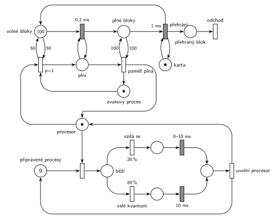

# Zvuková karta

## Zadání

> Mějme jednoprocesorový počítač se zvukovou kartou, na kterém běží 10 procesů. Jeden z nich je speciální a zapisuje do zvukové karty vzorky, které je schopen produkovat rychlostí 500 tisíc za sekundu. Karta má vyrovnávací paměť o velikosti 10 tisíc vzorků a je nastavena tak, že přehraje 100 tisíc vzorků za sekundu. Pokud se vyrovnávací paměť dostatečně vyprázdní (a je volný procesor), je procesor prioritně přidělen zvukovému procesu, který ji začne plnit po blocích 100 vzorků dokud nebude zcela plná a potom se vzdá procesoru. (Doporučení: tečka = volné místo pro jeden blok 100 vzorků)
>
> Všechny ostatní procesy mají stejnou prioritu a je jim spravedlivě (round-robin) přidělován procesor s časovým kvantem přesně 10 milisekund. Procesy se mohou vzdát procesoru s pravděpodobností 20 procent v libovolném okamžiku jim přiděleného časového kvanta. Dobu potřebnou pro přepnutí kontextu zanedbáváme.

Podobné úlohy: [Počítačový server](<../04 - Počítačový server/04 - Počítačový server.md>) (přidělování procesoru), [Výpočetní služba se spánkem](<../02 - Výpočetní služba se spánkem/02 - Výpočetní služba se spánkem.md>).

## Interpretace

<details>
<summary>Zobrazit interpretaci (nápověda)</summary>
<br>

- **Jednotka je blok 100 vzorků**, jak radí doporučení. Paměť 10 000 vzorků je 100 bloků: místo *volné bloky* (na počátku 100 značek, paměť je prázdná) a *plné bloky*. Platí *volné* + *plné* = 100.
- **Časy:** zvukový proces vyrobí 100 vzorků za 100 / 500 000 s = **0,2 ms**, karta je přehraje za 100 / 100 000 s = **1 ms**. Obojí jsou pevné časy.
- **Karta** přehrává jeden blok po druhém, proto má jednu značku ve smyčce s přechodem *přehrání* `1 ms` (bez ní by běžný časovaný přechod přehrával všechny plné bloky najednou, slajd 138). Přehrání vrátí volné místo a **přehraný blok opouští systém** přechodem *odchod*. To je jediná transakce, která systém opravdu opouští.
- **„Dostatečně vyprázdní“** zadání nečísluje. Síť používá polovinu paměti: testovací dvojice hran s váhou 50 na *volné bloky*. Jiný práh je jen jiné číslo u hran.
- **Přednost zvukového procesu:** přidělení *procesoru* (místo s jednou značkou) zvukovému procesu má `p=1`, ostatním `p=0`. Běžící proces se nepřerušuje („a je volný procesor“).
- **Plnění dokud není plná:** zvukový proces drží procesor a smyčka *plní* ⇄ `0,2 ms` bere po jednom volné místo a přidává plný blok. Přechod *paměť plná* (test váhou 100 na *plné bloky*) vrátí procesor i značku *zvukového procesu*. Plnění je 5× rychlejší než přehrávání, takže se paměť naplní.
- **Ostatní procesy** (9 značek v *připravené procesy*) dostávají procesor po jednom. Pořadí značek v místě síť nerozliší. Protože jsou procesy stejné, náhodný výběr odpovídá round-robinu.
- **20 % / 80 %:** proces se buď vzdá v náhodném okamžiku kvanta (`0–10 ms` rovnoměrně), nebo kvantum vyčerpá (`10 ms`). Pak přechod *uvolní procesor* vrátí procesor a proces se vrací mezi *připravené procesy*.
- Procesy systém neopouštějí (běží pořád). Proto je výstupní přechod jen u přehraných bloků.
- **Jemnost sémantiky:** přechod *paměť plná* testuje místo *plné bloky* hranou s váhou 100 tam a zpět. To místo je zároveň vstupem přehrávání `1 ms`, takže test probíhající přehrávání bloku formálně zruší a spustí znovu (slajdy 137–139). Stane se to jednou za cyklus plnění a zpozdí to přehrávání nejvýš o 1 ms, na podstatu modelu to nemá vliv. Přesný model by měl stav „paměť plná“ v samostatném místě.

</details>

## Petriho síť

<details>
<summary>Zobrazit Petriho síť</summary>
<br>



</details>

## Časté chyby

<details>
<summary>Zobrazit časté chyby</summary>
<br>

- Přepočet rychlostí: 100 vzorků je 0,2 ms při 500 000/s a 1 ms při 100 000/s.
- Přehrávání bez značky karty: časovaný přechod s více značkami na vstupu má odpočet pro každou značku (slajd 138).
- Plnění bez smyčky nebo bez testu „paměť plná“: zvukový proces buď zapíše jediný blok, nebo procesor nikdy nevrátí.
- Zvukový proces, který přeruší běžící proces. Zadání chce přidělení, až je procesor volný.
- Procesy, které se po kvantu nevracejí do *připravených procesů*.
- Pravděpodobnost i priorita u jednoho přechodu: `20 %`/`80 %` patří na samostatné přechody za přidělením.
- V SIMLIBu `Seize(Procesor, 1)` pro zvukový proces: to je priorita obsluhy a běžící proces by přerušil. Přednost při přidělení je priorita procesu (`Priority = 1`).

</details>

## SIMLIB

<details>
<summary>Zobrazit SIMLIB kód</summary>
<br>

Model je izomorfní k Petriho síti výše: každé místo, přechod a značka mají svůj protějšek v kódu. Bloky jsou dva čítače; karta a zvukový proces se navzájem budí (`Passivate` / `Activate`), když čekají na plný blok, nebo na 50 volných bloků. Přednost zvukového procesu je priorita procesu: ve frontě procesoru se zařadí před ostatní, běžící proces nepřeruší. Jemnost s testem *plných bloků* (viz Interpretace) kód nemá, karta přehrává bez restartu.

```cpp
// Zvuková karta – model v SIMLIB/C++
#include "simlib.h"

int volne = 100, plne = 0;                 // místa „volné bloky“ a „plné bloky“
long prehrano = 0, prideleni_z = 0;
Facility Procesor("Procesor");             // místo „procesor“ s jednou značkou
Stat Mezera("Doba mezi přiděleními procesoru zvukovému procesu [ms]");

Process *karta, *zp;                       // procesy, které se navzájem budí
bool kartaCeka = false, zpCeka = false;

class ZvukovyProces : public Process {     // značka „zvukový proces“
  void Behavior() {
    Priority = 1;                          // přidělení procesoru zvukovému procesu má p=1
    double posledni = 0;
    for (;;) {
      if (volne < 50) {                    // test 50 „volných bloků“
        zpCeka = true;
        Passivate();                       // vzbudí ho karta, až bude volných 50
      }
      Seize(Procesor);                     // přidělení: před ostatními čekajícími procesy
      prideleni_z++;
      if (posledni > 0)
        Mezera(Time - posledni);
      posledni = Time;
      while (volne > 0) {                  // „plní“ ⇄ zápis 0,2 ms, dokud není paměť plná
        Wait(0.2);
        volne--;
        plne++;
        if (kartaCeka) {                   // karta čekala na plný blok
          kartaCeka = false;
          karta->Activate();
        }
      }
      Release(Procesor);                   // „paměť plná“ (test 100 plných bloků):
    }                                      // vrací procesor i značku zvukového procesu
  }
};

class Karta : public Process {             // značka „karta“: přehrává blok po bloku
  void Behavior() {
    for (;;) {
      if (plne == 0) {                     // není co přehrát
        kartaCeka = true;
        Passivate();
      }
      Wait(1);                             // přehrání 1 ms
      plne--;
      volne++;                             // volné místo se vrací do paměti
      prehrano++;                          // „přehraný blok“ → přechod „odchod“
      if (zpCeka && volne >= 50) {
        zpCeka = false;
        zp->Activate();
      }
    }
  }
};

class Proces : public Process {            // značka v „připravené procesy“
  void Behavior() {
    for (;;) {
      Seize(Procesor);                     // přidělení (round-robin: fronta podle příchodu)
      if (Random() < 0.2)                  // 20 %: vzdá se v libovolném okamžiku kvanta
        Wait(Uniform(0, 10));
      else                                 // 80 %: celé kvantum
        Wait(10);
      Release(Procesor);                   // „uvolní procesor“ a vrací se mezi připravené
    }
  }
};

int main() {
  Init(0, 60000);                          // modelový čas v milisekundách: 1 minuta
  (zp = new ZvukovyProces)->Activate();
  (karta = new Karta)->Activate();
  for (int i = 0; i < 9; i++)
    (new Proces)->Activate();
  Run();
  Print("Přehráno bloků: %ld za %g ms, zvukový proces dostal procesor %ld krát\n",
        prehrano, Time, prideleni_z);
  Procesor.Output();
  Mezera.Output();
}
```

| Petriho síť | SIMLIB |
|---|---|
| *volné bloky* (100), *plné bloky* | `int volne = 100, plne = 0` |
| *karta* ⇄ *přehrání* `1 ms` → *přehraný blok* → *odchod* | proces `Karta`: `Wait(1); plne--; volne++; prehrano++;` |
| *procesor* (1 značka) | `Facility Procesor` |
| přidělení zvukovému procesu (`p=1`, test 50 volných) | `Priority = 1`; `if (volne < 50) Passivate();` a pak `Seize(Procesor)` |
| *plní* ⇄ zápis `0,2 ms` | `while (volne > 0) { Wait(0.2); volne--; plne++; }` |
| *paměť plná* (test 100 plných) → *procesor* + *zvukový proces* | konec smyčky, `Release(Procesor)` |
| *připravené procesy* (9), přidělení | 9 procesů `Proces`, `Seize(Procesor)` (fronta podle příchodu) |
| `20 %` → `0–10 ms`, `80 %` → `10 ms` | `if (Random() < 0.2) Wait(Uniform(0, 10)); else Wait(10);` |
| *uvolní procesor* → *procesor* + *připravené procesy* | `Release(Procesor)` a další průchod smyčkou |

**Kontrola simulací.** Petriho síť: procesor je vždy právě u jednoho procesu nebo volný, *volné* + *plné* = 100 a všech 9 obyčejných procesů je pořád v síti, všechny přechody se provádějí (`make check`). Karta hraje bez přerušení (za 9,5 s přehrála 9 544 bloků). Zvukový proces dostává procesor zhruba každých 65 ms. SIMLIB model: za minutu karta přehrála 59 999 bloků (první blok začala hrát až po prvním zápisu), tedy ani jednou nečekala; zvukový proces dostal procesor 907krát, v průměru po 66 ms (61,6–74,2 ms). Odhad: paměť se během plnění zaplňuje rychlostí 5 − 1 = 4 bloky za ms, doplnění 50 bloků tedy trvá asi 12,5 ms; pak trvá 50 ms, než karta uvolní polovinu paměti, a zvukový proces ještě čeká na konec kvanta běžícího procesu (nejvýš 10 ms, v průměru asi 4 ms). Dohromady asi 66 ms (`make simlib`).

</details>

## Původ a zdroje

<details>
<summary>Zobrazit původ a zdroje</summary>
<br>

**Původ:** půlsemestrální písemka, rok neznámý (zadání ve Studentských skriptech 2015/16 a v přípravném dokumentu 2021/22).

**Původní znění:**

> Mějme jednoprocesorový počítač se zvukovou kartou, na kterém běží 10 procesů. Jeden z nich je speciální a zapisuje do zvukové karty vzorky, které je schopen produkovat rychlostí 500 tisíc za sekundu. Karta má vyrovnávací paměť o velikosti 10 tisíc vzorků a je nastavena tak, že přehraje 100 tisíc vzorků za sekundu. Pokud se vyrovnávací paměť dostatečně vyprázdní (a je volný procesor), je procesor prioritně přidělen zvukovému procesu, který ji začne plnit po blocích 100 vzorků dokud nebude zcela plná a potom se vzdá procesoru. (Doporučení: tečka = volné místo pro jeden blok 100 vzorků)
>
> Všechny ostatní procesy mají stejnou prioritu a je jim spravedlivě (round-robin) přidělován procesor s časovým kvantem 10ms. Procesy se mohou vzdát procesoru s pravděpodobností 20 procent v libovolném okamžiku jim přiděleného časového kvanta. Dobu potřebnou pro přepnutí kontextu zanedbáváme.

**Zdroje:**

- `Fitcheats/Skripta/FIT - Studentská skripta 2015-16.pdf`, str. 43 (zadání „Příklad se zvukovou kartou“, bez řešení)
- `Fitcheats/Půlsemestrálky/FIT - Příprava 2021-22.pdf`, str. 22 (totéž zadání a ručně kreslené studentské řešení)

**Existující řešení:**

- **Příprava 2021/22, str. 22 (ručně kreslené, bez hlasů):** „Procesor“ (1 značka) nahoře, vlevo zvukový proces „ZP“ s `p=1`, `a) 0,2 ms` (plnění), `b) 10ms` (přehrávání), `c)` s hranami `100` (paměť plná), místo „100V“ a legenda „1V = 1 volné miesto pre blok 100 vzorkov“. Vpravo 9 procesů, `20%` → `exp(10ms)` a druhá větev (číslo se čte spíš jako `90%`, má být 80 %) → `10 ms`. Chyby a nejasnosti:
  - přehrání bloku trvá 1 ms, ne 10 ms, a karta nemá vlastní značku, takže by se přehrávalo víc bloků souběžně;
  - `a) 0,2 ms` není ve smyčce, zvukový proces tak zapíše jen jeden blok. Značka „ZP“ se nikam nevrací;
  - vzdání v libovolném okamžiku kvanta jako `exp(10ms)` může trvat déle než celé kvantum; patří sem rovnoměrné `0–10 ms`;
  - z uvolnění procesoru vede hrana jen do „Procesor“, procesy se mezi připravené nevracejí (po jednom kvantu zmizí);
  - práh „dostatečně vyprázdní“ je jedna volná tečka v „100V“. To je přípustné čtení, jen se pak zvukový proces probouzí po každém přehraném bloku.
- Ve Studentských skriptech (str. 43) je jen zadání.

</details>
