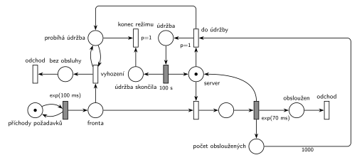

# 10–01 – Server s údržbou po 1000 požadavcích

## Zadání

> ⚠️ **Převyprávěné zadání.** Originální zadání v materiálech chybí. Text níže je zpráva studenta na Discordu (Thetzi, 1. 11. 2023), kterou autor po odeslání ještě upravil (Discord u ní ukazuje „(upraveno)“). Přesné znění, body a závěrečná věta o odchodu transakce nejsou známé. Řešení neexistuje.
>
> Zadání A: V intervalu exp(100ms) přicházejí požadavky a čekají ve fronte na obsloužení serverem. Ten má kapacitu 1 a požadavky obsluhuje rychlostí exp(70ms). Ihned po obsloužení každeho 1000. požadavku se přepne server do režimu údržby kde je 100s. V režimu údržby jsou všechny transakce z fronty i nově příchozí vyhozeny bez obsluhy.

Podobné úlohy: [04–06 – Údržba po každé 10. obsluze](<../04–06 - Údržba po každé 10. obsluze/04–06 - Údržba po každé 10. obsluze.md>), [04–02 – Automat na kávu – údržba po 50 obsluhách](<../04–02 - Automat na kávu – údržba po 50 obsluhách/04–02 - Automat na kávu – údržba po 50 obsluhách.md>), [05–07 – Každá 100. transakce vyprázdní frontu](<../05–07 - Každá 100. transakce vyprázdní frontu/05–07 - Každá 100. transakce vyprázdní frontu.md>), [09–03 – Psí salon](<../09–03 - Psí salon/09–03 - Psí salon.md>).

## Interpretace

Zobrazit interpretaci (nápověda)

- **Jednotky:** časy jsou v milisekundách i sekundách, u přechodů je proto vždy jednotka. „Rychlostí exp(70ms)“ znamená střední dobu obsluhy 70 ms (ne intenzitu). Server je vytížen asi na 70 %.
- **Server s kapacitou 1** je místo *Server* s jednou značkou. Uvolnění je sloučené s časovaným přechodem obsluhy.
- **Čítač:** každá dokončená obsluha přidá značku do místa *obsloužené*. Okamžitý přechod s hranou s váhou 1000 vezme všech 1000 značek (čítač se tím vynuluje) a k tomu značku *Serveru*. Server tak přejde do *Údržby* a po `100 s` se značka vrátí do *Serveru*.
- **„Ihned po obsloužení“:** v okamžiku 1000. obsluhy se značka vrátí do *Serveru* a zároveň jsou proveditelné dva okamžité přechody: přechod do údržby a obsazení serveru dalším čekajícím. Priorita `p=1` zajistí, že vyhraje údržba. Bez ní by server mohl obsloužit ještě 1001. požadavek.
- **Vyhazování:** okamžitý přechod *vyhození* bere požadavky z *Fronty* a testovacími hranami (hrana tam a zpět) kontroluje stav *probíhá údržba*. Provádí se opakovaně, takže na začátku údržby vyprázdní celou frontu a pak hned vyhazuje každý nově příchozí požadavek.
- **Proč samostatné místo *probíhá údržba*:** testovací hrana značku na okamžik vezme a vrátí. Kdyby testovala přímo místo *Údržba*, které je vstupem časovaného přechodu `100 s`, každé vyhození by odpočet zrušilo a spustilo znovu (slajdy 137–139) – s příchody každých 100 ms by údržba nikdy neskončila. Proto odpočet běží na *Údržbě*, testuje se *probíhá údržba* a po skončení údržby ho okamžitý přechod *konec režimu* (`p=1`) zruší.
- Příchody se během údržby **nezastavují**: požadavky dál přicházejí, jen hned odcházejí bez obsluhy (odchod přes vlastní výstupní přechod).
- Zadání je převyprávěné. Pokud by originál říkal něco jiného (např. že se během údržby příchody zastaví), změní se jen část s vyhazováním.

## Řešení

Zobrazit řešení

| Požadavek | Prvek sítě |
|---|---|
| příchody exp(100 ms) | *generátor* ⇄ `exp(100 ms)` → *Fronta* |
| server s kapacitou 1, obsluha exp(70 ms) | *Server* (1 značka), obsazení, `exp(70 ms)` vrací značku *Serveru* |
| počítání obsloužených | `exp(70 ms)` → *obsloužené* |
| po 1000. obsluze údržba 100 s | `p=1`: *obsloužené* (váha 1000) + *Server* → *Údržba* + *probíhá údržba*; *Údržba* → `100 s` → *Server* + *údržba skončila* → *konec režimu* |
| vyhození fronty i nově příchozích | *vyhození*: *Fronta* + test *probíhá údržba* → *bez obsluhy* → *odchod* |
| odchod obsloužených | *odchod* vpravo |

Kontrola simulací: *Server* + obsluhovaný + *Údržba* = 1, *probíhá údržba* = *Údržba* + *údržba skončila*, čítač nikdy nepřesáhne 1000. Údržba nastane zhruba každých 200 s (asi 100 s na 1000 obsluh a 100 s údržby) a během ní se vyhodí asi 1000 požadavků. Fronta zůstává krátká (nejvýš kolem 16).

## Časté chyby

Zobrazit časté chyby

- Přechod do údržby bez priority. V okamžiku 1000. obsluhy pak může server obsadit další požadavek a údržba začne až po něm.
- Čítač testovaný hranami tam a zpět (váha 1000 v obou směrech). Čítač se nevynuluje a údržba by se spouštěla po každé další obsluze.
- Vyhození fronty jednorázově (jeden přechod nebo hrana s váhou). Požadavky, které přijdou během údržby, by pak čekaly; zadání chce vyhazovat i nově příchozí po celých 100 s.
- Zastavení generátoru místo vyhazování. Zadání říká, že požadavky přicházejí a jsou vyhozeny, ne že přestanou chodit.
- Údržba, která nevrátí značku *Serveru*. Systém se po první údržbě zastaví.
- Počítání i vyhozených požadavků do tisíce. Počítají se jen obsloužené.

## Původ a zdroje

**Původ:** půlsemestrální písemka 2023/24, varianta A. Body nejsou uvedené (ostatní varianty téhož roku mají 10 bodů).

**Zdroje:**

- `Fitcheats/Půlsemestrálky/Zadání z minulých let/2023-24.pdf`, str. 1 (snímek zprávy z Discordu, bez řešení)

**Existující řešení:**

Zobrazit existující řešení

- K této variantě v materiálech žádné řešení není (ani od Hrubého, ani studentské).

